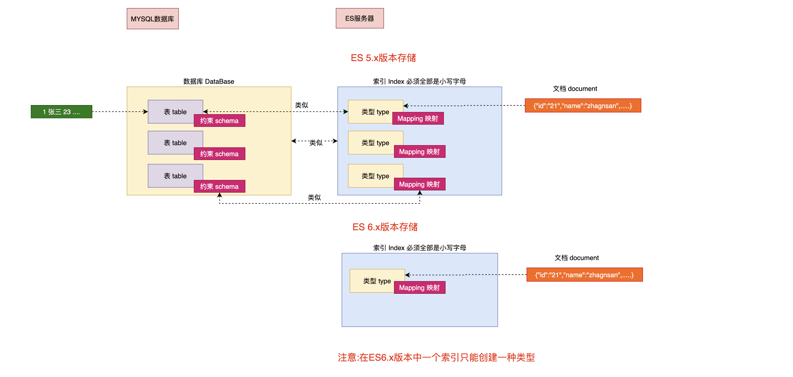

# ElasticSearch中的基本概念

## 接近实时(NRT Near Real Time )

**Elasticsearch是一个接近实时的搜索平台**。这意味着，**从索引一个文档直到这个文档能够被搜索到有一个轻微的延迟(通常是1秒内)** 

## 索引(index)

**一个索引就是一个拥有几分相似特征的文档的集合**。比如说，你可以有一个客户数据的索引，另一个产品目录的索引，还有一个订单数据的索引。**一个索引由一个名字来标识(必须全部是小写字母的)**，**并且当我们要对这个索引中的文档进行索引、搜索、更新和删除的时候，都要使用到这个名字**。**索引类似于关系型数据库中Database 的概念**。在一个集群中，如果你想，可以定义任意多的索引。 

## 类型(type)

**在一个索引中，你可以定义一种或多种类型**。一个类型是你的索引的一个逻辑上的分类/分区，其语义完全由你来定。通常，会为具有一组共同字段的文档定义一个类型。比如说，我们假设你运营一个博客平台并且将你所有的数 据存储到一个索引中。在这个索引中，你可以为用户数据定义一个类型，为博客数据定义另一个类型，当然，也可 以为评论数据定义另一个类型。**类型类似于关系型数据库中Table的概念**。 

**NOTE: 在5.x版本以前可以在一个索引中定义多个类型,6.x之后版本也可以使用,但是不推荐,在7~8.x版本中彻底移除一个索引中创建多个类型**

## 映射(Mapping)

**Mapping**是ES中的一个很重要的内容，**它类似于传统关系型数据中table的schema，用于定义一个索引(index)中的类型(type)的数据的结构**。 在ES中，我们可以手动创建type(相当于table)和mapping(相关与schema),也可以采用默认创建方式。**在默认配置下，ES可以根据插入的数据自动地创建type及其mapping。 mapping中主要包括字段名、字段数据类型和字段索引类型** 

## 文档(document)

**一个文档是一个可被索引的基础信息单元，类似于表中的一条记录。**比如，你可以拥有某一个员工的文档,也可以拥有某个商品的一个文档。文档以采用了轻量级的数据交换格式JSON(Javascript Object Notation)来表示。 

## 概念关系图

