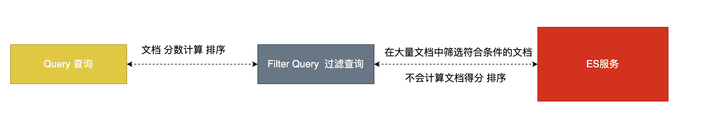

# ElasticSearch中的过滤查询(Filter Query)

##  介绍

其实准确来说，ES中的查询操作分为2种: `查询(query)`和`过滤(filter)`。`查询即是之前提到的query查询，它 (查询)默认会计算每个返回文档的得分，然后根据得分排序`。`而过滤(filter)只会筛选出符合的文档，并不计算 得分，且它可以缓存文档 。所以，单从性能考虑，过滤比查询更快`。 

换句话说，过滤适合在大范围筛选数据，而查询则适合精确匹配数据。一般应用时， 应先使用过滤操作过滤数据， 然后使用查询匹配数据。 



##  过滤语法

- **在执行filter和query时,先执行filter在执行query**
- **Elasticsearch会自动缓存经常使用的过滤器，以加快性能。**

```json
GET /buubiu/user/_search
{
  "query": {
    "bool": {
      "must": [
        {"match_all": {}}
      ],
      "filter": {
        "range": {
          "age": {
            "gte": 10
          }
        }
      }
    }
  }
}
```

##  常用的过滤器类型

###  range filter

```json
GET /buubiu/user/_search
{
  "query": {
    "bool": {
      "must": [
        {
          "term": {
            "content": {
              "value": "框架"
            }
          }
        }
      ],
      "filter": {
        "range": {
          "age": {
            "gte": 0,
            "lte": 23
          }
        }
      }
    }
  }
}
```

###  term filter

```json
GET /buubiu/user/_search
{
  "query": {
    "bool": {
      "must": [
        {
          "term": {
            "name": {
              "value": "小黑"
            }
          }
        }
      ],
      "filter": {
        "term": {
          "content": "框架"
        }
      }
    }
  }
}
```

###  terms filter

`多关键字是或的关系`，下面表示：content包含框架或者分层

```json
GET /buubiu/user/_search
{
  "query": {
    "bool": {
      "must": [
        {
          "term": {
            "name": {
              "value": "小黑"
            }
          }
        }
      ],
      "filter": {
        "terms": {
          "content": [
            "框架",
            "分层"
          ]
        }
      }
    }
  }
}
```

###  exists filter

`过滤存在指定字段`，下面表示：只获取文档包含字段address的数据

```json
GET /buubiu/user/_search
{
  "query": {
    "bool": {
      "must": [
        {
          "match_all": {}
        }
      ],
      "filter": {
        "exists": {
          "field": "address"
        }
      }
    }
  }
}
```

###  ids filter

**过滤含有指定字段的索引记录**

```json
GET /buubiu/user/_search
{
  "query": {
    "bool": {
      "must": [
        {
          "match_all": {}
        }
      ],
      "filter": {
        "ids": {
          "values": [
            "TVoUk3YBZ23tdxk-vWeC",
            "TloUk3YBZ23tdxk-vWeC"
          ]
        }
      }
    }
  }
}
```

