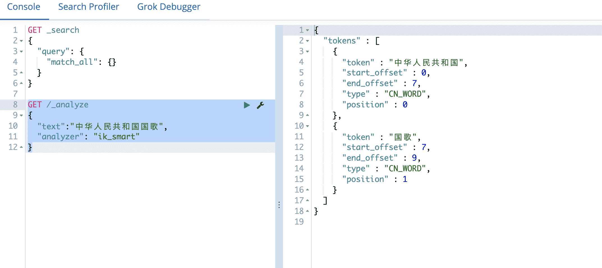

# IK分词器

##  IK分词器介绍

默认ES中采用标准分词器进行分词,这种方式并不适用于中文网站,因此需要修改ES对中文友好分词,从而达到更佳的搜索的效果。

##  安装IK分词器

- ES 在v5.5.1版本后开始支持在线安装分词插件
- IK分词插件版本一定要和ES的版本一致
- IK分词器下载地址：https://github.com/medcl/elasticsearch-analysis-ik

###  在线安装

1. 将es服务器中原始数据删除

进入es安装目录中将data目录数据删除

```shell
rm -rf data
```

2. 在es安装目录中执行安装命令

```shell
elasticsearch/elasticsearch-6.8.0/bin
➜ ./elasticsearch-plugin install https://github.com/medcl/elasticsearch-analysis-ik/releases/download/v6.8.0/elasticsearch-analysis-ik-6.8.0.zip
-> Downloading https://github.com/medcl/elasticsearch-analysis-ik/releases/download/v6.8.0/elasticsearch-analysis-ik-6.8.0.zip
[=================================================] 100%
@@@@@@@@@@@@@@@@@@@@@@@@@@@@@@@@@@@@@@@@@@@@@@@@@@@@@@@@@@@
@     WARNING: plugin requires additional permissions     @
@@@@@@@@@@@@@@@@@@@@@@@@@@@@@@@@@@@@@@@@@@@@@@@@@@@@@@@@@@@
* java.net.SocketPermission * connect,resolve
See http://docs.oracle.com/javase/8/docs/technotes/guides/security/permissions.html
for descriptions of what these permissions allow and the associated risks.

Continue with installation? [y/N]y
-> Installed analysis-ik
```

3. IK分词配置文件和字典位置为

`/XXX/elasticsearch/elasticsearch-6.8.0/config/analysis-ik/IKAnalyzer.cfg.xml`

4. 重启ES生效
5. 测试ik安装成功

```json
GET /_analyze
{
  "text":"中华人民共和国国歌",
  "analyzer": "ik_smart"
}
```


###  离线安装

1. 将es服务器中原始数据删除

   进入es安装目录中将data目录数据删除

   ```shell
   rm -rf data
   ```

   

2. 下载对应IK分词器版本

https://github.com/medcl/elasticsearch-analysis-ik/releases

3. 解压缩到plugins目录中命名为analysis-ik
4. IK分词配置文件和字典位置为

`/xxxx/elasticsearch/elasticsearch-6.8.0/plugins/analysis-ik/config/IKAnalyzer.cfg.xml`

5. 重启ES生效

6. 测试ik安装成功

```json
GET /_analyze
{
  "text":"中华人民共和国国歌",
  "analyzer": "ik_smart"
}
```



##  测试IK分词器

IK分词器提供了两种mapping类型用来做文档的分词分别是 `ik_max_word` 和` ik_smart`

- `ik_max_word: 会将文本做最细粒度的拆分`，比如会将“中华人民共和国国歌”拆分为“中华人民共和国,中华人民,中华,华人,人民共和国,人民,人,民,共和国,共和,和,国国,国歌”，会穷尽各种可能的组合；
- `ik_smart: 会做最粗粒度的拆分`，比如会将“中华人民共和国国歌”拆分为“中华人民共和国,国歌”。

###  测试数据

```json
DELETE /buubiu

PUT /buubiu
{
  "mappings":{
    "user":{
      "properties":{
        "name":{
          "type":"text",
           "analyzer": "ik_max_word",
           "search_analyzer": "ik_max_word"
        },
        "age":{
          "type":"integer"
        },
        "bir":{
          "type":"date"
        },
        "content":{
          "type":"text",
          "analyzer": "ik_max_word",
          "search_analyzer": "ik_max_word"
        },
        "address":{
          "type":"keyword"
        }
      }
    }
  }
}

PUT /buubiu/user/_bulk
  {"index":{}}
  {"name":"小黑","age":23,"bir":"2012-12-12","content":"为开发团队选择一款优秀的MVC框架是件难事儿，在众多可行的方案中决择需要很高的经验和水平","address":"北京"}
  {"index":{}}
  {"name":"王小黑","age":24,"bir":"2012-12-12","content":"Spring 框架是一个分层架构，由 7 个定义良好的模块组成。Spring 模块构建在核心容器之上，核心容器定义了创建、配置和管理 bean 的方式","address":"上海"}
  {"index":{}}
  {"name":"张小五","age":8,"bir":"2012-12-12","content":"Spring Cloud 作为Java 语言的微服务框架，它依赖于Spring Boot，有快速开发、持续交付和容易部署等特点。Spring Cloud 的组件非常多，涉及微服务的方方面面，井在开源社区Spring 和Netflix 、Pivotal 两大公司的推动下越来越完善","address":"无锡"}
  {"index":{}}
  {"name":"win7","age":9,"bir":"2012-12-12","content":"Spring的目标是致力于全方位的简化Java开发。 这势必引出更多的解释， Spring是如何简化Java开发的？","address":"南京"}
  {"index":{}}
  {"name":"梅超风","age":43,"bir":"2012-12-12","content":"Redis是一个开源的使用ANSI C语言编写、支持网络、可基于内存亦可持久化的日志型、Key-Value数据库，并提供多种语言的API","address":"杭州"}
  {"index":{}}
  {"name":"张无忌","age":59,"bir":"2012-12-12","content":"ElasticSearch是一个基于Lucene的搜索服务器。它提供了一个分布式多用户能力的全文搜索引擎，基于RESTful web接口","address":"北京"}


GET /buubiu/user/_search
{
  "query":{
    "term":{
      "content":"框架"
    }
  },
  "highlight": {
    "pre_tags": ["<span style='color:red'>"],
    "post_tags": ["</span>"],
    "fields": {
      "*":{}
    }
  }
}
```

##  配置扩展词

IK支持自定义`扩展词典`和`停用词典`,所谓**`扩展词典`**就是有些词并不是关键词,但是也希望被ES用来作为检索的关键词,可以将这些词加入扩展词典。**`停用词典`**就是有些词是关键词,但是出于业务场景不想使用这些关键词被检索到，可以将这些词放入停用词典。

###  定义扩展词典和停用词典

- 可以修改IK分词器中`config`目录中`IKAnalyzer.cfg.xml`这个文件。

**`NOTE：词典的编码必须为UTF-8，否则无法生效`**

1. 修改vim IKAnalyzer.cfg.xml

    ```xml
    <?xml version="1.0" encoding="UTF-8"?>
    <!DOCTYPE properties SYSTEM "http://java.sun.com/dtd/properties.dtd">
    <properties>
    	<comment>IK Analyzer 扩展配置</comment>
    	<!--用户可以在这里配置自己的扩展字典 -->
    	<entry key="ext_dict"></entry>
    	 <!--用户可以在这里配置自己的扩展停止词字典-->
    	<entry key="ext_stopwords"></entry>
    </properties>
    ```

2. 在ik分词器目录下config目录中创建ext_dict.dic文件   编码一定要为UTF-8才能生效

   ```shell
   vim ext_dict.dic #加入扩展词即可
   ```

3. 在ik分词器目录下config目录中创建ext_stopword.dic文件 
	
	```shell
	vim ext_stopword.dic #加入停用词即可
	```

4. 重启es生效

###  定义远程扩展词典和停用词典

1. 开发Spring Boot项目提供远程字典URL接口

2. 修改vim IKAnalyzer.cfg.xml

```xml
<?xml version="1.0" encoding="UTF-8"?>
<!DOCTYPE properties SYSTEM "http://java.sun.com/dtd/properties.dtd">
<properties>
	<comment>IK Analyzer 扩展配置</comment>
	<!--用户可以在这里配置远程扩展字典 -->
	<entry key="remote_ext_dict">http://localhsot:8080/springboot/es/ext_dict.txt</entry>
	<!--用户可以在这里配置远程扩展停止词字典-->
	<entry key="remote_ext_stopwords">http://localhsot:8080/springboot/es/ext_stopword.txt</entry>
</properties>
```

3. 重启es生效

