# ElasticSearch的安装

##  准备环境

###  安装前准备

- Linux / Mac
- Java8+
- elastic 6.X 7.X

###  在官方网站下载ES

https://www.elastic.co/cn/downloads

##  安装ES服务

###  ES不能以root用户身份启动必须创建普通用户

1. 在Linux中创建新的组

```shell
groupadd es
```

2. 创建新的用户es，并将es用户放入es组中

```shell
useradd es -g es
```

3. 修改es用户密码

```shell
passwd es
```

###  使用es用户登录并上传安装包

###  解压缩elasticsearch

```shell
tar -zxvf elasticsearch-6.8.0.tar.gz
```

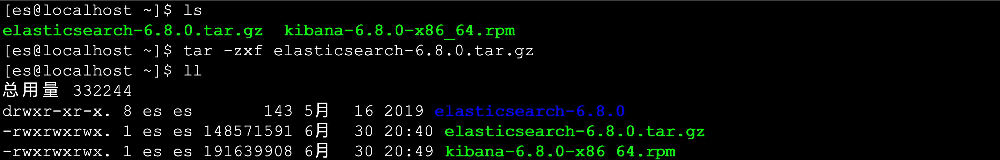

###  进入ES安装目录查看目录结构

```markdown
- bin                         可执行的二进制文件的目录
- config                    	配置文件的目录
- lib                         运行时依赖的库
- logs         								运行时日志文件
- modules											运行时依赖的模块
- plugins                   	可以安装官方以及第三方插件
```

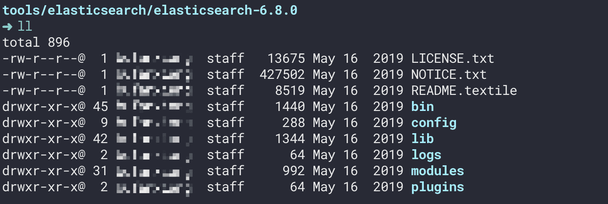

###  进入bin目录启动ES服务

```shell
./elaticsearch
```

出现下图红框日志表示启动成功

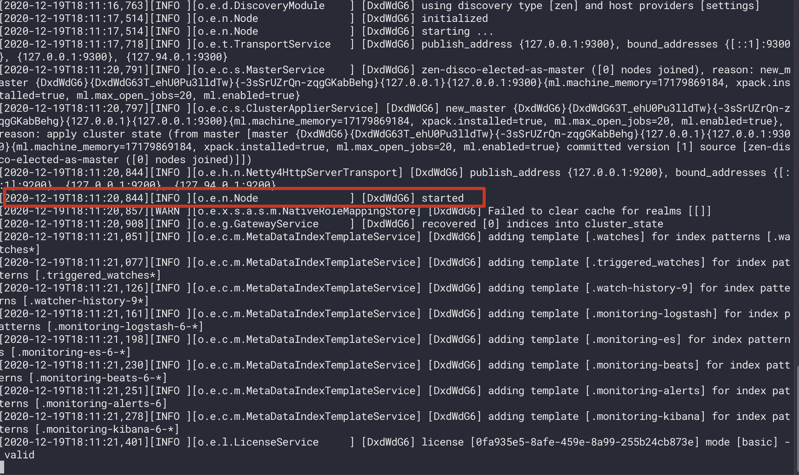

###  执行如下命令测试客户端操作

```shell
curl http://localhost:9200
```

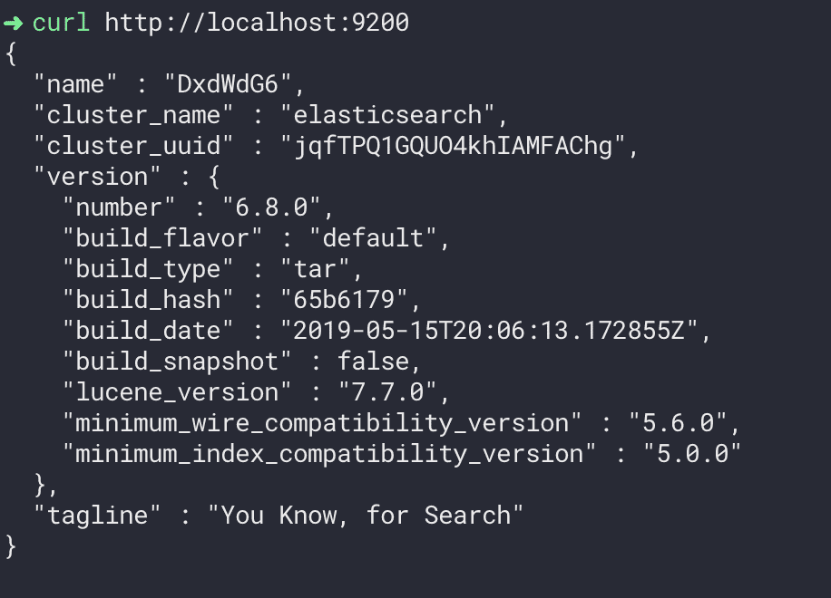

##  开启远程连接权限

**注意:ES服务默认启动是受保护的,只允许本地客户端连接,如果想要通过远程客户端访问,必须开启远程连接**

###  开启ES远程访问

```sh
vim elasticsearch.yml 将原来network修改为以下配置:
network.host: 0.0.0.0
```

- 原始配置

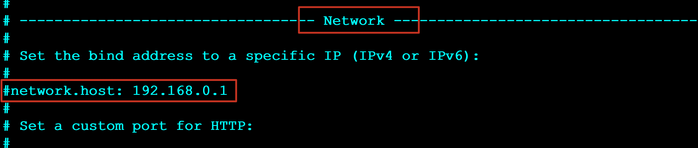

- 修改后配置

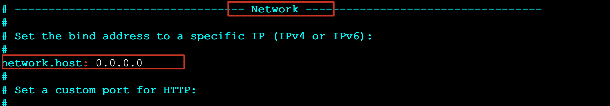

###  重启启动ES服务

```shell
./elasticsearch
```

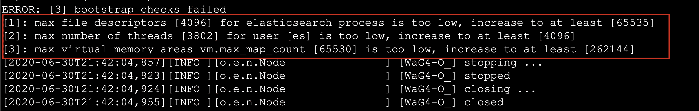

重新启动es出现如下错误

```markdown
ERROR: [3] bootstrap checks failed
	[1]: max file descriptors [4096] for elasticsearch process is too low, increase to at least [65535]
	[2]: max number of threads [3802] for user [es] is too low, increase to at least [4096]
	[3]: max virtual memory areas vm.max_map_count [65530] is too low, increase to at least [262144]
```

- 解决错误[1] 使用root用户修改系统配置

```shell
vim /etc/security/limits.conf	 在最后面追加下面内容
	*               soft    nofile          65536
	*               hard    nofile          65536
	*               soft    nproc           4096
	*               hard    nproc           4096
```

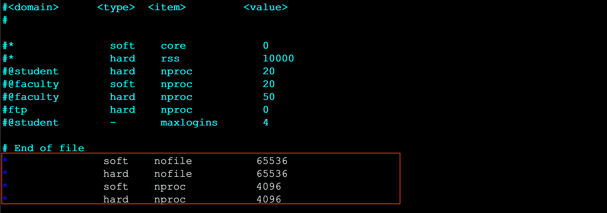

登录重新在检测配置是否生效

```shell
ulimit -Hn
ulimit -Sn
ulimit -Hu
ulimit -Su
```


- 解决错误[2]  使用root用户修改系统配置

```shell
vim /etc/security/limits.d/20-nproc.conf 
启动ES用户名 soft nproc 4096
```


- 解决错误[3] 使用root用户修改系统配置

```shell
vim /etc/sysctl.conf
vm.max_map_count=655360
```

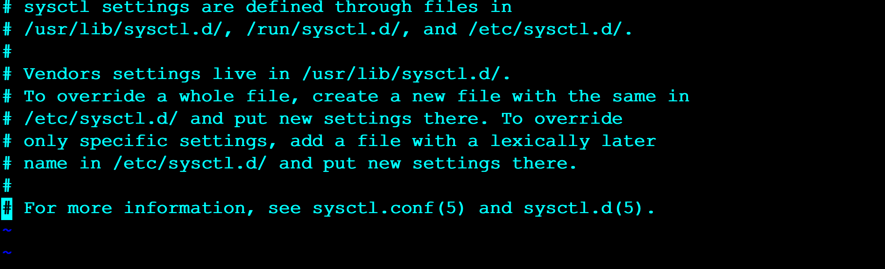

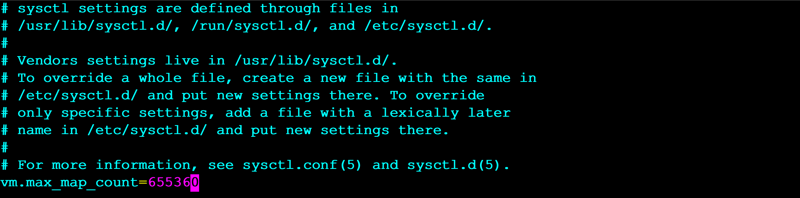

执行如下命令检测是否生效

```shell
sysctl -p
```

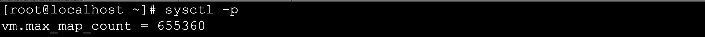

退出从新登录之后重新启动ES服务

```shell
./elasticsearch
```

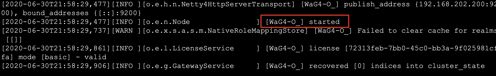

###  通过浏览器访问ES服务

http://192.168.31.23:9200/

##  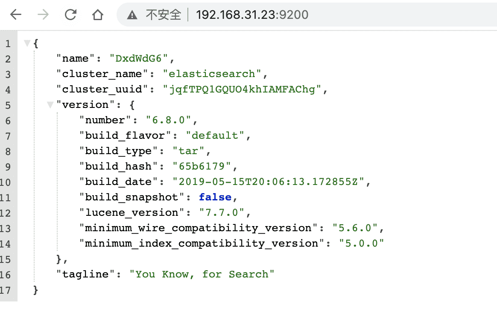加密es

修改配置文件：`elasticsearch.yml`

最后追加：

```yaml
xpack.security.enabled: true
xpack.security.transport.ssl.enabled: true
```

进入bin目录执行命令，提示输入密码，确认密码

```bash
$ ./elasticsearch-setup-passwords interactive
```

重新启动es，输入elastic和密码即可。

```bash
curl http://localhost:9200  --user elastic:Aa000000
curl -X DELETE  http://localhost:9200/.kibana*  --user elastic:Aa000000
```

