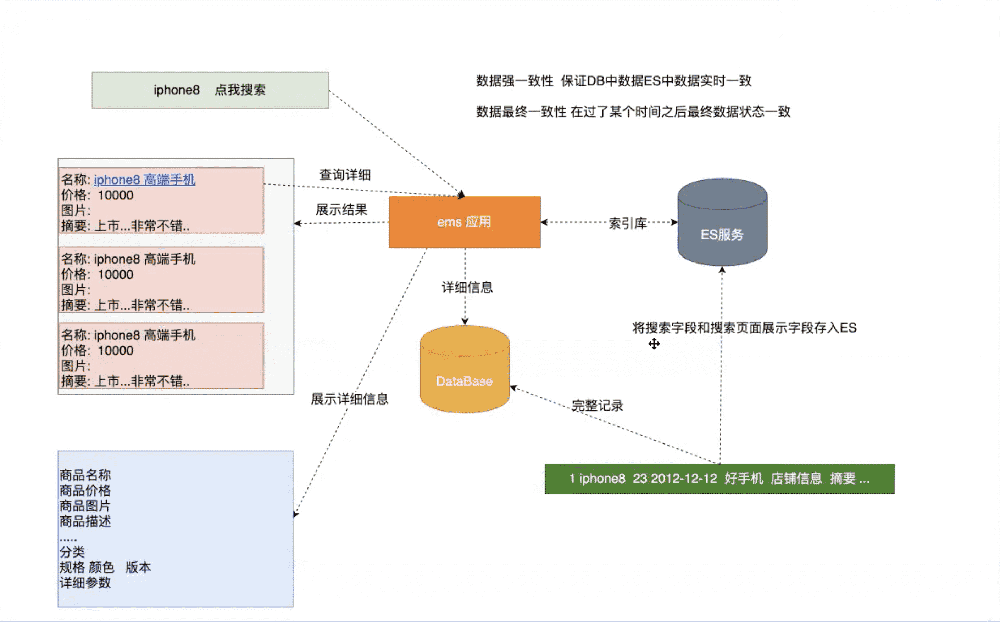

# Java操作ElasticSearch

##  Java操作ES检索和索引思路分析



##  引入maven依赖

```xml
<!--引入elasticsearch客户端依赖-->
<dependency>
  <groupId>org.elasticsearch</groupId>
  <artifactId>elasticsearch</artifactId>
  <version>6.8.0</version>
</dependency>
<dependency>
  <groupId>org.elasticsearch.client</groupId>
  <artifactId>transport</artifactId>
  <version>6.8.0</version>
</dependency>
<dependency>
  <groupId>org.elasticsearch.plugin</groupId>
  <artifactId>transport-netty4-client</artifactId>
  <version>6.8.0</version>
</dependency>
```

##  创建索引和类型

###  创建客户端操作对象

```java
private TransportClient transportClient;

@Before
public void before() throws UnknownHostException {
  //创建ES客户端对象
  this.transportClient = new PreBuiltTransportClient(Settings.EMPTY);
  //设置操作ES服务主机和端口
  transportClient
    .addTransportAddress(new TransportAddress(InetAddress.getByName("127.0.0.1"), 9300));
}

@After
public void after() {
  transportClient.close();
	}
}
```

###  创建索引

```java
//创建索引
@Test
public void testCreateIndex() {
  //创建一个索引  前提：保证创建的索引不存在
  CreateIndexResponse createIndexResponse = transportClient.admin().indices().prepareCreate("buubiu").get();
  //获取响应信息
  boolean acknowledged = createIndexResponse.isAcknowledged();
  System.out.println("acknowledged = " + acknowledged);
}
```

###  删除对象

```java
//删除索引
@Test
public void testDeleteIndex() {
  //删除索引
  AcknowledgedResponse acknowledgedResponse = transportClient.admin().indices().prepareDelete("buubiu")
    .get();
  //获取响应信息
  boolean acknowledged = acknowledgedResponse.isAcknowledged();
  System.out.println("acknowledged = " + acknowledged);
}
```

###  创建索引和类型

```java
//[了解]创建索引 类型 mapping
@Test
public void testCreateIndexAndTypeMaping() throws ExecutionException, InterruptedException {
  //创建一个索引请求对象
  CreateIndexRequest buubiuIndex = new CreateIndexRequest("buubiu");
  //索引设置类型
  //参数1：类型名 参数2：映射的json格式数据 参数3：映射格式类型
  buubiuIndex.mapping("user", "{\"properties\":{\"name\":{\"type\":\"text\",\"analyzer\":\"ik_max_word\",\"search_analyzer\":\"ik_max_word\"},\"age\":{\"type\":\"integer\"},\"bir\":{\"type\":\"date\"},\"content\":{\"type\":\"text\",\"analyzer\":\"ik_max_word\",\"search_analyzer\":\"ik_max_word\"},\"address\":{\"type\":\"keyword\"}}}", XContentType.JSON);
  //创建索引
  CreateIndexResponse createIndexResponse = transportClient.admin().indices()
    .create(buubiuIndex).get();
  boolean acknowledged = createIndexResponse.isAcknowledged();
  System.out.println("acknowledged = " + acknowledged);
}
```

##  操作索引记录

###  指定id生成索引记录

```java
//添加一个记录 指定id
@Test
public void testCreateOptionId() {
  User user = new User("1", "张三", 23, new Date(), "今天晴转多云", "上海");
  //转为json
  String json = JSONObject.toJSONStringWithDateFormat(user,"yyyy-MM-dd");
  //创建一条记录
  IndexResponse indexResponse = transportClient.prepareIndex("buubiu", "user", user.getId())
    .setSource(json, XContentType.JSON).get();
  RestStatus status = indexResponse.status();
  System.out.println("status = " + status);
}
```

###  自动生成id索引记录

```java
//添加一个记录 自动id
@Test
public void testCreateAutoId() {
  User user = new User(null, "张三2", 23, new Date(), "今天晴转多云2", "上海");
  //转为json
  String json = JSONObject.toJSONStringWithDateFormat(user,"yyyy-MM-dd");
  //创建一条记录
  IndexResponse indexResponse = transportClient.prepareIndex("buubiu", "user")
    .setSource(json, XContentType.JSON).get();
  RestStatus status = indexResponse.status();
  System.out.println("status = " + status);
}
```

###  更新一条记录

```java
//更新一条记录
@Test
public void testUpdate() {
  User user = new User();
  user.setName("王武")
    .setContent("今天樱桃")
    .setBir(new Date());
  //转为json
  String json = JSONObject.toJSONStringWithDateFormat(user,"yyyy-MM-dd");
  UpdateResponse updateResponse = transportClient.prepareUpdate("buubiu", "user", "1")
    .setDoc(json, XContentType.JSON).get();
  RestStatus status = updateResponse.status();
  System.out.println("status = " + status);
}
```

###  删除一条记录

```java
//删除记录
@Test
public void testDelete() {
  DeleteResponse deleteResponse = transportClient.prepareDelete("buubiu", "user", "1").get();
  RestStatus status = deleteResponse.status();
  System.out.println("status = " + status);
}
```

###  批量更新记录

```java
//批量更新记录
@Test
public void testBulk() throws IOException {
  //添加一条记录
  IndexRequest indexRequest1 = new IndexRequest("buubiu", "user", "12");
  User user1 = new User("1","刘能1", 22, new Date(), "男", "这是好人");
  indexRequest1.source(JSONObject.toJSONStringWithDateFormat(user1,"yyyy-MM-dd"), XContentType.JSON);
  //添加第二条记录
  IndexRequest indexRequest2 = new IndexRequest("buubiu", "user", "13");
  User user2 = new User("2","刘能2", 24, new Date(), "男", "这是好人");
  indexRequest2.source(JSONObject.toJSONStringWithDateFormat(user2,"yyyy-MM-dd"), XContentType.JSON);
  //更新一条记录
  UpdateRequest updateRequest = new UpdateRequest("buubiu", "user", "12");
  User user = new User().setName("中国厉害");
  updateRequest.doc(JSONObject.toJSONString(user), XContentType.JSON);
  //删除一条记录
  DeleteRequest deleteRequest = new DeleteRequest("buubiu", "user", "13");

  BulkResponse bulkItemResponses = transportClient.prepareBulk().add(indexRequest1)
    .add(indexRequest2).add(updateRequest).add(deleteRequest).get();
  BulkItemResponse[] items = bulkItemResponses.getItems();
  for (BulkItemResponse item : items) {
    System.out.println("item = " + item.status());
  }

}
```

##  检索记录

###  查询一条记录

```java
//查询一条记录
@Test
public void testFindOne() throws ParseException {
  GetResponse getResponse = transportClient.prepareGet("buubiu", "user", "1").get();
  String sourceAsString = getResponse.getSourceAsString();
  System.out.println("sourceAsString = " + sourceAsString);
  Map<String, Object> sourceAsMap = getResponse.getSourceAsMap();
  User user = new User();
  user.setId(sourceAsMap.get("id").toString());
  user.setBir(new SimpleDateFormat("yyyy-MM-dd").parse(sourceAsMap.get("bir").toString()));
  System.out.println("user = " + user);
}
```

###  查询所有

```java
//查询所有
@Test
public void testMatchAllQuery() {
  //查询条件
  MatchAllQueryBuilder matchAllQueryBuilder = QueryBuilders.matchAllQuery();

  SearchResponse searchResponse = transportClient.prepareSearch("buubiu")
    .setTypes("user")//指定类型
    .setQuery(matchAllQueryBuilder)//指定查询条件
    .get();

  SearchHits hits = searchResponse.getHits();
  System.out.println("总条数 = " + hits.getTotalHits());
  System.out.println("最大得分 = " + hits.getMaxScore());
  SearchHit[] hits1 = hits.getHits();
  for (SearchHit hit : hits1) {
    System.out.println("hit.getSourceAsString() = " + hit.getSourceAsString());
  }
}
```

##  高级检索

###  分页查询

```java
/**
	 * 分页查询
	 *  From 从哪条记录开始 默认从0 开始  form = (pageNow-1)*size
	 *  Size 每次返回多少条符合条件的结果  默认10
	 */
@Test
public void testMatchAllQueryFormAndSize() {
  //查询条件
  MatchAllQueryBuilder matchAllQueryBuilder = QueryBuilders.matchAllQuery();

  SearchResponse searchResponse = transportClient.prepareSearch("buubiu")
    .setTypes("user")//指定类型
    .setQuery(matchAllQueryBuilder)//指定查询条件
    .setFrom(0)//起始条数 默认从0开始（当前页-1）*size
    .setSize(2)//设置每页展示记录数
    .get();

  SearchHits hits = searchResponse.getHits();
  System.out.println("总条数 = " + hits.getTotalHits());
  System.out.println("最大得分 = " + hits.getMaxScore());
  SearchHit[] hits1 = hits.getHits();
  for (SearchHit hit : hits1) {
    System.out.println("hit.getSourceAsString() = " + hit.getSourceAsString());
  }
}
```

###  排序查询

```java
/**
	 * 排序查询
	 *  From 从那条记录开始 默认从0 开始  form = (pageNow-1)*size
	 *  Size 每次返回多少条符合条件的结果  默认10
	 *  ASC 升序  DESC 降序
	 *  addSort("age", SortOrder.ASC)  指定排序字段以及使用哪种方式排序
	 *  addSort("age", SortOrder.DESC) 指定排序字段以及使用哪种方式排序
	 */
@Test
public void testMatchAllQueryFormAndSizeAndSort() {
  //查询条件
  MatchAllQueryBuilder matchAllQueryBuilder = QueryBuilders.matchAllQuery();

  SearchResponse searchResponse = transportClient.prepareSearch("buubiu")
    .setTypes("user")//指定类型
    .setQuery(matchAllQueryBuilder)//指定查询条件
    .setFrom(0)//起始条数 默认从0开始（当前页-1）*size
    .setSize(20)//设置每页展示记录数，默认10条
    .addSort("age", SortOrder.DESC)//设置排序 desc降序 asc升序
    .get();

  SearchHits hits = searchResponse.getHits();
  System.out.println("总条数 = " + hits.getTotalHits());
  System.out.println("最大得分 = " + hits.getMaxScore());
  SearchHit[] hits1 = hits.getHits();
  for (SearchHit hit : hits1) {
    System.out.println("hit.getSourceAsString() = " + hit.getSourceAsString());
  }
}
```

###  term关键字查询

```java
//term关键字查询
@Test
public void testTermQuery() {

   TermQueryBuilder termQueryBuilder = QueryBuilders.termQuery("content", "今天");

   testResult(termQueryBuilder);
}

private void testResult(QueryBuilder queryBuilder) {
   SearchResponse searchResponse = transportClient.prepareSearch("buubiu")
      .setTypes("user")//指定类型
      .setQuery(queryBuilder)//指定查询条件
      .setFrom(0)//起始条数 默认从0开始（当前页-1）*size
      .setSize(20)//设置每页展示记录数，默认10条
      .addSort("age", SortOrder.ASC)//设置排序 desc降序 asc升序
      .get();

   SearchHits hits = searchResponse.getHits();
   System.out.println("总条数 = " + hits.getTotalHits());
   System.out.println("最大得分 = " + hits.getMaxScore());
   SearchHit[] hits1 = hits.getHits();
   for (SearchHit hit : hits1) {
      System.out.println("hit.getSourceAsString() = " + hit.getSourceAsString());
   }
}
```

###  range范围查询

```java
/**
	 *  rang查询
	 *     lt    小于
	 *     lte   小于等于
	 *     gt    大于
	 *     gte   大于等于
	 */
@Test
public void testRangeQuery() {
   RangeQueryBuilder rangeQueryBuilder = QueryBuilders.rangeQuery("age").gte(0).lte(22);

   testResult(rangeQueryBuilder);
}

private void testResult(QueryBuilder queryBuilder) {
   SearchResponse searchResponse = transportClient.prepareSearch("buubiu")
      .setTypes("user")//指定类型
      .setQuery(queryBuilder)//指定查询条件
      .setFrom(0)//起始条数 默认从0开始（当前页-1）*size
      .setSize(20)//设置每页展示记录数，默认10条
      .addSort("age", SortOrder.ASC)//设置排序 desc降序 asc升序
      .get();

   SearchHits hits = searchResponse.getHits();
   System.out.println("总条数 = " + hits.getTotalHits());
   System.out.println("最大得分 = " + hits.getMaxScore());
   SearchHit[] hits1 = hits.getHits();
   for (SearchHit hit : hits1) {
      System.out.println("hit.getSourceAsString() = " + hit.getSourceAsString());
   }
}
```

###  wildcard通配符查询

```java
//wildcardQuery 通配符查询 ? 一个  * 0到多个
@Test
public void testWildcardQuery() {
   WildcardQueryBuilder wildcardQueryBuilder = QueryBuilders.wildcardQuery("name", "张*");

   testResult(wildcardQueryBuilder);
}

private void testResult(QueryBuilder queryBuilder) {
   SearchResponse searchResponse = transportClient.prepareSearch("buubiu")
      .setTypes("user")//指定类型
      .setQuery(queryBuilder)//指定查询条件
      .setFrom(0)//起始条数 默认从0开始（当前页-1）*size
      .setSize(20)//设置每页展示记录数，默认10条
      .addSort("age", SortOrder.ASC)//设置排序 desc降序 asc升序
      .get();

   SearchHits hits = searchResponse.getHits();
   System.out.println("总条数 = " + hits.getTotalHits());
   System.out.println("最大得分 = " + hits.getMaxScore());
   SearchHit[] hits1 = hits.getHits();
   for (SearchHit hit : hits1) {
      System.out.println("hit.getSourceAsString() = " + hit.getSourceAsString());
   }
}
```

###  prefix前缀查询

```java
/**
 * prefix 前缀查询
 */
@Test
public void testPrefixQuery() {
   PrefixQueryBuilder prefixQueryBuilder = QueryBuilders.prefixQuery("name", "中");

   testResult(prefixQueryBuilder);
}

private void testResult(QueryBuilder queryBuilder) {
   SearchResponse searchResponse = transportClient.prepareSearch("buubiu")
      .setTypes("user")//指定类型
      .setQuery(queryBuilder)//指定查询条件
      .setFrom(0)//起始条数 默认从0开始（当前页-1）*size
      .setSize(20)//设置每页展示记录数，默认10条
      .addSort("age", SortOrder.ASC)//设置排序 desc降序 asc升序
      .get();

   SearchHits hits = searchResponse.getHits();
   System.out.println("总条数 = " + hits.getTotalHits());
   System.out.println("最大得分 = " + hits.getMaxScore());
   SearchHit[] hits1 = hits.getHits();
   for (SearchHit hit : hits1) {
      System.out.println("hit.getSourceAsString() = " + hit.getSourceAsString());
   }
}
```

###  ids查询

```java
/**
 * ids查询
 */
@Test
public void testIdsQuery() {
   IdsQueryBuilder idsQueryBuilder = QueryBuilders.idsQuery().addIds("U1q9k3YBZ23tdxk-z2eh", "1");

   testResult(idsQueryBuilder);
}

private void testResult(QueryBuilder queryBuilder) {
   SearchResponse searchResponse = transportClient.prepareSearch("buubiu")
      .setTypes("user")//指定类型
      .setQuery(queryBuilder)//指定查询条件
      .setFrom(0)//起始条数 默认从0开始（当前页-1）*size
      .setSize(20)//设置每页展示记录数，默认10条
      .addSort("age", SortOrder.ASC)//设置排序 desc降序 asc升序
      .get();

   SearchHits hits = searchResponse.getHits();
   System.out.println("总条数 = " + hits.getTotalHits());
   System.out.println("最大得分 = " + hits.getMaxScore());
   SearchHit[] hits1 = hits.getHits();
   for (SearchHit hit : hits1) {
      System.out.println("hit.getSourceAsString() = " + hit.getSourceAsString());
   }
}
```

###  fuzzy模糊查询

```java
/**
 * fuzzy模糊查询 字符数：0-2 不允许模糊 3-5 可以出现一个模糊 >5最多出现两个模糊
 */
@Test
public void testFuzzyQuery() {
   FuzzyQueryBuilder fuzzyQueryBuilder = QueryBuilders.fuzzyQuery("name", "厉害");

   testResult(fuzzyQueryBuilder);
}

private void testResult(QueryBuilder queryBuilder) {
   SearchResponse searchResponse = transportClient.prepareSearch("buubiu")
      .setTypes("user")//指定类型
      .setQuery(queryBuilder)//指定查询条件
      .setFrom(0)//起始条数 默认从0开始（当前页-1）*size
      .setSize(20)//设置每页展示记录数，默认10条
      .addSort("age", SortOrder.ASC)//设置排序 desc降序 asc升序
      .get();

   SearchHits hits = searchResponse.getHits();
   System.out.println("总条数 = " + hits.getTotalHits());
   System.out.println("最大得分 = " + hits.getMaxScore());
   SearchHit[] hits1 = hits.getHits();
   for (SearchHit hit : hits1) {
      System.out.println("hit.getSourceAsString() = " + hit.getSourceAsString());
   }
}
```

###  bool查询

```java
/**
 * bool查询
 */
@Test
public void testBoolQuery() {
   BoolQueryBuilder boolQueryBuilder = QueryBuilders.boolQuery()
      .must(QueryBuilders.termQuery("name", "张三"));

   testResult(boolQueryBuilder);
}

private void testResult(QueryBuilder queryBuilder) {
   SearchResponse searchResponse = transportClient.prepareSearch("buubiu")
      .setTypes("user")//指定类型
      .setQuery(queryBuilder)//指定查询条件
      .setFrom(0)//起始条数 默认从0开始（当前页-1）*size
      .setSize(20)//设置每页展示记录数，默认10条
      .addSort("age", SortOrder.ASC)//设置排序 desc降序 asc升序
      .get();

   SearchHits hits = searchResponse.getHits();
   System.out.println("总条数 = " + hits.getTotalHits());
   System.out.println("最大得分 = " + hits.getMaxScore());
   SearchHit[] hits1 = hits.getHits();
   for (SearchHit hit : hits1) {
      System.out.println("hit.getSourceAsString() = " + hit.getSourceAsString());
   }
}
```

###  指定返回字段查询

```java
/**
 * 指定返回字段查询
 */
@Test
public void testMatchAllQuerySource() {
   //查询条件
   MatchAllQueryBuilder matchAllQueryBuilder = QueryBuilders.matchAllQuery();

   SearchResponse searchResponse = transportClient.prepareSearch("buubiu")
      .setTypes("user")//指定类型
      .setQuery(matchAllQueryBuilder)//指定查询条件
      .setFrom(0)//起始条数 默认从0开始（当前页-1）*size
      .setSize(2)//设置每页展示记录数，默认10条
      .setSource(SearchSourceBuilder.searchSource().fetchSource("*", "age"))//执行结果中返回哪些字段
      .get();

   SearchHits hits = searchResponse.getHits();
   System.out.println("总条数 = " + hits.getTotalHits());
   System.out.println("最大得分 = " + hits.getMaxScore());
   SearchHit[] hits1 = hits.getHits();
   for (SearchHit hit : hits1) {
      System.out.println("hit.getSourceAsString() = " + hit.getSourceAsString());
   }
}
```

###  multiMatch多字段查询

```java
/**
 * multiMatch 多字段查询
 */
@Test
public void testMultiMatchQuery() {
   MultiMatchQueryBuilder multiMatchQueryBuilder = QueryBuilders
      .multiMatchQuery("2", "name", "content");

   testResult(multiMatchQueryBuilder);
}

private void testResult(QueryBuilder queryBuilder) {
   SearchResponse searchResponse = transportClient.prepareSearch("buubiu")
      .setTypes("user")//指定类型
      .setQuery(queryBuilder)//指定查询条件
      .setFrom(0)//起始条数 默认从0开始（当前页-1）*size
      .setSize(20)//设置每页展示记录数，默认10条
      .addSort("age", SortOrder.ASC)//设置排序 desc降序 asc升序
      .get();

   SearchHits hits = searchResponse.getHits();
   System.out.println("总条数 = " + hits.getTotalHits());
   System.out.println("最大得分 = " + hits.getMaxScore());
   SearchHit[] hits1 = hits.getHits();
   for (SearchHit hit : hits1) {
      System.out.println("hit.getSourceAsString() = " + hit.getSourceAsString());
   }
}
```

###  高亮查询

```java
/**
 * 高亮查询
 */
@Test
public void testHighlight() throws ParseException {

   List<User> users = new ArrayList<>();

   //创建highlightBuilder
   HighlightBuilder highlightBuilder = new HighlightBuilder()
      .field("*")
      .requireFieldMatch(false)
      .preTags("<span style='color:red;'>")
      .postTags("</span>");

   SearchResponse searchResponse = transportClient.prepareSearch("buubiu")
      .setTypes("user")//指定类型
      .setQuery(QueryBuilders.termQuery("name", "张三"))//指定查询条件
      .highlighter(highlightBuilder)//高亮处理
      .get();

   SearchHits hits = searchResponse.getHits();
   System.out.println("总条数 = " + hits.getTotalHits());
   System.out.println("最大得分 = " + hits.getMaxScore());
   SearchHit[] hits1 = hits.getHits();
   for (SearchHit hit : hits1) {
      User user = new User();

      //封装原始结果
      Map<String, Object> sourceAsMap = hit.getSourceAsMap();
      user.setId(hit.getId());
      user.setName(sourceAsMap.get("name").toString());
      user.setAge(Integer.valueOf(sourceAsMap.get("age").toString()));
      //user.setBir(new SimpleDateFormat("yyyy-MM-dd").parse(sourceAsMap.get("bir").toString()));
      user.setContent(sourceAsMap.get("content").toString());
      user.setAddress(sourceAsMap.get("address").toString());

      //高亮处理
      Map<String, HighlightField> highlightFields = hit.getHighlightFields();
      if (highlightFields.containsKey("name")) {
         user.setName(highlightFields.get("name").fragments()[0].toString());
      }
      if (highlightFields.containsKey("content")) {
         user.setContent(highlightFields.get("content").fragments()[0].toString());
      }

      users.add(user);
   }
   //遍历集合
   users.forEach(user -> System.out.println("user = " + user));
}
```

###  过滤查询

```java
/**
	 * 过滤查询 主要用在查询执行之前对大量数据进行过滤
	 */
@Test
public void testHighlight() {
  RangeQueryBuilder rangeQueryBuilder = QueryBuilders.rangeQuery("name").gte(0).lte(23);
  SearchResponse searchResponse = transportClient.prepareSearch("buubiu")
    .setTypes("user")
    .setPostFilter(rangeQueryBuilder)//过滤条件
    .setQuery(QueryBuilders.matchAllQuery())
    .get();
  SearchHit[] hits = searchResponse.getHits().getHits();
  for (SearchHit hit : hits) {
    System.out.println("hit.toString() = " + hit.toString());
  }
}
```