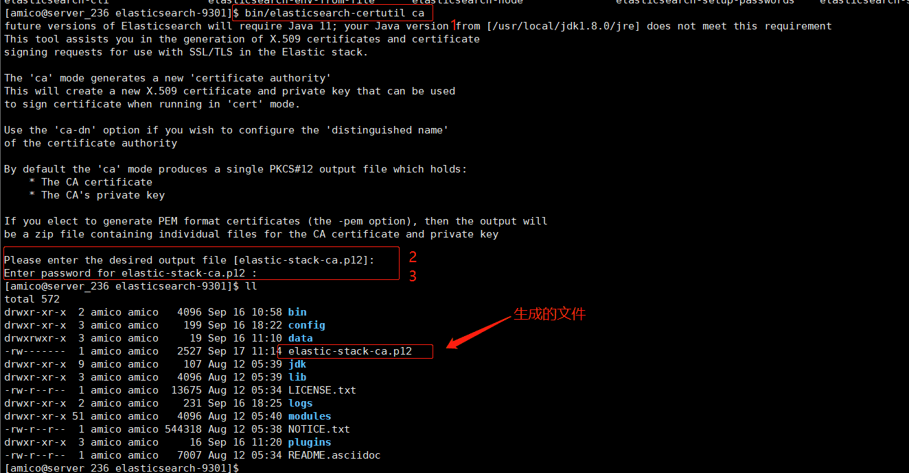
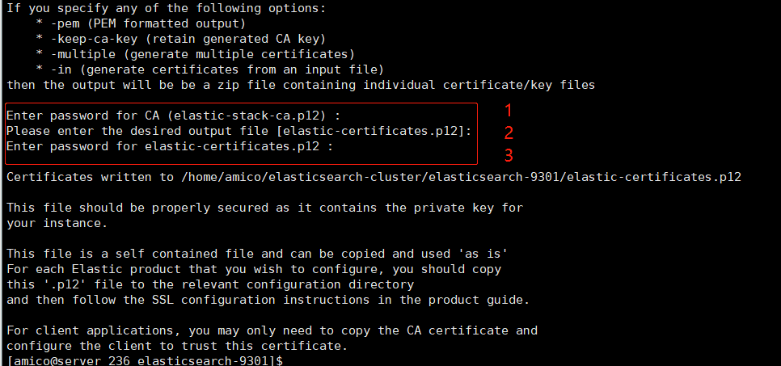
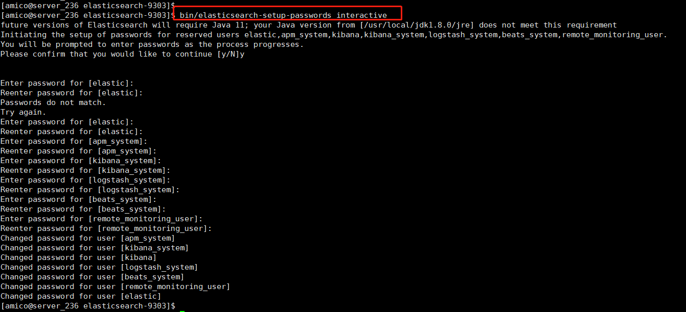

# Elasticsearch的集群添加节点证书

## 背景

**集群搭建完成后，但是没配置账号密码，集群中各节点之间的通信是也没有什么校验措施的，别人随随便便就连上集群。这样在互联网中就相当于裸奔！**

## 准备工作

防止出现不确定的错误，需要按照以下顺序执行：

- 停止与es相关的软件，比如：kafka logstash filebeat skywalking 等
- 停止es集群所有机器
- 生成证书
- 修改配置文件
- 配置证书
- 启动es
- 配置密码

## 配置证书

TLS需要X.509证书才能对与之通信的应用程序执行加密和身份验证。为了使节点之间的通信真正安全，必须对证书进行验证。在Elasticsearch集群中验证证书真实性的推荐方法是信任签署证书的证书颁发机构（CA）。这样，将节点添加到群集时，它们只需要使用由同一CA签名的证书，即可自动允许该节点加入群集。

### 生成节点证书

命令 `elasticsearch-certutil` 简化了生成证书的过程，它负责生成CA并与CA签署证书。

**创建证书颁发机构CA**

> 在任意一个节点执行即可

随便进入一个节点的bin 目录下执行`elasticsearch-certutil` 命令即可，如下

```bash
# 该命令输出单个文件，默认名称为elastic-stack-ca.p12。此文件是PKCS＃12密钥库
# 其中包含CA的公共证书和用于对每个节点的证书签名的私钥。
$ ./elasticsearch-certutil ca
```

执行这个命令之后：

- 会让你输入生成`elastic-stack-ca.p12`文件放在哪。（直接回车，放在了上层目录）
- 回车之后让你输入密码，该密码是让你保护文件和密钥的。如果你以后还要加集群的话，要记得输入的密码。



**生成证书和私钥**

> 在任意一个节点执行即可，bin 目录下执行

```bash
# 此命令生成证书凭证，输出的文件是单个PKCS＃12密钥库，其中包括节点证书，节点密钥和CA证书。
$ ./elasticsearch-certutil cert --ca /usr/share/elasticsearch/elastic-stack-ca.p12
```

执行命令之后需要你操作3次：

- 第一次，输入上面生成CA的密码，没有设置直接回车
- 第二次，生成的文件路径，直接回车
- 第三次，生成这次证书与私钥文件的密码，建议和上面生成CA一致（怕忘记密码，也可以直接回车）

**如下图需要输入密码的地方：**



**命令执行完之后会生成一个`elastic-certificates.p12` 文件（放在了上层目录），这个就是各节点通信的凭证**

### 配置证书

##### 复制证书凭证

> 每个节点执行

把证书凭证复制到各个节点一份，最好复制到与elasticsearch.yml一个目录下， 方便管理。

```bash
$ cp elastic-certificates.p12 /etc/elasticsearch/config
# 授可以访问权限
$ chmod 660 elastic-certificates.p12
```

### 修改配置文件

> 在每个节点执行

在各个节点下的`elasticsearch.yml`文件添加如下配置

```yaml
xpack.security.enabled: true
xpack.security.authc.accept_default_password: false
xpack.security.transport.ssl.enabled: true
xpack.security.transport.ssl.verification_mode: certificate
xpack.security.transport.ssl.keystore.path: /etc/elasticsearch/config/elastic-certificates.p12
xpack.security.transport.ssl.truststore.path: /etc/elasticsearch/config/elastic-certificates.p12
```

- xpack.security.enabled：是否启用xpack

- xpack.security.authc.accept_default_password：是否启用默认密码，默认为changeme

- xpack.security.transport.ssl.enabled：是否启用ssl证书
- xpack.security.transport.ssl.verification_mode：证书类型
- xpack.security.transport.ssl.keystore.path：节点证书路径
- xpack.security.transport.ssl.truststore.path：节点证书的密钥库的路径

### 添加密码到密码库

> 在每个节点执行，bin 目录下执行

因为之前生成CA 和生成凭证都设置了密码，所以把密码添加到密钥库中

```bash
# 执行之后，输入上面设置的密码，回车即可
$ ./elasticsearch-keystore add xpack.security.transport.ssl.keystore.secure_password
$ ./elasticsearch-keystore add xpack.security.transport.ssl.truststore.secure_password
```

若你的jdk是8版本，会有个警告，不必理会。

### 启动各个节点

若配置了系统服务则：

```bash
$ systemctl start elasticsearch
```

若没有配置系统服务则：

```bash
$. /elasticsearch -d
```

**可以看看日志，不出意外集群启动成功了。随便请求一个节点地址连接查看，但是需要账户和密码访问**

## 配置密码

**在安装Elasticsearch时，如果内置用户`elastic`用户没有密码，它将使用默认的引导密码。引导程序密码是一个临时密码，从随机 `keystore.seed` 设置派生的会在安装过程中添加到密钥库中。我们压根不知道密码是啥，所以需要为内置用户`elastic`设置密码。首次设置可以用`elasticsearch-setup-passwords`命令**

### 初始化密码

> 任意节点执行即可，bin目录下执行

`elasticsearch-setup-passwords`工具是首次设置内置用户密码的最简单方法。它使用elastic用户的引导程序密码来运行用户管理API请求。
执行命令如下：

```bash
$ ./elasticsearch-setup-passwords interactive
```

它在“互动”模式下提示你输入：`elastic`，`kibana_system`，`logstash_system`，`beats_system`，`apm_system`，和`remote_monitoring_user`用户的密码



至此ES集群的账号跟密码就设置完成了，我们设置密码之后会有一个名为`.security-7`的索引文档。

### 修改密码

- 可以重新初始化密码
- 也可以按照以下url修改

```json
# 随便一个节点地址修改即可，一个集群共用一个账号密码
# 用Postman 请求时，选择 Authorization -> 选择 Basic Auth -> 右边选择上面设置的账号密码：elastic用户与密码
POST http://127.0.0.1:9200/_xpack/security/user/elastic/_password

{
  "password": "yourNewPassword"
}
```

