# Kibana的安装与基本操作

## 介绍

Kibana是一个针对Elasticsearch的开源分析及可视化平台，使用Kibana可以查询、查看并与存储在ES索引的数据进行交互操作，使用Kibana能执行高级的数据分析，并能以图表、表格和地图的形式查看数据。

## 安装

### 下载Kibana

https://www.elastic.co/downloads/kibana

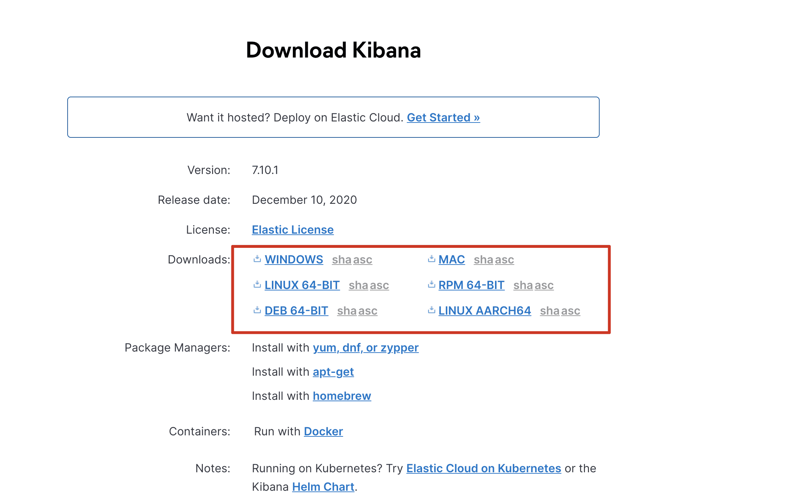

### 编辑kibana配置文件

config/kibana.yml

修改如下配置，若es有用户名密码，还需要追加后两行：

```yml
server.host: "127.0.0.1"                				 #ES服务器主机地址
elasticsearch.hosts: ["http://127.0.0.1:9200"]   #ES服务器地址
elasticsearch.username: "kibana"
elasticsearch.password: "Aa000000"
xpack.security.enabled: true
#32位以上的随机数即可，用作信息的加密
xpack.security.encryptionKey: "4297f44b13955235245b2497399d7a93" 
```

### 启动kibana

```shell
../bin/kibana
```

### 关闭kibana

```shell
$ ps -ef|grep node 
$ kill -9 4444
```

### 访问kibana的web界面

http://127.0.0.1:5601/   #kibana默认端口为5601 使用主机:端口直接访问即可   

登录kibana的时候，输入的用户名和密码是:elastic/Aa000000

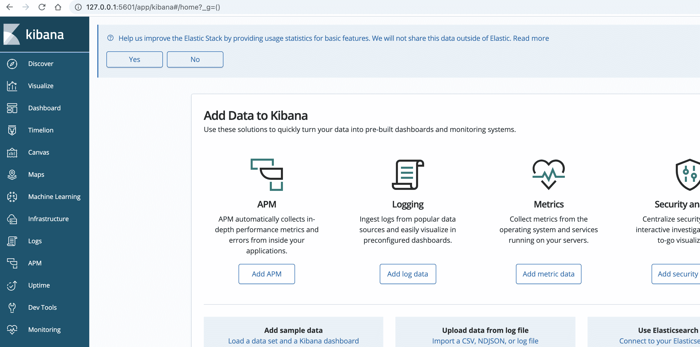

## kibana的基本操作

### 索引(Index)的基本操作

#### 创建索引

规则：`PUT /索引`

```json
PUT /buubiu
```

#### 删除索引

规则：`DELETE /索引`

```json
DELETE /buubiu
#删除所有
DELETE /*
```

#### 查看索引信息

规则：`GET /_cat/indices?v`

```json
GET /_cat/indices?_v
```

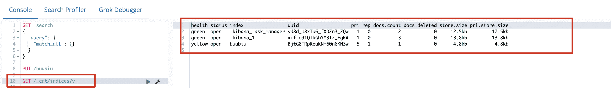

### 类型(Type)的基本操作

#### 创建类型

规则：` PUT /索引 {}`

**注意：这种方式创建类型要求索引不能存在，否则创建的时候报错**

```json 
#创建 /buubiu索引并创建（user）类型
PUT /buubiu
{
  "mappings": {
    "user":{
      "properties":{
        "id":{"type":"keyword"},
        "name":{"type":"text"},
        "age":{"type":"integer"},
        "bir":{"type":"date"}
      }
    }
  }
}
```

Mpping Type类型有：

`text , keyword , date ,integer, long , double , boolean or ip** `

#### 查看类型

规则：`GET /索引/_mapping`

```json
GET /buubiu/_mapping
```

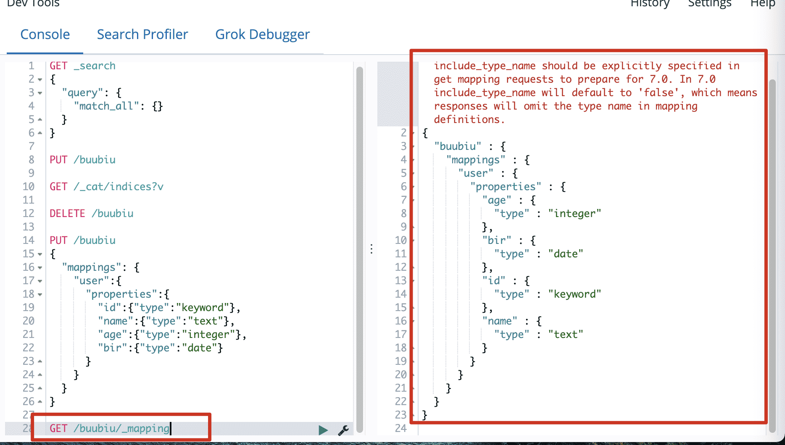

### 文档(document)的基本操作

#### 添加文档

规则：`PUT /索引/类型/_id`

```json
#1.手动生成文档id
PUT /buubiu/user/1
{
  "id":1,
  "name":"buubiu",
  "age":23,
  "bir":"2020-12-12"
}
#2.自动生成文档id
POST /buubiu/user
{
  "id":2,
  "name":"buubiu2",
  "age":24,
  "bir":"2020-12-14"
}
```

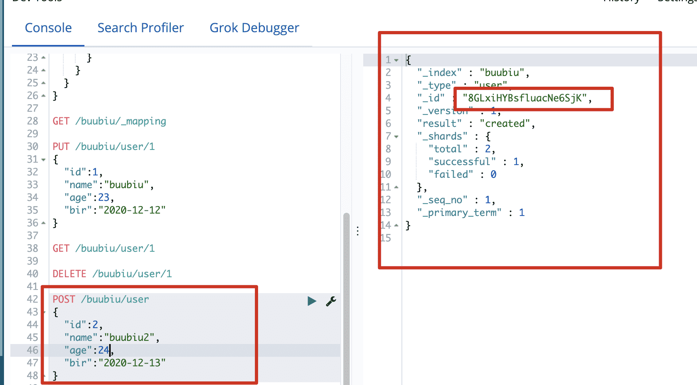

#### 查看文档

规则：`PUT /索引/类型/_id`

```json
GET /buubiu/user/1
```

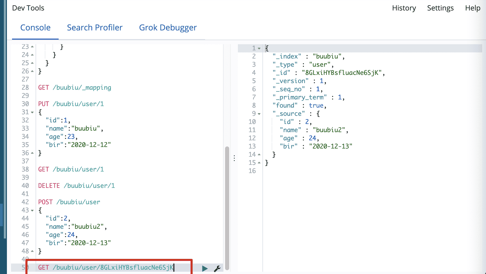

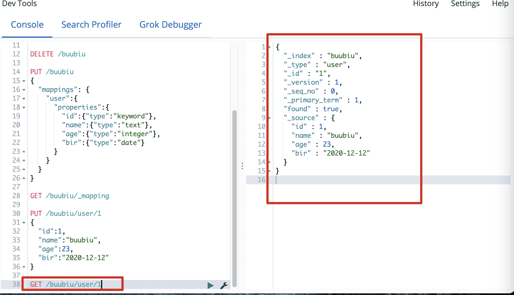

#### 删除文档

规则：`DELETE /索引/类型/_id`

```json
DELETE /buubiu/user/1
```

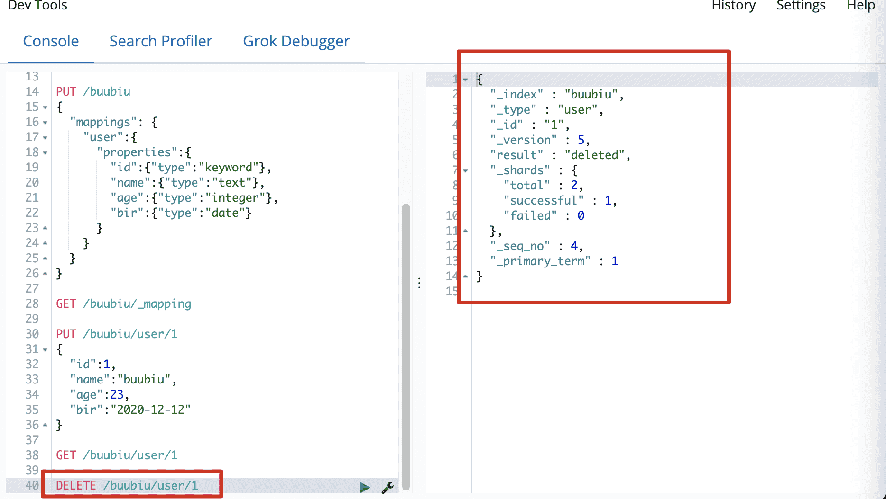

#### 更新文档

- 规则：`POST /索引/文档id {}`

**注意：此方法不保留未修改的数据（先删除后插入）**

```json
POST /buubiu/user/8GLxiHYBsfluacNe6SjK
{
  "name":"小明"
}
```

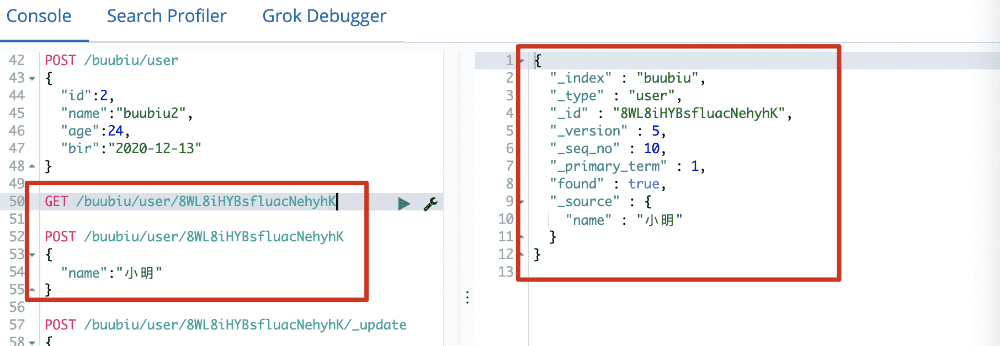

- 规则：`POST /索引/文档id/_update {"doc"}`

**说明：保留未修改的数据，更新时若有新字段会自动生成相应的类型mapping**

```json
POST /buubiu/user/8mIFiXYBsfluacNevCho/_update
{
  "doc": {
    "name":"校长",
    "age":33,
    "dept":"软件开发部"
  }
}
```

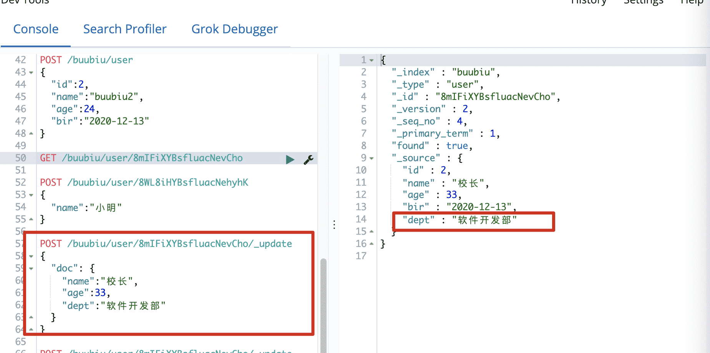

- 规则：`POST /索引/文档id/_update {"script"}`

**说明：脚本更新数据**

```json
#例如：把年龄自增3岁
POST /buubiu/user/8mIFiXYBsfluacNevCho/_update
{
  "script": "ctx._source.age+=3"
}
```

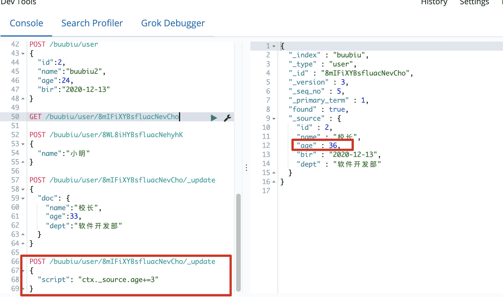

#### 批量操作文档

规则：`PUT /索引/类型/_bulk`

**注意:批量时不会因为一个失败而全部失败,而是继续执行后续操作,批量在返回时按照执行的状态开始返回**

```json
#index:添加 delete：删除 update：更新
PUT /buubiu/user/_bulk
{"index":{"_id":"5"}}
  {"name":"buubiu5","age":44,"bir":"2020-02-22"}
{"delete":{"_id":"4"}}
{"update":{"_id":"1"}}
  {"doc":{"name":"buubiu11","age":55}}
```

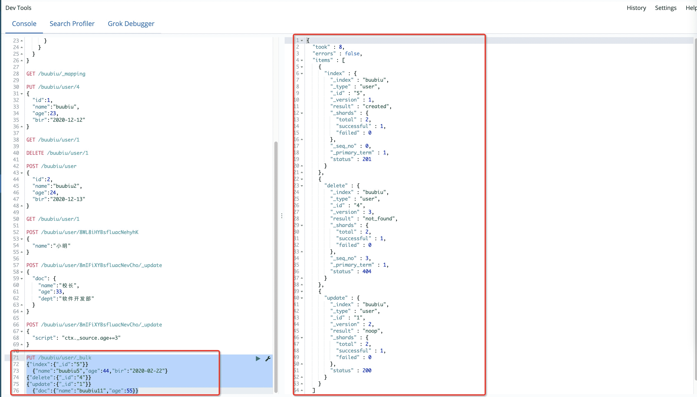