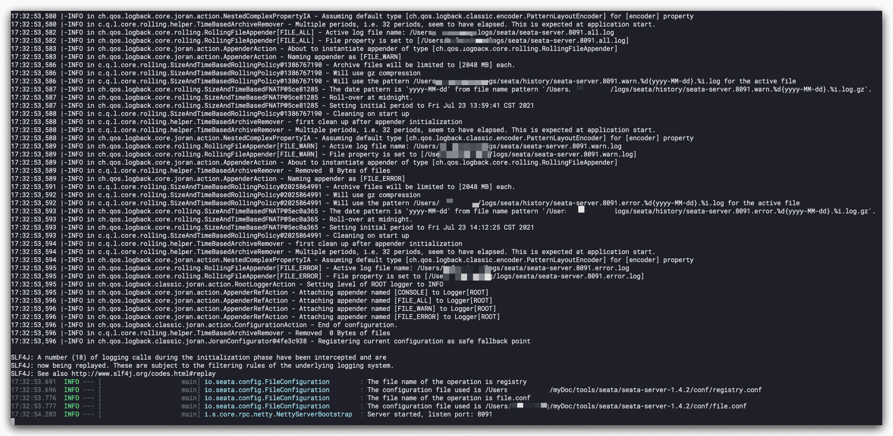
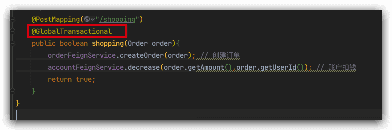
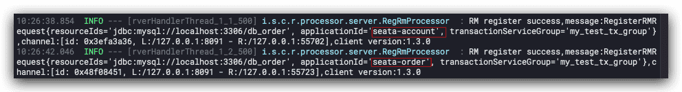
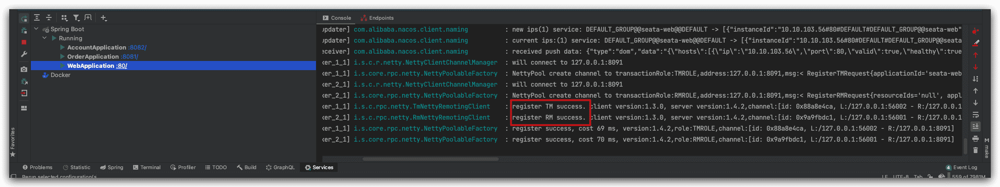
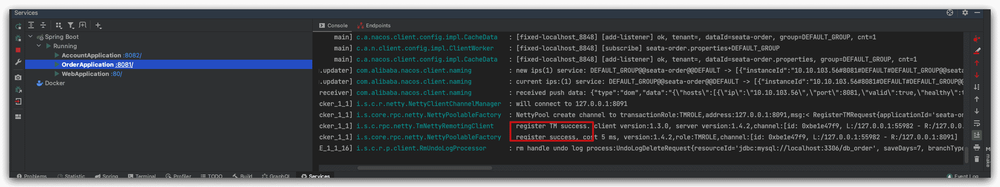
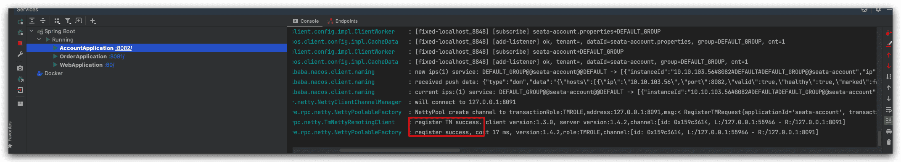
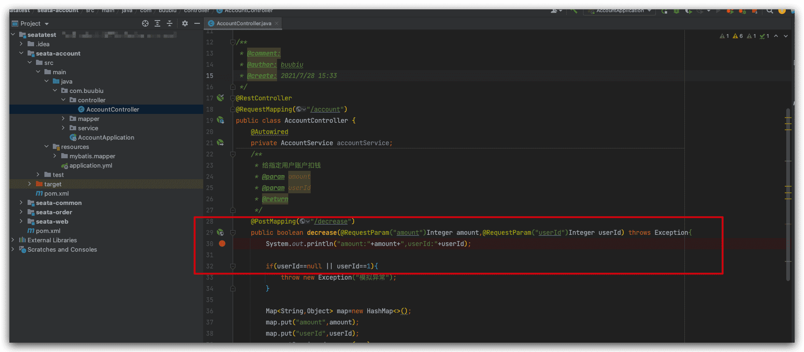
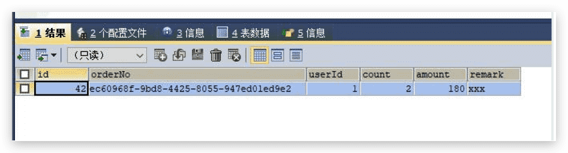
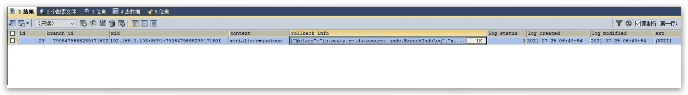

# seata AT模式方案解决分布式事务问题

seata主推的是AT模式强一致性解决方案，所以我们采用这个方案来解决前面案例的分布式问题。

## 下载和运行seata server

seata server地址：https://github.com/seata/seata/releases

最新版本 `v1.4.2`

用macOS或者Linux的下载：[seata-server-1.4.2.tar.gz](https://github.com/seata/seata/releases/download/v1.4.2/seata-server-1.4.2.tar.gz)

用windows的下载[seata-server-1.4.2.zip](https://github.com/seata/seata/releases/download/v1.4.2/seata-server-1.4.2.zip)

## 编辑seata-server配置文件

seata server所有的配置都在conf文件夹内，该文件夹内有两个文件我们必须要详细介绍下。

seata server默认使用file（文件方式）进行存储事务日志、事务运行信息，我们可以通过-m db脚本参

数的形式来指定，目前仅支持file、db这两种方式。

- `file.conf`

  该文件用于配置存储方式、透传事务信息的NIO等信息，默认对应registry.conf文件内的file方式配置。

- `registry.conf`

  seata server核心配置文件，可以通过该文件配置服务注册方式、配置读取方式。

  注册方式目前支持file 、nacos 、eureka、redis、zk、consul、etcd3、sofa等方式，默认为file，对应读取file.conf内的注册方式信息。

  读取配置信息的方式支持file、nacos 、apollo、zk、consul、etcd3等方式，默认为file，对应读取file.conf文件内的配置。

**file.conf 加一个service 配置：**

```sh
service {
  #vgroup->rgroup 服务分组 集群分组默认为"default"
  vgroupMapping.my_test_tx_group = "default"
  #only support single node
  default.grouplist = "127.0.0.1:8091"
  #degrade current not support 服务降级达到多次错误不走seata
  enableDegrade = false
  #disable
  disable = false
  #unit ms,s,m,h,d represents milliseconds, seconds, minutes, hours, days,default permanent
  max.commit.retry.timeout = "-1"
  max.rollback.retry.timeout = "-1"
}
```

这里事务分组概念，另外单独讲，主要是为了集群故障的时候，能快速切换，实现高可用；

配置分组映射，集群分组再配置grouplist，暴露server地址，提供给seata-client调用；

最后运行bin目录下的seata-server.sh启动seata-server，启动OK，监听端口8091



## 每个数据库都建一个undo_log回滚日志表

根据seata AT模式规范，我们新建undo_log表，db_account和db_order都要建;

```sql
CREATE TABLE `undo_log` (
  `id` bigint(20) NOT NULL AUTO_INCREMENT,
  `branch_id` bigint(20) NOT NULL,
  `xid` varchar(100) NOT NULL,
  `context` varchar(128) NOT NULL,
  `rollback_info` longblob NOT NULL,
  `log_status` int(11) NOT NULL,
  `log_created` datetime NOT NULL,
  `log_modified` datetime NOT NULL,
  `ext` varchar(100) DEFAULT NULL,
  PRIMARY KEY (`id`),
  UNIQUE KEY `ux_undo_log` (`xid`,`branch_id`)
) ENGINE=InnoDB AUTO_INCREMENT=3 DEFAULT CHARSET=utf8
```

## 项目里添加seata-client maven依赖

我们只需要在seata-common公共模块项目里添加seata依赖，其他子模块都有了，方便；

```xml
<dependency>
  <groupId>com.alibaba.cloud</groupId>
  <artifactId>spring-cloud-starter-alibaba-seata</artifactId>
</dependency>
```

## 项目里配置seata分布式事务

首先是每个项目都要配置seata支持，请求seata-server，根据配置；

再通过`@GlobalTransactional`注解，开启全局分布式事务；

### 修改配置文件

seata-order子项目 `application.yml`配置改下，主要多了服务分组和集群分组的配置：

```yaml seata-order/application.yml
server:
  port: 8081
  servlet:
    context-path: /

mybatis:
  mapper-locations: classpath:mybatis/mapper/*.xml

spring:
  application:
    name: seata-order
  datasource:
    type: com.alibaba.druid.pool.DruidDataSource
    driver-class-name: com.mysql.jdbc.Driver
    url: jdbc:mysql://localhost:3306/db_order?serverTimezone=Asia/Shanghai
    username: root
    password: root
  cloud:
    nacos:
      discovery:
        server-addr: 127.0.0.1:8848
    alibaba:
      seata:
        tx-service-group: my_test_tx_group

seata:
  service:
    vgroup-mapping: 
      my_test_tx_group: default
    grouplist: 
      default: 127.0.0.1:8091
    enable-degrade: false
    disable-global-transaction: false
```

同理，seata-account下的`application.yml`配置：

```yaml seata-account/application.yml
server:
  port: 8082
  servlet:
    context-path: /

mybatis:
  mapper-locations: classpath:mybatis/mapper/*.xml

spring:
  application:
    name: seata-account
  datasource:
    type: com.alibaba.druid.pool.DruidDataSource
    driver-class-name: com.mysql.jdbc.Driver
    url: jdbc:mysql://localhost:3306/db_order?serverTimezone=Asia/Shanghai
    username: root
    password: root
  cloud:
    nacos:
      discovery:
        server-addr: 127.0.0.1:8848
    alibaba:
      seata:
        tx-service-group: my_test_tx_group
seata:
  service:
    vgroup-mapping:
      my_test_tx_group: default
    grouplist:
      default: 127.0.0.1:8091
    enable-degrade: false
    disable-global-transaction: false
```

seata-web下的`application.yml`配置：

```yaml seata-web/application.yml
server:
  port: 80
  servlet:
    context-path: /
spring:
  application:
    name: seata-web
  cloud:
    nacos:
      discovery:
        server-addr: 127.0.0.1:8848
    alibaba:
      seata:
        tx-service-group: my_test_tx_group

seata:
  service:
    vgroup-mapping:
      my_test_tx_group: default
    grouplist:
      default: 127.0.0.1:8091
    enable-degrade: false
    disable-global-transaction: false
```

### 添加@GlobalTransactional注解

seata-web项目->WebController->shopping方法，添加@GlobalTransactional注解



## 分布式案例测试

三个子项目一起运行；

seata-server日志显示：两个RM在seata-server注册成功；



seata-web项目的RM，TM注册成功：



seata-order项目的TM注册成功：



seata-account项目的TM注册成功：



## setata二阶段提交过程剖析

因为是执行是一瞬间的，很多人根本无法感受到内部的二阶段提交过程。

- 一阶段：业务数据和回滚日志记录在同一个本地事务中提交，释放本地锁和连接资源。

- 二阶段：
  - 提交异步化，非常快速地完成。
  - 回滚通过一阶段的回滚日志进行反向补偿。

所以我们在再seata-account项目里搞个断点，来看下回滚的一个流程；



seata-account项目debug启动；

再次postman测试，我们立刻查看db_order数据库表信息（比较难捕获，因为提交事务超时就立刻回滚，看不到信息）

订单服务执行完的时候，db_order有数据



undo_log也有数据



说明一阶段业务数据和回滚日志记录在同一个本地事务中提交，释放本地锁和连接资源。

然后：

- 如果提交事务超时或者有接口调用异常，则分支事务立刻根据回滚日志，立刻进行反向补偿，最后回滚日志会被清空；

- 如果接口调用一切正常，日志清空，全局事务提交，完成本次事务操作；
