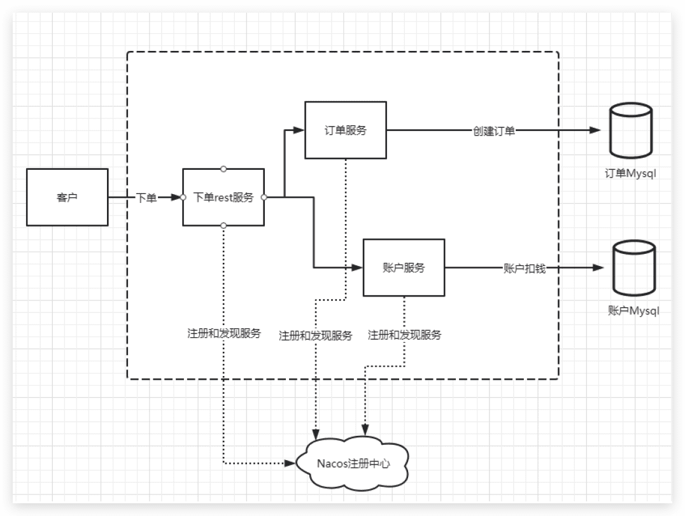
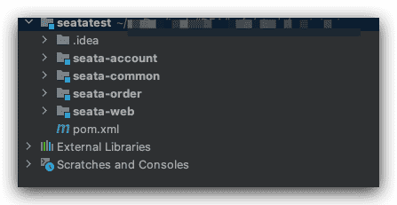
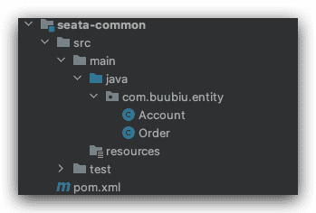
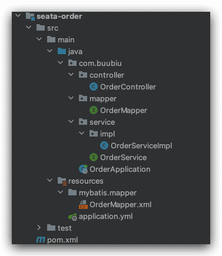
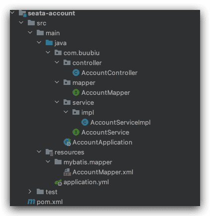
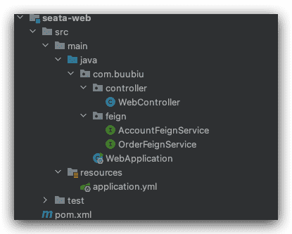

# 分布式基础案例搭建

## 背景

我们模拟一个简单下单业务，客户端调用rest对外服务，rest服务再调用订单服务实现创建订单和账户服

务实现账户扣钱操作，最终来完整下单业务；

## 案例架构设计

所有服务都注册到nacos中，方便feign远程调用；订单服务，账户服务各自有独立数据库；架构设计如

下图：



整体项目结构如下图：



- `seatatest` 是父项目，主要是做一些依赖管理，依赖版本管理，管理所有子module项目；

- `seata-common` 子项目，主要是引入其他子项目需要的公共依赖，以及公共实体，工具类，配置类的统

一封装；

- `seata-order` 子项目，主要提供订单服务，生成订单；

- `seata-account` 子项目，主要提供账户服务，根据订单扣钱操作；

- `seata-web` 子项目，主要处理客户端下单请求，feign远程调用order，和account服务接口，最终完成

下单处理；

## 数据库设计

我们新建两个数据库，分别是`db_order` （订单数据库）， `db_account` （账户数据库），

`db_order` 数据库里面新建表`t_order` 订单表：

```sql
CREATE TABLE `t_order` (
`id` int(11) NOT NULL AUTO_INCREMENT,
`orderNo` varchar(100) DEFAULT NULL,
`userId` int(11) DEFAULT NULL,
`count` int(11) DEFAULT NULL,
`amount` int(11) DEFAULT NULL,
`remark` varchar(100) DEFAULT NULL,
PRIMARY KEY (`id`)
) ENGINE=InnoDB AUTO_INCREMENT=21 DEFAULT CHARSET=utf8
```

`db_account` 数据库里面新建表`t_account` 用户账户表：

```sql
CREATE TABLE `t_account` (
`id` int(11) NOT NULL AUTO_INCREMENT,
`userId` int(11) DEFAULT NULL,
`balance` int(11) DEFAULT NULL,
`remark` varchar(100) DEFAULT NULL,
PRIMARY KEY (`id`)
) ENGINE=InnoDB AUTO_INCREMENT=3 DEFAULT CHARSET=utf8
```

插入数据：

```sql
insert into `t_account` (`id`, `userId`, `balance`, `remark`)
values('1','1','2000','jack的账户');
insert into `t_account` (`id`, `userId`, `balance`, `remark`)
values('2','2','1000','marry的账户');
```

## 项目搭建 

### seatatest父项目搭建

seatatest是父项目，主要是做一些依赖管理，依赖版本管理，管理所有子module项目；

注意，它的`packaging` 类型是`pom`

pom.xml：

```xml
<?xml version="1.0" encoding="UTF-8"?>
<project xmlns="http://maven.apache.org/POM/4.0.0"
  xmlns:xsi="http://www.w3.org/2001/XMLSchema-instance"
  xsi:schemaLocation="http://maven.apache.org/POM/4.0.0 http://maven.apache.org/xsd/maven-4.0.0.xsd">
  <modelVersion>4.0.0</modelVersion>

  <groupId>com.buubiu</groupId>
  <artifactId>seatatest</artifactId>
  <packaging>pom</packaging>
  <version>1.0-SNAPSHOT</version>

  <properties>
    <project.build.sourceEncoding>UTF-8</project.build.sourceEncoding>
    <maven.compiler.source>8</maven.compiler.source>
    <maven.compiler.target>8</maven.compiler.target>
    <druid.version>1.1.10</druid.version>
    <spring-cloud.version>Hoxton.SR8</spring-cloud.version>
    <springboot.version>2.3.2.RELEASE</springboot.version>
    <springcloudalibaba.version>2.2.4.RELEASE</springcloudalibaba.version>
    <fastjson.version>1.2.73</fastjson.version>
    <commons-lang3.version>3.10</commons-lang3.version>
    <mybatis.version>2.1.0</mybatis.version>
  </properties>

  <dependencyManagement>
    <dependencies>
      <dependency>
        <groupId>org.springframework.cloud</groupId>
        <artifactId>spring-cloud-dependencies</artifactId>
        <version>${spring-cloud.version}</version>
        <type>pom</type>
        <scope>import</scope>
      </dependency>
      <dependency>
        <groupId>org.springframework.boot</groupId>
        <artifactId>spring-boot-dependencies</artifactId>
        <version>${springboot.version}</version>
        <type>pom</type>
        <scope>import</scope>
      </dependency>
      <dependency>
        <groupId>com.alibaba.cloud</groupId>
        <artifactId>spring-cloud-alibaba-dependencies</artifactId>
        <version>${springcloudalibaba.version}</version>
        <type>pom</type>
        <scope>import</scope>
      </dependency>
      <!-- 连接池 -->
      <dependency>
        <groupId>com.alibaba</groupId>
        <artifactId>druid</artifactId>
        <version>${druid.version}</version>
      </dependency>
      <dependency>
        <groupId>com.alibaba</groupId>
        <artifactId>fastjson</artifactId>
        <version>${fastjson.version}</version>
      </dependency>
      <dependency>
        <groupId>org.apache.commons</groupId>
        <artifactId>commons-lang3</artifactId>
        <version>${commons-lang3.version}</version>
      </dependency>
      <dependency>
        <groupId>org.mybatis.spring.boot</groupId>
        <artifactId>mybatis-spring-boot-starter</artifactId>
        <version>${mybatis.version}</version>
      </dependency>
    </dependencies>
  </dependencyManagement>

</project>
```

### seata-common子项目搭建

`seata-common` 子项目，主要是引入其他子项目需要的公共依赖，以及公共实体，工具类，配置类的统

一封装；

项目结构：



### seata-order子项目搭建

`seata-order` 子项目，主要提供订单服务，生成订单；

项目结构：



```yaml application.yml
server:
  port: 8081
  servlet:
    context-path: /

mybatis:
  mapper-locations: classpath:mybatis/mapper/*.xml

spring:
  application:
    name: seata-order
  datasource:
    type: com.alibaba.druid.pool.DruidDataSource
    driver-class-name: com.mysql.jdbc.Driver
    url: jdbc:mysql://localhost:3306/db_order?serverTimezone=Asia/Shanghai
    username: root
    password: root
  cloud:
    nacos:
      discovery:
        server-addr: 127.0.0.1:8848
```

### seata-account子项目搭建

`seata-account `子项目，主要提供账户服务，根据订单扣钱操作；

项目结构：



```yaml application.yml
server:
  port: 8082
  servlet:
    context-path: /

mybatis:
  mapper-locations: classpath:mybatis/mapper/*.xml

spring:
  application:
    name: seata-account
  datasource:
    type: com.alibaba.druid.pool.DruidDataSource
    driver-class-name: com.mysql.jdbc.Driver
    url: jdbc:mysql://localhost:3306/db_order?serverTimezone=Asia/Shanghai
    username: root
    password: root
  cloud:
    nacos:
      discovery:
        server-addr: 127.0.0.1:8848
```


### seata-web子项目搭建

`seata-web` 子项目，主要处理客户端下单请求，feign远程调用order，和account服务接口，最终完成

下单处理；

项目结构：



```yaml application.yml
server:
  port: 80
  servlet:
    context-path: /
spring:
  application:
    name: seata-web
  cloud:
    nacos:
      discovery:
        server-addr: 127.0.0.1:8848
```
