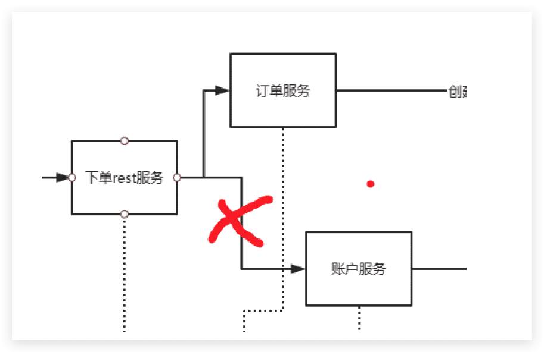
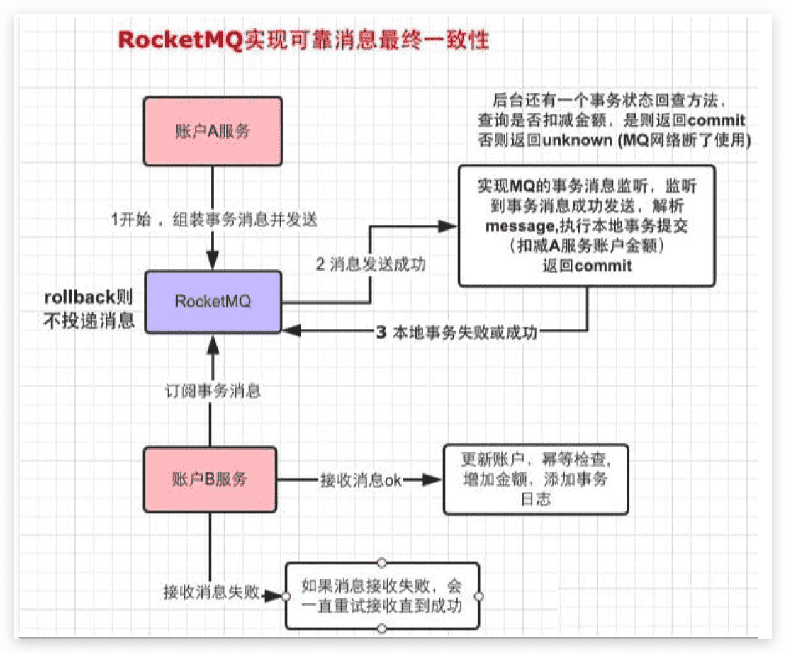
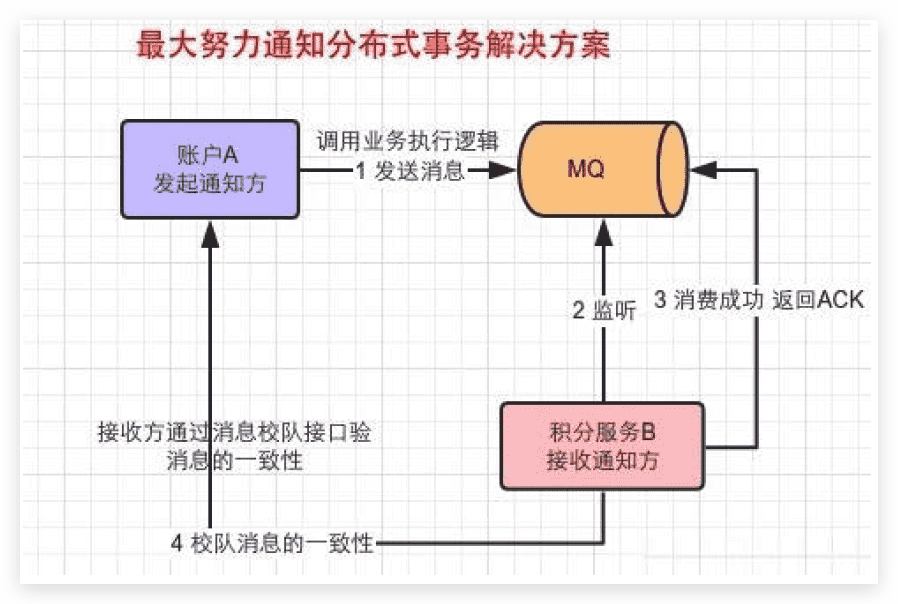
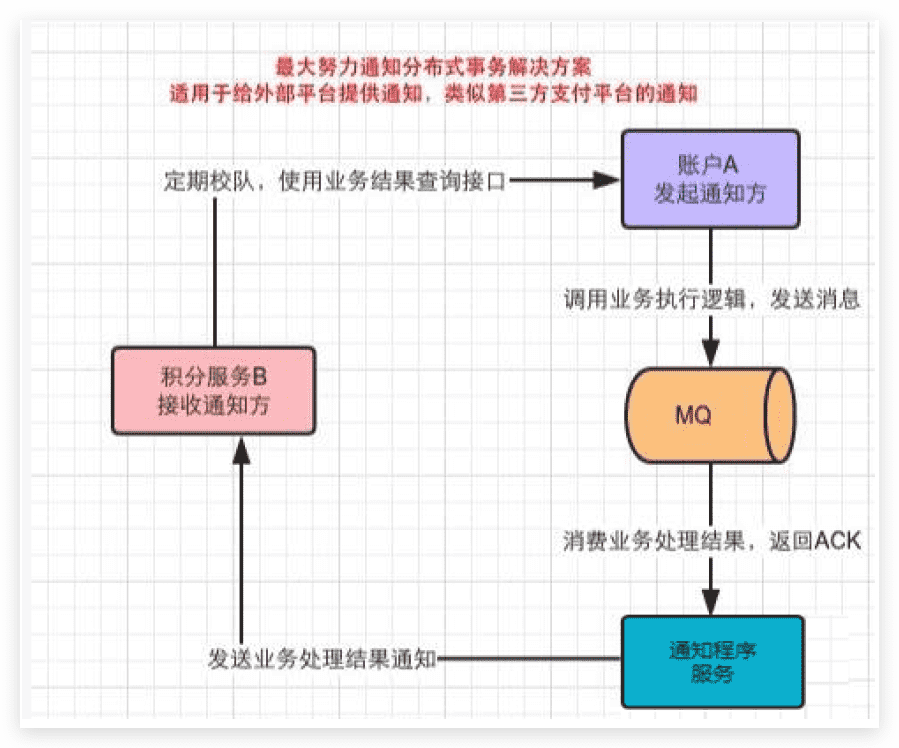
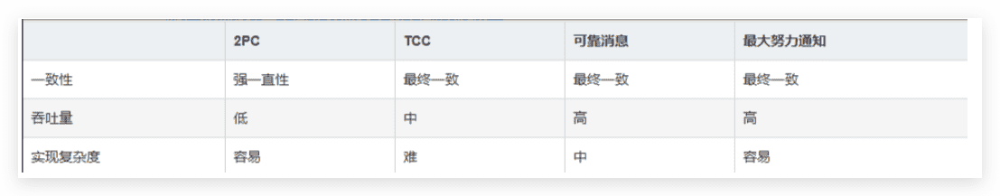

# 分布式事务常见解决方案

## 分布式事务问题模拟

当多个服务调用过程中，其中一个或者多个服务执行失败，出现异常情况的时候，导致数据不一致性，

这样就出现了分布式事务问题；

我们来模拟下这个问题，我们运行过程中，让账户扣钱操作执行失败；



我们修改`seata-account `里面`AccountController` 类的`decrease` 方法：

```java
/**
	 * 给指定用户账户扣钱
	 * @param amount
	 * @param userId
	 * @return
	 */
	@PostMapping("/decrease")
	public boolean decrease(@RequestParam("amount")Integer amount,@RequestParam("userId")Integer userId) throws Exception{
		System.out.println("amount:"+amount+",userId:"+userId);

		if(userId==null || userId==1){
			throw new Exception("模拟异常");
		}

		Map<String,Object> map=new HashMap<>();
		map.put("amount",amount);
		map.put("userId",userId);
		accountService.decrease(map);
		return true;
	}
```

当userId=1的时候，模拟抛出异常，这时候我们去查看数据库发现，t_order表有数据，订单已经生成了；

再看t_account表，数据没变化；

这样的话，就导致了业务上的数据不一致性问题，也就是分布式事务问题，我们需要解决这个问题；

## 分布式事务常见解决方案

### CAP理论

CAP理论：一个分布式系统不可能同时满足一致性，可用性和分区容错性这个三个基本需求，最多只能

同时满足其中两项

- 一致性(C)：数据在多个副本之间是否能够保持一致的特性。

-  可用性(A)：是指系统提供的服务必须一致处于可用状态，对于每一个用户的请求总是在有限的时间内返

  回结果，超过时间就认为系统是不可用的

- 分区容错性(P)：分布式系统在遇到任何网络分区故障的时候，仍然需要能够保证对外提供满足一致性和

  可用性的服务，除非整个网络环境都发生故障。

#### CAP定理的应用

1. 放弃P(CA)：如果希望能够避免系统出现分区容错性问题，一种较为简单的做法就是将所有的数据(或者

   是与事物相关的数据)都放在一个分布式节点上，这样虽然无法保证100%系统不会出错，但至少不会

   碰到由于网络分区带来的负面影响

2. 放弃A(CP):其做法是一旦系统遇到网络分区或其他故障时，那受到影响的服务需要等待一定的时间，应

   用等待期间系统无法对外提供正常的服务，即不可用

3. 放弃C(AP):这里说的放弃一致性，并不是完全不需要数据一致性，是指放弃数据的强一致性，保留数据

   的最终一致性

### BASE理论

BASE是基本可用，软状态，最终一致性。是对CAP中一致性和可用性权限的结果，是基于CAP定理演化而来的，核心思想是即使无法做到强一致性，但每个应用都可以根据自身的业务特定，采用适当的方式来使系统达到最终一致性

### 2PC提交

二阶段提交协议是将事务的提交过程分成提交事务请求和执行事务提交两个阶段进行处理。

#### 阶段一：提交事务请求

- **事务询问**：协调者向所有参与者发送事务内容，询问是否可以执行事务提交操作，并开始等待各参与者的响应。

- **执行事务**：各参与者节点执行事务操作，并将Undo和Redo信息记录到事务日志中。
- **反馈响应**：
  - 如果参与者成功执行事务操作，则向协调者反馈"Yes"响应，表示事务可以提交。
  - 如果参与者未能成功执行事务操作，则向协调者反馈"No"响应，表示事务不能提交。
- **投票阶段**：二阶段提交的第一阶段也称为投票阶段，即各参与者通过投票表明是否可以继续执行后续的事务提交操作。

#### 阶段二：执行事务提交

1. **决策提交**：如果协调者从所有参与者获得的反馈均为"Yes"响应，则决定执行事务提交。
2. **发送提交请求**：协调者向所有参与者节点发送Commit请求。
3. **事务提交**：参与者接收到Commit请求后，正式执行事务提交操作，并在完成提交后释放事务执行期间占用的资源。
4. **反馈提交结果**：参与者在完成事务提交后，向协调者发送ACK消息，确认提交完成。
5. **完成事务**：协调者接收到所有参与者反馈的ACK消息后，正式完成事务。

#### 中断事务

1. **决策中断**：如果任何一个参与者向协调者反馈了"No"响应，或者在等待超时后，协调者仍未收到所有参与者的反馈响应，则决定中断事务。
2. **发送回滚请求**：协调者向所有参与者节点发送Rollback请求。
3. **事务回滚**：参与者接收到Rollback请求后，利用其在阶段一中记录的Undo信息执行事务回滚操作，并在完成回滚后释放事务执行期间占用的资源。
4. **反馈回滚结果**：参与者在完成事务回滚后，向协调者发送ACK消息，确认回滚完成。
5. **中断事务**：协调者接收到所有参与者反馈的ACK消息后，正式完成事务中断。

#### 优缺点

- 优点：原理简单，实现方便

- 缺点：同步阻塞，单点问题，脑裂，保守

### 3PC提交

- 三阶段提交，也叫三阶段提交协议，是二阶段提交（2PC）的改进版本。
- 与两阶段提交不同的是，三阶段提交有两个改动点。
  - 引入超时机制：同时在协调者和参与者中都引入超时机制。
  - 在第一阶段和第二阶段中插入一个准备阶段：保证了在最后提交阶段之前各参与节点的状态是一致的。
- 三阶段提交就有CanCommit、PreCommit、DoCommit三个阶段。

#### 阶段一：CanCommit（预提交询问）

1. **事务询问**：协调者向所有参与者发送CanCommit请求，询问是否可以执行事务提交操作。
2. **参与者反馈**：
   - 如果参与者能够执行事务，则反馈"Yes"响应。
   - 如果参与者无法执行事务，则反馈"No"响应。
3. **协调者决策**：
   - 如果所有参与者都反馈"Yes"，则进入下一阶段。
   - 如果有任何一个参与者反馈"No"，则中断事务。

#### 阶段二：PreCommit（预提交）

1. **发送预提交请求**：协调者向所有参与者发送PreCommit请求，通知参与者准备提交事务。
2. **参与者执行预提交**：
   - 参与者执行事务操作，并将Undo和Redo信息记录到事务日志中。
   - 参与者反馈"Ack"响应，表示已准备好提交。
3. **协调者等待**：协调者等待所有参与者的"Ack"响应。
   - 如果所有参与者都反馈"Ack"，则进入下一阶段。
   - 如果等待超时或收到"No"响应，则中断事务。

#### 阶段三：DoCommit（正式提交）

1. **发送提交请求**：协调者向所有参与者发送DoCommit请求，通知参与者正式提交事务。
2. **参与者提交事务**：
   - 参与者正式提交事务，并释放事务占用的资源。
   - 参与者反馈"Ack"响应，表示事务已提交。
3. **协调者完成事务**：协调者收到所有参与者的"Ack"响应后，完成事务。

#### 中断事务

如果在任何阶段中，协调者收到"No"响应或等待超时，协调者会向所有参与者发送中断请求（Abort），参与者会根据日志回滚事务，并释放资源。

### TCC分布式事务

#### 定义

- TCC是服务化的两阶段编程模型，其Try、Confirm、Cancel，3个方法均由业务编码实现

- TCC要求每个分支事务实现三个操作：预处理Try,确认Confirm,撤销Cancel。

- Try操作做业务检查及资源预留,

- Confirm做业务确认操作

- Cancel实现一个与Try相反的操作即回滚操作。

- TM首先发起所有的分支事务Try操作，任何一个分支事务的Try操作执行失败，TM将会发起所有分支事务的Cancel操作，若Try操作全部成功，TM将会发起所有分支事务的Confirm操作,其中Confirm/Cancel操作若执行失败,TM会进行重试。

#### TCC的三个阶段

- Try阶段是做业务检查(一致性)及资源预留(隔离),此阶段仅是一个初步操作，它和后续的Confirm一起才能构成一个完整的业务逻辑

- Confirm阶段是做确认提交，Try阶段所有分支事务执行成功后开始执行Confirm，通常情况下，采用TCC则认为Confirm阶段是不会出错的,即：只要Try成功，Confirm一定成功，若Confirm阶段真的出错，需要引入重试机制或人工处理

- Cancel阶段是在业务执行错误需要回滚到状态下执行分支事务的取消，预留资源的释放，通常情况下，采用TCC则认为Cancel阶段也一定是真功的,若Cance阶段真的出错，需要引入重试机制或人工处理

- TM事务管理器：TM事务管理器可以实现为独立的服务，也可以让全局事务发起方充当TM的角色,TM独立出来是为了公用组件，是为了考虑系统结构和软件的复用

- TM在发起全局事务时生成全局事务记录，全局事务ID贯穿整个分布式事务调用链条，用来记录事务上下文，追踪和记录状态，用于Confirm和cacel失败需要进行重试,因此需要实现幂等

#### TCC的三种异常处理情况

##### 幂等处理

- 因为网络抖动等原因，分布式事务框架可能会重复调用同一个分布式事务中的一个分支事务的二阶段接口。所以分支事务的二阶段接口Confirm/Cancel需要能够保证幂等性。如果二阶段接口不能保证幂等性，则会产生严重的问题，造成资源的重复使用或者重复释放，进而导致业务故障。
- 对于幂等类型的问题，通常的手段是引入幂等字段进行防重放攻击。对于分布式事务框架中的幂等问题，同样可以祭出这一利器。

- 幂等记录的插入时机是参与者的Try方法，此时的分支事务状态会被初始化为INIT。然后当二阶段的Confirm/Cancel执行时会将其状态置为CONFIRMED/ROLLBACKED。

- 当TC重复调用二阶段接口时，参与者会先获取事务状态控制表的对应记录查看其事务状态。如果状态已经为CONFIRMED/ROLLBACKED，那么表示参与者已经处理完其分内之事，不需要再次执行，可以直接返回幂等成功的结果给TC，帮助其推进分布式事务。

##### 空回滚

- 当没有调用参与方Try方法的情况下，就调用了二阶段的Cancel方法，Cancel方法需要有办法识别出此时Try有没有执行。如果Try还没执行，表示这个Cancel操作是无效的，即本次Cancel属于空回滚；如果Try已经执行，那么执行的是正常的回滚逻辑。
- 要应对空回滚的问题，就需要让参与者在二阶段的Cancel方法中有办法识别到一阶段的Try是否已经执行。很显然，可以继续利用事务状态控制表来实现这个功能。
- 当Try方法被成功执行后，会插入一条记录，标识该分支事务处于INIT状态。所以后续当二阶段的Cancel方法被调用时，可以通过查询控制表的对应记录进行判断。如果记录存在且状态为INIT，就表示一阶段已成功执行，可以正常执行回滚操作，释放预留的资源；如果记录不存在则表示一阶段未执行，本次为空回滚，不释放任何资源。

##### 资源悬挂

问题：TC回滚事务调用二阶段完成空回滚后，一阶段执行成功

解决：事务状态控制记录作为控制手段，二阶段发现无记录时插入记录，一阶段执行时检查记录是否存在

#### TCC和2PC比较

- 2PC通常都是在跨库的DB层面，而TCC则在应用层面处理，需要通过业务逻辑实现，这种分布式事务的实现方式优势在于，可以让应用自己定义数据操作的粒度，使得降低锁冲突，提高吞吐量成为可能

- 而不足之处则在于对应用的侵入性非常强，业务逻辑的每个分支都需要实现Try，confirm,cancel三个操作。此外，其实现难度也比较大，需要按照网络状态，系统故障的不同失败原因实现不同的回滚策略

### 消息队列实现可靠消息最终一致性

- 可靠消息最终一致性就是保证消息从生产方经过消息中间件传递到消费方的一致性

- RocketMQ主要解决了两个功能：本地事务与消息发送的原子性问题。事务参与方接收消息的可靠性

- 可靠消息最终一致性事务适合执行周期长且实时性要求不高的场景，引入消息机制后，同步的事务操作变为基于消息执行的异步操作，避免分布式事务中的同步阻塞操作的影响，并实现了两个服务的解耦



### 最大努力通知

#### 最大努力通知与可靠消息一致性有什么不同

- 可靠消息一致性，发起通知方需要保证将消息发出去，并且将消息发送到接收通知方，消息的可靠性由发起通知方保证

- 最大努力通知，发起通知方尽最大的努力将业务处理结果通知为接收通知方，但是消息可能接收不到，此时需要接收通知方主动调用发起通知方的接口查询业务，通知可靠性关键在于接收通知方

#### 两者的应用场景

- 可靠消息一致性关注的是交易过程的事务一致，以异步的方式完成交易

- 最大努力通知关注的是交易后的通知事务，即将交易结果可靠的通知出去

#### 基于MQ的ack机制实现最大努力通知

##### 方案一：



- 利用MQ的ack机制由MQ向接收通知方发送消息通知，发起方将普通消息发送到MQ

- 接收通知监听MQ，接收消息，业务处理完成回应ACK

- 接收通知方如果没有回应ACK则MQ会重复通知，按照时间间隔的方式，逐步拉大通知间隔

- 此方案适用于内部微服务之间的通知，不适应与通知外部平台

##### 方案二：

增加一个通知服务区进行通知，提供外部第三方时适用



## 分布式事务方案对比分析

- 2PC 最大的一个诟病是一个阻塞协议。RM在执行分支事务后需要等待TM的决定，此时服务会阻塞锁定资源。由于其阻塞机制和最差时间复杂度高，因此，这种设计不能适应随着事务涉及的服务数量增加而扩展的需要，很难用于并发较高以及子事务生命周期较长的分布式服务中

- 如果拿TCC事务的处理流程与2PC两阶段提交做比较，2PC通常都是在跨库的DB层面，而TCC则在应用层面处理，需要通过业务逻辑来实现。这种分布式事务的优势在于，可以让应用自定义数据操作的粒度，使得降低锁冲突，提高吞吐量成为可能。而不足之处在于对应用的侵入性非常强，业务逻辑的每个分支都需要实现三个操作。此外，其实现难度也比较大，需要按照网络状态，系统故障等不同失败原因实现不同的策略。

- 可靠消息最终一致性事务适合执行周期长且实时性要求不高的场景。引入消息机制后，同步的事务操作变为基于消息执行的异步操作，避免了分布式事务中的同步阻塞操作的影响，并实现了两个服务的解耦，典型的场景：注册送积分，登陆送优惠券等

- 最大努力通知是分布式事务中要求最低的一种，适用于一些最终一致性时间敏感度低的业务，允许发起通知方业务处理失败，在接收通知方收到通知后积极进行失败处理，无论发起通知方如何处理结果都不会影响到接收通知方的后续处理，发起通知方需提供查询执行情况接口，用于接收通知方校对结果，典型的应用场景：银行通知，支付结果通知等。


