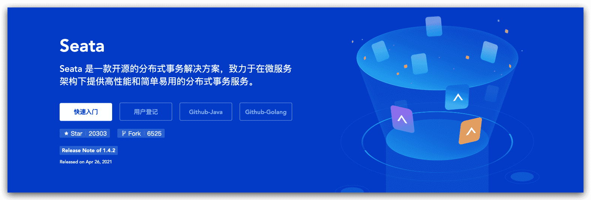

# Seata与事务简介

## Seata 是什么?

Seata 是一款开源的分布式事务解决方案，致力于提供高性能和简单易用的分布式事务服务。Seata 将为用户提供了 AT、TCC、SAGA 和 XA 事务模式，为用户打造一站式的分布式解决方案。

中文官方站点：https://seata.io/zh-cn/

seata github开源地址：https://github.com/seata

## 分布式事务简介

### 本地事务

在计算机系统中，更多的是通过关系型数据库来控制事务，这是利用数据库本身的事务特性来实现的，

因此叫数据库事务，由于应用主要靠关系数据库来控制事务，而数据库通常和应用在同一个服务器，所

以基于关系型数据库的事务又被称为本地事务。

数据库事务的四大特性：`ACID`

- **A（Atomic）**：原子性，构成事务的所有操作，要么都执行完成，要么全部不执行，不可能出现部分成

功部分失败的情况。

- **C（Consistency）**：一致性，在事务执行前后，数据库的一致性约束没有被破坏。比如：张三向李四转

100 元，转账前和转账后的数据是正确状态这叫一致性，如果出现张三转出 100 元，李四账户没有增加

100 元这就出现了数 据错误，就没有达到一致性。

- **I（Isolation）**：隔离性，数据库中的事务一般都是并发的，隔离性是指并发的两个事务的执行互不干

扰，一个事务不能看到其他事务的运行过程的中间状态。通过配置事务隔离级别可以比避免脏读、重复

读问题。

- **D（Durability）**：持久性，事务完成之后，该事务对数据的更改会持久到数据库，且不会被回滚。

数据库事务在实现时会将一次事务的所有操作全部纳入到一个不可分割的执行单元，该执行单元的所有

操作要么都成功，要么都失败，只要其中任一操作执行失败，都将导致整个事务的回滚。

### 分布式事务

随着互联网的快速发展，软件系统由原来的单体应用转变为分布式应用

分布式系统会把一个应用系统拆分为可独立部署的多个服务，因此需要服务与服务之间远程协作才能完

成事务操作，这种分布式系统环境下由不同的服务之间通过网络远程协作完成事务称之为**分布式事务**，

例如用户注册送积分事务、创建订单减库存事务，银行转账事务等都是分布式事务。
