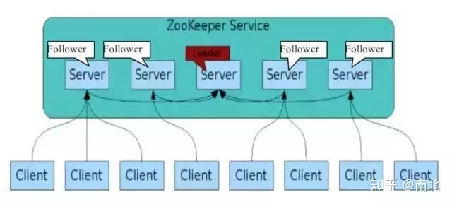

# Zookeeper的集群

## 简介

### 概念

集群(cluster)：集合同一种软件服务的多个节点同时提供服务。

### 解决的问题

- 解决了单节点的并发访问的压力问题
- 解决了单节点故障问题（如硬件老化、自然灾害等）

## 集群架构

zk集群节点有两种角色：

- `leader`：领导节点，zk集群中的主节点

- `follower`：仲裁节点，除了主节点之外的节点



## 集群搭建

这里在一台机器上模拟三台机器

1. 创建三个dataDir

```shell
[root@localhost ~]# mkdir zkdata1 zkdata2 zkdata3
```

2. 分别在三个dataDir目录下面创建myid文件，并且依次赋值为1，2，3

   **myid的内容：是服务器的标识**

```shell
[root@localhost ~]# touch zkdata1/myid zkdata2/myid zkdata3/myid
[root@localhost ~]# echo "1" >> zkdata1/myid
[root@localhost ~]# echo "2" >> zkdata2/myid
[root@localhost ~]# echo "3" >> zkdata3/myid
```

3. 在/conf目录下创建三个zk配置文件，分别为zoo1.cfg，zoo2.cfg，zoo3.cfg

   参数说明：

   - server.X：x为服务器的唯一标识
   - 192.168.91.4：服务器所在的ip地址
   - 3002,4002,5002：数据同步使用的端口
   - 3003,4003,5003：选举使用的端口

- zoo1.cfg

  `vi /root/zkdata1/zoo1.cfg`

  ```properties
  tickTime=2000
  initLimit=10
  syncLimit=5
  dataDir=/root/zkdata1
  clientPort=3001
  server.1=192.168.91.4:3002:3003
  server.2=192.168.91.4:4002:4003
  server.3=192.168.91.4:5002:5003
  ```

- zoo2.cfg

  `vi /root/zkdata2/zoo2.cfg`

  ```properties
  tickTime=2000
  initLimit=10
  syncLimit=5
  dataDir=/root/zkdata2
  clientPort=4001
  server.1=192.168.91.4:3002:3003
  server.2=192.168.91.4:4002:4003
  server.3=192.168.91.4:5002:5003
  ```

- zoo3.cfg

  `vi /root/zkdata3/zoo3.cfg`

  ```properties
  tickTime=2000
  initLimit=10
  syncLimit=5
  dataDir=/root/zkdata3
  clientPort=5001
  server.1=192.168.91.4:3002:3003
  server.2=192.168.91.4:4002:4003
  server.3=192.168.91.4:5002:5003
  ```

4. 分别启动各个zk服务器

```shell
[root@localhost apache-zookeeper-3.7.0]# ./bin/zkServer.sh start /root/zkdata1/zoo1.cfg
ZooKeeper JMX enabled by default
Using config: /root/zkdata1/zoo1.cfg
Starting zookeeper ... STARTED
[root@localhost apache-zookeeper-3.7.0]# ./bin/zkServer.sh start /root/zkdata2/zoo2.cfg
ZooKeeper JMX enabled by default
Using config: /root/zkdata2/zoo2.cfg
Starting zookeeper ... STARTED
[root@localhost apache-zookeeper-3.7.0]# ./bin/zkServer.sh start /root/zkdata3/zoo3.cfg
ZooKeeper JMX enabled by default
Using config: /root/zkdata3/zoo3.cfg
Starting zookeeper ... STARTED
[root@localhost apache-zookeeper-3.7.0]# jps
2386 Jps
2325 QuorumPeerMain
2186 QuorumPeerMain
2251 QuorumPeerMain
[root@localhost apache-zookeeper-3.7.0]#
```

5. 查看各个zk服务器的角色信息

```shell
[root@localhost apache-zookeeper-3.7.0]# ./bin/zkServer.sh status /root/zkdata1/zoo1.cfg
ZooKeeper JMX enabled by default
Using config: /root/zkdata1/zoo1.cfg
Client port found: 3001. Client address: localhost. Client SSL: false.
Mode: follower
[root@localhost apache-zookeeper-3.7.0]# ./bin/zkServer.sh status /root/zkdata2/zoo2.cfg
ZooKeeper JMX enabled by default
Using config: /root/zkdata2/zoo2.cfg
Client port found: 4001. Client address: localhost. Client SSL: false.
Mode: leader
[root@localhost apache-zookeeper-3.7.0]# ./bin/zkServer.sh status /root/zkdata3/zoo3.cfg
ZooKeeper JMX enabled by default
Using config: /root/zkdata3/zoo3.cfg
Client port found: 5001. Client address: localhost. Client SSL: false.
Mode: follower
[root@localhost apache-zookeeper-3.7.0]#
```

6. 客户端连接任意zk服务器进行节点操作

```shell
[root@localhost apache-zookeeper-3.7.0]# ./bin/zkCli.sh -server 192.168.91.4:3001
[root@localhost apache-zookeeper-3.7.0]# ./bin/zkCli.sh -server 192.168.91.4:4001
[root@localhost apache-zookeeper-3.7.0]# ./bin/zkCli.sh -server 192.168.91.4:5001
```

7. 停止特定zk服务器

```shell
[root@localhost apache-zookeeper-3.7.0]# ./bin/zkServer.sh stop /root/zkdata2/zoo2.cfg
```

## Java客户端操作zk集群

```java
package com.buubiu.test;

import com.buubiu.entity.User;
import java.io.IOException;
import java.util.Date;
import java.util.List;
import org.I0Itec.zkclient.IZkChildListener;
import org.I0Itec.zkclient.IZkDataListener;
import org.I0Itec.zkclient.ZkClient;
import org.I0Itec.zkclient.serialize.SerializableSerializer;
import org.apache.zookeeper.CreateMode;
import org.apache.zookeeper.data.Stat;
import org.junit.After;
import org.junit.Before;
import org.junit.Test;

/**
 * @author buubiu
 **/
public class TestZKClient {

	private ZkClient zkClient;

	/**
	 * 初始化客户端对象
	 */
	@Before
	public void before() {
		/**
		 * 参数1：zkserver服务器的ip地址和端口号
		 * 参数2：会话超时时间 毫秒
		 * 参数3：连接超时时间 毫秒
		 * 参数4：序列化方式 我们创建的对象是怎么样的方式存储在zk中的，一般采用zk提供的jdk的方式 new SerializableSerializer()
		 */
		zkClient = new ZkClient("192.168.91.4:3001,192.168.91.4:4001,192.168.91.4:5001", 60000 * 30, 60000, new SerializableSerializer());
	}

	/**
	 * 释放资源
	 */
	@After
	public void after() throws InterruptedException {
		//Thread.sleep(5000);
		zkClient.close();
	}
}

```


