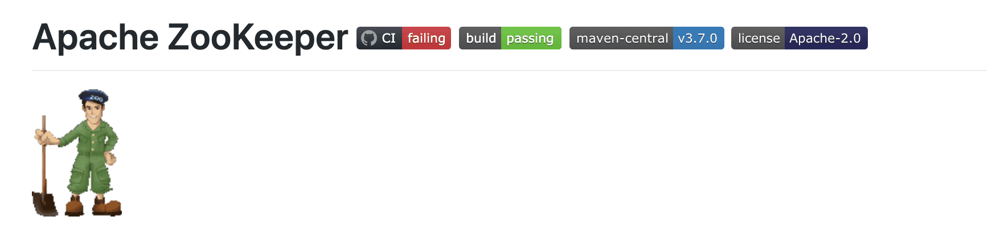
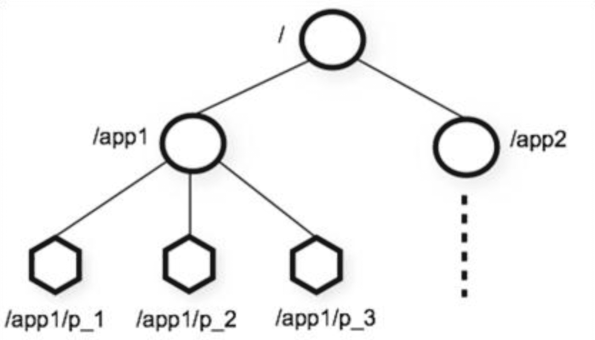

# Zookeeper简介

## ZK简介

Zookeeper(动物园管理者)简称**ZK，一个分布式的，开放源码的分布式应用协调服务**，是Google的Chubby一个开源的实现，是Hadoop和Hbase的重要组件，Zookeeper使用Java编写，但支持java和C两种编程语言。

## ZK内存数据模型

### 模型结构

### 模型的特点

- 每个子目录如`/app1`都被称作一个`znode(节点)`。这个`znode`是被它所在的路径唯一标识
- `znode`可以有子节点目录，并且每个`znode`**可以存储数据**
- `znode`是**有版本的**，每个`znode`中存储的数据可以有多个版本，也就是一个访问路径中可以存储多份数据
- `znode`**可以被监控**，包括这个目录节点中存储的数据的修改，子节点目录的变化等，一旦变化可以通知设置监控的客户端

## ZK节点的分类

### 持久节点(PERSISTENT)

是指在节点创建后，就一直存在，直到有删除操作来主动删除这个节点，不会因为创建该节点的客户端会话失效而消失。

### 持久顺序节点(PERSISTENT_SEQUENTIAL)

这类节点的基本特性和上面的节点类型是一致的。额外的特性是，在ZK中，每个父节点会为他的第一级子节点维护一份时序，会记录每个子节点创建的先后顺序。基于这个特性，在创建子节点的时候，可以设置这个属性，那么在创建节点的过程中，ZK会自动为给定节点名加上一个数字后缀，作为新的节点名。这个数字后缀的范围是整形的最大值。

### 临时节点(EPHEMERAL)

和持久化节点不同的是，临时节点的生命周期和客户端会话绑定。也就是说，如果客户端会话失效，那么这个节点就会自动被清除掉。注意，这里提到的是会话失效，而非连接断开。另外，在临时节点下面不能创建子节点。

### 临时顺序节点(EPHEMERAL_SEQUENTIAL)

具有临时节点特点额外的特性是，每个父节点会为它的第一级子节点维护一份时序，这点和刚才提到的持久顺序节点类似。