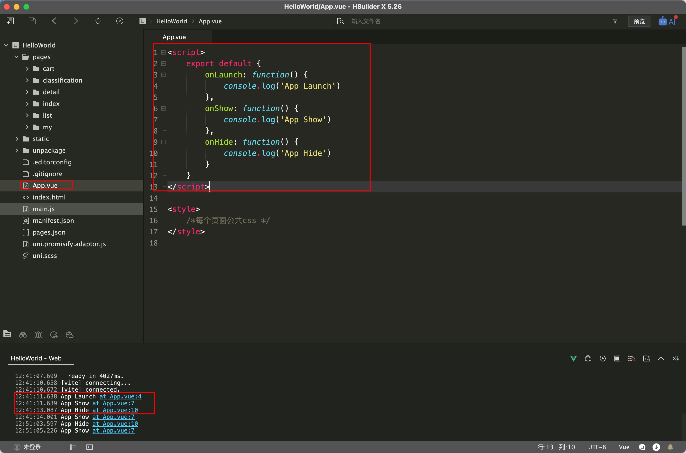
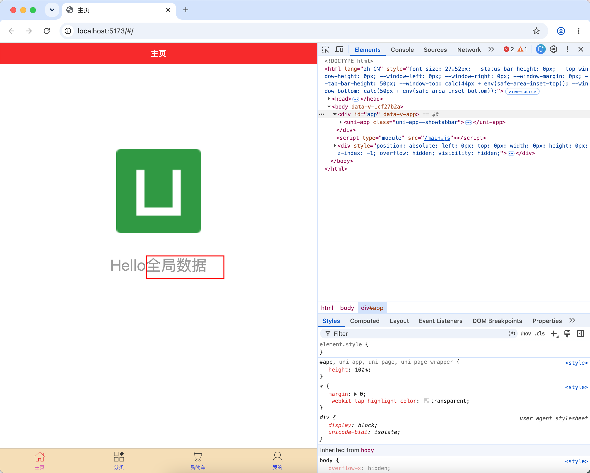
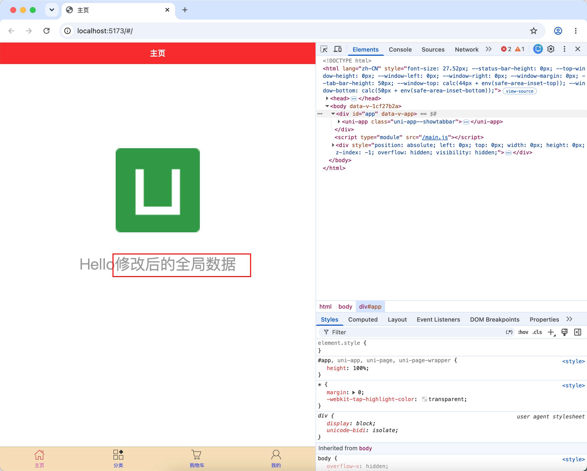
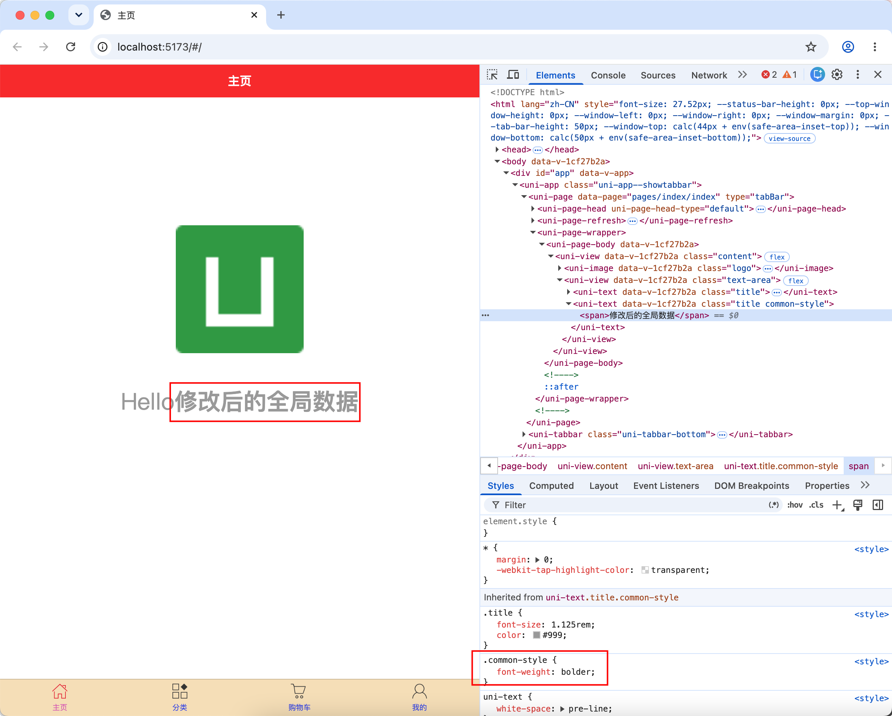
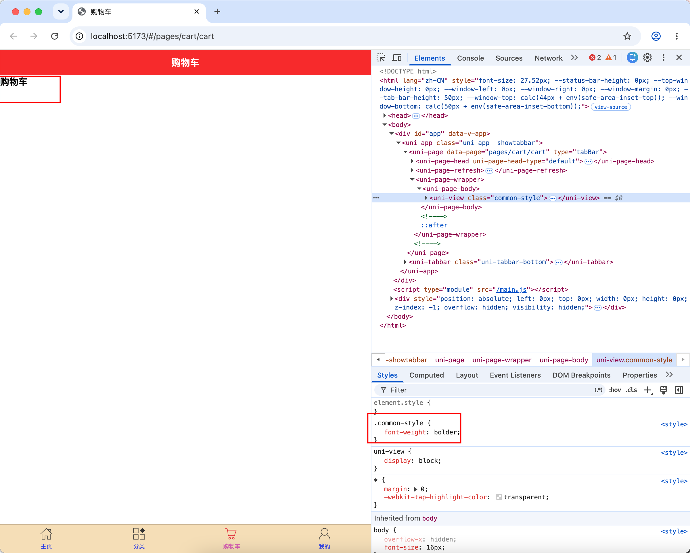

# App.vue使用

## 简介

`App.vue`是uni-app的主组件。uni-app js引擎版是app.vue。uni-app x是app.uvue。以下出现的`app.vue`一般泛指包含了`app.uvue`。

所有页面都是在`App.vue`下进行切换的，是应用入口文件。但`App.vue`本身不是页面，这里不能编写视图元素，也就是没有`<template>`。

这个文件的作用包括：监听应用生命周期、配置全局样式、配置全局的存储`globalData`

应用生命周期仅可在`App.vue`中监听，在页面监听无效。

## 应用生命周期

`uni-app` 支持如下应用生命周期函数：

| 函数名               | 说明                                                         | 平台兼容              |
| :------------------- | :----------------------------------------------------------- | :-------------------- |
| onLaunch             | 当`uni-app` 初始化完成时触发（全局只触发一次），参数为应用启动参数，同 [uni.getLaunchOptionsSync](https://uniapp.dcloud.net.cn/api/getLaunchOptionsSync.html#getlaunchoptionssync) 的返回值 |                       |
| onShow               | 当 `uni-app` 启动，或从后台进入前台显示，参数为应用启动参数，同 [uni.getLaunchOptionsSync](https://uniapp.dcloud.net.cn/api/getLaunchOptionsSync.html#getlaunchoptionssync) 的返回值 |                       |
| onHide               | 当 `uni-app` 从前台进入后台                                  |                       |
| onError              | 当 `uni-app` 报错时触发                                      | app-uvue 不支持       |
| onUniNViewMessage    | 对 `nvue` 页面发送的数据进行监听，可参考 [nvue 向 vue 通讯](https://uniapp.dcloud.io/tutorial/nvue-api?id=communication) | app-uvue 不支持       |
| onUnhandledRejection | 对未处理的 Promise 拒绝事件监听函数（2.8.1+）                | app-uvue 不支持       |
| onPageNotFound       | 页面不存在监听函数                                           | app-uvue 不支持       |
| onThemeChange        | 监听系统主题变化                                             | app-uvue 不支持       |
| onLastPageBackPress  | 最后一个页面按下Android back键，常用于自定义退出             | app-uvue-android 3.9+ |
| onExit               | 监听应用退出                                                 | app-uvue-android 3.9+ |

**注意**

- **应用生命周期仅可在`App.vue`中监听，在其它页面监听无效**。
- 以组合式 API 使用时，在 Vue2 和 Vue3 中存在一定区别，请分别参考：[Vue2 组合式 API 使用文档](https://uniapp.dcloud.net.cn/tutorial/vue-composition-api.html) 和 [Vue3 组合式 API 使用文档](https://uniapp.dcloud.net.cn/tutorial/vue3-composition-api.html)。
- 应用启动参数，可以在API `uni.getLaunchOptionsSync`获取，[详见](https://uniapp.dcloud.net.cn/api/getLaunchOptionsSync.html#getlaunchoptionssync)
- onlaunch里进行页面跳转，如遇白屏报错，请参考https://ask.dcloud.net.cn/article/35942
- `App.vue` 不能写模板
- onPageNotFound 页面实际上已经打开了（比如通过分享卡片、小程序码）且发现页面不存在，才会触发，api 跳转不存在的页面不会触发（如 uni.navigateTo）

### 示例

```vue [App.vue]
<script>
	export default {
		onLaunch: function() {
			console.log('App Launch')
		},
		onShow: function() {
			console.log('App Show')
		},
		onHide: function() {
			console.log('App Hide')
		}
	}
</script>
```



## globalData

小程序有globalData，这是一种简单的全局变量机制。这套机制在uni-app里也可以使用，并且全端通用。

当然vue框架的全局变量，另有其他方式定义。

### 示例

使用全局数据

::: code-group

```vue [App.vue] {12-14}
<script>
	export default {
		onLaunch: function() {
			console.log('App Launch')
		},
		onShow: function() {
			console.log('App Show')
		},
		onHide: function() {
			console.log('App Hide')
		},
		globalData: {
			text: '全局数据'
		}
	}
</script>

<style>
	/*每个页面公共css */
</style>

```

```vue [index.vue] {6,16,20}
<template>
	<view class="content">
		<image class="logo" src="/static/logo.png"></image>
		<view class="text-area">
			<text class="title">{{title}}</text>
			<text class="title">{{text}}</text>
		</view>
	</view>
</template>

<script>
	export default {
		data() {
			return {
				title: 'Hello',
				text: ''
			}
		},
		onLoad() {
			this.text = getApp().globalData.text;
		},
		methods: {

		}
	}
</script>

<style lang="scss">
	.content {
		display: flex;
		flex-direction: column;
		align-items: center;
		justify-content: center;
	}

	.logo {
		height: 200rpx;
		width: 200rpx;
		margin-top: 200rpx;
		margin-left: auto;
		margin-right: auto;
		margin-bottom: 50rpx;
	}

	.text-area {
		display: flex;
		justify-content: center;
	}

	.title {
		font-size: 36rpx;
		color: $uni-text-color-grey;
	}
</style>

```

:::



修改全局数据

```vue [index.vue] {20}
<template>
	<view class="content">
		<image class="logo" src="/static/logo.png"></image>
		<view class="text-area">
			<text class="title">{{title}}</text>
			<text class="title">{{text}}</text>
		</view>
	</view>
</template>

<script>
	export default {
		data() {
			return {
				title: 'Hello',
				text: ''
			}
		},
		onLoad() {
			getApp().globalData.text = '修改后的全局数据';
			this.text = getApp().globalData.text;
		},
		methods: {

		}
	}
</script>

<style lang="scss">
	.content {
		display: flex;
		flex-direction: column;
		align-items: center;
		justify-content: center;
	}

	.logo {
		height: 200rpx;
		width: 200rpx;
		margin-top: 200rpx;
		margin-left: auto;
		margin-right: auto;
		margin-bottom: 50rpx;
	}

	.text-area {
		display: flex;
		justify-content: center;
	}

	.title {
		font-size: 36rpx;
		color: $uni-text-color-grey;
	}
</style>

```



## 全局样式

在`App.vue`中，可以定义一些全局通用样式，例如需要加一个通用的背景色，首屏页面渲染的动画等都可以写在App.vue中。

注意如果工程下同时有vue和nvue文件，全局样式的所有css会应用于所有文件，而nvue支持的css有限，编译器会在控制台报警，提示某些css无法在nvue中支持。此时需要把nvue不支持的css写在单独的条件编译里。如：

```html
<style>
    /* #ifndef APP-PLUS-NVUE */
    @import './common/uni.css';
    /* #endif*/
</style>
```

### 示例

把字体加粗

::: code-group

```vue [App.vue] {18-23}
<script>
	export default {
		onLaunch: function() {
			console.log('App Launch')
		},
		onShow: function() {
			console.log('App Show')
		},
		onHide: function() {
			console.log('App Hide')
		},
		globalData: {
			text: '全局数据'
		}
	}
</script>

<style lang="scss">
	/*每个页面公共css */
	.common-style {
		font-weight: bolder;
	}
</style>

```

```vue [index.vue] {6}
<template>
	<view class="content">
		<image class="logo" src="/static/logo.png"></image>
		<view class="text-area">
			<text class="title">{{title}}</text>
			<text class="title common-style">{{text}}</text>
		</view>
	</view>
</template>

<script>
	export default {
		data() {
			return {
				title: 'Hello',
				text: ''
			}
		},
		onLoad() {
			getApp().globalData.text = '修改后的全局数据';
			this.text = getApp().globalData.text;
		},
		methods: {

		}
	}
</script>

<style lang="scss">
	.content {
		display: flex;
		flex-direction: column;
		align-items: center;
		justify-content: center;
	}

	.logo {
		height: 200rpx;
		width: 200rpx;
		margin-top: 200rpx;
		margin-left: auto;
		margin-right: auto;
		margin-bottom: 50rpx;
	}

	.text-area {
		display: flex;
		justify-content: center;
	}

	.title {
		font-size: 36rpx;
		color: $uni-text-color-grey;
	}
</style>

```

```vue [cart.vue] {2}
<template>
	<view class="common-style">购物车</view>
</template>

<script>
</script>

<style>
</style>

```

:::



