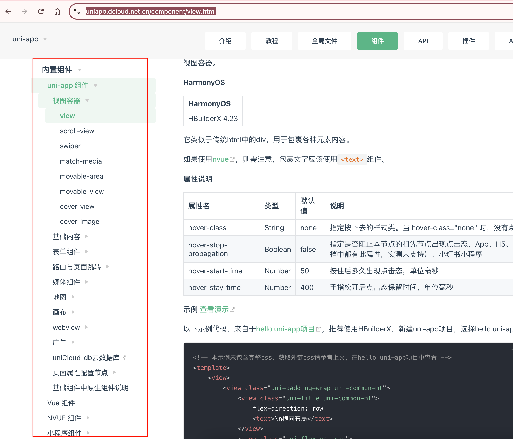
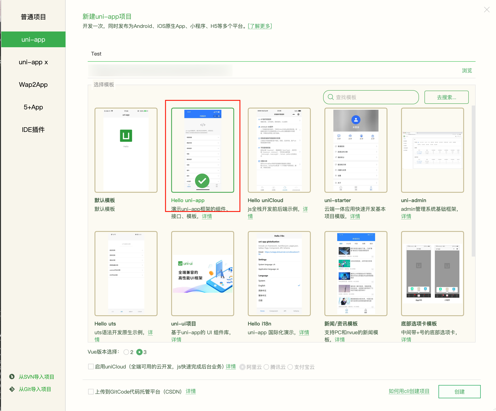
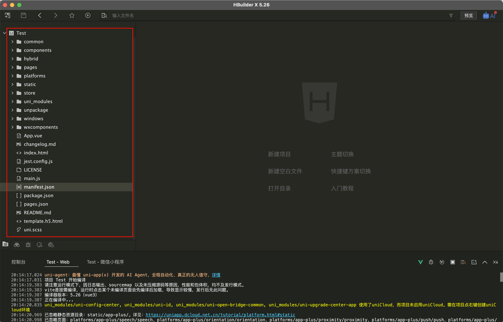
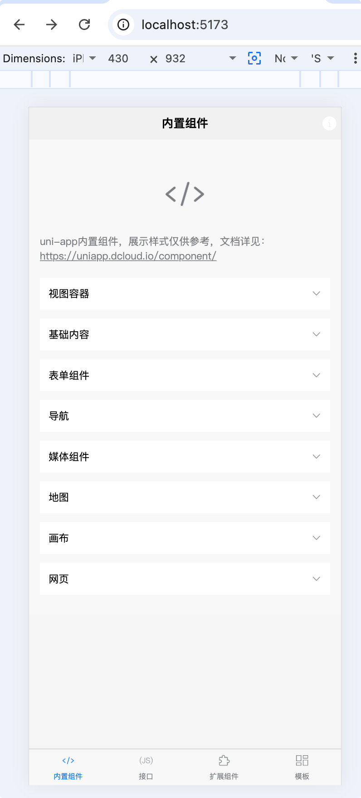
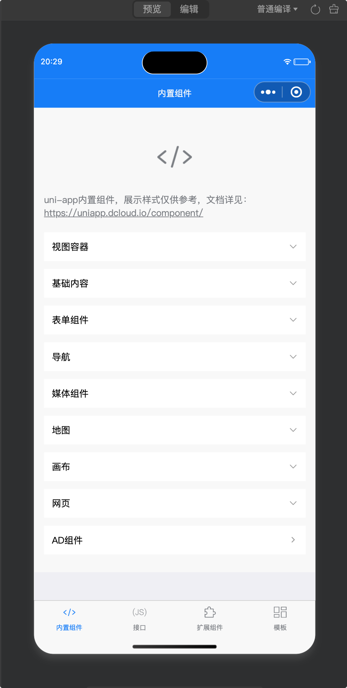
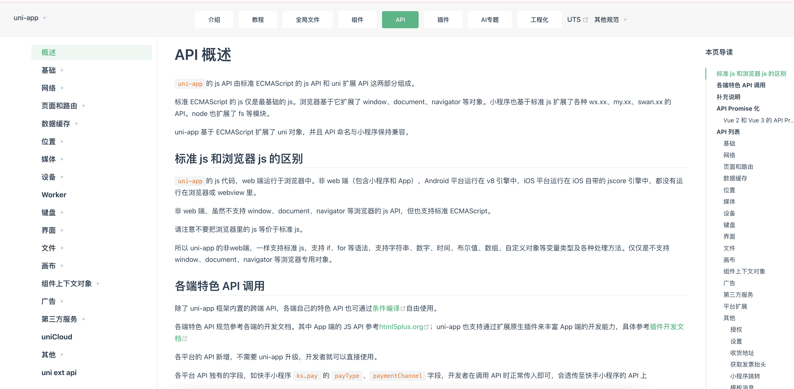
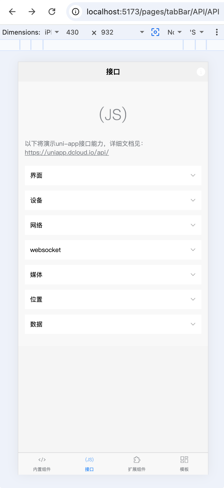
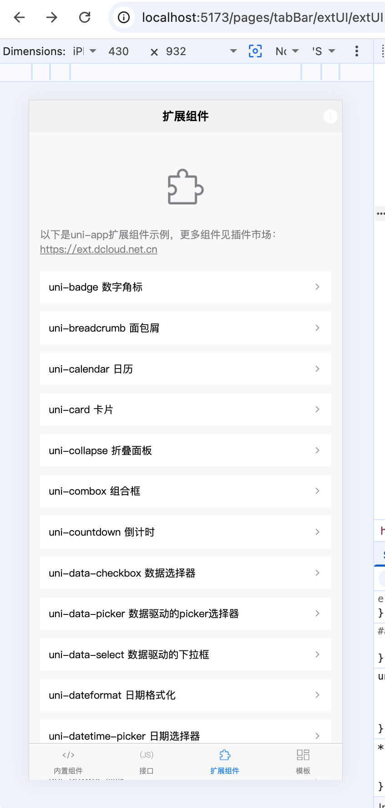
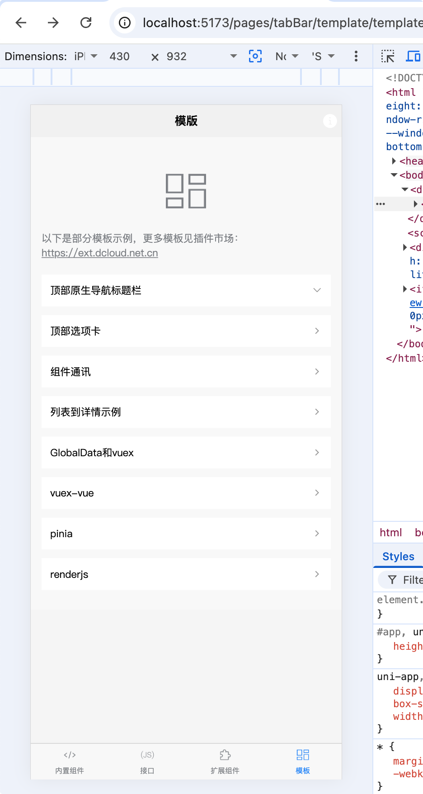

# 组件 API接口 模板

## 内置组件

官方文档：https://uniapp.dcloud.net.cn/component/view.html

学习的时候，新建项目，选择第二个Hello uni-app模板

{width=400}

{width=400}

## api接口

`uni-app`的 js API 由标准 ECMAScript 的 js API 和 uni 扩展 API 这两部分组成。

标准 ECMAScript 的 js 仅是最基础的 js。浏览器基于它扩展了 window、document、navigator 等对象。小程序也基于标准 js 扩展了各种 wx.xx、my.xx、swan.xx 的 API。node 也扩展了 fs 等模块。

uni-app 基于 ECMAScript 扩展了 uni 对象，并且 API 命名与小程序保持兼容。

官方文档：https://uniapp.dcloud.net.cn/api

{width=400}

## 扩展组件(uni-ui)

官方文档：https://uniapp.dcloud.net.cn/component/uniui/uni-ui.html

uni-ui 是DCloud提供的一个跨端ui库，它是基于vue组件的、flex布局的、无dom的跨全端ui框架。

`uni-ui` 不包括内置组件，**它是内置组件的补充**。

### uni-ui产品特点

**1、高性能**

目前为止，在小程序和混合app领域，uni-ui是性能的标杆。

- 自动差量更新数据

虽然uni-app支持小程序自定义组件，所有小程序的ui库都可以用。但小程序自定义组件的ui库都需要使用setData手动更新数据，在大数据量时、或高频更新数据时，很容易产生性能问题。

而uni-ui属于vue组件，uni-app引擎底层自动diff更新数据。当然其实插件市场里众多vue组件都具备这个特点。

- 优化逻辑层和视图层通讯折损

非H5，不管是小程序还是App，不管是app的webview渲染还是原生渲染，全都是逻辑层和视图层分离的。这里就有一个逻辑层和视图层通讯的折损问题。 比如在视图层拖动一个可跟手的组件，由于通讯的损耗，用js监听很难做到实时跟手。

这时就需要使用css动画以及平台底层提供的wxs、bindingx等技术。不过这些技术都比较复杂，所以uni-ui里做了封装，在需要跟手式操作的ui组件，比如swiperaction列表项左滑菜单，就在底层使用了这些技术，实现了高性能的交互体验

- 背景停止

很多ui组件是会一直动的，比如轮播图、跑马灯。即便这个窗体被新窗体挡住，它在背景层仍然在消耗着硬件资源。在Android的webview版本为chrome66以上，背景操作ui会引发很严重的性能问题，造成前台界面明显卡顿。

而uni-ui的组件，会自动判断自己的显示状态，在组件不再可见时，不会再消耗硬件资源。

**2、全端**

uni-ui的组件都是多端自适应的，底层会抹平很多小程序平台的差异或bug。

比如导航栏navbar组件，会自动处理不同端的状态栏； 比如swiperaction组件，在app和微信小程序上会使用交互体验更好的wxs技术，但在不支持wxs的其他小程序端会使用js模拟类似效果。

uni-ui还支持nvue原生渲染。

uni-ui还支持pc等宽屏设备，可以通过PC浏览器访问https://hellouniapp.dcloud.net.cn/pages/extUI/badge/badge体验

**3、风格扩展**

uni-ui的默认风格是中型的，与uni-app基础组件风格一致。但它支持[uni.scss](https://uniapp.dcloud.io/collocation/uni-scss)，可以方便的扩展和切换应用的风格。

UI 是一种需求非常发散的产品，DCloud官方也无意用uni-ui压制第三方 UI 插件的空间，但官方有义务在性能和跨端方面提供一个开源的标杆给大家。

我们欢迎更多优秀的 UI 组件出现，也欢迎更多人贡献uni-ui的主题风格，满足更多用户的需求。

**4、与uniCloud协作**

uni-ui里很多组件与uniCloud打通，可大幅提升开发效率

**5、与uni统计自动集成实现免打点**

uni统计是优秀的多端统计平台，见 [tongji.dcloud.net.cn](https://tongji.dcloud.net.cn/)。

除了一张报表看全端，它的另一个重要特点是免打点，也成为无侵入式埋点。

比如使用uni-ui的navbar标题栏、收藏、购物车等组件，均可实现自动打点，统计页面标题等各种行为数据。

当然你也可以关闭uni统计，这不是强制的。

**6、uni-ui符合全套DCloud组件规范**

包括 `easycom`、`uni_module`、`datacom`，全部遵循。

{width=400}

## 模版(扩展插件)

官方文档：https://uniapp.dcloud.net.cn/plugin

`uni-app`积极拥抱社区，创建了开放、兼容的插件系统。

- uni-app插件市场，[https://ext.dcloud.net.cn](https://ext.dcloud.net.cn/)，是uni-app官方插件生态集中地。有数千款插件，支持前端组件、js sdk、页面模板、项目模板、原生插件等多种类型。在生态建设上远远领先于竞品。请注意尽量在官方市场寻找插件，npm等三方市场没有uni-app兼容性描述，很容易下载到无法跨平台的、仅适配web的插件。
- 兼容 微信小程序 JS SDK

小程序生态内容可直接引入`uni-app`，并且在App侧通用。以前的跨平台开发框架普遍缺少三方SDK，由于大量SDK厂商均原厂维护小程序SDK，使得`uni-app`成为跨平台开发框架里生态最丰富的平台[参考](https://ask.dcloud.net.cn/article/35070)

- 兼容 微信小程序自定义组件

小程序自定义组件是一种ui组件，uni-app里可以在App、H5、微信小程序、QQ小程序同时兼容微信小程序自定义组件，[参考](https://uniapp.dcloud.io/frame?id=小程序组件支持)

- 兼容 NPM 包管理系统

uni-app支持npm包，但注意npm下载的插件很可能不是全端的，大多npm插件仅适配了web。需要全端插件还是要去uni-app插件市场[https://ext.dcloud.net.cn](https://ext.dcloud.net.cn/)去找。

- 兼容 weex 插件生态

uni-app内置了`weex`，`weex`的原生插件或ui库均可使用。注意`weex`的生态不如`uni-app`丰富，一般情况建议使用`uni-app`的插件市场。

- 兼容 普通 web 库

`uni-app`的H5端支持所有浏览器API。但众所周知，由于小程序的js不运行在浏览器里，所以小程序里不支持 HTML 和 DOM 的 API。

`uni-app`的App端虽然和小程序是相同的架构，逻辑层也运行在独立`jscore`而不是浏览器里，但App端和小程序还是有区别的： * 一方面可通过web-view组件加载本地HTML，引入web相关库； * 另一方面可通过[renderjs](https://uniapp.dcloud.net.cn/tutorial/renderjs.html)实现在渲染层执行js，此时完整`echart`、`threejs`等web库均可使用。 （但为了全端使用，仍然建议减少对dom库的依赖，在`uni-app`的插件市场可寻找全端兼容的库来替代）

- App端支持各种调用原生能力的方式

1. 支持 原生[混合开发](https://uniapp.dcloud.net.cn/hybrid.html)
2. 支持 比小程序能力更多的[plus JSAPI](http://www.html5plus.org/doc/h5p.html)
3. 支持 [Native.js](https://ask.dcloud.net.cn/docs/#//ask.dcloud.net.cn/article/88) 直接调用原生api
4. 支持 [uts插件](https://doc.dcloud.net.cn/uni-app-x/plugin/uts-plugin.html)
5. 支持 [原生语言插件](https://uniapp.dcloud.net.cn/plugin/native-plugin.html)

- App端支持双渲染引擎 `uni-app`逻辑层在独立jscore，而渲染层可选webview渲染和weex引擎渲染。

1. 使用webview渲染则整个架构与小程序相同，此时页面后缀为vue文件。
2. 使用weex引擎（经过改造）原生渲染，则整个架构与快应用相同，此时页面后缀为nvue文件。使用webview渲染时，还可以指定由系统webview渲染还是由x5引擎渲染。

{width=400}