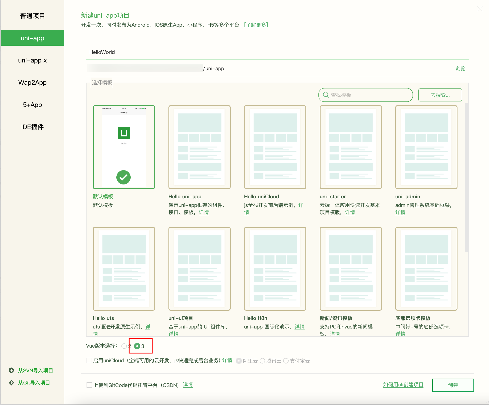
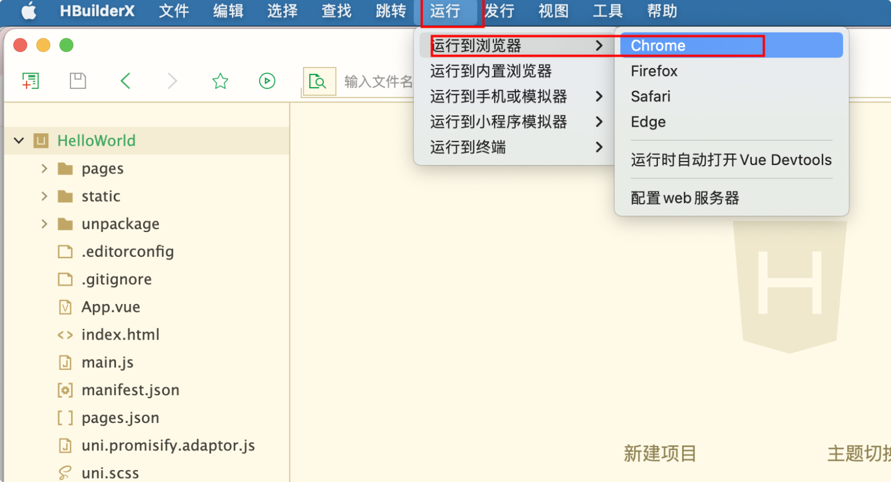
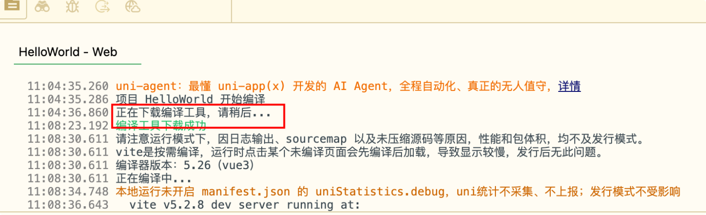
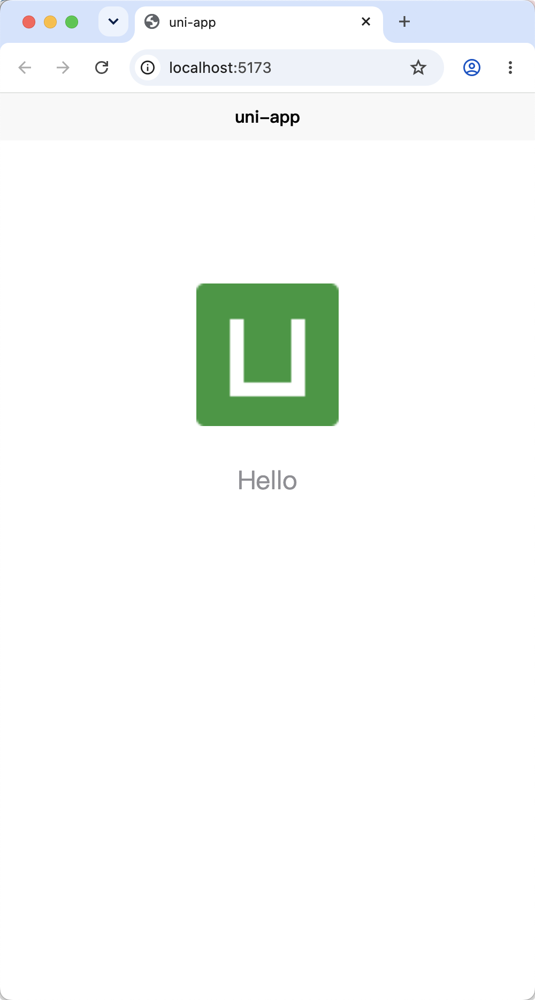
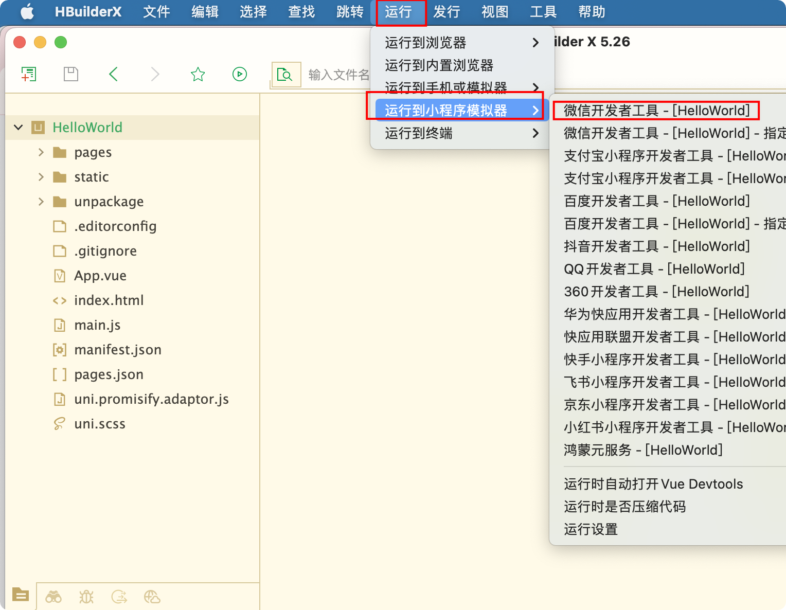
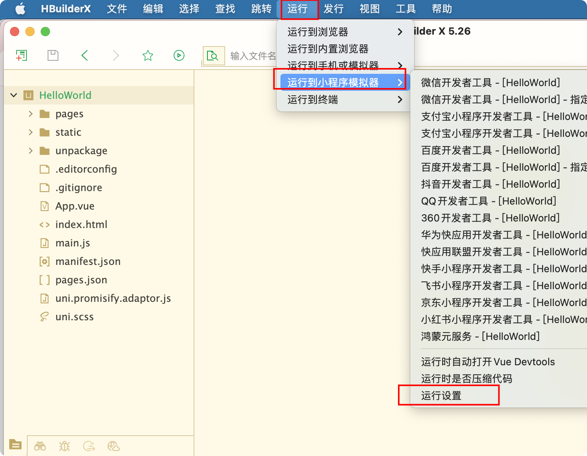
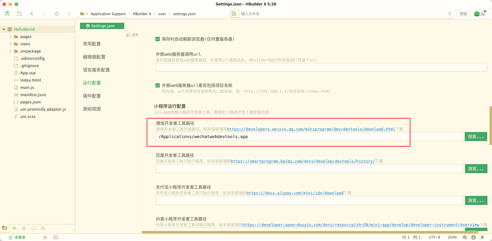
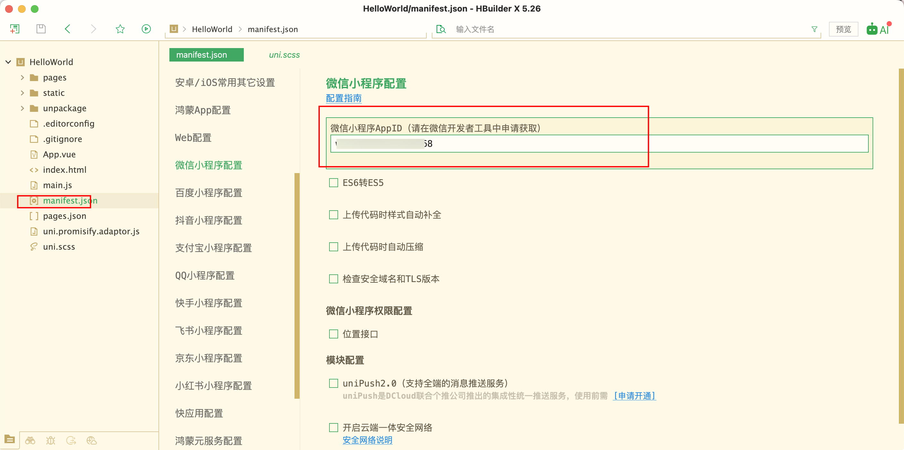
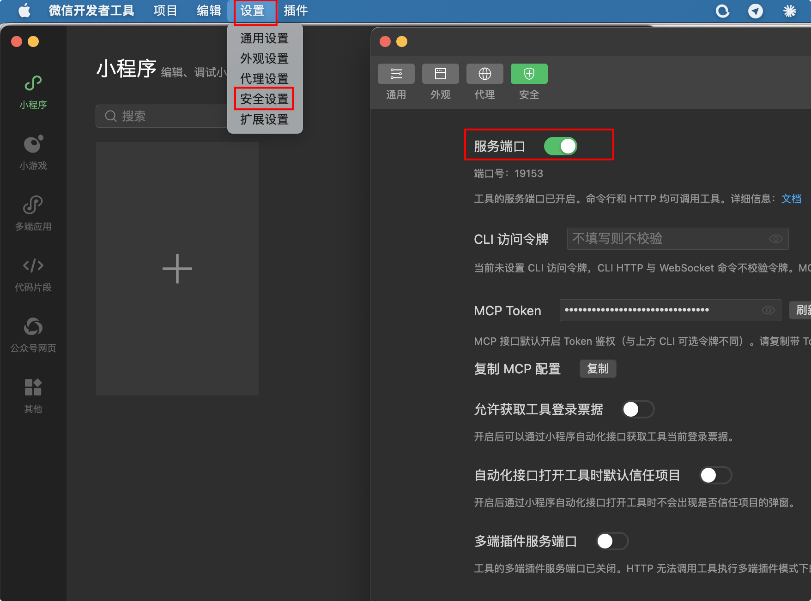
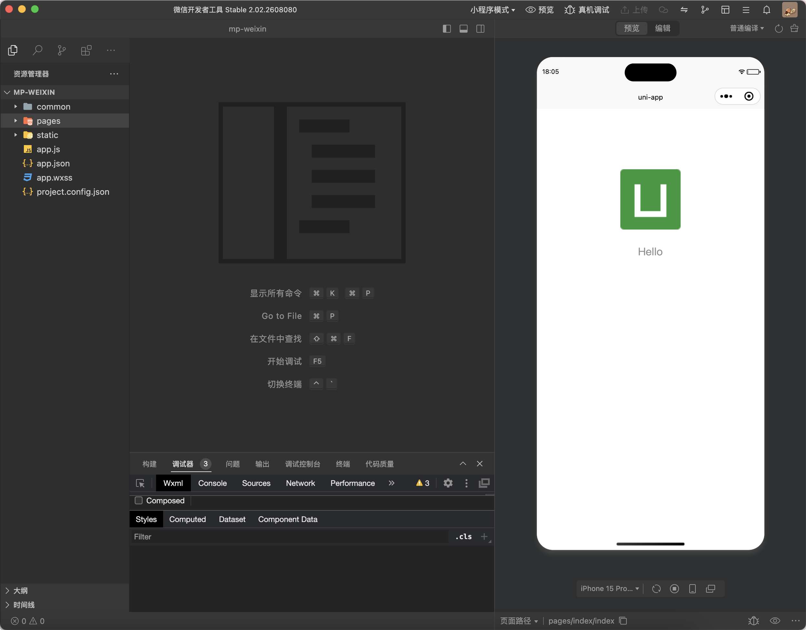

# uni-app 简介与环境搭建

## 介绍

uni-app官网：https://uniapp.dcloud.net.cn/

uni-app 是一个使用 Vue.js 开发所有前端应用的框架，开发者编写一套代码，可发布到iOS、 Android、Web(响应式)、以及各种小程序(微信/支付宝/百度/头条/飞书/QQ/快手/钉钉/淘宝)、快应用等多个平台。

uni-app 在手，做啥都不愁。即使不跨端， uni-app 也是更好的小程序开发框架、更好的App 跨平台框架、更方便的H5开发框架。

## 环境搭建

uni-app开发工具 hbuilerX安装

https://www.dcloud.io/hbuilderx.html

微信小程序开发工具

https://developers.weixin.qq.com/miniprogram/dev/devtools/download.html

## HelloWorld实现

打开HBuilderX，目录 文件 -> 新建

输入项目名称，以及项目目录，勾选Vue3版本，选择默认模版，然后点击“创建”按钮



### 浏览器运行

启动项目，运行到浏览器谷歌:

菜单目录 运行 -> 运行到浏览器 -> Chrome



HBuilderX进行编译发布，第一次会自动下载编译工具



自动打开谷歌浏览器，显示页面效果：

{width=400}

### 微信开发者工具运行

启动项目，运行到微信开发者工具:

菜单目录 运行 -> 运行到小程序模拟器 -> 微信开发者工具



**注意：**

- 设置HBuilderX，如果是第一次使用，需要先配置小程序ide的相关路径，才能运行成功。如下图，需在输入框输入微信开发者工具的安装路径。

  

  

- 还需要配置微信小程序的AppID，提前去申请或者用个人的测试AppID

  

- 设置微信开发者工具，设置->安全设置 开启服务端口	

成功运行：


## 工程目录结构介绍

一个uni-app工程，默认包含如下目录及文件：

```text
├──pages                    业务页面文件存放的目录
│  ├──index
│  │  └──index.vue          index页面
│  └──list
│     └──list.vue           list页面
├──static                   存放应用引用的本地静态资源（如图片、视频等）的目录，注意：静态资源只能存放于此
├──unpackage                非工程代码，一般存放运行或发行的编译结果
├──main.js                  Vue初始化入口文件
├──App.vue                  应用配置，用来配置App全局样式以及监听应用生命周期
├──manifest.json            配置应用名称、appid、logo、版本等打包信息
├──pages.json               配置页面路由、导航条、选项卡等页面类信息
└──uni.scss                 这里是uni-app内置的常用样式变量
```

**static目录 使用注意**

* 编译到任意平台时，`static` 目录下除不满足条件编译的文件，会直接复制到最终的打包目录，不会打包编译。非 `static` 目录下的文件（vue、js、css 等）只有被引用时，才会被打包编译。
* `css`、`less/scss` 等资源不要放在 `static` 目录下，建议这些公用的资源放在自建的 `common` 目录下。

**Tips**

* HbuilderX 1.9.0+ 支持在根目录创建 `ext.json`、`sitemap.json` 等小程序需要的文件。
