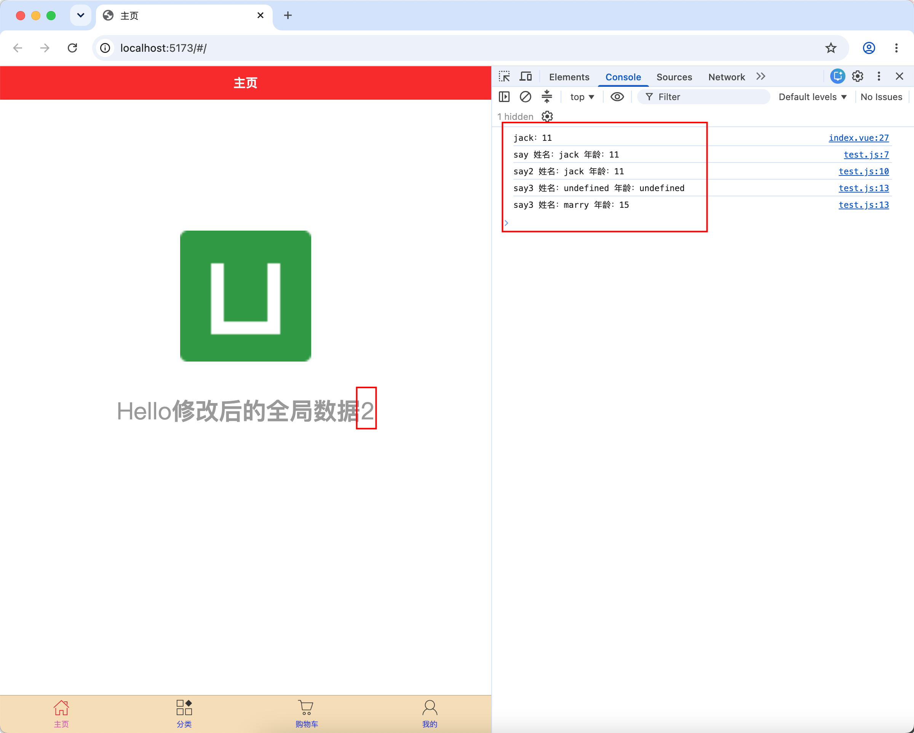
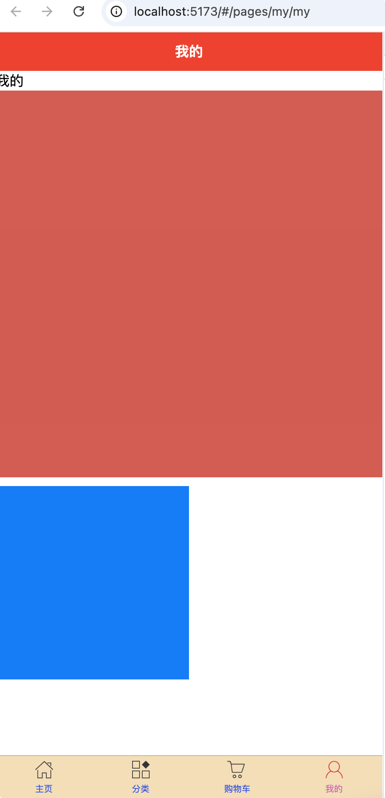
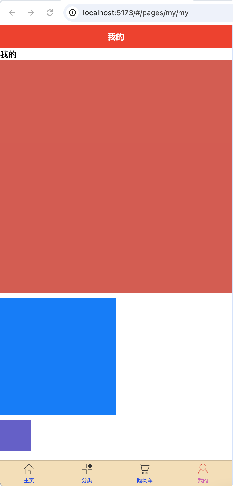
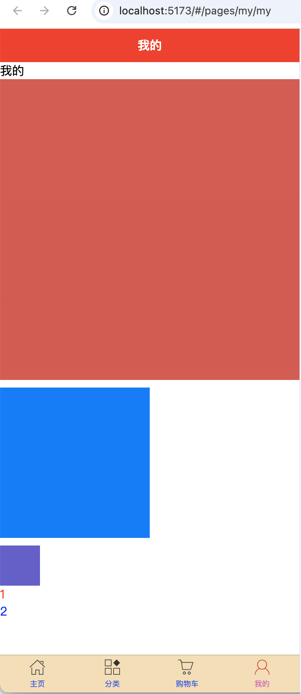
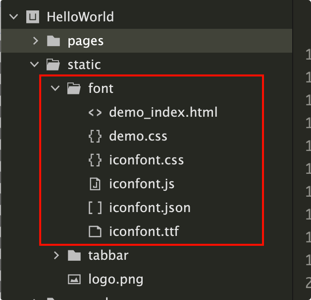
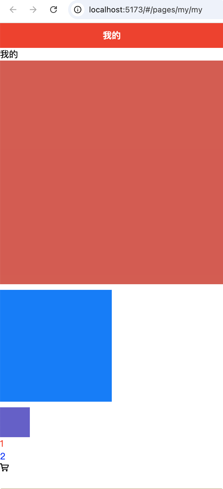

# js与css语法

## js语法

### 简介

`uni-app`的js API由标准ECMAScript的js API 和 uni 扩展 API 这两部分组成。

标准ECMAScript的js仅是最基础的js。浏览器基于它扩展了window、document、navigator等对象。小程序也基于标准js扩展了各种wx.xx、my.xx、swan.xx的API。node也扩展了fs等模块。

uni-app基于ECMAScript扩展了uni对象，并且API命名与小程序保持兼容。

### 标准js和浏览器js的区别

`uni-app`的js代码，h5端运行于浏览器中。非h5端（包含小程序和App），Android平台运行在v8引擎中，iOS平台运行在iOS自带的jscore引擎中，都没有运行在浏览器或webview里。

非H5端，虽然不支持window、document、navigator等浏览器的js API，但也支持标准ECMAScript。

请注意不要把浏览器里的js扩展对象等价于标准js。

所以uni-app的非H5端，一样支持标准js，支持if、for等语法，支持字符串、数字、时间、布尔值、数组、自定义对象等变量类型及各种处理方法。仅仅是不支持window、document、navigator等浏览器专用对象。

### ES6 支持

uni-app 在支持绝大部分 ES6 API 的同时，也支持了 ES7 的 await/async。

### 示例

pages下新建common目录，再新建test.js，并修改index.vue

::: code-group

```js [test.js]
const a = 2;

const obj = {
	name: "jack",
	age: 11,
	say() {
		console.log("say 姓名：" + this.name + " 年龄：" + this.age)
	},
	say2: function() {
		console.log("say2 姓名：" + this.name + " 年龄：" + this.age)
	},
	say3: (name, age) => {
		console.log("say3 姓名：" + name + " 年龄：" + age)
	}
}

function func(m, n) {
	return m + n;
}

export {
	a,
	obj,
	func
}

```

```vue [index.vue] {7,13,19,26-31}
<template>
	<view class="content">
		<image class="logo" src="/static/logo.png"></image>
		<view class="text-area">
			<text class="title">{{title}}</text>
			<text class="title common-style">{{text}}</text>
			<text class="title">{{text2}}</text>
		</view>
	</view>
</template>

<script>
	import {a, obj, func} from "@/pages/common/test.js"
	export default {
		data() {
			return {
				title: 'Hello',
				text: '',
				text2: ''
			}
		},
		onLoad() {
			getApp().globalData.text = '修改后的全局数据';
			this.text = getApp().globalData.text;

			this.text2 = a;
			console.log(obj.name + "：" + obj.age);
			obj.say();
			obj.say2();
			obj.say3();
			obj.say3("marry", 15);
		},
		methods: {

		}
	}
</script>

<style lang="scss">
	.content {
		display: flex;
		flex-direction: column;
		align-items: center;
		justify-content: center;
	}

	.logo {
		height: 200rpx;
		width: 200rpx;
		margin-top: 200rpx;
		margin-left: auto;
		margin-right: auto;
		margin-bottom: 50rpx;
	}

	.text-area {
		display: flex;
		justify-content: center;
	}

	.title {
		font-size: 36rpx;
		color: $uni-text-color-grey;
	}
</style>

```

:::



## css语法

uni-app 的 css 与 web 的 css 基本一致。

### 尺寸单位

`uni-app` 支持的通用 css 单位包括 px、rpx

- px 即屏幕像素
- rpx 即响应式 px，一种根据屏幕宽度自适应的动态单位。以 750 宽的屏幕为基准，750rpx 恰好为屏幕宽度。屏幕变宽，rpx 实际显示效果会等比放大，但在 App（vue2 不含 nvue） 端和 H5（vue2） 端屏幕宽度达到 960px 时，默认将按照 375px 的屏幕宽度进行计算

示例：

```vue
<template>
	<view>我的</view>
	<view class="c1"></view>
	<view class="c2"></view>
</template>

<script>
</script>

<style lang="scss">
	.c1 {
		width: 750rpx;
		height: 750rpx;
		background-color: $uni-color-error;
	}
	.c2 {
		margin-top: 10px;
		width: 375rpx;
		height: 375rpx;
		background-color: $uni-color-primary;
	}
</style>

```

{width=400}

### 样式导入

使用`@import`语句可以导入外联样式表，`@import`后跟需要导入的外联样式表的相对路径，用`;`表示语句结束。

示例：

common目录下新建test.css，以及my.vue页面修改

::: code-group

```css [test.css]
.c3 {
	margin-top: 10px;
	background-color: slateblue;
	width: 100rpx;
	height: 100rpx;
}

```

```vue [my.vue] {5,12}
<template>
	<view>我的</view>
	<view class="c1"></view>
	<view class="c2"></view>
	<view class="c3"></view>
</template>

<script>
</script>

<style lang="scss">
	@import url("../common/test.css");
	.c1 {
		width: 750rpx;
		height: 750rpx;
		background-color: $uni-color-error;
	}
	.c2 {
		margin-top: 10px;
		width: 375rpx;
		height: 375rpx;
		background-color: $uni-color-primary;
	}
</style>

```

:::

{width=400}

### 内联样式

框架组件上支持使用 style、class 属性来控制组件的样式。

- style：静态的样式统一写到 class 中。style 接收动态的样式，在运行时会进行解析，请尽量避免将静态的样式写进 style 中，以免影响渲染速度。
- class：用于指定样式规则，其属性值是样式规则中类选择器名(样式类名)的集合，样式类名不需要带上`.`，样式类名之间用空格分隔。

示例：

```vue {6,7,14}
<template>
	<view>我的</view>
	<view class="c1"></view>
	<view class="c2"></view>
	<view class="c3"></view>
	<view style="color: red;">1</view>
	<view :style="{color: style_color}">2</view>
</template>

<script>
	export default {
		data() {
			return {
				style_color: "blue"
			}
		}
	}
</script>

<style lang="scss">
	@import url("../common/test.css");
	.c1 {
		width: 750rpx;
		height: 750rpx;
		background-color: $uni-color-error;
	}
	.c2 {
		margin-top: 10px;
		width: 375rpx;
		height: 375rpx;
		background-color: $uni-color-primary;
	}
</style>

```

{width=400}

### 选择器

目前支持的选择器有：

| 选择器           | 样例           | 样例描述                                       |
| :--------------- | :------------- | :--------------------------------------------- |
| .class           | .intro         | 选择所有拥有 class="intro" 的组件              |
| #id              | #firstname     | 选择拥有 id="firstname" 的组件                 |
| element          | view           | 选择所有 view 组件                             |
| element, element | view, checkbox | 选择所有文档的 view 组件和所有的 checkbox 组件 |
| ::after          | view::after    | 在 view 组件后边插入内容，**仅 vue 页面生效**  |
| ::before         | view::before   | 在 view 组件前边插入内容，**仅 vue 页面生效**  |

**注意：**

- 在 `uni-app` 中不能使用 `*` 选择器。

- 微信小程序自定义组件中仅支持 class 选择器

- `page` 相当于 `body` 节点，例如：

  ```css
  <!-- 设置页面背景颜色，使用 scoped 会导致失效 -- >
  page {
    background-color: #ccc;
  }
  ```

- web端可以使用`html`、`body`、`:root`等选择器。由于页面的css样式隔离，且html节点并未添加data-xxx属性，`html`、`:root`写在页面style内无效，只能写在App.vue内。

### 全局样式与局部样式

定义在 App.vue 中的样式为全局样式，作用于每一个页面。在 pages 目录下 的 vue 文件中定义的样式为局部样式，只作用在对应的页面，并会覆盖 App.vue 中相同的选择器。

**注意：**

- App.vue 中通过 `@import` 语句可以导入外联样式，一样作用于每一个页面。
- nvue 页面暂不支持全局样式

### CSS 变量

uni-app 提供内置 CSS 变量

| CSS 变量            | 描述                   | App                                                          | 小程序 | H5                   |
| :------------------ | :--------------------- | :----------------------------------------------------------- | :----- | :------------------- |
| --status-bar-height | 系统状态栏高度         | [系统状态栏高度](http://www.html5plus.org/doc/zh_cn/navigator.html#plus.navigator.getStatusbarHeight)、nvue 注意见下 | 25px   | 0                    |
| --window-top        | 内容区域距离顶部的距离 | 0                                                            | 0      | NavigationBar 的高度 |
| --window-bottom     | 内容区域距离底部的距离 | 0                                                            | 0      | TabBar 的高度        |

**注意：**

- `var(--status-bar-height)` 此变量在微信小程序环境为固定 `25px`，在 App 里为手机实际状态栏高度。
- 当设置 `"navigationStyle":"custom"` 取消原生导航栏后，由于窗体为沉浸式，占据了状态栏位置。此时可以使用一个高度为 `var(--status-bar-height)` 的 view 放在页面顶部，避免页面内容出现在状态栏。
- 由于在 H5 端，不存在原生导航栏和 tabbar，也是前端 div 模拟。如果设置了一个固定位置的居底 view，在小程序和 App 端是在 tabbar 上方，但在 H5 端会与 tabbar 重叠。此时可使用`--window-bottom`，不管在哪个端，都是固定在 tabbar 上方。
- 目前 nvue 在 App 端，还不支持 `--status-bar-height`变量，替代方案是在页面 onLoad 时通过 uni.getSystemInfoSync().statusBarHeight 获取状态栏高度，然后通过 style 绑定方式给占位 view 设定高度。下方提供了示例代码

**代码块**

快速书写 css 变量的方法是：在 css 中敲 hei，在候选助手中即可看到 3 个 css 变量。（HBuilderX 1.9.6 以上支持）

示例 1 - 普通页面使用 css 变量：

```html
<template>
	<!-- HBuilderX 2.6.3+ 新增 page-meta, 详情：https://uniapp.dcloud.io/component/page-meta -->
	<page-meta>
		<navigation-bar />
	</page-meta>
	<view>
		<view class="status_bar">
			<!-- 这里是状态栏 -->
		</view>
		<view>状态栏下的文字</view>
	</view>
</template>
<style>
	.status_bar {
		height: var(--status-bar-height);
		width: 100%;
	}
</style>
```

```html
<template>
	<view>
		<view class="toTop">
			<!-- 这里可以放一个向上箭头，它距离底部tabbar上浮10px-->
		</view>
	</view>
</template>
<style>
	.toTop {
		bottom: calc(var(--window-bottom) + 10px);
	}
</style>
```


示例 2 - nvue 页面获取状态栏高度

```html
<template>
	<view class="content">
		<view :style="{ height: iStatusBarHeight + 'px'}"></view>
	</view>
</template>

<script>
	export default {
		data() {
			return {
				iStatusBarHeight: 0,
			};
		},
		onLoad() {
			this.iStatusBarHeight = uni.getSystemInfoSync().statusBarHeight;
		},
	};
</script>
```

### 固定值

`uni-app` 中以下组件的高度是固定的，不可修改：

| 组件          | 描述       | App                                                          | H5   |
| :------------ | :--------- | :----------------------------------------------------------- | :--- |
| NavigationBar | 导航栏     | 44px                                                         | 44px |
| TabBar        | 底部选项卡 | HBuilderX 2.3.4 之前为 56px，2.3.4 起和 H5 调为一致，统一为 50px。（但可以自主更改高度） | 50px |

各小程序平台，包括同小程序平台的 iOS 和 Android 的高度也不一样。

### Flex 布局

为支持跨平台，框架建议使用 Flex 布局，关于 Flex 布局可以参考外部文档[A Complete Guide to Flexbox](https://css-tricks.com/snippets/css/a-guide-to-flexbox/)、[阮一峰的 flex 教程](http://www.ruanyifeng.com/blog/2015/07/flex-grammar.html)等。

### 背景图片

`uni-app` 支持使用在 css 里设置背景图片，使用方式与普通 `web` 项目大体相同，但需要注意以下几点：

- 支持 base64 格式图片。

- 支持网络路径图片。

- 小程序不支持在 css 中使用本地文件，包括本地的背景图和字体文件。需以 base64 方式方可使用。

- 使用本地路径背景图片需注意：

  1. 为方便开发者，在背景图片小于 40kb 时，`uni-app` 编译到不支持本地背景图的平台时，会自动将其转化为 base64 格式；
  2. 图片大于等于 40kb，会有性能问题，不建议使用太大的背景图，如开发者必须使用，则需自己将其转换为 base64 格式使用，或将其挪到服务器上，从网络地址引用。
  3. 本地背景图片的引用路径推荐使用以 ~@ 开头的绝对路径。

  ```css
  .test2 {
  	background-image: url('~@/static/logo.png');
  }
  ```

**注意**

- 微信小程序不支持相对路径（真机不支持，开发工具支持）

### 字体图标

`uni-app` 支持使用字体图标，使用方式与普通 `web` 项目相同，需要注意以下几点：

- 支持 base64 格式字体图标。

- 支持网络路径字体图标。

- 小程序不支持在 css 中使用本地文件，包括本地的背景图和字体文件。需以 base64 方式方可使用。

- 网络路径必须加协议头 `https`。

- 从 [http://www.iconfont.cn](http://www.iconfont.cn/) 上拷贝的代码，默认是没加协议头的。

- 从 [http://www.iconfont.cn](http://www.iconfont.cn/) 上下载的字体文件，都是同名字体（字体名都叫 iconfont，安装字体文件时可以看到），在 nvue 内使用时需要注意，此字体名重复可能会显示不正常，可以使用工具修改。

- 使用本地路径图标字体需注意：

  1. 为方便开发者，在字体文件小于 40kb 时，`uni-app` 会自动将其转化为 base64 格式；
  2. 字体文件大于等于 40kb，仍转换为 base64 方式使用的话可能有性能问题，如开发者必须使用，则需自己将其转换为 base64 格式使用，或将其挪到服务器上，从网络地址引用；
  3. 字体文件的引用路径推荐使用以 ~@ 开头的绝对路径。

  ```css
  @font-face {
  	font-family: test1-icon;
  	src: url('~@/static/iconfont.ttf');
  }
  ```

`nvue`中不可直接使用 css 的方式引入字体文件，需要使用以下方式在 js 内引入。nvue 内不支持本地路径引入字体，请使用网络链接或者`base64`形式。**`src`字段的`url`的括号内一定要使用单引号。**

```js
var domModule = weex.requireModule('dom');
domModule.addRule('fontFace', {
	fontFamily: 'fontFamilyName',
	src: "url('https://...')",
});
```

示例：

先把下载的字体图标放到对应目录，在全局App.vue中引用，然后在页面使用

{width=200}

::: code-group

```vue [App.vue] {20}
<script>
	export default {
		onLaunch: function() {
			console.log('App Launch')
		},
		onShow: function() {
			console.log('App Show')
		},
		onHide: function() {
			console.log('App Hide')
		},
		globalData: {
			text: '全局数据'
		}
	}
</script>

<style lang="scss">
	/*每个页面公共css */
	@import url("static/font/iconfont.css");
	.common-style {
		font-weight: bolder;
	}
</style>

```

```vue [my.vue] {8}
<template>
	<view>我的</view>
	<view class="c1"></view>
	<view class="c2"></view>
	<view class="c3"></view>
	<view style="color: red;">1</view>
	<view :style="{color: style_color}">2</view>
	<view class="iconfont icon-gouwuchekong"></view>
</template>

<script>
	export default {
		data() {
			return {
				style_color: "blue"
			}
		}
	}
</script>

<style lang="scss">
	@import url("../common/test.css");
	.c1 {
		width: 750rpx;
		height: 750rpx;
		background-color: $uni-color-error;
	}
	.c2 {
		margin-top: 10px;
		width: 375rpx;
		height: 375rpx;
		background-color: $uni-color-primary;
	}
</style>

```

:::

{width=400}