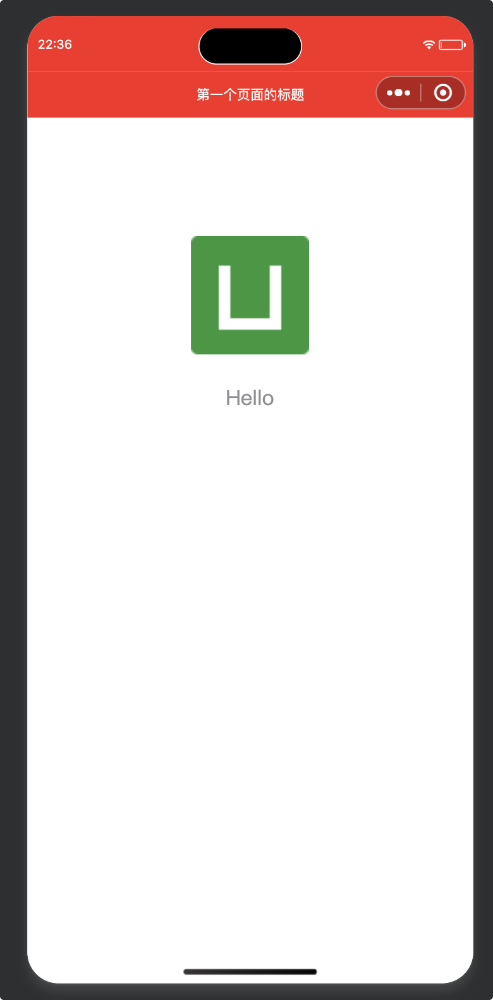
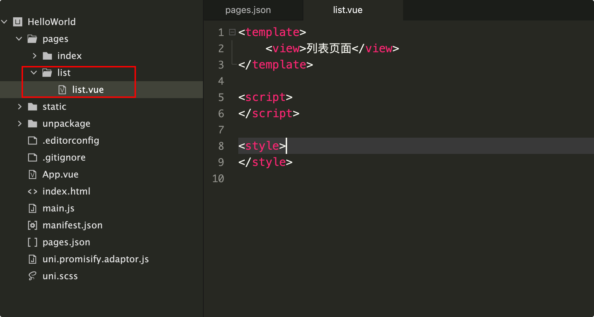
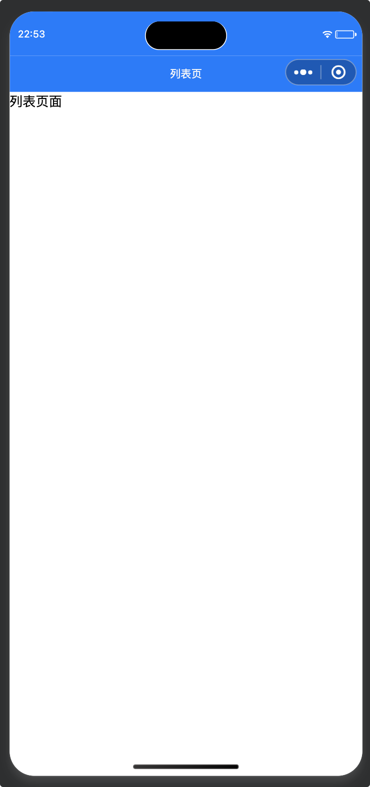
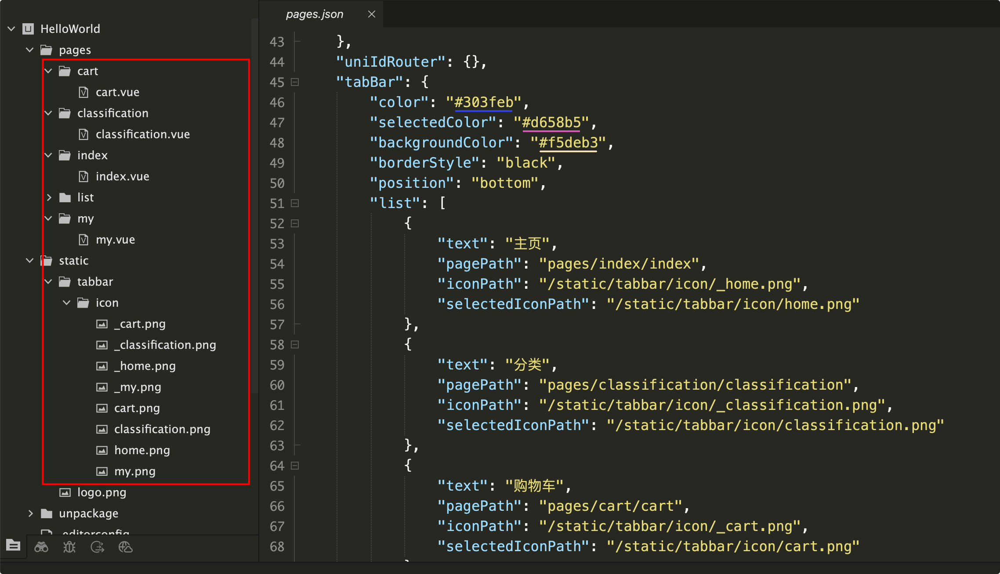
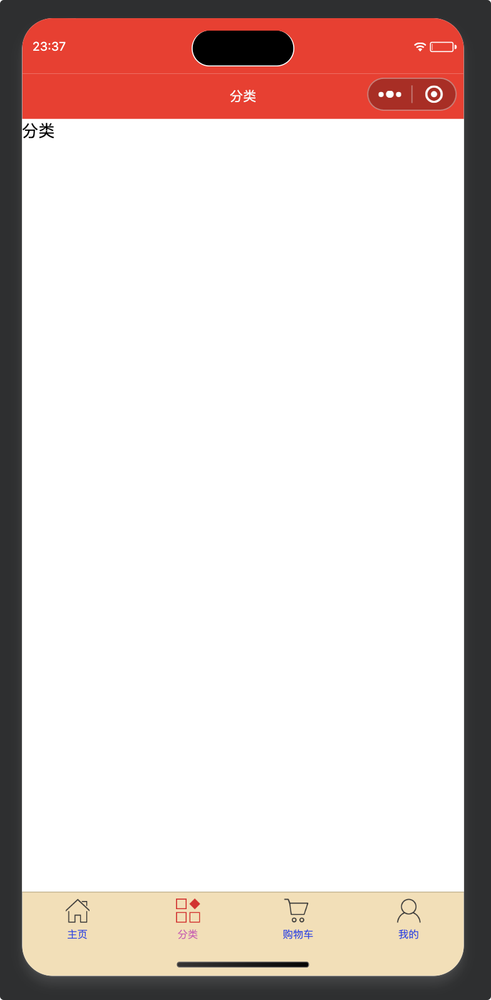
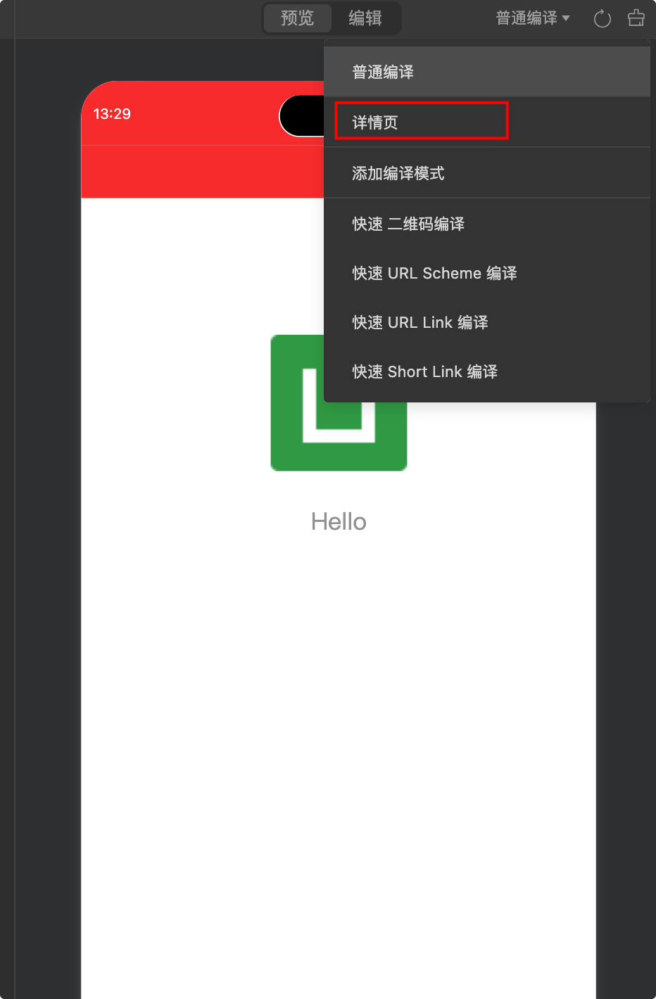

# pages.json 页面路由

## globalStyle

**全局页面样式配置**

- 设置默认页面的窗口表现
- 用于设置应用的状态栏、导航条、标题、窗口背景色等。

| 属性                         | 类型     | 默认值  | 描述                                               | 平台差异说明                                     |
| :--------------------------- | :------- | :------ | :------------------------------------------------- | :----------------------------------------------- |
| navigationBarBackgroundColor | HexColor | #F7F7F7 | 导航栏背景颜色（同状态栏背景色）                   | APP与H5为#F7F7F7，小程序平台请参考相应小程序文档 |
| navigationBarTextStyle       | String   | white   | 导航栏标题颜色及状态栏前景颜色，仅支持 black/white | 支付宝小程序不支持，请使用 my.setNavigationBar   |
| navigationBarTitleText       | String   |         | 导航栏标题文字内容，每个子页面可以覆盖此值         |                                                  |
| backgroundColor              | HexColor | #ffffff | 下拉显示出来的窗口的背景色                         | 微信小程序                                       |
| backgroundTextStyle          | String   | dark    | 下拉 loading 的样式，仅支持 dark / light           | 微信小程序                                       |
| enablePullDownRefresh        | Boolean  | false   | 是否开启下拉刷新                                   |                                                  |
| onReachBottomDistance        | Number   | 50      | 页面上拉触底事件触发时距页面底部距离，单位只支持px |                                                  |

示例：

```json {10-18}
{
	"pages": [ //pages数组中第一项表示应用启动页，参考：https://uniapp.dcloud.io/collocation/pages
		{
			"path": "pages/index/index",
			"style": {
				"navigationBarTitleText": "第一个页面的标题"
			}
		}
	],
	"globalStyle": {
		"navigationBarTextStyle": "white",
		"navigationBarTitleText": "helloworld",
		"navigationBarBackgroundColor": "#f92721",
		"backgroundColor": "#54f99c",
		"enablePullDownRefresh": true,
		"backgroundTextStyle": "light",
		"onReachBottomDistance": 55
	},
	"uniIdRouter": {}
}

```

{width=400}

## 新建page以及page外观配置

`uni-app` 通过 `pages` 节点配置应用由哪些页面组成，`pages` 节点接收一个数组，数组每个项都是一个对象，其属性值如下：

| 属性  | 类型   | 默认值 | 描述             |
| :---- | :----- | :----- | :--------------- |
| path  | String |        | 配置页面路径     |
| style | Object |        | 配置页面窗口表现 |

示例：
新建list目录和list.vue页面

::: code-group

```vue [list.vue]
<template>
	<view>列表页面</view>
</template>

<script>
</script>

<style>
</style>

```

```json [pages.json] {3-9}
{
	"pages": [ //pages数组中第一项表示应用启动页，参考：https://uniapp.dcloud.io/collocation/pages
		{
			"path": "pages/list/list",
			"style": {
				"navigationBarTitleText": "列表页",
				"navigationBarBackgroundColor": "#007aff"
			}
		},
		{
			"path": "pages/index/index",
			"style": {
				"navigationBarTitleText": "第一个页面的标题"
			}
		}
	],
	"globalStyle": {
		"navigationBarTextStyle": "white",
		"navigationBarTitleText": "helloworld",
		"navigationBarBackgroundColor": "#f92721",
		"backgroundColor": "#54f99c",
		"enablePullDownRefresh": true,
		"backgroundTextStyle": "light",
		"onReachBottomDistance": 55
	},
	"uniIdRouter": {}
}

```

:::



{width=400}

## tabbar组件

如果应用是一个多 tab 应用，可以通过 tabBar 配置项指定一级导航栏，以及 tab 切换时显示的对应页。

在 pages.json 中提供 tabBar 配置，不仅仅是为了方便快速开发导航，更重要的是在App和小程序端提升性能。在这两个平台，底层原生引擎在启动时无需等待js引擎初始化，即可直接读取 pages.json 中配置的 tabBar 信息，渲染原生tab。

**注意**

* 当设置 position 为 top 时，将不会显示 icon
* tabBar 中的 list 是一个数组，只能配置最少2个、最多5个 tab，tab 按数组的顺序排序。
* tabbar 切换第一次加载时可能渲染不及时，可以在每个tabbar页面的onLoad生命周期里先弹出一个等待雪花（uni-app使用了此方式）
* tabbar 的页面展现过一次后就保留在内存中，再次切换 tabbar 页面，只会触发每个页面的onShow，不会再触发onLoad。
* 顶部的 tabbar 目前仅微信小程序上支持。需要用到顶部选项卡的话，建议不使用 tabbar 的顶部设置，而是自己做顶部选项卡，可参考 uni-app->模板->顶部选项卡。

**属性说明：**

| 属性            | 类型     | 必填 | 默认值 | 描述                                                      | 平台差异说明                                         |
| :-------------- | :------- | :--- | :----- | :-------------------------------------------------------- | :--------------------------------------------------- |
| color           | HexColor | 是   |        | tab 上的文字默认颜色                                      |                                                      |
| selectedColor   | HexColor | 是   |        | tab 上的文字选中时的颜色                                  |                                                      |
| backgroundColor | HexColor | 是   |        | tab 的背景色                                              |                                                      |
| borderStyle     | String   | 否   | black  | tabbar 上边框的颜色，可选值 black/white，也支持其他颜色值 | App 2.3.4+、H5 3.0.0+                                |
| blurEffect      | String   | 否   | none   | iOS 高斯模糊效果，可选值 dark/extralight/light/none       | App 2.4.0+ 支持、H5 3.0.0+（只有最新版浏览器才支持） |
| list            | Array    | 是   |        | tab 的列表，详见 list 属性说明，最少2个、最多5个 tab      |                                                      |
| position        | String   | 否   | bottom | 可选值 bottom、top                                        | top 值仅微信小程序支持                               |
| fontSize        | String   | 否   | 10px   | 文字默认大小                                              | App 2.3.4+、H5 3.0.0+                                |
| iconWidth       | String   | 否   | 24px   | 图标默认宽度（高度等比例缩放）                            | App 2.3.4+、H5 3.0.0+                                |
| spacing         | String   | 否   | 3px    | 图标和文字的间距                                          | App 2.3.4+、H5 3.0.0+                                |
| height          | String   | 否   | 50px   | tabBar 默认高度                                           | App 2.3.4+、H5 3.0.0+                                |
| midButton       | Object   | 否   |        | 中间按钮 仅在 list 项为偶数时有效                         | App 2.3.4+、H5 3.0.0+                                |
| iconfontSrc     | String   | 否   |        | list设置 iconfont 属性时，需要指定字体文件路径            | App 3.4.4+、H5 3.5.3+                                |

其中 list 接收一个数组，数组中的每个项都是一个对象，其属性值如下：

| 属性             | 类型    | 必填 | 说明                                                         | 平台差异                    |
| :--------------- | :------ | :--- | :----------------------------------------------------------- | :-------------------------- |
| pagePath         | String  | 是   | 页面路径，必须在 pages 中先定义                              |                             |
| text             | String  | 是   | tab 上按钮文字，在 App 和 H5 平台为非必填。例如中间可放一个没有文字的+号图标 |                             |
| iconPath         | String  | 否   | 图片路径，icon 大小限制为40kb，建议尺寸为 81px * 81px，当 position 为 top 时，此参数无效，不支持网络图片，不支持字体图标 |                             |
| selectedIconPath | String  | 否   | 选中时的图片路径，icon 大小限制为40kb，建议尺寸为 81px * 81px，当 position 为 top 时，此参数无效 |                             |
| visible          | Boolean | 否   | 该项是否显示，默认显示                                       | App (3.2.10+)、H5 (3.2.10+) |
| iconfont         | Object  | 否   | 字体图标，优先级高于 iconPath                                | App (3.4.4+)、H5 (3.5.3+)   |

示例：
:::code-group

```json [pages.json] {3-26,45-77}
{
	"pages": [ //pages数组中第一项表示应用启动页，参考：https://uniapp.dcloud.io/collocation/pages
		{
			"path": "pages/index/index",
			"style": {
				"navigationBarTitleText": "主页"
			}
		},
		{
			"path": "pages/classification/classification",
			"style": {
				"navigationBarTitleText": "分类"
			}
		},
		{
			"path": "pages/cart/cart",
			"style": {
				"navigationBarTitleText": "购物车"
			}
		},
		{
			"path": "pages/my/my",
			"style": {
				"navigationBarTitleText": "我的"
			}
		},
		{
			"path": "pages/list/list",
			"style": {
				"navigationBarTitleText": "列表页",
				"navigationBarBackgroundColor": "#007aff"
			}
		}
	],
	"globalStyle": {
		"navigationBarTextStyle": "white",
		"navigationBarTitleText": "helloworld",
		"navigationBarBackgroundColor": "#f92721",
		"backgroundColor": "#54f99c",
		"enablePullDownRefresh": true,
		"backgroundTextStyle": "light",
		"onReachBottomDistance": 55
	},
	"uniIdRouter": {},
	"tabBar": {
		"color": "#303feb",
		"selectedColor": "#d658b5",
		"backgroundColor": "#f5deb3",
		"borderStyle": "black",
		"position": "bottom",
		"list": [
			{
				"text": "主页",
				"pagePath": "pages/index/index",
				"iconPath": "/static/tabbar/icon/_home.png",
				"selectedIconPath": "/static/tabbar/icon/home.png"
			},
			{
				"text": "分类",
				"pagePath": "pages/classification/classification",
				"iconPath": "/static/tabbar/icon/_classification.png",
				"selectedIconPath": "/static/tabbar/icon/classification.png"
			},
			{
				"text": "购物车",
				"pagePath": "pages/cart/cart",
				"iconPath": "/static/tabbar/icon/_cart.png",
				"selectedIconPath": "/static/tabbar/icon/cart.png"
			},
			{
				"text": "我的",
				"pagePath": "pages/my/my",
				"iconPath": "/static/tabbar/icon/_my.png",
				"selectedIconPath": "/static/tabbar/icon/my.png"
			}
		]
	}
}

```

```vue [index.vue]
<template>
	<view class="content">
		<image class="logo" src="/static/logo.png"></image>
		<view class="text-area">
			<text class="title">{{title}}</text>
		</view>
	</view>
</template>

<script>
	export default {
		data() {
			return {
				title: 'Hello'
			}
		},
		onLoad() {

		},
		methods: {

		}
	}
</script>

<style>
	.content {
		display: flex;
		flex-direction: column;
		align-items: center;
		justify-content: center;
	}

	.logo {
		height: 200rpx;
		width: 200rpx;
		margin-top: 200rpx;
		margin-left: auto;
		margin-right: auto;
		margin-bottom: 50rpx;
	}

	.text-area {
		display: flex;
		justify-content: center;
	}

	.title {
		font-size: 36rpx;
		color: #8f8f94;
	}
</style>

```

```vue [classification.vue]
<template>
	<view>分类</view>
</template>

<script>
</script>

<style>
</style>

```

```vue [cart.vue]
<template>
	<view>购物车</view>
</template>

<script>
</script>

<style>
</style>

```

```vue [my.vue]
<template>
	<view>我的</view>
</template>

<script>
</script>

<style>
</style>

```

:::



{width=400}

## condition启动模式配置

启动模式配置，仅开发期间生效，用于模拟直达页面的场景，如：小程序转发后，用户点击所打开的页面。

**属性说明：**

| 属性    | 类型   | 是否必填 | 描述                              |
| :------ | :----- | :------- | :-------------------------------- |
| current | Number | 是       | 当前激活的模式，list 节点的索引值 |
| list    | Array  | 是       | 启动模式列表                      |

**list 说明：**

| 属性  | 类型   | 是否必填 | 描述                                                         |
| :---- | :----- | :------- | :----------------------------------------------------------- |
| name  | String | 是       | 启动模式名称                                                 |
| path  | String | 是       | 启动页面路径                                                 |
| query | String | 否       | 启动参数，可在页面的 [onLoad](https://uniapp.dcloud.net.cn/tutorial/page.html#lifecycle) 函数里获得 |

示例：我们想要直达详情页面，需求先进detail目录和detail.vue页面，并且编辑pages.json

:::code-group

```json [pages.json] {34-40,85-94}
{
	"pages": [ //pages数组中第一项表示应用启动页，参考：https://uniapp.dcloud.io/collocation/pages
		{
			"path": "pages/index/index",
			"style": {
				"navigationBarTitleText": "主页"
			}
		},
		{
			"path": "pages/classification/classification",
			"style": {
				"navigationBarTitleText": "分类"
			}
		},
		{
			"path": "pages/cart/cart",
			"style": {
				"navigationBarTitleText": "购物车"
			}
		},
		{
			"path": "pages/my/my",
			"style": {
				"navigationBarTitleText": "我的"
			}
		},
		{
			"path": "pages/list/list",
			"style": {
				"navigationBarTitleText": "列表页",
				"navigationBarBackgroundColor": "#007aff"
			}
		},
		{
			"path": "pages/detail/detail",
			"style": {
				"navigationBarTitleText": "详情页",
				"navigationBarBackgroundColor": "#007aff"
			}
		}
	],
	"globalStyle": {
		"navigationBarTextStyle": "white",
		"navigationBarTitleText": "helloworld",
		"navigationBarBackgroundColor": "#f92721",
		"backgroundColor": "#54f99c",
		"enablePullDownRefresh": true,
		"backgroundTextStyle": "light",
		"onReachBottomDistance": 55
	},
	"uniIdRouter": {},
	"tabBar": {
		"color": "#303feb",
		"selectedColor": "#d658b5",
		"backgroundColor": "#f5deb3",
		"borderStyle": "black",
		"position": "bottom",
		"list": [
			{
				"text": "主页",
				"pagePath": "pages/index/index",
				"iconPath": "/static/tabbar/icon/_home.png",
				"selectedIconPath": "/static/tabbar/icon/home.png"
			},
			{
				"text": "分类",
				"pagePath": "pages/classification/classification",
				"iconPath": "/static/tabbar/icon/_classification.png",
				"selectedIconPath": "/static/tabbar/icon/classification.png"
			},
			{
				"text": "购物车",
				"pagePath": "pages/cart/cart",
				"iconPath": "/static/tabbar/icon/_cart.png",
				"selectedIconPath": "/static/tabbar/icon/cart.png"
			},
			{
				"text": "我的",
				"pagePath": "pages/my/my",
				"iconPath": "/static/tabbar/icon/_my.png",
				"selectedIconPath": "/static/tabbar/icon/my.png"
			}
		]
	},
	"condition": {
		"current": 0,
		"list": [
			{
				"name": "详情页",
				"path": "pages/detail/detail",
				"query": "id=11"
			}
		]
	}
}

```

```vue [detail.vue]
<template>
	<view>详情页面</view>
</template>

<script>
</script>

<style>
</style>

```

:::

{width=400}
