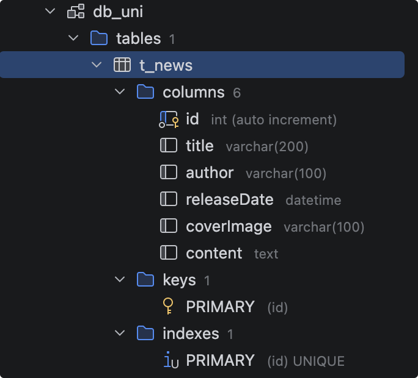
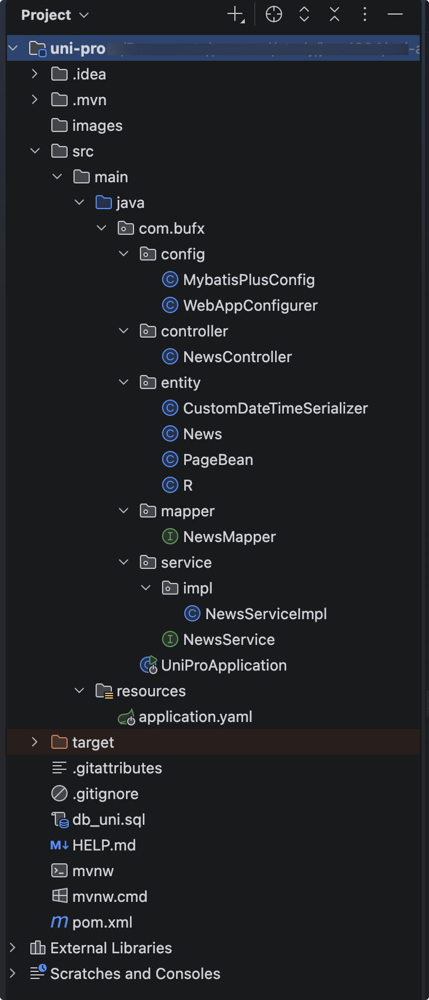
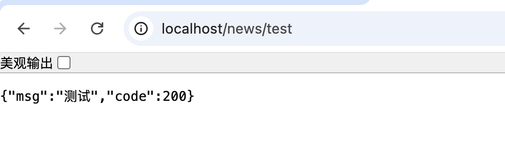
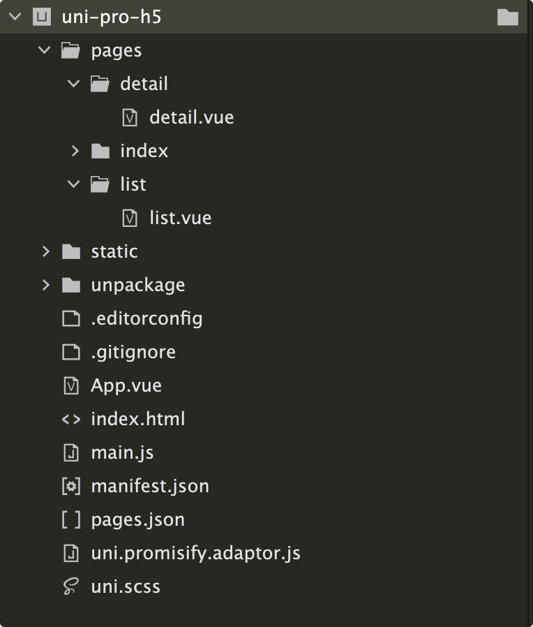
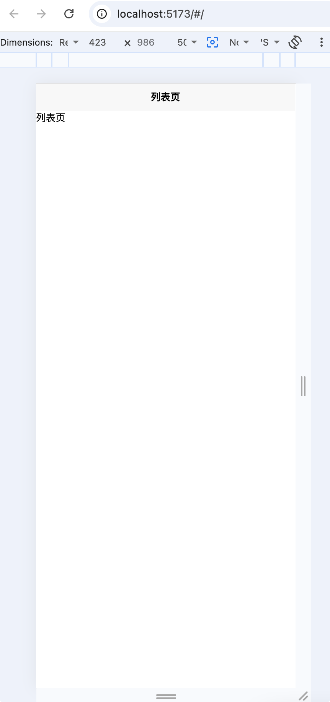
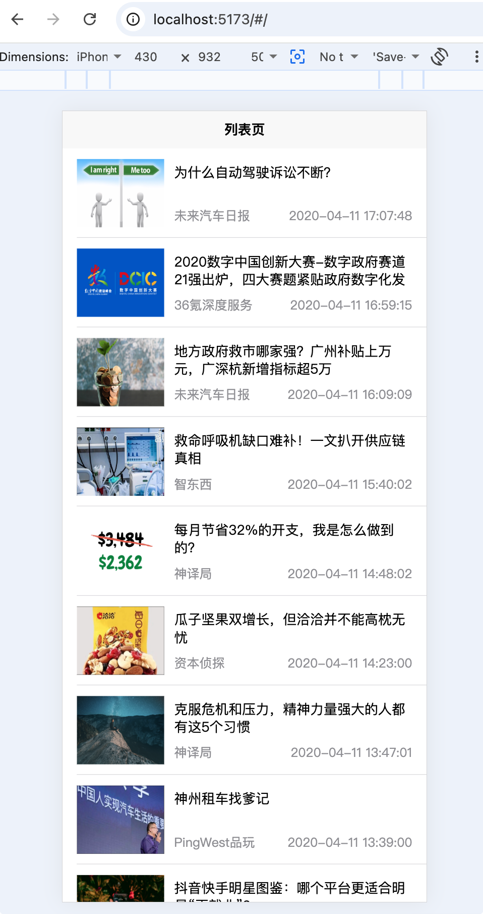
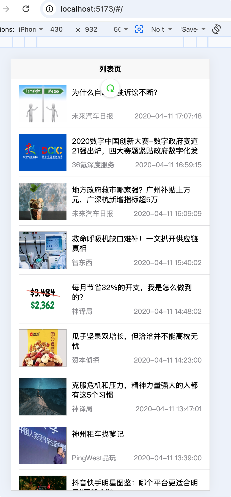
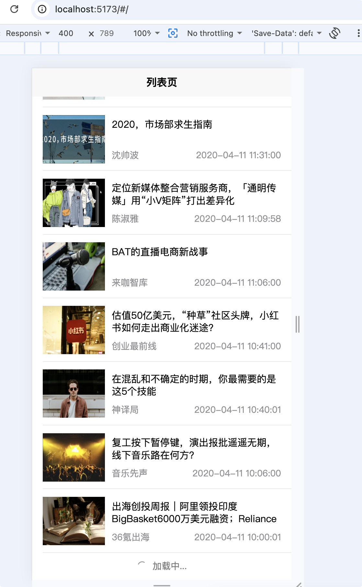
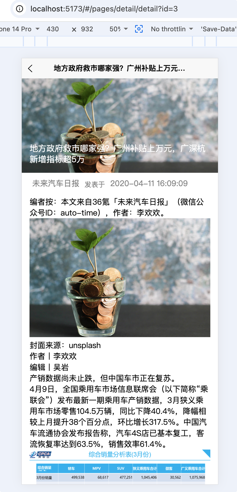

# uni-app与后端SpringBoot集成

## springboot后端搭建

1. 创建数据库db_uni

{width=400}

2. 打开idea 新建项目 uni-pro

目录结构：
{width=400}

::: code-group

```xml [pom.xml]
<?xml version="1.0" encoding="UTF-8"?>
<project xmlns="http://maven.apache.org/POM/4.0.0" xmlns:xsi="http://www.w3.org/2001/XMLSchema-instance"
  xsi:schemaLocation="http://maven.apache.org/POM/4.0.0 https://maven.apache.org/xsd/maven-4.0.0.xsd">
  <modelVersion>4.0.0</modelVersion>
  <parent>
    <groupId>org.springframework.boot</groupId>
    <artifactId>spring-boot-starter-parent</artifactId>
    <version>2.3.2.RELEASE</version>
    <relativePath/> <!-- lookup parent from repository -->
  </parent>
  <groupId>com.bufx</groupId>
  <artifactId>uni-pro</artifactId>
  <version>0.0.1-SNAPSHOT</version>
  <name>uni-pro</name>
  <description>uni-pro</description>
  <properties>
    <java.version>8</java.version>
  </properties>
  <dependencies>
    <dependency>
      <groupId>org.springframework.boot</groupId>
      <artifactId>spring-boot-starter-web</artifactId>
    </dependency>

    <dependency>
      <groupId>mysql</groupId>
      <artifactId>mysql-connector-java</artifactId>
      <scope>runtime</scope>
    </dependency>

    <!-- 连接池 -->
    <dependency>
      <groupId>com.alibaba</groupId>
      <artifactId>druid</artifactId>
      <version>1.1.10</version>
    </dependency>
    <!-- mybatis-plus -->
    <dependency>
      <groupId>com.baomidou</groupId>
      <artifactId>mybatis-plus-boot-starter</artifactId>
      <version>3.3.2</version>
    </dependency>
    <dependency>
      <groupId>com.baomidou</groupId>
      <artifactId>mybatis-plus-boot-starter</artifactId>
      <version>3.3.2</version>
    </dependency>

    <dependency>
      <groupId>org.projectlombok</groupId>
      <artifactId>lombok</artifactId>
      <optional>true</optional>
    </dependency>


  </dependencies>

  <build>
    <plugins>
      <plugin>
        <groupId>org.springframework.boot</groupId>
        <artifactId>spring-boot-maven-plugin</artifactId>
      </plugin>
    </plugins>
  </build>

</project>

```

```yml [application.yml]
server:
  port: 80
  servlet:
    context-path: /

spring:
  application:
    name: uni-pro
  datasource:
    type: com.alibaba.druid.pool.DruidDataSource
    driver-class-name: com.mysql.cj.jdbc.Driver
    url: jdbc:mysql://localhost:13306/db_uni?serverTimezone=Asia/Shanghai
    username: root
    password: root


mybatis-plus:
  global-config:
    db-config:
      id-type: auto
  configuration:
    map-underscore-to-camel-case: true
    auto-mapping-behavior: full
    log-impl: org.apache.ibatis.logging.stdout.StdOutImpl
  mapper-locations: classpath:mapper/*.xml
```

```java [UniProApplication.java]
package com.bufx;

import org.mybatis.spring.annotation.MapperScan;
import org.springframework.boot.SpringApplication;
import org.springframework.boot.autoconfigure.SpringBootApplication;

@SpringBootApplication
@MapperScan("com.bufx.mapper")
public class UniProApplication {

    public static void main(String[] args) {
        SpringApplication.run(UniProApplication.class, args);
    }

}

```

```java [NewsController.java]
package com.bufx.controller;

import com.bufx.entity.R;
import com.bufx.service.NewsService;
import org.springframework.beans.factory.annotation.Autowired;
import org.springframework.web.bind.annotation.GetMapping;
import org.springframework.web.bind.annotation.RequestMapping;
import org.springframework.web.bind.annotation.RestController;

/**
 * 新闻Controller控制器
 */
@RestController
@RequestMapping("/news")
public class NewsController {

    @Autowired
    private NewsService newsService;

    /**
     * 测试
     * @return
     */
    @GetMapping("/test")
    public R test(){
        return R.ok("测试");
    }
}

```


:::

测试:http://localhost/news/test

{width=400}

## uniapp前端搭建

1. 新建uni-app项目 uni-pro-h5
2. 新建两个页面 列表页和详情页

{width=400}

::: code-group

```vue [list.vue]
<template>
	列表页
</template>

<script>
</script>

<style>
</style>

```

```vue [detail.vue]
<template>
	详情页
</template>

<script>
</script>

<style>
</style>

```

```json [pages.json]
{
	"pages": [ //pages数组中第一项表示应用启动页，参考：https://uniapp.dcloud.io/collocation/pages
		{
			"path": "pages/list/list",
			"style": {
				"navigationBarTitleText": "列表页"
			}
		},
		{
			"path": "pages/detail/detail",
			"style": {
				"navigationBarTitleText": "详情页"
			}
		},
		{
			"path": "pages/index/index",
			"style": {
				"navigationBarTitleText": "uni-app"
			}
		}
	],
	"globalStyle": {
		"navigationBarTextStyle": "black",
		"navigationBarTitleText": "uni-app",
		"navigationBarBackgroundColor": "#F8F8F8",
		"backgroundColor": "#F8F8F8"
	},
	"uniIdRouter": {}
}

```

:::

{width=400}

## 数据列表显示

::: code-group

```java [NewsController.java]
/**
 * 获取新闻列表
 * @return
 */
@PostMapping("/list")
public R list() throws InterruptedException {
    Thread.sleep(2000); // 模拟延迟
    List<News> newsList = newsService.list();
    Map<String, Object> resultMap = new HashMap<>();
    resultMap.put("newsList", newsList);
    return R.ok(resultMap);
}
```

```vue [list.vue]
<template>
	<view class="uni-list">
		<block v-for="(value, index) in listData" :key="index">
			<view class="uni-list-cell">
				<view class="uni-media-list">
					<image class="uni-media-list-logo" :src="'http://localhost/image/' + value.coverImage"></image>
					<view class="uni-media-list-body">
						<view class="uni-media-list-text-top">{{value.title}}</view>
						<view class="uni-media-list-text-bottom">
							<text>{{value.author}}</text>
							<text>{{value.releaseDate}}</text>
						</view>
					</view>
				</view>
			</view>
		</block>
		<!-- <view class="uni-list-cell">
			<view class="uni-media-list">
				<image class="uni-media-list-logo" src="http://localhost/image/20230115051209000000878.png"></image>
				<view class="uni-media-list-body">
					<view class="uni-media-list-text-top">为什么自动驾驶诉讼不断？</view>
					<view class="uni-media-list-text-bottom">
						<text>未来汽车日报</text>
						<text>2020-04-11 17:07:48</text>
					</view>
				</view>
			</view>
		</view>
		<view class="uni-list-cell">
			<view class="uni-media-list">
				<image class="uni-media-list-logo" src="http://localhost/image/20230115051147000000020.png"></image>
				<view class="uni-media-list-body">
					<view class="uni-media-list-text-top">2020数字中国创新大赛-数字政府赛道21强出炉，四大赛题紧贴政府数字化发展需求</view>
					<view class="uni-media-list-text-bottom">
						<text>36氪深度服务</text>
						<text>2020/04/11-16:59</text>
					</view>
				</view>
			</view>
		</view> -->
	</view>
</template>

<script>
	export default {
		data() {
			return {
				listData:[]
			}
		},
		onLoad() {
			this.getList();
		},
		methods: {
			getList() {
				uni.request({
					url:'http://localhost/news/list',
					method:'POST',
					success:data=>{
						let result = data.data;
						if(result.code == 200) {
							this.listData = result.newsList;
						}
					},
					fail:(data, code)=>{
						console.log("fail:" + JSON.stringify(data));
					}
				})
			}
		}
	}
</script>

<style lang="scss">
	.uni-list{
		background-color: #FFFFFF;
		position: relative;
		width: 100%;
		display: flex;
		flex-direction: column;
		.uni-list-cell {
			position: relative;
			display: flex;
			flex-direction: row;
			justify-content: space-between;
			align-items: center;
			.uni-media-list {
				padding: 22rpx 30rpx;
				box-sizing: border-box;
				display: flex;
				width: 100%;
				flex-direction: row;
				.uni-media-list-logo {
					width: 5.625rem;
					height: 4.375rem;
					margin-right: 0.625rem;
				}

				.uni-media-list-body {
					height: auto;
					display: flex;
					flex: 1;
					flex-direction: column;
					justify-content: space-around;
					align-items: flex-start;
					overflow: hidden;
					.uni-media-list-text-top {
						height: 2.3125rem;
						font-size: 0.875rem;
						overflow: hidden;
						width: 100%;
						line-height: 1.125rem;
					}
					.uni-media-list-text-bottom {
						display: flex;
						flex-direction: row;
						justify-content: space-between;
						width: 100%;
						line-height: 0.9375rem;
						font-size: 0.8125rem;
						color: #8f8f94;
					}

				}
			}
		}
		.uni-list-cell::after {
		    position: absolute;
		    z-index: 3;
		    right: 0;
		    bottom: 0;
		    left: 0.9375rem;
		    height: 1px;
		    content: '';
		    transform: scaleY(.5);
		    background-color: #c8c7cc;
		}
	}
</style>

```

:::

{width=400}

## 下拉刷新实现

首先需要开启列表页面开启下拉刷新，并添加下来刷新函数，然后getList方法，success回调方法里，要加下停止下拉刷新，不然一直会有个刷新图标

::: code-group

```json [pages.json] {7}
{
	"pages": [ //pages数组中第一项表示应用启动页，参考：https://uniapp.dcloud.io/collocation/pages
		{
			"path": "pages/list/list",
			"style": {
				"navigationBarTitleText": "列表页",
				"enablePullDownRefresh": true
			}
		},
		{
			"path": "pages/detail/detail",
			"style": {
				"navigationBarTitleText": "详情页"
			}
		},
		{
			"path": "pages/index/index",
			"style": {
				"navigationBarTitleText": "uni-app"
			}
		}
	],
	"globalStyle": {
		"navigationBarTextStyle": "black",
		"navigationBarTitleText": "uni-app",
		"navigationBarBackgroundColor": "#F8F8F8",
		"backgroundColor": "#F8F8F8"
	},
	"uniIdRouter": {}
}

```

```vue [list.vue] {13-17,24}
...

<script>
	export default {
		data() {
			return {
				listData:[]
			}
		},
		onLoad() {
			this.getList();
		},
		onPullDownRefresh() {
			console.log("下拉刷新了");
			this.listData = [];
			this.getList();
		},
		methods: {
			getList() {
				uni.request({
					url:'http://localhost/news/list',
					method:'POST',
					success:data=>{
						uni.stopPullDownRefresh();
						let result = data.data;
						if(result.code == 200) {
							this.listData = result.newsList;
						}
					},
					fail:(data, code)=>{
						console.log("fail:" + JSON.stringify(data));
					}
				})
			}
		}
	}
</script>
...

```

:::

{width=400}

## 上拉分页实现

后端添加新接口，前端需要用到新组件：uni-load-more 组件 使用文档：https://uniapp.dcloud.net.cn/component/uniui/uni-load-more.html

::: code-group

```java [NewsController.java]
/**
 * 分页获取新闻列表
 * @return
 */
@PostMapping("/page")
public R page(@RequestBody PageBean pageBean) throws InterruptedException {
    Thread.sleep(2000); // 模拟延迟
    Page<News> pageResult = newsService.page(new Page<>(pageBean.getPageNum(), pageBean.getPageSize()));
    Map<String, Object> resultMap = new HashMap<>();
    resultMap.put("newsList", pageResult.getRecords());
    resultMap.put("total", pageResult.getTotal());
    resultMap.put("totalPage", pageResult.getPages());
    return R.ok(resultMap);
}
```

```vue [list.vue] {18,26-36,48-59,62,65,71,72}
<template>
	<view class="uni-list">
		<block v-for="(value, index) in listData" :key="index">
			<view class="uni-list-cell">
				<view class="uni-media-list">
					<image class="uni-media-list-logo" :src="'http://localhost/image/' + value.coverImage"></image>
					<view class="uni-media-list-body">
						<view class="uni-media-list-text-top">{{value.title}}</view>
						<view class="uni-media-list-text-bottom">
							<text>{{value.author}}</text>
							<text>{{value.releaseDate}}</text>
						</view>
					</view>
				</view>
			</view>
		</block>
	</view>
	<uni-load-more :status="status" :icon-size=16 :content-text="contentText"></uni-load-more>
</template>

<script>
	export default {
		data() {
			return {
				listData:[],
				queryParams: {
					pageNum: 1,
					pageSize: 10
				},
				totalPage: 0,
				status: "more",
				contentText: {
					contentdown: "上拉加载更多",
					contentrefresh: "加载中...",
					contentnomore: "没有更多数据了"
				}
			}
		},
		onLoad() {
			this.getList();
		},
		onPullDownRefresh() {
			console.log("下拉刷新了");
			this.listData = [];
			this.queryParams.pageNum = 1;
			this.getList();
		},
		// 触底函数
		onReachBottom() {
			console.log("上拉触底了");
			if(this.queryParams.pageNum >= this.totalPage) {
				console.log("没有下一页数据了");
				this.status="no-more";
			} else {
				console.log("有下一页数据");
				this.queryParams.pageNum++;
				this.getList();
			}
		},
		methods: {
			getList() {
				this.status="loading";
				uni.request({
					url:'http://localhost/news/page',
					data: this.queryParams,
					method:'POST',
					success:data=>{
						uni.stopPullDownRefresh();
						let result = data.data;
						if(result.code == 200) {
							this.listData = [...this.listData, ...result.newsList];
							this.totalPage = result.totalPage;
						}
					},
					fail:(data, code)=>{
						console.log("fail:" + JSON.stringify(data));
					}
				})
			}
		}
	}
</script>

```

:::

{width=400}

## 详情页实现

后端添加新接口，前端添加点击事件实现跳转发方法，跳到详情页

::: code-group

```java [NewsController.java]
/**
 * 获取新闻详情
 *
 * @param id 新闻ID
 * @return
 */
@GetMapping("/detail/{id}")
public R detail(@PathVariable Long id) {
    News news = newsService.getById(id);
    Map<String, Object> resultMap = new HashMap<>();
    resultMap.put("news", news);
    return R.ok(resultMap);
}
```

```vue [list.vue] {4,80-84}
<template>
	<view class="uni-list">
		<block v-for="(value, index) in listData" :key="index">
			<view class="uni-list-cell" @click="goDetail(value)">
				<view class="uni-media-list">
					<image class="uni-media-list-logo" :src="'http://localhost/image/' + value.coverImage"></image>
					<view class="uni-media-list-body">
						<view class="uni-media-list-text-top">{{value.title}}</view>
						<view class="uni-media-list-text-bottom">
							<text>{{value.author}}</text>
							<text>{{value.releaseDate}}</text>
						</view>
					</view>
				</view>
			</view>
		</block>
	</view>
	<uni-load-more :status="status" :icon-size=16 :content-text="contentText"></uni-load-more>
</template>

<script>
	export default {
		data() {
			return {
				listData:[],
				queryParams: {
					pageNum: 1,
					pageSize: 10
				},
				totalPage: 0,
				status: "more",
				contentText: {
					contentdown: "上拉加载更多",
					contentrefresh: "加载中...",
					contentnomore: "没有更多数据了"
				}
			}
		},
		onLoad() {
			this.getList();
		},
		onPullDownRefresh() {
			console.log("下拉刷新了");
			this.listData = [];
			this.queryParams.pageNum = 1;
			this.getList();
		},
		// 触底函数
		onReachBottom() {
			console.log("上拉触底了");
			if(this.queryParams.pageNum >= this.totalPage) {
				console.log("没有下一页数据了");
				this.status="no-more";
			} else {
				console.log("有下一页数据");
				this.queryParams.pageNum++;
				this.getList();
			}
		},
		methods: {
			getList() {
				this.status="loading";
				uni.request({
					url:'http://localhost/news/page',
					data: this.queryParams,
					method:'POST',
					success:data=>{
						uni.stopPullDownRefresh();
						let result = data.data;
						if(result.code == 200) {
							this.listData = [...this.listData, ...result.newsList];
							this.totalPage = result.totalPage;
						}
					},
					fail:(data, code)=>{
						console.log("fail:" + JSON.stringify(data));
					}
				})
			},
			goDetail: function(e) {
				uni.navigateTo({
					url:"/pages/detail/detail?id=" + e.id
				})
			}
		}
	}
</script>
```

```vue [detail.vue]
<template>
	<view>
		<view class="banner">
			<image class="banner-img" :src="'http://localhost/image/'+news.coverImage"></image>
			<view class="banner-title">{{news.title}}</view>
		</view>
		<view class="article-meta">
			<text class="article-author">{{news.author}}</text>
			<text class="article-text">发表于</text>
			<text class="article-time">{{news.releaseDate}}</text>
		</view>
		<view class="article-content">
			<rich-text :nodes="news.content"></rich-text>
		</view>
	</view>
</template>

<script>
	export default {
		data() {
			return {
				news: {}
			}
		},
		onLoad(event) {
			const id = event.id || 0;
			console.log("id=" + id);
			if(id > 0) {
				uni.request({
					url: "http://localhost/news/detail/" + id,
					success:(data)=>{
						let result = data.data;
						this.news = result.news;
						uni.setNavigationBarTitle({
							title: result.news.title
						})
					},
					fail:(data,code)=>{
						console.log("fail:" + JSON.stringify(data))
					}
				})
			}
		}
	}
</script>

<style lang="scss">
	.banner {
		height: 360rpx;
		overflow: hidden;
		position: relative;
		background-color: #ccc;
		.banner-img {
			width: 100%;
		}

		.banner-title {
			max-height: 84rpx;
			overflow: hidden;
			position: absolute;
			left: 30rpx;
			bottom: 30rpx;
			width: 90%;
			font-size: 32rpx;
			font-weight: 400;
			line-height: 42rpx;
			color: white;
			z-index: 11;
		}
	}

	.article-meta {
		padding: 20rpx 40rpx;
		display: flex;
		flex-direction: row;
		justify-content: flex-start;
		color: gray;

		.article-text {
			font-size: 26rpx;
			line-height: 50rpx;
			margin: 0 20rpx;
		}

		.article-author,
		.article-time {
			font-size: 30rpx;
		}
	}

	.article-content {
		padding: 0 30rpx;
		overflow: hidden;
		font-size: 30rpx;
		margin-bottom: 30rpx;
	}
</style>

```

:::

{width=400}