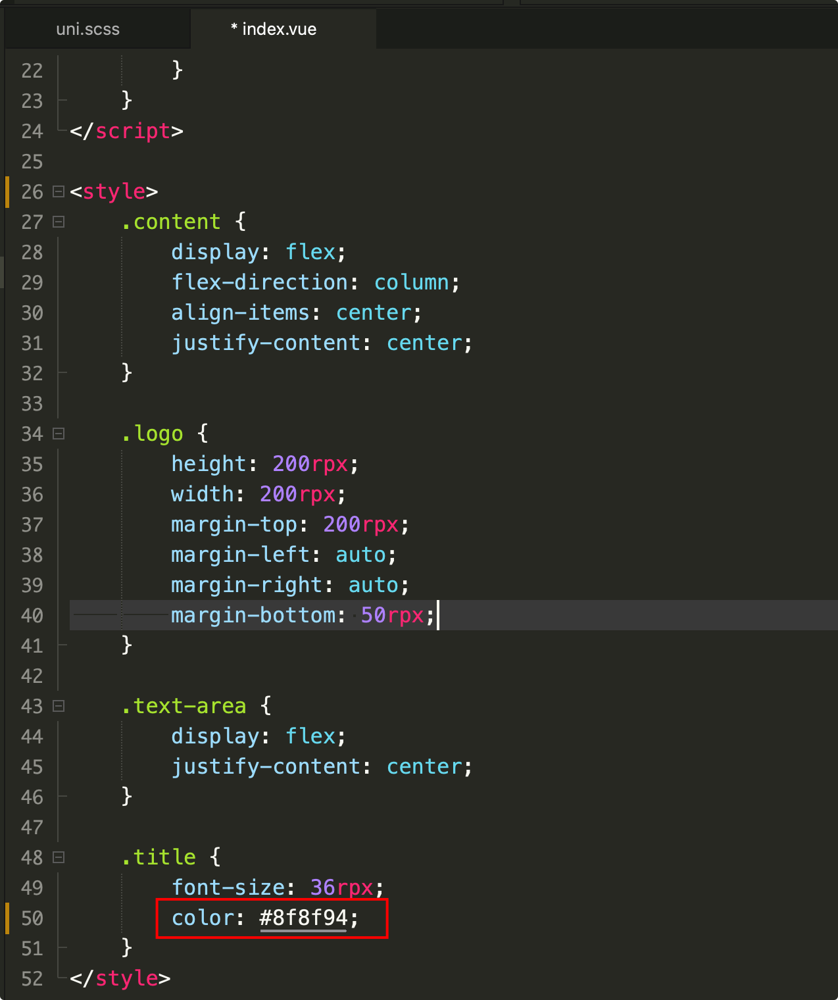
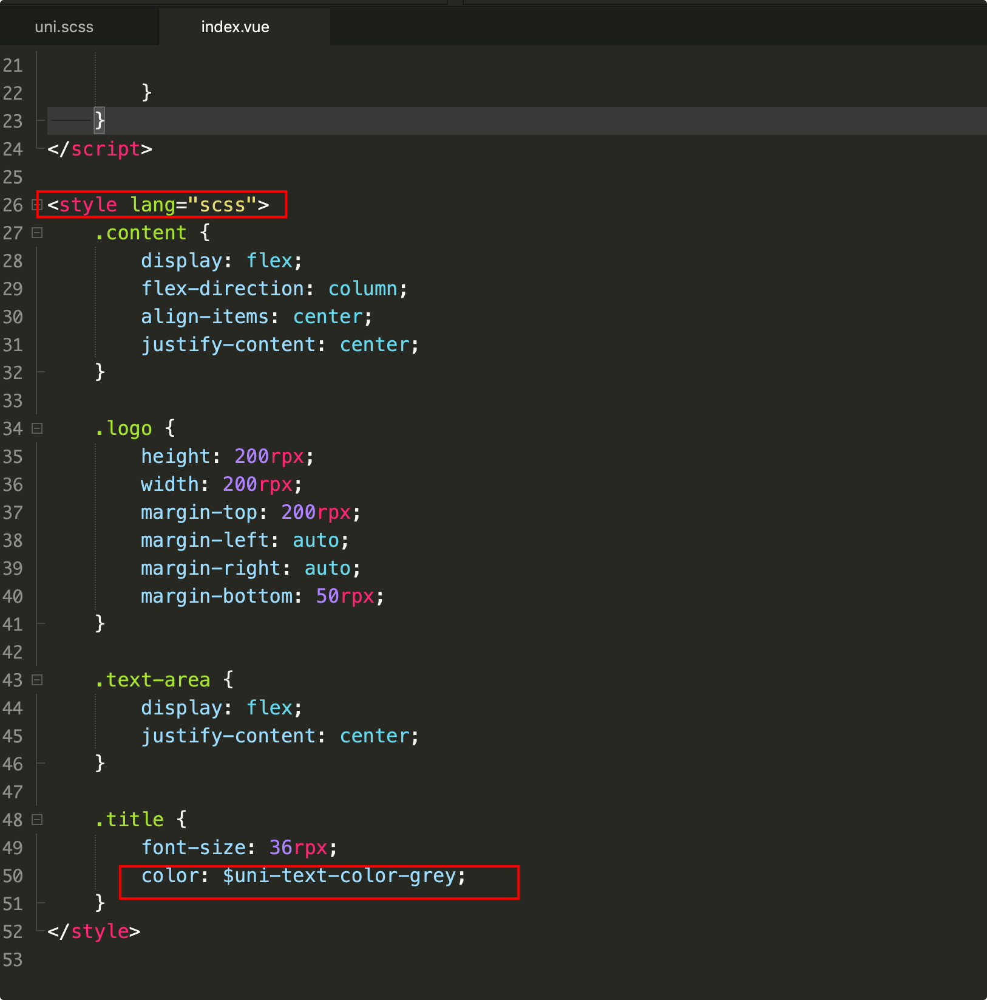
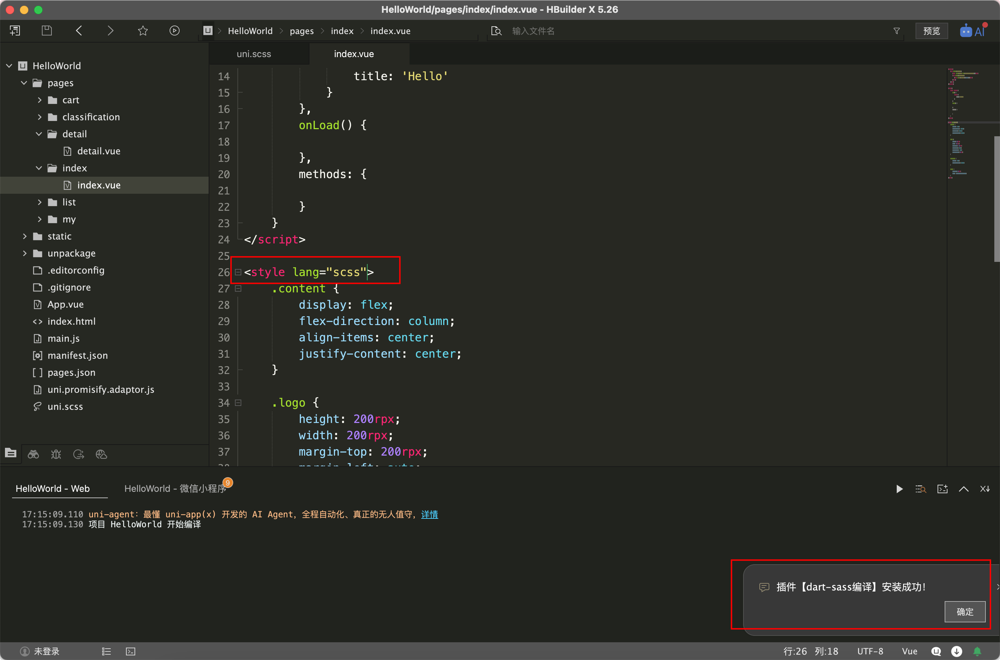
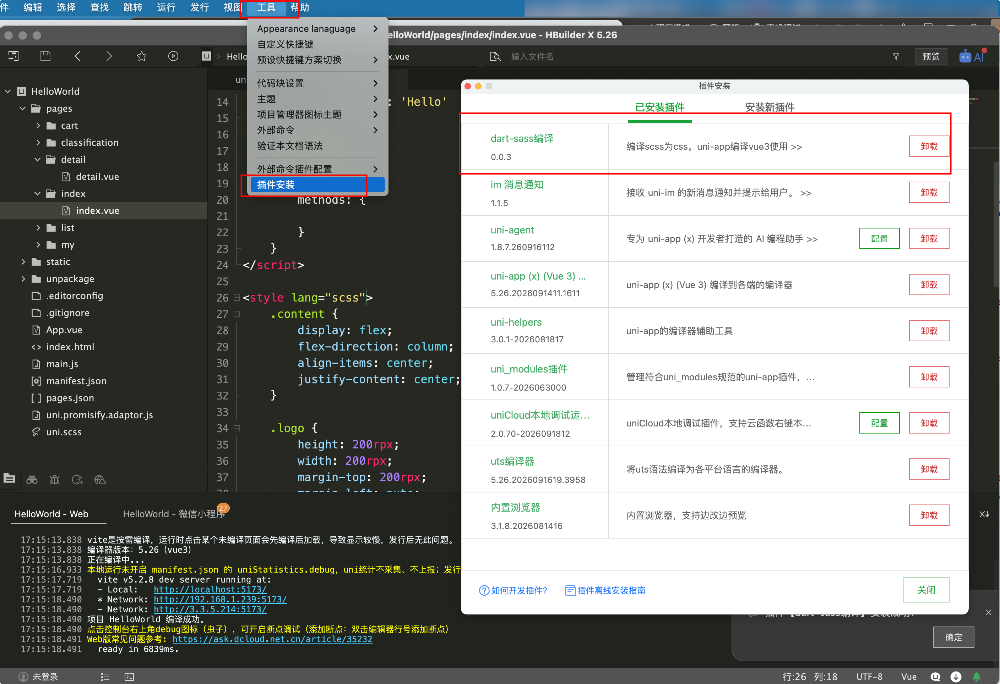
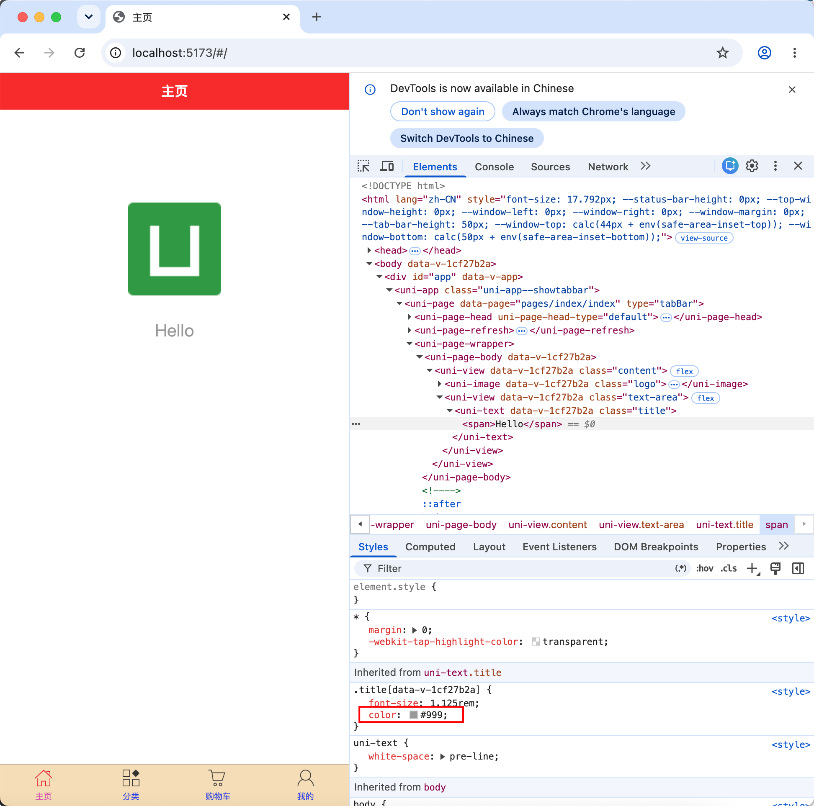

# uni.scss内置全局样式变量

## 介绍

`uni.scss`文件的用途是为了方便整体控制应用的风格。比如按钮颜色、边框风格，`uni.scss`文件里预置了一批scss变量预置。

## 作用

`uni-app` 官方扩展插件（uni ui）及 [插件市场](https://ext.dcloud.net.cn/) 上很多三方插件均使用了这些样式变量，如果你是插件开发者，建议你使用 scss 预处理，并在插件代码中直接使用这些变量（无需 import 这个文件），方便用户通过搭积木的方式开发整体风格一致的App。

`uni.scss`是一个特殊文件，在代码中无需 import 这个文件即可在scss代码中使用这里的样式变量。uni-app的编译器在webpack配置中特殊处理了这个uni.scss，使得每个scss文件都被注入这个uni.scss，达到全局可用的效果。如果开发者想要less、stylus的全局使用，需要在vue.config.js中自行配置webpack策略。

## 基本使用

### 注意点

1. 如要使用这些常用变量，需要在 HBuilderX 里面安装 scss 插件；
2. 使用时需要在 style 节点上加上 `lang="scss"`。

```html
<style lang="scss">
</style>
```

### 示例

比如需要修改首页的字体hello颜色为uni.scss里面的`$uni-text-color-grey:#999;//辅助灰色，如加载更多的提示信息`

1. 现在的颜色

{width=600}

页面上

{width=600}

2. 修改颜色

{width=600}

3. 当写了 `lang="scss"`后，工具会自动下载插件

{width=600}

{width=600}

4. 查看页面，已经颜色修改了

{width=600}