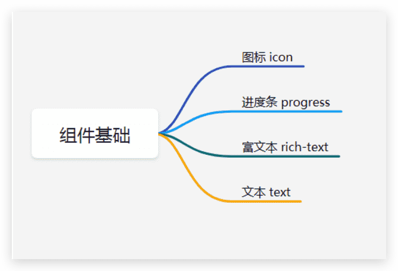
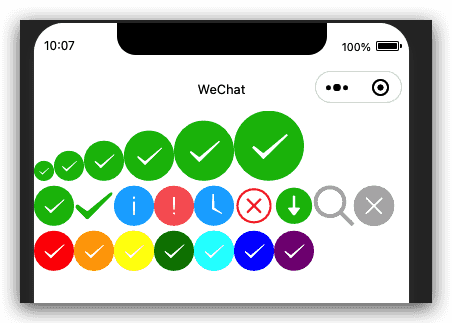
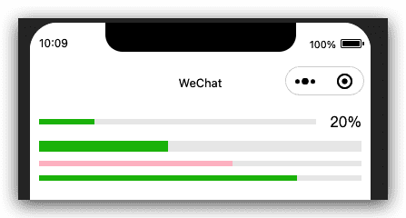
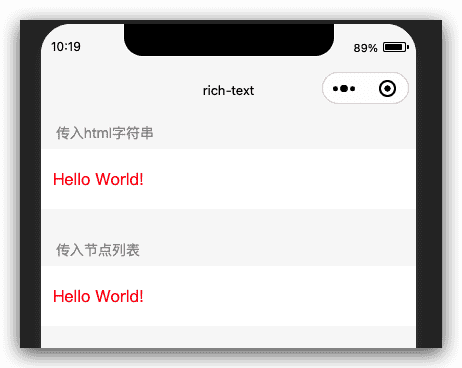
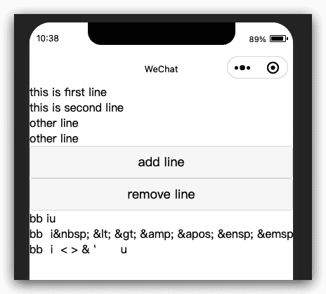

# 微信小程序框架组件-组件基础内容

组件基础内容分类，如下图:




## 图标icon

> 基础库 1.0.0 开始支持，低版本需做[兼容处理](https://developers.weixin.qq.com/miniprogram/dev/framework/compatibility.html)。

图标。组件属性的长度单位默认为px，[2.4.0](https://developers.weixin.qq.com/miniprogram/dev/framework/compatibility.html)起支持传入单位(rpx/px)。

| 属性  | 类型          | 默认值 | 必填 | 说明                                                         | 最低版本                                                     |
| :---- | :------------ | :----- | :--- | :----------------------------------------------------------- | :----------------------------------------------------------- |
| type  | string        |        | 是   | icon的类型，有效值：success, success_no_circle, info, warn, waiting, cancel, download, search, clear | [1.0.0](https://developers.weixin.qq.com/miniprogram/dev/framework/compatibility.html) |
| size  | number/string | 23     | 否   | icon的大小                                                   | [1.0.0](https://developers.weixin.qq.com/miniprogram/dev/framework/compatibility.html) |
| color | string        |        | 否   | icon的颜色，同css的color                                     | [1.0.0](https://developers.weixin.qq.com/miniprogram/dev/framework/compatibility.html) |

### 示例代码

[在开发者工具中预览效果](https://developers.weixin.qq.com/s/LK9tzcmM6QYj)

```html index.wxml
<view class="group">
  <block wx:for="{{iconSize}}">
    <icon type="success" size="{{item}}"/>
  </block>
</view>

<view class="group">
  <block wx:for="{{iconType}}">
    <icon type="{{item}}" size="40"/>
  </block>
</view>


<view class="group">
  <block wx:for="{{iconColor}}">
    <icon type="success" size="40" color="{{item}}"/>
  </block>
</view>
```

```js index.js
Page({
  data: {
    iconSize: [20, 30, 40, 50, 60, 70],
    iconColor: [
      'red', 'orange', 'yellow', 'green', 'rgb(0,255,255)', 'blue', 'purple'
    ],
    iconType: [
      'success', 'success_no_circle', 'info', 'warn', 'waiting', 'cancel', 'download', 'search', 'clear'
    ]
  }
})
```



## 进度条progress

> 基础库 1.0.0 开始支持，低版本需做[兼容处理](https://developers.weixin.qq.com/miniprogram/dev/framework/compatibility.html)。

进度条。组件属性的长度单位默认为px，[2.4.0](https://developers.weixin.qq.com/miniprogram/dev/framework/compatibility.html)起支持传入单位(rpx/px)。

| 属性            | 类型          | 默认值    | 必填 | 说明                                                    | 最低版本                                                     |
| :-------------- | :------------ | :-------- | :--- | :------------------------------------------------------ | :----------------------------------------------------------- |
| percent         | number        |           | 否   | 百分比0~100                                             | [1.0.0](https://developers.weixin.qq.com/miniprogram/dev/framework/compatibility.html) |
| show-info       | boolean       | false     | 否   | 在进度条右侧显示百分比                                  | [1.0.0](https://developers.weixin.qq.com/miniprogram/dev/framework/compatibility.html) |
| border-radius   | number/string | 0         | 否   | 圆角大小                                                | [2.3.1](https://developers.weixin.qq.com/miniprogram/dev/framework/compatibility.html) |
| font-size       | number/string | 16        | 否   | 右侧百分比字体大小                                      | [2.3.1](https://developers.weixin.qq.com/miniprogram/dev/framework/compatibility.html) |
| stroke-width    | number/string | 6         | 否   | 进度条线的宽度                                          | [1.0.0](https://developers.weixin.qq.com/miniprogram/dev/framework/compatibility.html) |
| color           | string        | #09BB07   | 否   | 进度条颜色（请使用activeColor）                         | [1.0.0](https://developers.weixin.qq.com/miniprogram/dev/framework/compatibility.html) |
| activeColor     | string        | #09BB07   | 否   | 已选择的进度条的颜色                                    | [1.0.0](https://developers.weixin.qq.com/miniprogram/dev/framework/compatibility.html) |
| backgroundColor | string        | #EBEBEB   | 否   | 未选择的进度条的颜色                                    | [1.0.0](https://developers.weixin.qq.com/miniprogram/dev/framework/compatibility.html) |
| active          | boolean       | false     | 否   | 进度条从左往右的动画                                    | [1.0.0](https://developers.weixin.qq.com/miniprogram/dev/framework/compatibility.html) |
| active-mode     | string        | backwards | 否   | backwards: 动画从头播；forwards：动画从上次结束点接着播 | [1.7.0](https://developers.weixin.qq.com/miniprogram/dev/framework/compatibility.html) |
| duration        | number        | 30        | 否   | 进度增加1%所需毫秒数                                    | [2.8.2](https://developers.weixin.qq.com/miniprogram/dev/framework/compatibility.html) |
| bindactiveend   | eventhandle   |           | 否   | 动画完成事件                                            | [2.4.1](https://developers.weixin.qq.com/miniprogram/dev/framework/compatibility.html) |

### 示例代码

[在开发者工具中预览效果](https://developers.weixin.qq.com/s/Oga4Hcmj6cYS)

```html index.wxml
<progress percent="20" show-info />
<progress percent="40" stroke-width="12" />
<progress percent="60" color="pink" />
<progress percent="80" active />
```



## 富文本rich-text

> 基础库 1.4.0 开始支持，低版本需做[兼容处理](https://developers.weixin.qq.com/miniprogram/dev/framework/compatibility.html)。

富文本。

| 属性  | 类型         | 默认值 | 必填 | 说明                 | 最低版本                                                     |
| :---- | :----------- | :----- | :--- | :------------------- | :----------------------------------------------------------- |
| nodes | array/string | []     | 否   | 节点列表/HTML String | [1.4.0](https://developers.weixin.qq.com/miniprogram/dev/framework/compatibility.html) |
| space | string       |        | 否   | 显示连续空格         | [2.4.1](https://developers.weixin.qq.com/miniprogram/dev/framework/compatibility.html) |

**space 的合法值**

| 值   | 说明                   | 最低版本 |
| :--- | :--------------------- | :------- |
| ensp | 中文字符空格一半大小   |          |
| emsp | 中文字符空格大小       |          |
| nbsp | 根据字体设置的空格大小 |          |

### nodes

现支持两种节点，通过type来区分，分别是元素节点和文本节点，默认是元素节点，在富文本区域里显示的HTML节点

**元素节点：type = node**

| 属性     | 说明       | 类型   | 必填 | 备注                                     |
| :------- | :--------- | :----- | :--- | :--------------------------------------- |
| name     | 标签名     | string | 是   | 支持部分受信任的 HTML 节点               |
| attrs    | 属性       | object | 否   | 支持部分受信任的属性，遵循 Pascal 命名法 |
| children | 子节点列表 | array  | 否   | 结构和 nodes 一致                        |

**文本节点：type = text**

| 属性 | 说明 | 类型   | 必填 | 备注         |
| :--- | :--- | :----- | :--- | :----------- |
| text | 文本 | string | 是   | 支持entities |

### 受信任的HTML节点及属性

全局支持class和style属性，**不支持id属性**。

| 节点       | 属性                            |
| :--------- | :------------------------------ |
| a          |                                 |
| abbr       |                                 |
| address    |                                 |
| article    |                                 |
| aside      |                                 |
| b          |                                 |
| bdi        |                                 |
| bdo        | dir                             |
| big        |                                 |
| blockquote |                                 |
| br         |                                 |
| caption    |                                 |
| center     |                                 |
| cite       |                                 |
| code       |                                 |
| col        | span，width                     |
| colgroup   | span，width                     |
| dd         |                                 |
| del        |                                 |
| div        |                                 |
| dl         |                                 |
| dt         |                                 |
| em         |                                 |
| fieldset   |                                 |
| font       |                                 |
| footer     |                                 |
| h1         |                                 |
| h2         |                                 |
| h3         |                                 |
| h4         |                                 |
| h5         |                                 |
| h6         |                                 |
| header     |                                 |
| hr         |                                 |
| i          |                                 |
| img        | alt，src，height，width         |
| ins        |                                 |
| label      |                                 |
| legend     |                                 |
| li         |                                 |
| mark       |                                 |
| nav        |                                 |
| ol         | start，type                     |
| p          |                                 |
| pre        |                                 |
| q          |                                 |
| rt         |                                 |
| ruby       |                                 |
| s          |                                 |
| section    |                                 |
| small      |                                 |
| span       |                                 |
| strong     |                                 |
| sub        |                                 |
| sup        |                                 |
| table      | width                           |
| tbody      |                                 |
| td         | colspan，height，rowspan，width |
| tfoot      |                                 |
| th         | colspan，height，rowspan，width |
| thead      |                                 |
| tr         | colspan，height，rowspan，width |
| tt         |                                 |
| u          |                                 |
| ul         |                                 |

### Bug & Tip

1. `tip`: nodes 不推荐使用 String 类型，性能会有所下降。
2. `tip`: `rich-text` 组件内屏蔽所有节点的事件。
3. `tip`: attrs 属性不支持 id ，支持 class 。
4. `tip`: name 属性大小写不敏感。
5. `tip`: 如果使用了不受信任的HTML节点，该节点及其所有子节点将会被移除。
6. `tip`: img 标签仅支持网络图片。
7. `tip`: 如果在自定义组件中使用 `rich-text` 组件，那么仅自定义组件的 wxss 样式对 `rich-text` 中的 class 生效。

### 示例代码

[在开发者工具中预览效果](https://developers.weixin.qq.com/s/zPVmpim46wYQ)

```html index.wxml
<view class="page-body">
  <view class="page-section">
    <view class="page-section-title">传入html字符串</view>
    <view class="rich-text-wrp">
      <rich-text nodes="{{html}}" bindtap="tap"></rich-text>
    </view>
  </view>

  <view class="page-section">
    <view class="page-section-title">传入节点列表</view>
    <view class="rich-text-wrp">
      <rich-text nodes="{{nodes}}" bindtap="tap"></rich-text>
    </view>
  </view>
</view>
```

```js index.js
Page({
  data: {
    html: '<div class="div_class" style="line-height: 60px; color: red;">Hello&nbsp;World!</div>',
    nodes: [{
      name: 'div',
      attrs: {
        class: 'div_class',
        style: 'line-height: 60px; color: red;'
      },
      children: [{
        type: 'text',
        text: 'Hello&nbsp;World!'
      }]
    }]
  },
  tap() {
    console.log('tap')
  }
})
```



## 文本text

> 基础库 1.0.0 开始支持，低版本需做[兼容处理](https://developers.weixin.qq.com/miniprogram/dev/framework/compatibility.html)。

文本。

| 属性        | 类型    | 默认值 | 必填 | 说明                                                | 最低版本                                                     |
| :---------- | :------ | :----- | :--- | :-------------------------------------------------- | :----------------------------------------------------------- |
| selectable  | boolean | false  | 否   | 文本是否可选 (已废弃)                               | [1.1.0](https://developers.weixin.qq.com/miniprogram/dev/framework/compatibility.html) |
| user-select | boolean | false  | 否   | 文本是否可选，该属性会使文本节点显示为 inline-block | [2.12.1](https://developers.weixin.qq.com/miniprogram/dev/framework/compatibility.html) |
| space       | string  |        | 否   | 显示连续空格                                        | [1.4.0](https://developers.weixin.qq.com/miniprogram/dev/framework/compatibility.html) |
| decode      | boolean | false  | 否   | 是否解码                                            | [1.4.0](https://developers.weixin.qq.com/miniprogram/dev/framework/compatibility.html) |

**space 的合法值**

| 值   | 说明                   | 最低版本 |
| :--- | :--------------------- | :------- |
| ensp | 中文字符空格一半大小   |          |
| emsp | 中文字符空格大小       |          |
| nbsp | 根据字体设置的空格大小 |          |

### Bug & Tip

1. `tip`: decode可以解析的有 ` ` `<` `>` `&` `'` ` ` ` `
2. `tip`: 各个操作系统的空格标准并不一致。
3. `tip`:[text](https://developers.weixin.qq.com/miniprogram/dev/component/text.html) 组件内只支持 [text](https://developers.weixin.qq.com/miniprogram/dev/component/text.html) 嵌套。
4. `tip`: 除了文本节点以外的其他节点都无法长按选中。
5. `bug`: 基础库版本低于 `2.1.0` 时， [text](https://developers.weixin.qq.com/miniprogram/dev/component/text.html) 组件内嵌的 [text](https://developers.weixin.qq.com/miniprogram/dev/component/text.html) style 设置可能不会生效。

### 示例代码

[在开发者工具中预览效果](https://developers.weixin.qq.com/s/Egao9cm46gY6)

```html index.wxml
<view class="btn-area">
  <view class="body-view">
    <text>{{text}}</text>
    <button bindtap="add">add line</button>
    <button bindtap="remove">remove line</button>
  </view>
</view>

<view><text user-select>bb  iu</text></view>
<view><text user-select space="nbsp">bb  i&nbsp; &lt; &gt; &amp; &apos; &ensp; &emsp;u</text></view>
<view><text user-select space="nbsp" decode>bb  i&nbsp; &lt; &gt; &amp; &apos; &ensp; &emsp;u</text></view>
```

```js index.js
var initData = 'this is first line\nthis is second line'
var extraLine = [];
Page({
  data: {
    text: initData
  },
  add: function (e) {
    extraLine.push('other line')
    this.setData({
      text: initData + '\n' + extraLine.join('\n')
    })
  },
  remove: function (e) {
    if (extraLine.length > 0) {
      extraLine.pop()
      this.setData({
        text: initData + '\n' + extraLine.join('\n')
      })
    }
  }
})
```


