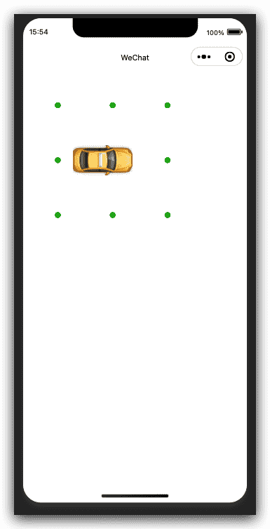
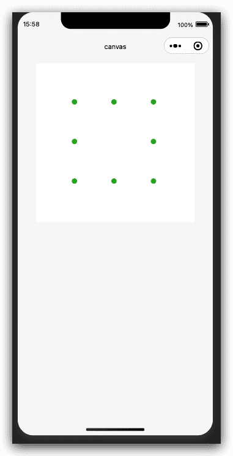

# 微信小程序框架组件-画布组件

## canvas 组件

> 基础库 1.0.0 开始支持，低版本需做[兼容处理](https://developers.weixin.qq.com/miniprogram/dev/framework/compatibility.html)。

画布，我们可以做一些绘图和动画效果。2.9.0 起支持一套新 Canvas 2D 接口（需指定 type 属性），同时支持[同层渲染](https://developers.weixin.qq.com/miniprogram/dev/component/native-component.html#原生组件同层渲染)，原有接口不再维护。相关api：[获取 canvas 实例](https://developers.weixin.qq.com/miniprogram/dev/api/canvas/Canvas.html)。


| 属性            | 类型        | 默认值 | 必填 | 说明                                                         | 最低版本                                                     |
| :-------------- | :---------- | :----- | :--- | :----------------------------------------------------------- | :----------------------------------------------------------- |
| type            | string      |        | 否   | 指定 canvas 类型，支持 2d (2.9.0) 和 webgl (2.7.0)           | [2.7.0](https://developers.weixin.qq.com/miniprogram/dev/framework/compatibility.html) |
| canvas-id       | string      |        | 否   | canvas 组件的唯一标识符，若指定了 type 则无需再指定该属性    | [1.0.0](https://developers.weixin.qq.com/miniprogram/dev/framework/compatibility.html) |
| disable-scroll  | boolean     | false  | 否   | 当在 canvas 中移动时且有绑定手势事件时，禁止屏幕滚动以及下拉刷新 | [1.0.0](https://developers.weixin.qq.com/miniprogram/dev/framework/compatibility.html) |
| bindtouchstart  | eventhandle |        | 否   | 手指触摸动作开始                                             | [1.0.0](https://developers.weixin.qq.com/miniprogram/dev/framework/compatibility.html) |
| bindtouchmove   | eventhandle |        | 否   | 手指触摸后移动                                               | [1.0.0](https://developers.weixin.qq.com/miniprogram/dev/framework/compatibility.html) |
| bindtouchend    | eventhandle |        | 否   | 手指触摸动作结束                                             | [1.0.0](https://developers.weixin.qq.com/miniprogram/dev/framework/compatibility.html) |
| bindtouchcancel | eventhandle |        | 否   | 手指触摸动作被打断，如来电提醒，弹窗                         | [1.0.0](https://developers.weixin.qq.com/miniprogram/dev/framework/compatibility.html) |
| bindlongtap     | eventhandle |        | 否   | 手指长按 500ms 之后触发，触发了长按事件后进行移动不会触发屏幕的滚动 | [1.0.0](https://developers.weixin.qq.com/miniprogram/dev/framework/compatibility.html) |
| binderror       | eventhandle |        | 否   | 当发生错误时触发 error 事件，`detail = {errMsg}`               | [1.0.0](https://developers.weixin.qq.com/miniprogram/dev/framework/compatibility.html) |

## Bug & Tip

1. `tip`：canvas 标签默认宽度300px、高度150px
2. `tip`：同一页面中的 canvas-id 不可重复，如果使用一个已经出现过的 canvas-id，该 canvas 标签对应的画布将被隐藏并不再正常工作
3. `tip`：请注意[原生组件使用限制](https://developers.weixin.qq.com/miniprogram/dev/component/native-component.html#原生组件的使用限制)
4. `tip`：开发者工具中默认关闭了 GPU 硬件加速，可在开发者工具的设置中开启“硬件加速”提高 WebGL 的渲染性能
5. `tip`: WebGL 支持通过 getContext('webgl', { alpha: true }) 获取透明背景的画布
6. `tip`: Canvas 2D（新接口）需要显式设置画布宽高，默认：`300*150`，最大：`1365*1365`
7. `bug`: 避免设置过大的宽高，在安卓下会有crash的问题
8. `tip`: iOS 暂不支持 pointer-events

## Canvas 2D 示例代码

[在开发者工具中预览效果](https://developers.weixin.qq.com/s/SHfgCmmq7UcM)

```html index.wxml
<canvas
  type="2d"
  id="canvas"
  style="width: 300px; height: 300px;"
></canvas>
```

```js index.js
const app = getApp()

Page({
  data: {},

  onLoad: function () {
    this.position = {
      x: 150,
      y: 150,
      vx: 2,
      vy: 2
    }
    this.x = -100

    // 通过 SelectorQuery 获取 Canvas 节点
    wx.createSelectorQuery()
      .select('#canvas')
      .fields({
        node: true,
        size: true,
      })
      .exec(this.init.bind(this))
  },

  init(res) {
    const width = res[0].width
    const height = res[0].height

    const canvas = res[0].node
    const ctx = canvas.getContext('2d')

    const dpr = wx.getSystemInfoSync().pixelRatio
    canvas.width = width * dpr
    canvas.height = height * dpr
    ctx.scale(dpr, dpr)

    const renderLoop = () => {
      this.render(canvas, ctx)
      canvas.requestAnimationFrame(renderLoop)
    }
    canvas.requestAnimationFrame(renderLoop)

    const img = canvas.createImage()
    img.onload = () => {
      this._img = img
    }
    img.src = './car.png'
  },

  render(canvas, ctx) {
    ctx.clearRect(0, 0, 300, 300)
    this.drawBall(ctx)
    this.drawCar(ctx)
  },

  drawBall(ctx) {
    const p = this.position
    p.x += p.vx
    p.y += p.vy
    if (p.x >= 300) {
      p.vx = -2
    }
    if (p.x <= 7) {
      p.vx = 2
    }
    if (p.y >= 300) {
      p.vy = -2
    }
    if (p.y <= 7) {
      p.vy = 2
    }

    function ball(x, y) {
      ctx.beginPath()
      ctx.arc(x, y, 5, 0, Math.PI * 2)
      ctx.fillStyle = '#1aad19'
      ctx.strokeStyle = 'rgba(1,1,1,0)'
      ctx.fill()
      ctx.stroke()
    }

    ball(p.x, 150)
    ball(150, p.y)
    ball(300 - p.x, 150)
    ball(150, 300 - p.y)
    ball(p.x, p.y)
    ball(300 - p.x, 300 - p.y)
    ball(p.x, 300 - p.y)
    ball(300 - p.x, p.y)
  },

  drawCar(ctx) {
    if (!this._img) return
    if (this.x > 350) {
      this.x = -100
    }
    ctx.drawImage(this._img, this.x++, 150 - 25, 100, 50)
    ctx.restore()
  }
})

```



## WebGL 示例代码

[在开发者工具中预览效果](https://developers.weixin.qq.com/s/qEGUOqmf7T8z)

```html index.wxml
<canvas type="webgl" id="myCanvas" style="width: 300px; height: 300px;"></canvas>
```

```js index.js
const vs = `
  precision mediump float;

  attribute vec2 vertPosition;
  attribute vec3 vertColor;
  varying vec3 fragColor;

  void main() {
    gl_Position = vec4(vertPosition, 0.0, 1.0);
    fragColor = vertColor;
  }
`

const fs = `
  precision mediump float;

  varying vec3 fragColor;
  void main() {
    gl_FragColor = vec4(fragColor, 1.0);
  }
`

const triangleVertices = [
  0.0, 0.5, 1.0, 1.0, 0.0,
  -0.5, -0.5, 0.7, 0.0, 1.0,
  0.5, -0.5, 0.1, 1.0, 0.6
];

Page({
  onLoad() {
    const query = wx.createSelectorQuery()
    query.select('#myCanvas').node().exec((res) => {
      const canvas = res[0].node
      this._render(canvas)
    })
  },

  _render(canvas) {
    const gl = canvas.getContext('webgl')
    if (!gl) {
      console.error('gl init failed', gl)
      return
    }
    gl.viewport(0, 0, 300, 300)
    const vertShader = gl.createShader(gl.VERTEX_SHADER)
    gl.shaderSource(vertShader, vs)
    gl.compileShader(vertShader)

    const fragShader = gl.createShader(gl.FRAGMENT_SHADER)
    gl.shaderSource(fragShader, fs)
    gl.compileShader(fragShader)

    const prog = gl.createProgram()
    gl.attachShader(prog, vertShader)
    gl.attachShader(prog, fragShader)
    gl.deleteShader(vertShader)
    gl.deleteShader(fragShader)
    gl.linkProgram(prog)
    gl.useProgram(prog)

    const draw = () => {
      const triangleVertexBufferObject = gl.createBuffer()
      gl.bindBuffer(gl.ARRAY_BUFFER, triangleVertexBufferObject)
      gl.bufferData(gl.ARRAY_BUFFER, new Float32Array(triangleVertices), gl.STATIC_DRAW)

      const positionAttribLocation = gl.getAttribLocation(prog, 'vertPosition')
      const colorAttribLocation = gl.getAttribLocation(prog, 'vertColor')
      gl.vertexAttribPointer(
        positionAttribLocation,
        2,
        gl.FLOAT,
        gl.FALSE,
        5 * Float32Array.BYTES_PER_ELEMENT,
        0
      )
      gl.vertexAttribPointer(
        colorAttribLocation,
        3,
        gl.FLOAT,
        gl.FALSE,
        5 * Float32Array.BYTES_PER_ELEMENT,
        2 * Float32Array.BYTES_PER_ELEMENT
      )

      gl.enableVertexAttribArray(positionAttribLocation)
      gl.enableVertexAttribArray(colorAttribLocation)
      gl.drawArrays(gl.TRIANGLES, 0, 3)
      canvas.requestAnimationFrame(draw)
    }

    canvas.requestAnimationFrame(draw)
  }
})

```

(可惜报错了，无法运行，等待官方修复)

## 示例代码（旧的接口）

[在开发者工具中预览效果](https://developers.weixin.qq.com/s/oyVplmmG6xYt)

```xml index.wxml
<view class="page-body">
  <view class="page-body-wrapper">
    <canvas canvas-id="canvas" class="canvas"></canvas>
  </view>
</view>
```

```js index.js
Page({
  onReady: function () {
    this.position = {
      x: 150,
      y: 150,
      vx: 2,
      vy: 2
    }

    this.drawBall()
    this.interval = setInterval(this.drawBall, 17)
  },
  drawBall: function () {
    var p = this.position
    p.x += p.vx
    p.y += p.vy
    if (p.x >= 300) {
      p.vx = -2
    }
    if (p.x <= 7) {
      p.vx = 2
    }
    if (p.y >= 300) {
      p.vy = -2
    }
    if (p.y <= 7) {
      p.vy = 2
    }

    var context = wx.createContext()

    function ball(x, y) {
      context.beginPath(0)
      context.arc(x, y, 5, 0, Math.PI * 2)
      context.setFillStyle('#1aad19')
      context.setStrokeStyle('rgba(1,1,1,0)')
      context.fill()
      context.stroke()
    }

    ball(p.x, 150)
    ball(150, p.y)
    ball(300 - p.x, 150)
    ball(150, 300 - p.y)
    ball(p.x, p.y)
    ball(300 - p.x, 300 - p.y)
    ball(p.x, 300 - p.y)
    ball(300 - p.x, p.y)

    wx.drawCanvas({
      canvasId: 'canvas',
      actions: context.getActions()
    })
  },
  onUnload: function () {
    clearInterval(this.interval)
  }
})

```




