# 微信小程序框架组件-表单组件

表单组件由一系列组件组成,包括: button、checkbox、form、 input、 label、 picker、picker - view 、radio、slider 、switch和 textarea。熟悉WEB开发的朋友应该知道表单在WEB开发中应用非常广泛, 表单主要用来构建与用户进行的交互,因而建议大家务必重点掌握表单组件的应用。


## 按钮button

> 基础库 1.0.0 开始支持，低版本需做[兼容处理](https://developers.weixin.qq.com/miniprogram/dev/framework/compatibility.html)。

按钮。

| 属性                   | 类型        | 默认值       | 必填 | 说明                                                         | 最低版本                                                     |
| :--------------------- | :---------- | :----------- | :--- | :----------------------------------------------------------- | :----------------------------------------------------------- |
| size                   | string      | default      | 否   | 按钮的大小                                                   | [1.0.0](https://developers.weixin.qq.com/miniprogram/dev/framework/compatibility.html) |
| type                   | string      | default      | 否   | 按钮的样式类型                                               | [1.0.0](https://developers.weixin.qq.com/miniprogram/dev/framework/compatibility.html) |
| plain                  | boolean     | false        | 否   | 按钮是否镂空，背景色透明                                     | [1.0.0](https://developers.weixin.qq.com/miniprogram/dev/framework/compatibility.html) |
| disabled               | boolean     | false        | 否   | 是否禁用                                                     | [1.0.0](https://developers.weixin.qq.com/miniprogram/dev/framework/compatibility.html) |
| loading                | boolean     | false        | 否   | 名称前是否带 loading 图标                                    | [1.0.0](https://developers.weixin.qq.com/miniprogram/dev/framework/compatibility.html) |
| form-type              | string      |              | 否   | 用于 [form](https://developers.weixin.qq.com/miniprogram/dev/component/form.html) 组件，点击分别会触发 [form](https://developers.weixin.qq.com/miniprogram/dev/component/form.html) 组件的 submit/reset 事件 | [1.0.0](https://developers.weixin.qq.com/miniprogram/dev/framework/compatibility.html) |
| open-type              | string      |              | 否   | 微信开放能力                                                 | [1.1.0](https://developers.weixin.qq.com/miniprogram/dev/framework/compatibility.html) |
| hover-class            | string      | button-hover | 否   | 指定按钮按下去的样式类。当 `hover-class="none"` 时，没有点击态效果 | [1.0.0](https://developers.weixin.qq.com/miniprogram/dev/framework/compatibility.html) |
| hover-stop-propagation | boolean     | false        | 否   | 指定是否阻止本节点的祖先节点出现点击态                       | [1.5.0](https://developers.weixin.qq.com/miniprogram/dev/framework/compatibility.html) |
| hover-start-time       | number      | 20           | 否   | 按住后多久出现点击态，单位毫秒                               | [1.0.0](https://developers.weixin.qq.com/miniprogram/dev/framework/compatibility.html) |
| hover-stay-time        | number      | 70           | 否   | 手指松开后点击态保留时间，单位毫秒                           | [1.0.0](https://developers.weixin.qq.com/miniprogram/dev/framework/compatibility.html) |
| lang                   | string      | en           | 否   | 指定返回用户信息的语言，zh_CN 简体中文，zh_TW 繁体中文，en 英文。 | [1.3.0](https://developers.weixin.qq.com/miniprogram/dev/framework/compatibility.html) |
| session-from           | string      |              | 否   | 会话来源，open-type="contact"时有效                          | [1.4.0](https://developers.weixin.qq.com/miniprogram/dev/framework/compatibility.html) |
| send-message-title     | string      | 当前标题     | 否   | 会话内消息卡片标题，open-type="contact"时有效                | [1.5.0](https://developers.weixin.qq.com/miniprogram/dev/framework/compatibility.html) |
| send-message-path      | string      | 当前分享路径 | 否   | 会话内消息卡片点击跳转小程序路径，open-type="contact"时有效  | [1.5.0](https://developers.weixin.qq.com/miniprogram/dev/framework/compatibility.html) |
| send-message-img       | string      | 截图         | 否   | 会话内消息卡片图片，open-type="contact"时有效                | [1.5.0](https://developers.weixin.qq.com/miniprogram/dev/framework/compatibility.html) |
| app-parameter          | string      |              | 否   | 打开 APP 时，向 APP 传递的参数，open-type=launchApp时有效    | [1.9.5](https://developers.weixin.qq.com/miniprogram/dev/framework/compatibility.html) |
| show-message-card      | boolean     | false        | 否   | 是否显示会话内消息卡片，设置此参数为 true，用户进入客服会话会在右下角显示"可能要发送的小程序"提示，用户点击后可以快速发送小程序消息，open-type="contact"时有效 | [1.5.0](https://developers.weixin.qq.com/miniprogram/dev/framework/compatibility.html) |
| bindgetuserinfo        | eventhandle |              | 否   | 用户点击该按钮时，会返回获取到的用户信息，回调的detail数据与[wx.getUserInfo](https://developers.weixin.qq.com/miniprogram/dev/api/open-api/user-info/wx.getUserInfo.html)返回的一致，open-type="getUserInfo"时有效 | [1.3.0](https://developers.weixin.qq.com/miniprogram/dev/framework/compatibility.html) |
| bindcontact            | eventhandle |              | 否   | 客服消息回调，open-type="contact"时有效                      | [1.5.0](https://developers.weixin.qq.com/miniprogram/dev/framework/compatibility.html) |
| bindgetphonenumber     | eventhandle |              | 否   | 获取用户手机号回调，open-type=getPhoneNumber时有效           | [1.2.0](https://developers.weixin.qq.com/miniprogram/dev/framework/compatibility.html) |
| binderror              | eventhandle |              | 否   | 当使用开放能力时，发生错误的回调，open-type=launchApp时有效  | [1.9.5](https://developers.weixin.qq.com/miniprogram/dev/framework/compatibility.html) |
| bindopensetting        | eventhandle |              | 否   | 在打开授权设置页后回调，open-type=openSetting时有效          | [2.0.7](https://developers.weixin.qq.com/miniprogram/dev/framework/compatibility.html) |
| bindlaunchapp          | eventhandle |              | 否   | 打开 APP 成功的回调，open-type=launchApp时有效               | [2.4.4](https://developers.weixin.qq.com/miniprogram/dev/framework/compatibility.html) |

**size 的合法值**

| 值      | 说明     | 最低版本 |
| :------ | :------- | :------- |
| default | 默认大小 |          |
| mini    | 小尺寸   |          |

**type 的合法值**

| 值      | 说明 | 最低版本 |
| :------ | :--- | :------- |
| primary | 绿色 |          |
| default | 白色 |          |
| warn    | 红色 |          |

**form-type 的合法值**

| 值     | 说明     | 最低版本 |
| :----- | :------- | :------- |
| submit | 提交表单 |          |
| reset  | 重置表单 |          |

**open-type 的合法值**

| 值             | 说明                                                         | 最低版本                                                     |
| :------------- | :----------------------------------------------------------- | :----------------------------------------------------------- |
| contact        | 打开客服会话，如果用户在会话中点击消息卡片后返回小程序，可以从 bindcontact 回调中获得具体信息，[具体说明](https://developers.weixin.qq.com/miniprogram/dev/framework/open-ability/customer-message/customer-message.html) （*小程序插件中不能使用*） | [1.1.0](https://developers.weixin.qq.com/miniprogram/dev/framework/compatibility.html) |
| share          | 触发用户转发，使用前建议先阅读[使用指引](https://developers.weixin.qq.com/miniprogram/dev/framework/open-ability/share.html#使用指引) | [1.2.0](https://developers.weixin.qq.com/miniprogram/dev/framework/compatibility.html) |
| getPhoneNumber | 获取用户手机号，可以从bindgetphonenumber回调中获取到用户信息，[具体说明](https://developers.weixin.qq.com/miniprogram/dev/framework/open-ability/getPhoneNumber.html) （*小程序插件中不能使用*） | [1.2.0](https://developers.weixin.qq.com/miniprogram/dev/framework/compatibility.html) |
| getUserInfo    | 获取用户信息，可以从bindgetuserinfo回调中获取到用户信息 （*小程序插件中不能使用*） | [1.3.0](https://developers.weixin.qq.com/miniprogram/dev/framework/compatibility.html) |
| launchApp      | 打开APP，可以通过app-parameter属性设定向APP传的参数[具体说明](https://developers.weixin.qq.com/miniprogram/dev/framework/open-ability/launchApp.html) | [1.9.5](https://developers.weixin.qq.com/miniprogram/dev/framework/compatibility.html) |
| openSetting    | 打开授权设置页                                               | [2.0.7](https://developers.weixin.qq.com/miniprogram/dev/framework/compatibility.html) |
| feedback       | 打开“意见反馈”页面，用户可提交反馈内容并上传[日志](https://developers.weixin.qq.com/miniprogram/dev/api/base/debug/wx.getLogManager.html)，开发者可以登录[小程序管理后台](https://mp.weixin.qq.com/)后进入左侧菜单“客服反馈”页面获取到反馈内容 | [2.1.0](https://developers.weixin.qq.com/miniprogram/dev/framework/compatibility.html) |

**lang 的合法值**

| 值    | 说明     | 最低版本 |
| :---- | :------- | :------- |
| en    | 英文     |          |
| zh_CN | 简体中文 |          |
| zh_TW | 繁体中文 |          |

### Bug & Tip

1. `tip`: `button-hover` 默认为`{background-color: rgba(0, 0, 0, 0.1); opacity: 0.7;}`
2. `tip`: `bindgetphonenumber` 从1.2.0 开始支持，但是在1.5.3以下版本中无法使用[wx.canIUse](https://developers.weixin.qq.com/miniprogram/dev/api/base/wx.canIUse.html)进行检测，建议使用基础库版本进行判断。
3. `tip`: 在`bindgetphonenumber` 等返回加密信息的回调中调用 [wx.login](https://developers.weixin.qq.com/miniprogram/dev/api/open-api/login/wx.login.html) 登录，可能会刷新登录态。此时服务器使用 code 换取的 sessionKey 不是加密时使用的 sessionKey，导致解密失败。建议开发者提前进行 `login`；或者在回调中先使用 `checkSession` 进行登录态检查，避免 `login` 刷新登录态。
4. `tip`: 从 2.1.0 起，button 可作为原生组件的子节点嵌入，以便在原生组件上使用 `open-type` 的能力。
5. `tip`: 目前设置了 `form-type` 的 `button` 只会对当前组件中的 `form` 有效。因而，将 `button` 封装在自定义组件中，而 `form` 在自定义组件外，将会使这个 `button` 的 `form-type` 失效。

### 示例代码

[在开发者工具中预览效果](https://developers.weixin.qq.com/s/ZHrWZqm66cZy)

```html index.wxml
<button type="default" size="{{defaultSize}}" loading="{{loading}}" plain="{{plain}}"
        disabled="{{disabled}}" bindtap="default" hover-class="other-button-hover"> default </button>
<button type="primary" size="{{primarySize}}" loading="{{loading}}" plain="{{plain}}"
        disabled="{{disabled}}" bindtap="primary"> primary </button>
<button type="warn" size="{{warnSize}}" loading="{{loading}}" plain="{{plain}}"
        disabled="{{disabled}}" bindtap="warn"> warn </button>
<button bindtap="setDisabled">点击设置以上按钮disabled属性</button>
<button bindtap="setPlain">点击设置以上按钮plain属性</button>
<button bindtap="setLoading">点击设置以上按钮loading属性</button>
<button open-type="contact">进入客服会话</button>
<button open-type="getUserInfo" lang="zh_CN" bindgetuserinfo="onGotUserInfo">获取用户信息</button>
```

```js index.js
var types = ['default', 'primary', 'warn']
var pageObject = {
  data: {
    defaultSize: 'default',
    primarySize: 'default',
    warnSize: 'default',
    disabled: false,
    plain: false,
    loading: false
  },
  setDisabled: function (e) {
    this.setData({
      disabled: !this.data.disabled
    })
  },
  setPlain: function (e) {
    this.setData({
      plain: !this.data.plain
    })
  },
  setLoading: function (e) {
    this.setData({
      loading: !this.data.loading
    })
  },
  onGotUserInfo: function (e) {
    console.log(e.detail.errMsg)
    console.log(e.detail.userInfo)
    console.log(e.detail.rawData)
  },
}

for (var i = 0; i < types.length; ++i) {
  (function (type) {
    pageObject[type] = function (e) {
      var key = type + 'Size'
      var changedData = {}
      changedData[key] =
        this.data[key] === 'default' ? 'mini' : 'default'
      this.setData(changedData)
    }
  })(types[i])
}

Page(pageObject)
```

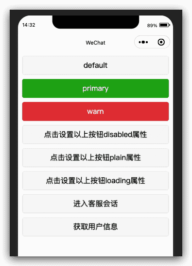

## 多项选择器checkbox-group

> 基础库 1.0.0 开始支持，低版本需做[兼容处理](https://developers.weixin.qq.com/miniprogram/dev/framework/compatibility.html)。

多项选择器，内部由多个[checkbox](https://developers.weixin.qq.com/miniprogram/dev/component/checkbox.html)组成。

| 属性       | 类型        | 默认值 | 必填 | 说明                                                         | 最低版本                                                     |
| :--------- | :---------- | :----- | :--- | :----------------------------------------------------------- | :----------------------------------------------------------- |
| bindchange | EventHandle |        | 否   | [checkbox-group](https://developers.weixin.qq.com/miniprogram/dev/component/checkbox-group.html)中选中项发生改变时触发 change 事件，detail = {value:[选中的checkbox的value的数组]} | [1.0.0](https://developers.weixin.qq.com/miniprogram/dev/framework/compatibility.html) |

## 多选项目checkbox

> 基础库 1.0.0 开始支持，低版本需做[兼容处理](https://developers.weixin.qq.com/miniprogram/dev/framework/compatibility.html)。

多选项目。

| 属性     | 类型    | 默认值  | 必填 | 说明                                                         | 最低版本                                                     |
| :------- | :------ | :------ | :--- | :----------------------------------------------------------- | :----------------------------------------------------------- |
| value    | string  |         | 否   | [checkbox](https://developers.weixin.qq.com/miniprogram/dev/component/checkbox.html)标识，选中时触发[checkbox-group](https://developers.weixin.qq.com/miniprogram/dev/component/checkbox-group.html)的 change 事件，并携带 [checkbox](https://developers.weixin.qq.com/miniprogram/dev/component/checkbox.html) 的 value | [1.0.0](https://developers.weixin.qq.com/miniprogram/dev/framework/compatibility.html) |
| disabled | boolean | false   | 否   | 是否禁用                                                     | [1.0.0](https://developers.weixin.qq.com/miniprogram/dev/framework/compatibility.html) |
| checked  | boolean | false   | 否   | 当前是否选中，可用来设置默认选中                             | [1.0.0](https://developers.weixin.qq.com/miniprogram/dev/framework/compatibility.html) |
| color    | string  | #09BB07 | 否   | checkbox的颜色，同css的color                                 | [1.0.0](https://developers.weixin.qq.com/miniprogram/dev/framework/compatibility.html) |

### 示例代码

[在开发者工具中预览效果](https://developers.weixin.qq.com/s/hGa3DcmW6qYw)

```html
<checkbox-group bindchange="checkboxChange">
  <label class="checkbox" wx:for="{{items}}">
    <checkbox value="{{item.name}}" checked="{{item.checked}}"/>{{item.value}}
  </label>
</checkbox-group>
```

```js
Page({
  data: {
    items: [
      { name: 'USA', value: '美国' },
      { name: 'CHN', value: '中国', checked: 'true' },
      { name: 'BRA', value: '巴西' },
      { name: 'JPN', value: '日本' },
      { name: 'ENG', value: '英国' },
      { name: 'TUR', value: '法国' },
    ]
  },
  checkboxChange: function (e) {
    console.log('checkbox发生change事件，携带value值为：', e.detail.value)
  }
})
```

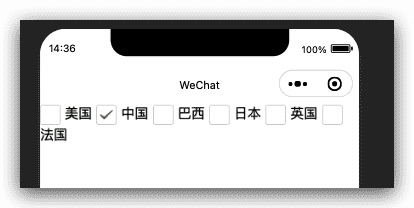

## 富文本编辑器editor

> 基础库 2.7.0 开始支持，低版本需做[兼容处理](https://developers.weixin.qq.com/miniprogram/dev/framework/compatibility.html)。

富文本编辑器，可以对图片、文字进行编辑。

编辑器导出内容支持带标签的 `html`和纯文本的 `text`，编辑器内部采用 `delta` 格式进行存储。

通过`setContents`接口设置内容时，解析插入的 `html` 可能会由于一些非法标签导致解析错误，建议开发者在小程序内使用时通过 delta 进行插入。

富文本组件内部引入了一些基本的样式使得内容可以正确的展示，开发时可以进行覆盖。需要注意的是，在其它组件或环境中使用富文本组件导出的html时，需要额外引入 [这段样式](data:application/zip;base64,UEsDBBQAAAAIAPmAhU999kpyHAYAAI4lAAAKAAAAZWRpdG9yLmNzc7Va7ZKbIBT935m+g51OZ3c7647J5qt22hdp+4MoiXQJWCTdbHf67r1CFBUjamyns4YLHO45XC5E8vCL+hFnEhGGhff69o3nxSRLKXoJvS3l0dPn3JTyjEjCWegJTJEkv7Eyb/nJz8gfwvYhfBYxFj6YVJX/jLdPRPrHDIwZpjiSoSfxSaradis/SgpuhB7jDGvLbyx2lD+HXkLiGDNlfCaxTEJvFgQfVDnBZJ8AzjwIUj34gTC/af379k2N6zeN+KPG+Ty03drLSzgmkoNIHYrsoEMuCZAgLMGCaGY5rbNHZYVpv0MHQl/KigaF0t5F3hhSFMdqQoKagv6p0LBuhmHRUfLanEmU+gnA0hwaNKBcwCwJxLIUCcxkvTE/RokfIUph+kr9TH05UhYJTqlyTfXpVjkMzwDnfluUC28ECLx35JByIRGT3UgPGsCHKUZbiuMcxo6sSxjkgPZYkYDwaMTKjuJTY3mgbcbpUTqXhy7CtKUnL0ZZAm69j6JI1f08ZpLsXpQjmIGmEfzFQtUhmBPmE4kPWWG/uNzMXFjWfmxLi4poTd6mWo+6BRDa6GWoFravPK75ukXR017wI4uL2Hq/2+1UVVHebDaWTDAa0Sq5xOUpioiECQoeNIzQa2RR+MVTVWiu2Nlc28wME6ZWrkqEZvnpJTNUQ8m5iWI7fVxQzMXViAmyBYFa9EUbgWJyhDhZnmlV1G5SD+y8WQj0xycsxieVYsZyhsTBvNduaaOjyHL3Uk4K4iaslhdny7BVfptQUTyvcTikKIP0lxAKOcMe6CoxHqQgiO0p9o8pgNt5215nJnT9kjrFO/BkqVO/TtE7Lg7nbE0RxNOtD9V31eANahtHLWLOLVZ1ZTP5QnGoVa3a7Z2h9nlLITarlqGCJYjFtCvvGBa5IoZjWbaXQvDhisRSWWwXo4sc9q5IP6CTX93HDQol6ZYjEXsQFLql2BNWTJIJkaKLOZNc9tw6JthnrctHAom25+W20PvMgf/xK8Zm1lIRqScigV3Kh5mPoF0qsP8sUKprwDVVAi8FRk9+brAYffU+AiuTF9QoVqv0vlbktF4+1su5H3WDmpRfRy4b9mTWKM8b5cdGedEoLxvllXNCgSlElsyDFWdYgpQE0s9MP+b68agfC/1Y6sdKP9b6sdGPT6VURhvvK9Q1BNJG5ZzqqBe7L19SExt/27qE4RZDrjkvz/KscvN9HsznNy29vsVIIkinOHrC8RcpjvjHfWeTHaIZ1ufzYlPw8W8YJdOe9RtD8/vYayjdtH1EOOAOGLBQp/ewRs7qTr1er1v3xukctKdvNZu5py/3vAdSYCOZDh1p0s4gjOv8YVL8HB9aYlwF8/9YTAaRsEjgQ05S1wbtbrTKUoDc6p73Xowj2OzonXfz4N20A0FZHcFYTuC1y5OZG6CHV7N7D7YBgEc0TdA4z7TqV8jdPdq8W4e5G6CHDvNCB8EPiPXUYd6mw/QCPHYL8OgG6CHA49DwfGwjPyHrRTfrhRugB+vFmPBftDGfgvKym/LSDdCD8nJMpC/bKF/FddXNdeUG6MF1NTSoV208xxFcdxNcuwF6EFyPid91G8mB7Dbd7DZugB7sNmNCddPGri+tT+20BgD0oPXJFZW1PZxxeZsbYiJwlH8r9oWEjtX3CH7+Raz1kATOTQhWhbJQwKC/F+p3JjVMZerl4WSw1W16AO1Fq4cTglWhRpF1ezgZbHW3H0B71erhhGBVqFFk3R5OBls9NwygvWn1cEKwKtQosm4PJ4OtHkQG0J4FrS5OiVbFGkW3h4/T4VYPOkOYO9P21WhVrHF83T5Oh1s9Sw1h7kzdV6NVscbxdfs4HW711DaEuTN9X41WxRrH1+3jdLjV8+cQ5s4UfjVaFWscX7eP0+FaSLpraQo9sDVuQcpfbFhoxg19u6vB7Fvfjo7nXwfYPc8VVtcGdbujMje75Z/gAo89tb6YFvstuoW3l+f/D6u7z7XvNkhKcateGKcUXt8mnMJl1F15g1vcKBIJLkSfL73gv3QRat+6QcH8vuPya+v6C+s+NwvmRu7V3Lf6syD/lzau1s5lc49W/LbEeaG7LC4B/wFQSwECPwAUAAAACAD5gIVPffZKchwGAACOJQAACgAkAAAAAAAAACAAAAAAAAAAZWRpdG9yLmNzcwoAIAAAAAAAAQAYAENPshVDq9UBQ0+yFUOr1QFDT7IVQ6vVAVBLBQYAAAAAAQABAFwAAABEBgAAAAA=)，并维护`<ql-container><ql-editor></ql-editor></ql-container>`的结构。

图片控件仅初始化时设置有效。

相关 api：[EditorContext](https://developers.weixin.qq.com/miniprogram/dev/api/media/editor/EditorContext.html)

| 属性             | 类型        | 默认值 | 必填 | 说明                                                         | 最低版本                                                     |
| :--------------- | :---------- | :----- | :--- | :----------------------------------------------------------- | :----------------------------------------------------------- |
| read-only        | boolean     | false  | 否   | 设置编辑器为只读                                             | [2.7.0](https://developers.weixin.qq.com/miniprogram/dev/framework/compatibility.html) |
| placeholder      | string      |        | 否   | 提示信息                                                     | [2.7.0](https://developers.weixin.qq.com/miniprogram/dev/framework/compatibility.html) |
| show-img-size    | boolean     | false  | 否   | 点击图片时显示图片大小控件                                   | [2.7.0](https://developers.weixin.qq.com/miniprogram/dev/framework/compatibility.html) |
| show-img-toolbar | boolean     | false  | 否   | 点击图片时显示工具栏控件                                     | [2.7.0](https://developers.weixin.qq.com/miniprogram/dev/framework/compatibility.html) |
| show-img-resize  | boolean     | false  | 否   | 点击图片时显示修改尺寸控件                                   | [2.7.0](https://developers.weixin.qq.com/miniprogram/dev/framework/compatibility.html) |
| bindready        | eventhandle |        | 否   | 编辑器初始化完成时触发                                       | [2.7.0](https://developers.weixin.qq.com/miniprogram/dev/framework/compatibility.html) |
| bindfocus        | eventhandle |        | 否   | 编辑器聚焦时触发，`event.detail = {html, text, delta}`         | [2.7.0](https://developers.weixin.qq.com/miniprogram/dev/framework/compatibility.html) |
| bindblur         | eventhandle |        | 否   | 编辑器失去焦点时触发，`detail = {html, text, delta}`           | [2.7.0](https://developers.weixin.qq.com/miniprogram/dev/framework/compatibility.html) |
| bindinput        | eventhandle |        | 否   | 编辑器内容改变时触发，`detail = {html, text, delta}`           | [2.7.0](https://developers.weixin.qq.com/miniprogram/dev/framework/compatibility.html) |
| bindstatuschange | eventhandle |        | 否   | 通过 Context 方法改变编辑器内样式时触发，返回选区已设置的样式 | [2.7.0](https://developers.weixin.qq.com/miniprogram/dev/framework/compatibility.html) |

编辑器内支持部分 HTML 标签和内联样式，不支持**class**和**id**

### 支持的标签

不满足的标签会被忽略，`<div>`会被转行为`<p>`储存。

| 类型     | 节点                                                         |
| :------- | :----------------------------------------------------------- |
| 行内元素 | `<span> <strong> <b> <ins> <em> <i> <u> <a> <del> <s> <sub> <sup> ` |
| 块级元素 | `<p> <h1> <h2> <h3> <h4> <h5> <h6> <hr> <ol> <ul> <li>`      |

### 支持的内联样式

内联样式仅能设置在行内元素或块级元素上，不能同时设置。例如 `font-size` 归类为行内元素属性，在 p 标签上设置是无效的。

| 类型     | 样式                                                         |
| :------- | :----------------------------------------------------------- |
| 块级样式 | `text-align` `direction` `margin` `margin-top` `margin-left` `margin-right` `margin-bottom` `padding` `padding-top` `padding-left` `padding-right` `padding-bottom` `line-height` `text-indent` |
| 行内样式 | `font` `font-size` `font-style` `font-variant` `font-weight` `font-family` `letter-spacing` `text-decoration` `color` `background-color` |

### Bug & Tip

1. `tip`: 使用 catchtouchend 绑定事件则不会使编辑器失去焦点(2.8.3)
2. `tip`: 插入的 html 中事件绑定会被移除
3. `tip`: formats 中的 color 属性会统一以 hex 格式返回
4. `tip`: 粘贴时仅纯文本内容会被拷贝进编辑器
5. `tip`: 插入 html 到编辑器内时，编辑器会删除一些不必要的标签，以保证内容的统一。例如`<p><span>xxx</span></p>`会改写为`<p>xxx</p>`
6. `tip`: 编辑器聚焦时页面会被上推，系统行为以保证编辑区可见

### 示例代码

[在开发者工具中预览效果](https://developers.weixin.qq.com/s/W7uZ3EmU7jbl)

```html
<view class="container" style="height:{{editorHeight}}px;">
  <editor id="editor" class="ql-container" placeholder="{{placeholder}}" bindstatuschange="onStatusChange" bindready="onEditorReady">
  </editor>
</view>

<view class="toolbar" catchtouchend="format" hidden="{{keyboardHeight > 0 ? false : true}}" style="bottom: {{isIOS ? keyboardHeight : 0}}px">
  <i class="iconfont icon-charutupian" catchtouchend="insertImage"></i>
  <i class="iconfont icon-format-header-2 {{formats.header === 2 ? 'ql-active' : ''}}" data-name="header" data-value="{{2}}"></i>
  <i class="iconfont icon-format-header-3 {{formats.header === 3 ? 'ql-active' : ''}}" data-name="header" data-value="{{3}}"></i>
  <i class="iconfont icon-zitijiacu {{formats.bold ? 'ql-active' : ''}}" data-name="bold"></i>
  <i class="iconfont icon-zitixieti {{formats.italic ? 'ql-active' : ''}}" data-name="italic"></i>
  <i class="iconfont icon-zitixiahuaxian {{formats.underline ? 'ql-active' : ''}}" data-name="underline"></i>
  <i class="iconfont icon--checklist" data-name="list" data-value="check"></i>
  <i class="iconfont icon-youxupailie {{formats.list === 'ordered' ? 'ql-active' : ''}}" data-name="list" data-value="ordered"></i>
  <i class="iconfont icon-wuxupailie {{formats.list === 'bullet' ? 'ql-active' : ''}}" data-name="list" data-value="bullet"></i>
</view>
```

```js
{
  "pages": [
    "editor/editor"
  ],
  "window": {
    "backgroundTextStyle": "light",
    "navigationBarBackgroundColor": "#fff",
    "navigationBarTitleText": "WeChat",
    "navigationBarTextStyle": "black"
  },
  "sitemapLocation": "sitemap.json"
}
```

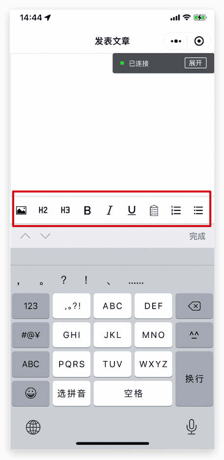

## 表单form

> 基础库 1.0.0 开始支持，低版本需做[兼容处理](https://developers.weixin.qq.com/miniprogram/dev/framework/compatibility.html)。

表单。将组件内的用户输入的[switch](https://developers.weixin.qq.com/miniprogram/dev/component/switch.html) [input](https://developers.weixin.qq.com/miniprogram/dev/component/input.html) [checkbox](https://developers.weixin.qq.com/miniprogram/dev/component/checkbox.html) [slider](https://developers.weixin.qq.com/miniprogram/dev/component/slider.html) [radio](https://developers.weixin.qq.com/miniprogram/dev/component/radio.html) [picker](https://developers.weixin.qq.com/miniprogram/dev/component/picker.html) 提交。

当点击 [form](https://developers.weixin.qq.com/miniprogram/dev/component/form.html) 表单中 form-type 为 submit 的 [button](https://developers.weixin.qq.com/miniprogram/dev/component/button.html) 组件时，会将表单组件中的 value 值进行提交，需要在表单组件中加上 name 来作为 key。

| 属性                  | 类型        | 默认值 | 必填 | 说明                                                         | 最低版本                                                     |
| :-------------------- | :---------- | :----- | :--- | :----------------------------------------------------------- | :----------------------------------------------------------- |
| report-submit         | boolean     | false  | 否   | 是否返回 formId 用于发送[模板消息](https://developers.weixin.qq.com/miniprogram/dev/framework/open-ability/template-message.html) | [1.0.0](https://developers.weixin.qq.com/miniprogram/dev/framework/compatibility.html) |
| report-submit-timeout | number      | 0      | 否   | 等待一段时间（毫秒数）以确认 formId 是否生效。如果未指定这个参数，formId 有很小的概率是无效的（如遇到网络失败的情况）。指定这个参数将可以检测 formId 是否有效，以这个参数的时间作为这项检测的超时时间。如果失败，将返回 requestFormId:fail 开头的 formId | [2.6.2](https://developers.weixin.qq.com/miniprogram/dev/framework/compatibility.html) |
| bindsubmit            | eventhandle |        | 否   | 携带 form 中的数据触发 submit 事件，`event.detail = {value : {'name': 'value'} , formId: ''}` | [1.0.0](https://developers.weixin.qq.com/miniprogram/dev/framework/compatibility.html) |
| bindreset             | eventhandle |        | 否   | 表单重置时会触发 reset 事件                                  | [1.0.0](https://developers.weixin.qq.com/miniprogram/dev/framework/compatibility.html) |

### 示例代码

// [在开发者工具中预览效果](https://developers.weixin.qq.com/s/MUaz7cmy6AYq)

```html
<form bindsubmit="formSubmit" bindreset="formReset">
  <view class="section section_gap">
    <view class="section__title">switch</view>
    <switch name="switch"/>
  </view>
  <view class="section section_gap">
    <view class="section__title">slider</view>
    <slider name="slider" show-value ></slider>
  </view>

  <view class="section">
    <view class="section__title">input</view>
    <input name="input" placeholder="please input here" />
  </view>
  <view class="section section_gap">
    <view class="section__title">radio</view>
    <radio-group name="radio-group">
      <label><radio value="radio1"/>radio1</label>
      <label><radio value="radio2"/>radio2</label>
    </radio-group>
  </view>
  <view class="section section_gap">
    <view class="section__title">checkbox</view>
    <checkbox-group name="checkbox">
      <label><checkbox value="checkbox1"/>checkbox1</label>
      <label><checkbox value="checkbox2"/>checkbox2</label>
    </checkbox-group>
  </view>
  <view class="btn-area">
    <button formType="submit">Submit</button>
    <button formType="reset">Reset</button>
  </view>
</form>
```

```js
Page({
  formSubmit: function (e) {
    console.log('form发生了submit事件，携带数据为：', e.detail.value)
  },
  formReset: function () {
    console.log('form发生了reset事件')
  }
})
```

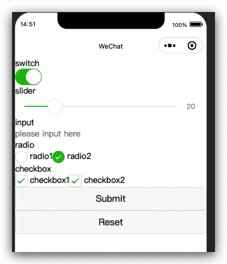

点击`Submit`提交，控制台输出：

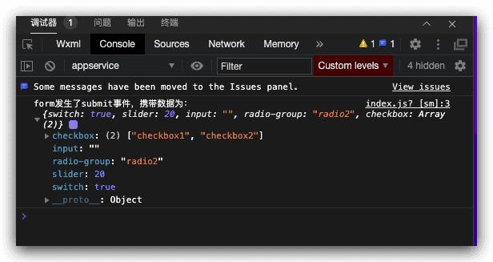

## 输入框input

> 基础库 1.0.0 开始支持，低版本需做[兼容处理](https://developers.weixin.qq.com/miniprogram/dev/framework/compatibility.html)。

输入框。该组件是[原生组件](https://developers.weixin.qq.com/miniprogram/dev/component/native-component.html)，使用时请注意相关限制

| 属性                      | 类型        | 默认值            | 必填 | 说明                                                         | 最低版本                                                     |
| :------------------------ | :---------- | :---------------- | :--- | :----------------------------------------------------------- | :----------------------------------------------------------- |
| value                     | string      |                   | 是   | 输入框的初始内容                                             | [1.0.0](https://developers.weixin.qq.com/miniprogram/dev/framework/compatibility.html) |
| type                      | string      | text              | 否   | input 的类型                                                 | [1.0.0](https://developers.weixin.qq.com/miniprogram/dev/framework/compatibility.html) |
| password                  | boolean     | false             | 否   | 是否是密码类型                                               | [1.0.0](https://developers.weixin.qq.com/miniprogram/dev/framework/compatibility.html) |
| placeholder               | string      |                   | 是   | 输入框为空时占位符                                           | [1.0.0](https://developers.weixin.qq.com/miniprogram/dev/framework/compatibility.html) |
| placeholder-style         | string      |                   | 是   | 指定 placeholder 的样式                                      | [1.0.0](https://developers.weixin.qq.com/miniprogram/dev/framework/compatibility.html) |
| placeholder-class         | string      | input-placeholder | 否   | 指定 placeholder 的样式类                                    | [1.0.0](https://developers.weixin.qq.com/miniprogram/dev/framework/compatibility.html) |
| disabled                  | boolean     | false             | 否   | 是否禁用                                                     | [1.0.0](https://developers.weixin.qq.com/miniprogram/dev/framework/compatibility.html) |
| maxlength                 | number      | 140               | 否   | 最大输入长度，设置为 -1 的时候不限制最大长度                 | [1.0.0](https://developers.weixin.qq.com/miniprogram/dev/framework/compatibility.html) |
| cursor-spacing            | number      | 0                 | 否   | 指定光标与键盘的距离，取 input 距离底部的距离和 cursor-spacing 指定的距离的最小值作为光标与键盘的距离 | [1.0.0](https://developers.weixin.qq.com/miniprogram/dev/framework/compatibility.html) |
| auto-focus                | boolean     | false             | 否   | (即将废弃，请直接使用 focus )自动聚焦，拉起键盘              | [1.0.0](https://developers.weixin.qq.com/miniprogram/dev/framework/compatibility.html) |
| focus                     | boolean     | false             | 否   | 获取焦点                                                     | [1.0.0](https://developers.weixin.qq.com/miniprogram/dev/framework/compatibility.html) |
| confirm-type              | string      | done              | 否   | 设置键盘右下角按钮的文字，仅在type='text'时生效              | [1.1.0](https://developers.weixin.qq.com/miniprogram/dev/framework/compatibility.html) |
| always-embed              | boolean     | false             | 否   | 强制 input 处于同层状态，默认 focus 时 input 会切到非同层状态 (仅在 iOS 下生效) | [2.10.4](https://developers.weixin.qq.com/miniprogram/dev/framework/compatibility.html) |
| confirm-hold              | boolean     | false             | 否   | 点击键盘右下角按钮时是否保持键盘不收起                       | [1.1.0](https://developers.weixin.qq.com/miniprogram/dev/framework/compatibility.html) |
| cursor                    | number      |                   | 是   | 指定focus时的光标位置                                        | [1.5.0](https://developers.weixin.qq.com/miniprogram/dev/framework/compatibility.html) |
| selection-start           | number      | -1                | 否   | 光标起始位置，自动聚集时有效，需与selection-end搭配使用      | [1.9.0](https://developers.weixin.qq.com/miniprogram/dev/framework/compatibility.html) |
| selection-end             | number      | -1                | 否   | 光标结束位置，自动聚集时有效，需与selection-start搭配使用    | [1.9.0](https://developers.weixin.qq.com/miniprogram/dev/framework/compatibility.html) |
| adjust-position           | boolean     | true              | 否   | 键盘弹起时，是否自动上推页面                                 | [1.9.90](https://developers.weixin.qq.com/miniprogram/dev/framework/compatibility.html) |
| hold-keyboard             | boolean     | false             | 否   | focus时，点击页面的时候不收起键盘                            | [2.8.2](https://developers.weixin.qq.com/miniprogram/dev/framework/compatibility.html) |
| safe-password-cert-path   | string      |                   | 否   | 安全键盘加密公钥的路径，只支持包内路径                       | [2.18.0](https://developers.weixin.qq.com/miniprogram/dev/framework/compatibility.html) |
| safe-password-length      | number      |                   | 否   | 安全键盘输入密码长度                                         | [2.18.0](https://developers.weixin.qq.com/miniprogram/dev/framework/compatibility.html) |
| safe-password-time-stamp  | number      |                   | 否   | 安全键盘加密时间戳                                           | [2.18.0](https://developers.weixin.qq.com/miniprogram/dev/framework/compatibility.html) |
| safe-password-nonce       | string      |                   | 否   | 安全键盘加密盐值                                             | [2.18.0](https://developers.weixin.qq.com/miniprogram/dev/framework/compatibility.html) |
| safe-password-salt        | string      |                   | 否   | 安全键盘计算hash盐值，若指定custom-hash 则无效               | [2.18.0](https://developers.weixin.qq.com/miniprogram/dev/framework/compatibility.html) |
| safe-password-custom-hash | string      |                   | 否   | 安全键盘计算hash的算法表达式，如 `md5(sha1('foo' + sha256(sm3(password + 'bar'))))` | [2.18.0](https://developers.weixin.qq.com/miniprogram/dev/framework/compatibility.html) |
| bindinput                 | eventhandle |                   | 是   | 键盘输入时触发，`event.detail = {value, cursor, keyCode}`，keyCode 为键值，2.1.0 起支持，处理函数可以直接 return 一个字符串，将替换输入框的内容。 | [1.0.0](https://developers.weixin.qq.com/miniprogram/dev/framework/compatibility.html) |
| bindfocus                 | eventhandle |                   | 是   | 输入框聚焦时触发，`event.detail = { value, height }`，height 为键盘高度，在基础库 1.9.90 起支持 | [1.0.0](https://developers.weixin.qq.com/miniprogram/dev/framework/compatibility.html) |
| bindblur                  | eventhandle |                   | 是   | 输入框失去焦点时触发，`event.detail = { value, encryptedValue, encryptError }` | [1.0.0](https://developers.weixin.qq.com/miniprogram/dev/framework/compatibility.html) |
| bindconfirm               | eventhandle |                   | 是   | 点击完成按钮时触发，`event.detail = { value }`                 | [1.0.0](https://developers.weixin.qq.com/miniprogram/dev/framework/compatibility.html) |
| bindkeyboardheightchange  | eventhandle |                   | 是   | 键盘高度发生变化的时候触发此事件，`event.detail = {height: height, duration: duration}` | [2.7.0](https://developers.weixin.qq.com/miniprogram/dev/framework/compatibility.html) |

**type 的合法值**

| 值            | 说明                                                         | 最低版本                                                     |
| :------------ | :----------------------------------------------------------- | :----------------------------------------------------------- |
| text          | 文本输入键盘                                                 |                                                              |
| number        | 数字输入键盘                                                 |                                                              |
| idcard        | 身份证输入键盘                                               |                                                              |
| digit         | 带小数点的数字键盘                                           |                                                              |
| safe-password | 密码安全输入键盘 [指引](https://developers.weixin.qq.com/miniprogram/dev/framework/open-ability/safe-password.html) | [2.18.0](https://developers.weixin.qq.com/miniprogram/dev/framework/compatibility.html) |

**confirm-type 的合法值**

| 值     | 说明                 | 最低版本 |
| :----- | :------------------- | :------- |
| send   | 右下角按钮为“发送”   |          |
| search | 右下角按钮为“搜索”   |          |
| next   | 右下角按钮为“下一个” |          |
| go     | 右下角按钮为“前往”   |          |
| done   | 右下角按钮为“完成”   |          |

### Bug & Tip

1. `tip`: confirm-type的最终表现与手机输入法本身的实现有关，部分安卓系统输入法和第三方输入法可能不支持或不完全支持
2. `tip` : input 组件是一个原生组件，字体是系统字体，所以无法设置 font-family
3. `tip` : 在 input 聚焦期间，避免使用 css 动画
4. `tip` : 对于将 `input` 封装在自定义组件中、而 `form` 在自定义组件外的情况， `form` 将不能获得这个自定义组件中 `input` 的值。此时需要使用自定义组件的 [内置 behaviors](https://developers.weixin.qq.com/miniprogram/dev/framework/custom-component/behaviors.html) `wx://form-field`
5. `tip` : 键盘高度发生变化，keyboardheightchange事件可能会多次触发，开发者对于相同的height值应该忽略掉
6. `bug` : 微信版本 `6.3.30`, focus 属性设置无效
7. `bug` : 微信版本 `6.3.30`, placeholder 在聚焦时出现重影问题

### 示例代码

[在开发者工具中预览效果](https://developers.weixin.qq.com/s/JYwgZ6ml6rYP)

```html
<view class="page-body">
  <view class="page-section">
    <view class="weui-cells__title">可以自动聚焦的input</view>
    <view class="weui-cells weui-cells_after-title">
      <view class="weui-cell weui-cell_input">
        <input class="weui-input" auto-focus placeholder="将会获取焦点"/>
      </view>
    </view>
  </view>
  <view class="page-section">
    <view class="weui-cells__title">控制最大输入长度的input</view>
    <view class="weui-cells weui-cells_after-title">
      <view class="weui-cell weui-cell_input">
        <input class="weui-input" maxlength="10" placeholder="最大输入长度为10" />
      </view>
    </view>
  </view>
  <view class="page-section">
    <view class="weui-cells__title">实时获取输入值：{{inputValue}}</view>
    <view class="weui-cells weui-cells_after-title">
      <view class="weui-cell weui-cell_input">
        <input class="weui-input"  maxlength="10" bindinput="bindKeyInput" placeholder="输入同步到view中"/>
      </view>
    </view>
  </view>
  <view class="page-section">
    <view class="weui-cells__title">控制输入的input</view>
    <view class="weui-cells weui-cells_after-title">
      <view class="weui-cell weui-cell_input">
        <input class="weui-input"  bindinput="bindReplaceInput" placeholder="连续的两个1会变成2" />
      </view>
    </view>
  </view>
  <view class="page-section">
    <view class="weui-cells__title">控制键盘的input</view>
    <view class="weui-cells weui-cells_after-title">
      <view class="weui-cell weui-cell_input">
        <input class="weui-input"  bindinput="bindHideKeyboard" placeholder="输入123自动收起键盘" />
      </view>
    </view>
  </view>
  <view class="page-section">
    <view class="weui-cells__title">数字输入的input</view>
    <view class="weui-cells weui-cells_after-title">
      <view class="weui-cell weui-cell_input">
        <input class="weui-input" type="number" placeholder="这是一个数字输入框" />
      </view>
    </view>
  </view>
  <view class="page-section">
    <view class="weui-cells__title">密码输入的input</view>
    <view class="weui-cells weui-cells_after-title">
      <view class="weui-cell weui-cell_input">
        <input class="weui-input" password type="text" placeholder="这是一个密码输入框" />
      </view>
    </view>
  </view>
  <view class="page-section">
    <view class="weui-cells__title">带小数点的input</view>
    <view class="weui-cells weui-cells_after-title">
      <view class="weui-cell weui-cell_input">
        <input class="weui-input" type="digit" placeholder="带小数点的数字键盘"/>
      </view>
    </view>
  </view>
  <view class="page-section">
    <view class="weui-cells__title">身份证输入的input</view>
    <view class="weui-cells weui-cells_after-title">
      <view class="weui-cell weui-cell_input">
        <input class="weui-input" type="idcard" placeholder="身份证输入键盘" />
      </view>
    </view>
  </view>
  <view class="page-section">
    <view class="weui-cells__title">控制占位符颜色的input</view>
    <view class="weui-cells weui-cells_after-title">
      <view class="weui-cell weui-cell_input">
        <input class="weui-input" placeholder-style="color:#F76260" placeholder="占位符字体是红色的" />
      </view>
    </view>
  </view>
</view>

```

```js
Page({
  data: {
    focus: false,
    inputValue: ''
  },
  bindKeyInput: function (e) {
    this.setData({
      inputValue: e.detail.value
    })
  },
  bindReplaceInput: function (e) {
    var value = e.detail.value
    var pos = e.detail.cursor
    var left
    if (pos !== -1) {
      // 光标在中间
      left = e.detail.value.slice(0, pos)
      // 计算光标的位置
      pos = left.replace(/11/g, '2').length
    }

    // 直接返回对象，可以对输入进行过滤处理，同时可以控制光标的位置
    return {
      value: value.replace(/11/g, '2'),
      cursor: pos
    }

    // 或者直接返回字符串,光标在最后边
    // return value.replace(/11/g,'2'),
  },
  bindHideKeyboard: function (e) {
    if (e.detail.value === '123') {
      // 收起键盘
      wx.hideKeyboard()
    }
  }
})

```

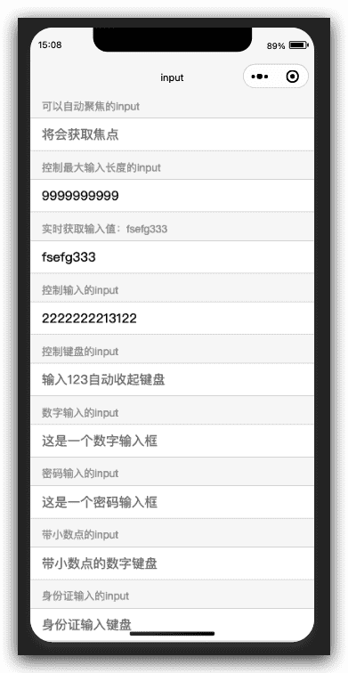

## keyboard-accessory

> 基础库 2.15.0 开始支持，低版本需做[兼容处理](https://developers.weixin.qq.com/miniprogram/dev/framework/compatibility.html)。

设置 input / textarea 聚焦时键盘上方 cover-view / cover-image 工具栏视图

### Bug & Tip

1. `tip`: 视图最大高度为 200px

### 示例代码

[在开发者工具中预览效果](https://developers.weixin.qq.com/s/GKxGjkmG77o1)

```html
<input style="margin-top: 200px;" placeholder="input" bindfocus="focus1" bindblur="blur1" hold-keyboard>
  <keyboard-accessory class="container" style="height: 100px;">
    <cover-view bindtap="tap" style="flex: 1; width: 50px; background: green;">
      <button>click</button>
    </cover-view>
    <cover-image bindtap="tap" src="https://images.unsplash.com/photo-1593642632823-8f785ba67e45?ixlib=rb-1.2.1&ixid=eyJhcHBfaWQiOjEyMDd9&auto=format&fit=crop&w=500&q=60" style="flex: 1; width: 50px; background: red;">
    </cover-image>
  </keyboard-accessory>
</input>

<textarea hold-keyboard="{{true}}" style="margin-top: 200px;" placeholder="textarea1" bindfocus="focus2" bindblur="blur2">
  <keyboard-accessory class="container" style="height: 50px;">
    <cover-view bindtap="tap" style="flex: 1; width: 50px; background: green;">textarea1</cover-view>
    <cover-view bindtap="tap" style="flex: 1; width: 50px; background: red;">2</cover-view>
  </keyboard-accessory>
</textarea>

```

```js
const app = getApp()

Page({
  data: {
    height: 50,
    flex: 1,
    show: true,
  },
  onLoad: function () {
    console.log('代码片段是一种迷你、可分享的小程序或小游戏项目，可用于分享小程序和小游戏的开发经验、展示组件和 API 的使用、复现开发问题和 Bug 等。可点击以下链接查看代码片段的详细文档：')
    console.log('https://mp.weixin.qq.com/debug/wxadoc/dev/devtools/devtools.html')
  },

  focus1() {
    console.log('focus input\n')
  },

  blur1() {
    console.log('blur input')
  },

  focus2() {
    console.log('focus textarea')
  },

  blur2() {
    console.log('blur textarea')
  },
})

```

用真机测试效果：

- input输入框获取焦点：

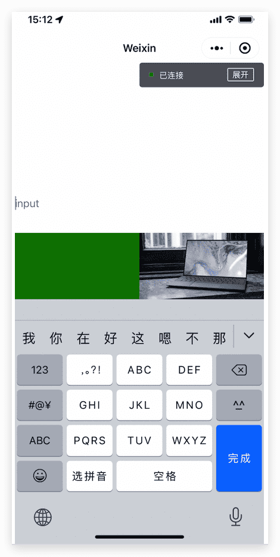

- textarea获取焦点：

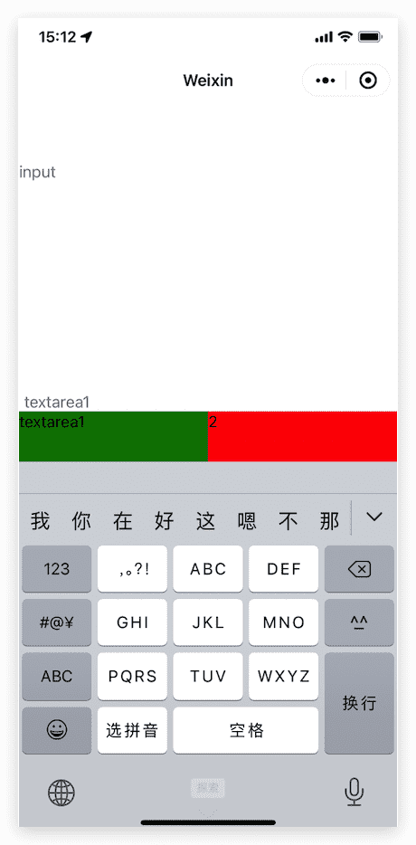

## label标签

> 基础库 1.0.0 开始支持，低版本需做[兼容处理](https://developers.weixin.qq.com/miniprogram/dev/framework/compatibility.html)。

用来改进表单组件的可用性。

使用for属性找到对应的id，或者将控件放在该标签下，当点击时，就会触发对应的控件。 for优先级高于内部控件，内部有多个控件的时候默认触发第一个控件。 目前可以绑定的控件有：[button](https://developers.weixin.qq.com/miniprogram/dev/component/button.html), [checkbox](https://developers.weixin.qq.com/miniprogram/dev/component/checkbox.html), [radio](https://developers.weixin.qq.com/miniprogram/dev/component/radio.html), [switch](https://developers.weixin.qq.com/miniprogram/dev/component/switch.html)。

| 属性 | 类型   | 默认值 | 必填 | 说明          | 最低版本                                                     |
| :--- | :----- | :----- | :--- | :------------ | :----------------------------------------------------------- |
| for  | string |        | 否   | 绑定控件的 id | [1.0.0](https://developers.weixin.qq.com/miniprogram/dev/framework/compatibility.html) |

### 示例代码

[在开发者工具中预览效果](https://developers.weixin.qq.com/s/alak1cmR6JYU)

```html
<view class="section section_gap">
<view class="section__title">表单组件在label内</view>
<checkbox-group class="group" bindchange="checkboxChange">
  <view class="label-1" wx:for="{{checkboxItems}}">
    <label>
      <checkbox hidden value="{{item.name}}" checked="{{item.checked}}"></checkbox>
      <view class="label-1__icon">
        <view class="label-1__icon-checked" style="opacity:{{item.checked ? 1: 0}}"></view>
      </view>
      <text class="label-1__text">{{item.value}}</text>
    </label>
  </view>
</checkbox-group>
</view>

<view class="section section_gap">
<view class="section__title">label用for标识表单组件</view>
<radio-group class="group" bindchange="radioChange">
  <view class="label-2" wx:for="{{radioItems}}">
    <radio id="{{item.name}}" hidden value="{{item.name}}" checked="{{item.checked}}"></radio>
    <view class="label-2__icon">
      <view class="label-2__icon-checked" style="opacity:{{item.checked ? 1: 0}}"></view>
    </view>
    <label class="label-2__text" for="{{item.name}}"><text>{{item.name}}</text></label>
  </view>
</radio-group>
</view>
```

```js
Page({
  data: {
    checkboxItems: [
      { name: 'USA', value: '美国' },
      { name: 'CHN', value: '中国', checked: 'true' },
      { name: 'BRA', value: '巴西' },
      { name: 'JPN', value: '日本', checked: 'true' },
      { name: 'ENG', value: '英国' },
      { name: 'TUR', value: '法国' },
    ],
    radioItems: [
      { name: 'USA', value: '美国' },
      { name: 'CHN', value: '中国', checked: 'true' },
      { name: 'BRA', value: '巴西' },
      { name: 'JPN', value: '日本' },
      { name: 'ENG', value: '英国' },
      { name: 'TUR', value: '法国' },
    ],
    hidden: false
  },
  checkboxChange: function (e) {
    var checked = e.detail.value
    var changed = {}
    for (var i = 0; i < this.data.checkboxItems.length; i++) {
      if (checked.indexOf(this.data.checkboxItems[i].name) !== -1) {
        changed['checkboxItems[' + i + '].checked'] = true
      } else {
        changed['checkboxItems[' + i + '].checked'] = false
      }
    }
    this.setData(changed)
  },
  radioChange: function (e) {
    var checked = e.detail.value
    var changed = {}
    for (var i = 0; i < this.data.radioItems.length; i++) {
      if (checked.indexOf(this.data.radioItems[i].name) !== -1) {
        changed['radioItems[' + i + '].checked'] = true
      } else {
        changed['radioItems[' + i + '].checked'] = false
      }
    }
    this.setData(changed)
  }
})
```

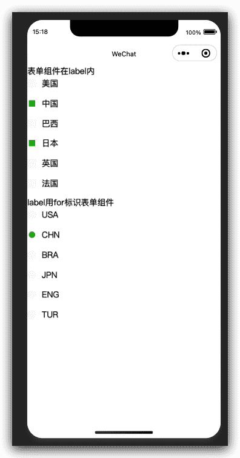

## 从底部弹起的滚动选择器picker

> 基础库 1.0.0 开始支持，低版本需做[兼容处理](https://developers.weixin.qq.com/miniprogram/dev/framework/compatibility.html)。

从底部弹起的滚动选择器。

| 属性        | 类型        | 默认值   | 必填 | 说明                     | 最低版本                                                     |
| :---------- | :---------- | :------- | :--- | :----------------------- | :----------------------------------------------------------- |
| header-text | string      |          | 否   | 选择器的标题，仅安卓可用 | [2.11.0](https://developers.weixin.qq.com/miniprogram/dev/framework/compatibility.html) |
| mode        | string      | selector | 否   | 选择器类型               | [1.0.0](https://developers.weixin.qq.com/miniprogram/dev/framework/compatibility.html) |
| disabled    | boolean     | false    | 否   | 是否禁用                 | [1.0.0](https://developers.weixin.qq.com/miniprogram/dev/framework/compatibility.html) |
| bindcancel  | eventhandle |          | 否   | 取消选择时触发           | [1.9.90](https://developers.weixin.qq.com/miniprogram/dev/framework/compatibility.html) |

**mode 的合法值**

| 值            | 说明         | 最低版本 |
| :------------ | :----------- | :------- |
| selector      | 普通选择器   |          |
| multiSelector | 多列选择器   |          |
| time          | 时间选择器   |          |
| date          | 日期选择器   |          |
| region        | 省市区选择器 |          |

除了上述通用的属性，对于不同的mode，`picker`拥有不同的属性。

### 普通选择器：mode = selector

| 属性名     | 类型               | 默认值 | 说明                                                         | 最低版本 |
| :--------- | :----------------- | :----- | :----------------------------------------------------------- | :------- |
| range      | array/object array | []     | mode 为 selector 或 multiSelector 时，range 有效             |          |
| range-key  | string             |        | 当 range 是一个 Object Array 时，通过 range-key 来指定 Object 中 key 的值作为选择器显示内容 |          |
| value      | number             | 0      | 表示选择了 range 中的第几个（下标从 0 开始）                 |          |
| bindchange | eventhandle        |        | value 改变时触发 change 事件，`event.detail = {value}`         |          |

### 多列选择器：mode = multiSelector

| 属性名           | 类型               | 默认值 | 说明                                                         | 最低版本 |
| :--------------- | :----------------- | :----- | :----------------------------------------------------------- | :------- |
| range            | array/object array | []     | mode 为 selector 或 multiSelector 时，range 有效             |          |
| range-key        | string             |        | 当 range 是一个 Object Array 时，通过 range-key 来指定 Object 中 key 的值作为选择器显示内容 |          |
| value            | array              | []     | 表示选择了 range 中的第几个（下标从 0 开始）                 |          |
| bindchange       | eventhandle        |        | value 改变时触发 change 事件，`event.detail = {value}`         |          |
| bindcolumnchange | eventhandle        |        | 列改变时触发                                                 |          |

### 时间选择器：mode = time

| 属性名     | 类型        | 默认值 | 说明                                                 | 最低版本 |
| :--------- | :---------- | :----- | :--------------------------------------------------- | :------- |
| value      | string      |        | 表示选中的时间，格式为"hh:mm"                        |          |
| start      | string      |        | 表示有效时间范围的开始，字符串格式为"hh:mm"          |          |
| end        | string      |        | 表示有效时间范围的结束，字符串格式为"hh:mm"          |          |
| bindchange | eventhandle |        | value 改变时触发 change 事件，`event.detail = {value}` |          |

### 日期选择器：mode = date

| 属性名     | 类型        | 默认值 | 说明                                                 | 最低版本 |
| :--------- | :---------- | :----- | :--------------------------------------------------- | :------- |
| value      | string      | 当天   | 表示选中的日期，格式为"YYYY-MM-DD"                   |          |
| start      | string      |        | 表示有效日期范围的开始，字符串格式为"YYYY-MM-DD"     |          |
| end        | string      |        | 表示有效日期范围的结束，字符串格式为"YYYY-MM-DD"     |          |
| fields     | string      | day    | 有效值 year,month,day，表示选择器的粒度              |          |
| bindchange | eventhandle |        | value 改变时触发 change 事件，`event.detail = {value}` |          |

**fields 有效值：**

| 值    | 说明             |
| :---- | :--------------- |
| year  | 选择器粒度为年   |
| month | 选择器粒度为月份 |
| day   | 选择器粒度为天   |

### 省市区选择器：mode = region [1.4.0](https://developers.weixin.qq.com/miniprogram/dev/framework/compatibility.html)

| 属性名      | 类型        | 默认值 | 说明                                                         | 最低版本                                                     |
| :---------- | :---------- | :----- | :----------------------------------------------------------- | :----------------------------------------------------------- |
| value       | array       | []     | 表示选中的省市区，默认选中每一列的第一个值                   |                                                              |
| custom-item | string      |        | 可为每一列的顶部添加一个自定义的项                           | [1.5.0](https://developers.weixin.qq.com/miniprogram/dev/framework/compatibility.html) |
| bindchange  | eventhandle |        | value 改变时触发 change 事件，`event.detail = {value, code, postcode}`，其中字段 code 是统计用区划代码，postcode 是邮政编码 |                                                              |

### 示例代码

[在开发者工具中预览效果](https://developers.weixin.qq.com/s/pZb21cmH6qYX)

```html
<view class="section">
  <view class="section__title">普通选择器</view>
  <picker bindchange="bindPickerChange" value="{{index}}" range="{{array}}">
    <view class="picker">
      当前选择：{{array[index]}}
    </view>
  </picker>
</view>
<view class="section">
  <view class="section__title">多列选择器</view>
  <picker mode="multiSelector" bindchange="bindMultiPickerChange" bindcolumnchange="bindMultiPickerColumnChange" value="{{multiIndex}}" range="{{multiArray}}">
    <view class="picker">
      当前选择：{{multiArray[0][multiIndex[0]]}}，{{multiArray[1][multiIndex[1]]}}，{{multiArray[2][multiIndex[2]]}}
    </view>
  </picker>
</view>
<view class="section">
  <view class="section__title">时间选择器</view>
  <picker mode="time" value="{{time}}" start="09:01" end="21:01" bindchange="bindTimeChange">
    <view class="picker">
      当前选择: {{time}}
    </view>
  </picker>
</view>

<view class="section">
  <view class="section__title">日期选择器</view>
  <picker mode="date" value="{{date}}" start="2015-09-01" end="2017-09-01" bindchange="bindDateChange">
    <view class="picker">
      当前选择: {{date}}
    </view>
  </picker>
</view>
<view class="section">
  <view class="section__title">省市区选择器</view>
  <picker mode="region" bindchange="bindRegionChange" value="{{region}}" custom-item="{{customItem}}">
    <view class="picker">
      当前选择：{{region[0]}}，{{region[1]}}，{{region[2]}}
    </view>
  </picker>
</view>
```

```js
Page({
  data: {
    array: ['美国', '中国', '巴西', '日本'],
    objectArray: [
      {
        id: 0,
        name: '美国'
      },
      {
        id: 1,
        name: '中国'
      },
      {
        id: 2,
        name: '巴西'
      },
      {
        id: 3,
        name: '日本'
      }
    ],
    index: 0,
    multiArray: [['无脊柱动物', '脊柱动物'], ['扁性动物', '线形动物', '环节动物', '软体动物', '节肢动物'], ['猪肉绦虫', '吸血虫']],
    objectMultiArray: [
      [
        {
          id: 0,
          name: '无脊柱动物'
        },
        {
          id: 1,
          name: '脊柱动物'
        }
      ], [
        {
          id: 0,
          name: '扁性动物'
        },
        {
          id: 1,
          name: '线形动物'
        },
        {
          id: 2,
          name: '环节动物'
        },
        {
          id: 3,
          name: '软体动物'
        },
        {
          id: 3,
          name: '节肢动物'
        }
      ], [
        {
          id: 0,
          name: '猪肉绦虫'
        },
        {
          id: 1,
          name: '吸血虫'
        }
      ]
    ],
    multiIndex: [0, 0, 0],
    date: '2016-09-01',
    time: '12:01',
    region: ['广东省', '广州市', '海珠区'],
    customItem: '全部'
  },
  bindPickerChange: function (e) {
    console.log('picker发送选择改变，携带值为', e.detail.value)
    this.setData({
      index: e.detail.value
    })
  },
  bindMultiPickerChange: function (e) {
    console.log('picker发送选择改变，携带值为', e.detail.value)
    this.setData({
      multiIndex: e.detail.value
    })
  },
  bindMultiPickerColumnChange: function (e) {
    console.log('修改的列为', e.detail.column, '，值为', e.detail.value);
    var data = {
      multiArray: this.data.multiArray,
      multiIndex: this.data.multiIndex
    };
    data.multiIndex[e.detail.column] = e.detail.value;
    switch (e.detail.column) {
      case 0:
        switch (data.multiIndex[0]) {
          case 0:
            data.multiArray[1] = ['扁性动物', '线形动物', '环节动物', '软体动物', '节肢动物'];
            data.multiArray[2] = ['猪肉绦虫', '吸血虫'];
            break;
          case 1:
            data.multiArray[1] = ['鱼', '两栖动物', '爬行动物'];
            data.multiArray[2] = ['鲫鱼', '带鱼'];
            break;
        }
        data.multiIndex[1] = 0;
        data.multiIndex[2] = 0;
        break;
      case 1:
        switch (data.multiIndex[0]) {
          case 0:
            switch (data.multiIndex[1]) {
              case 0:
                data.multiArray[2] = ['猪肉绦虫', '吸血虫'];
                break;
              case 1:
                data.multiArray[2] = ['蛔虫'];
                break;
              case 2:
                data.multiArray[2] = ['蚂蚁', '蚂蟥'];
                break;
              case 3:
                data.multiArray[2] = ['河蚌', '蜗牛', '蛞蝓'];
                break;
              case 4:
                data.multiArray[2] = ['昆虫', '甲壳动物', '蛛形动物', '多足动物'];
                break;
            }
            break;
          case 1:
            switch (data.multiIndex[1]) {
              case 0:
                data.multiArray[2] = ['鲫鱼', '带鱼'];
                break;
              case 1:
                data.multiArray[2] = ['青蛙', '娃娃鱼'];
                break;
              case 2:
                data.multiArray[2] = ['蜥蜴', '龟', '壁虎'];
                break;
            }
            break;
        }
        data.multiIndex[2] = 0;
        console.log(data.multiIndex);
        break;
    }
    this.setData(data);
  },
  bindDateChange: function (e) {
    console.log('picker发送选择改变，携带值为', e.detail.value)
    this.setData({
      date: e.detail.value
    })
  },
  bindTimeChange: function (e) {
    console.log('picker发送选择改变，携带值为', e.detail.value)
    this.setData({
      time: e.detail.value
    })
  },
  bindRegionChange: function (e) {
    console.log('picker发送选择改变，携带值为', e.detail.value)
    this.setData({
      region: e.detail.value
    })
  }
})
```

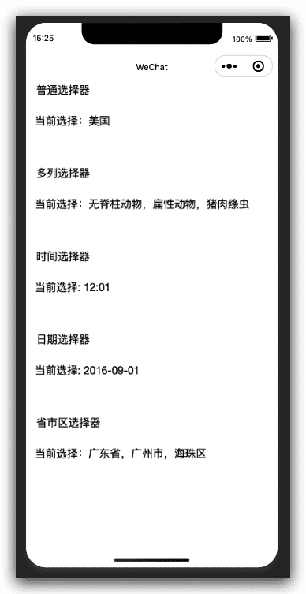

## 嵌入页面的滚动选择器 picker-view

> 基础库 1.0.0 开始支持，低版本需做[兼容处理](https://developers.weixin.qq.com/miniprogram/dev/framework/compatibility.html)。

嵌入页面的滚动选择器。其中只可放置 [picker-view-column](https://developers.weixin.qq.com/miniprogram/dev/component/picker-view-column.html)组件，其它节点不会显示。

| 属性            | 类型           | 默认值 | 必填 | 说明                                                         | 最低版本                                                     |
| :-------------- | :------------- | :----- | :--- | :----------------------------------------------------------- | :----------------------------------------------------------- |
| value           | `Array.<number>` |        | 否   | 数组中的数字依次表示 picker-view 内的 picker-view-column 选择的第几项（下标从 0 开始），数字大于 picker-view-column 可选项长度时，选择最后一项。 | [1.0.0](https://developers.weixin.qq.com/miniprogram/dev/framework/compatibility.html) |
| indicator-style | string         |        | 否   | 设置选择器中间选中框的样式                                   | [1.0.0](https://developers.weixin.qq.com/miniprogram/dev/framework/compatibility.html) |
| indicator-class | string         |        | 否   | 设置选择器中间选中框的类名                                   | [1.1.0](https://developers.weixin.qq.com/miniprogram/dev/framework/compatibility.html) |
| mask-style      | string         |        | 否   | 设置蒙层的样式                                               | [1.5.0](https://developers.weixin.qq.com/miniprogram/dev/framework/compatibility.html) |
| mask-class      | string         |        | 否   | 设置蒙层的类名                                               | [1.5.0](https://developers.weixin.qq.com/miniprogram/dev/framework/compatibility.html) |
| bindchange      | eventhandle    |        | 否   | 滚动选择时触发change事件，`event.detail = {value}`；value为数组，表示 picker-view 内的 picker-view-column 当前选择的是第几项（下标从 0 开始） | [1.0.0](https://developers.weixin.qq.com/miniprogram/dev/framework/compatibility.html) |
| bindpickstart   | eventhandle    |        | 否   | 当滚动选择开始时候触发事件                                   | [2.3.1](https://developers.weixin.qq.com/miniprogram/dev/framework/compatibility.html) |
| bindpickend     | eventhandle    |        | 否   | 当滚动选择结束时候触发事件                                   | [2.3.1](https://developers.weixin.qq.com/miniprogram/dev/framework/compatibility.html) |

### Bug & Tip

1. `tip`: 滚动时在iOS自带振动反馈，可在系统设置 -> 声音与触感 -> 系统触感反馈中关闭

### 示例代码

[在开发者工具中预览效果](https://developers.weixin.qq.com/s/YfbJZcmG6zYM)

```html
<view>
  <view>{{year}}年{{month}}月{{day}}日</view>
  <picker-view indicator-style="height: 50px;" style="width: 100%; height: 300px;" value="{{value}}" bindchange="bindChange">
    <picker-view-column>
      <view wx:for="{{years}}" style="line-height: 50px">{{item}}年</view>
    </picker-view-column>
    <picker-view-column>
      <view wx:for="{{months}}" style="line-height: 50px">{{item}}月</view>
    </picker-view-column>
    <picker-view-column>
      <view wx:for="{{days}}" style="line-height: 50px">{{item}}日</view>
    </picker-view-column>
  </picker-view>
</view>
```

```js
const date = new Date()
const years = []
const months = []
const days = []

for (let i = 1990; i <= date.getFullYear(); i++) {
  years.push(i)
}

for (let i = 1; i <= 12; i++) {
  months.push(i)
}

for (let i = 1; i <= 31; i++) {
  days.push(i)
}

Page({
  data: {
    years: years,
    year: date.getFullYear(),
    months: months,
    month: 2,
    days: days,
    day: 2,
    value: [9999, 1, 1],
  },
  bindChange: function (e) {
    const val = e.detail.value
    this.setData({
      year: this.data.years[val[0]],
      month: this.data.months[val[1]],
      day: this.data.days[val[2]]
    })
  }
})
```

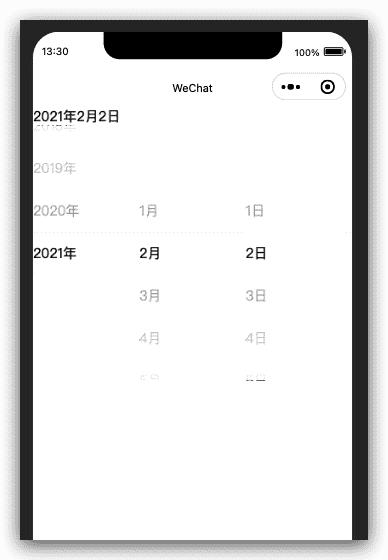

## 滚动选择器子项 picker-view-column

> 基础库 1.0.0 开始支持，低版本需做[兼容处理](https://developers.weixin.qq.com/miniprogram/dev/framework/compatibility.html)。

滚动选择器子项。仅可放置于[picker-view](https://developers.weixin.qq.com/miniprogram/dev/component/picker-view.html)中，其孩子节点的高度会自动设置成与[picker-view](https://developers.weixin.qq.com/miniprogram/dev/component/picker-view.html)的选中框的高度一致

## 单选项目 radio

> 基础库 1.0.0 开始支持，低版本需做[兼容处理](https://developers.weixin.qq.com/miniprogram/dev/framework/compatibility.html)。

单选项目。

| 属性     | 类型    | 默认值  | 必填 | 说明                                                         | 最低版本                                                     |
| :------- | :------ | :------ | :--- | :----------------------------------------------------------- | :----------------------------------------------------------- |
| value    | string  |         | 否   | [radio](https://developers.weixin.qq.com/miniprogram/dev/component/radio.html) 标识。当该[radio](https://developers.weixin.qq.com/miniprogram/dev/component/radio.html) 选中时，[radio-group](https://developers.weixin.qq.com/miniprogram/dev/component/radio-group.html) 的 change 事件会携带[radio](https://developers.weixin.qq.com/miniprogram/dev/component/radio.html)的value | [1.0.0](https://developers.weixin.qq.com/miniprogram/dev/framework/compatibility.html) |
| checked  | boolean | false   | 否   | 当前是否选中                                                 | [1.0.0](https://developers.weixin.qq.com/miniprogram/dev/framework/compatibility.html) |
| disabled | boolean | false   | 否   | 是否禁用                                                     | [1.0.0](https://developers.weixin.qq.com/miniprogram/dev/framework/compatibility.html) |
| color    | string  | #09BB07 | 否   | radio的颜色，同css的color                                    | [1.0.0](https://developers.weixin.qq.com/miniprogram/dev/framework/compatibility.html) |

### 示例代码

[在开发者工具中预览效果](https://developers.weixin.qq.com/s/tpbv9cmv6HYr)

```html
<view class="page">
    <view class="page__hd">
        <text class="page__title">radio</text>
        <text class="page__desc">单选框</text>
    </view>
    <view class="page__bd">
        <view class="section section_gap">
            <radio-group class="radio-group" bindchange="radioChange">
                <radio class="radio" wx:for-items="{{items}}" wx:key="name" value="{{item.name}}" checked="{{item.checked}}">
                    <text>{{item.value}}</text>
                </radio>
            </radio-group>
        </view>
    </view>
</view>
```

```js
Page({
  data: {
    items: [
      { name: 'USA', value: '美国' },
      { name: 'CHN', value: '中国', checked: 'true' },
      { name: 'BRA', value: '巴西' },
      { name: 'JPN', value: '日本' },
      { name: 'ENG', value: '英国' },
      { name: 'FRA', value: '法国' },
    ]
  },
  radioChange: function (e) {
    console.log('radio发生change事件，携带value值为：', e.detail.value)
  }
})

```

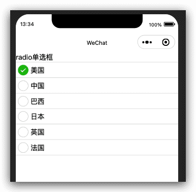

## 单项选择器 radio-group

> 基础库 1.0.0 开始支持，低版本需做[兼容处理](https://developers.weixin.qq.com/miniprogram/dev/framework/compatibility.html)。

单项选择器，内部由多个 [radio](https://developers.weixin.qq.com/miniprogram/dev/component/radio.html) 组成。

| 属性       | 类型        | 默认值 | 必填 | 说明                                                         | 最低版本                                                     |
| :--------- | :---------- | :----- | :--- | :----------------------------------------------------------- | :----------------------------------------------------------- |
| bindchange | EventHandle |        | 否   | [radio-group](https://developers.weixin.qq.com/miniprogram/dev/component/radio-group.html)中选中项发生改变时触发 change 事件，detail = {value:[选中的radio的value的数组]} | [1.0.0](https://developers.weixin.qq.com/miniprogram/dev/framework/compatibility.html) |

## 滑动选择器 slider

> 基础库 1.0.0 开始支持，低版本需做[兼容处理](https://developers.weixin.qq.com/miniprogram/dev/framework/compatibility.html)。

滑动选择器。

| 属性            | 类型        | 默认值  | 必填 | 说明                                             | 最低版本                                                     |
| :-------------- | :---------- | :------ | :--- | :----------------------------------------------- | :----------------------------------------------------------- |
| min             | number      | 0       | 否   | 最小值                                           | [1.0.0](https://developers.weixin.qq.com/miniprogram/dev/framework/compatibility.html) |
| max             | number      | 100     | 否   | 最大值                                           | [1.0.0](https://developers.weixin.qq.com/miniprogram/dev/framework/compatibility.html) |
| step            | number      | 1       | 否   | 步长，取值必须大于 0，并且可被(max - min)整除    | [1.0.0](https://developers.weixin.qq.com/miniprogram/dev/framework/compatibility.html) |
| disabled        | boolean     | false   | 否   | 是否禁用                                         | [1.0.0](https://developers.weixin.qq.com/miniprogram/dev/framework/compatibility.html) |
| value           | number      | 0       | 否   | 当前取值                                         | [1.0.0](https://developers.weixin.qq.com/miniprogram/dev/framework/compatibility.html) |
| color           | color       | #e9e9e9 | 否   | 背景条的颜色（请使用 backgroundColor）           | [1.0.0](https://developers.weixin.qq.com/miniprogram/dev/framework/compatibility.html) |
| selected-color  | color       | #1aad19 | 否   | 已选择的颜色（请使用 activeColor）               | [1.0.0](https://developers.weixin.qq.com/miniprogram/dev/framework/compatibility.html) |
| activeColor     | color       | #1aad19 | 否   | 已选择的颜色                                     | [1.0.0](https://developers.weixin.qq.com/miniprogram/dev/framework/compatibility.html) |
| backgroundColor | color       | #e9e9e9 | 否   | 背景条的颜色                                     | [1.0.0](https://developers.weixin.qq.com/miniprogram/dev/framework/compatibility.html) |
| block-size      | number      | 28      | 否   | 滑块的大小，取值范围为 12 - 28                   | [1.9.0](https://developers.weixin.qq.com/miniprogram/dev/framework/compatibility.html) |
| block-color     | color       | #ffffff | 否   | 滑块的颜色                                       | [1.9.0](https://developers.weixin.qq.com/miniprogram/dev/framework/compatibility.html) |
| show-value      | boolean     | false   | 否   | 是否显示当前 value                               | [1.0.0](https://developers.weixin.qq.com/miniprogram/dev/framework/compatibility.html) |
| bindchange      | eventhandle |         | 否   | 完成一次拖动后触发的事件，`event.detail = {value}` | [1.0.0](https://developers.weixin.qq.com/miniprogram/dev/framework/compatibility.html) |
| bindchanging    | eventhandle |         | 否   | 拖动过程中触发的事件，`event.detail = {value}`     | [1.7.0](https://developers.weixin.qq.com/miniprogram/dev/framework/compatibility.html) |

### 示例代码

[在开发者工具中预览效果](https://developers.weixin.qq.com/s/3NbqVcm56OYS)

```html
<view class="page">
    <view class="page__hd">
        <text class="page__title">slider</text>
        <text class="page__desc">滑块</text>
    </view>
    <view class="page__bd">
        <view class="section section_gap">
            <text class="section__title">设置left/right icon</text>
            <view class="body-view">
                <slider bindchange="slider1change" left-icon="cancel" right-icon="success_no_circle"/>
            </view>
        </view>

        <view class="section section_gap">
            <text class="section__title">设置step</text>
            <view class="body-view">
                <slider bindchange="slider2change" step="5"/>
            </view>
        </view>

        <view class="section section_gap">
            <text class="section__title">显示当前value</text>
            <view class="body-view">
                <slider bindchange="slider3change" show-value/>
            </view>
        </view>

        <view class="section section_gap">
            <text class="section__title">设置最小/最大值</text>
            <view class="body-view">
                <slider bindchange="slider4change" min="50" max="200" show-value/>
            </view>
        </view>
    </view>
</view>
```

```js
var pageData = {}
for (var i = 1; i < 5; ++i) {
  (function (index) {
    pageData[`slider${index}change`] = function (e) {
      console.log(`slider${index}发生change事件，携带值为`, e.detail.value)
    }
  })(i);
}
Page(pageData)
```

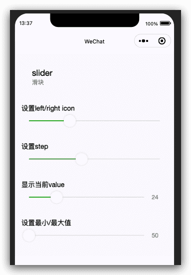

## 开关选择器 switch

> 基础库 1.0.0 开始支持，低版本需做[兼容处理](https://developers.weixin.qq.com/miniprogram/dev/framework/compatibility.html)。

开关选择器。

| 属性       | 类型        | 默认值  | 必填 | 说明                                                  | 最低版本                                                     |
| :--------- | :---------- | :------ | :--- | :---------------------------------------------------- | :----------------------------------------------------------- |
| checked    | boolean     | false   | 否   | 是否选中                                              | [1.0.0](https://developers.weixin.qq.com/miniprogram/dev/framework/compatibility.html) |
| disabled   | boolean     | false   | 否   | 是否禁用                                              | [1.0.0](https://developers.weixin.qq.com/miniprogram/dev/framework/compatibility.html) |
| type       | string      | switch  | 否   | 样式，有效值：switch, checkbox                        | [1.0.0](https://developers.weixin.qq.com/miniprogram/dev/framework/compatibility.html) |
| color      | string      | #04BE02 | 否   | switch 的颜色，同 css 的 color                        | [1.0.0](https://developers.weixin.qq.com/miniprogram/dev/framework/compatibility.html) |
| bindchange | eventhandle |         | 否   | checked 改变时触发 change 事件，`event.detail={ value}` | [1.0.0](https://developers.weixin.qq.com/miniprogram/dev/framework/compatibility.html) |

### Bug & Tip

1. `tip`: switch类型切换时在iOS自带振动反馈，可在系统设置 -> 声音与触感 -> 系统触感反馈中关闭

### 示例代码

[在开发者工具中预览效果](https://developers.weixin.qq.com/s/6db9lcmu6VYt)

```html
<view class="page">
    <view class="page__hd">
        <text class="page__title">switch</text>
        <text class="page__desc">开关</text>
    </view>
    <view class="page__bd">
        <view class="section section_gap">
            <view class="section__title">type="switch"</view>
            <view class="body-view">
                <switch checked="{{switch1Checked}}" bindchange="switch1Change"/>
            </view>
        </view>

        <view class="section section_gap">
            <view class="section__title">type="checkbox"</view>
            <view class="body-view">
                <switch type="checkbox" checked="{{switch2Checked}}" bindchange="switch2Change"/>
            </view>
        </view>
    </view>
</view>
```

```js
var pageData = {
  data: {
    switch1Checked: true,
    switch2Checked: false,
    switch1Style: '',
    switch2Style: 'text-decoration: line-through'
  }
}
for (var i = 1; i <= 2; ++i) {
  (function (index) {
    pageData[`switch${index}Change`] = function (e) {
      console.log(`switch${index}发生change事件，携带值为`, e.detail.value)
      var obj = {}
      obj[`switch${index}Checked`] = e.detail.value
      this.setData(obj)
      obj = {}
      obj[`switch${index}Style`] = e.detail.value ? '' : 'text-decoration: line-through'
      this.setData(obj)
    }
  })(i)
}
Page(pageData)
```

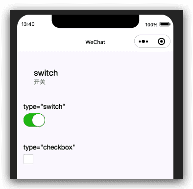

## 多行输入框 textarea

> 基础库 1.0.0 开始支持，低版本需做[兼容处理](https://developers.weixin.qq.com/miniprogram/dev/framework/compatibility.html)。

多行输入框。该组件是[原生组件](https://developers.weixin.qq.com/miniprogram/dev/component/native-component.html)，使用时请注意相关限制。

| 属性                     | 类型        | 默认值               | 必填 | 说明                                                         | 最低版本                                                     |
| :----------------------- | :---------- | :------------------- | :--- | :----------------------------------------------------------- | :----------------------------------------------------------- |
| value                    | string      |                      | 否   | 输入框的内容                                                 | [1.0.0](https://developers.weixin.qq.com/miniprogram/dev/framework/compatibility.html) |
| placeholder              | string      |                      | 否   | 输入框为空时占位符                                           | [1.0.0](https://developers.weixin.qq.com/miniprogram/dev/framework/compatibility.html) |
| placeholder-style        | string      |                      | 否   | 指定 placeholder 的样式，目前仅支持color,font-size和font-weight | [1.0.0](https://developers.weixin.qq.com/miniprogram/dev/framework/compatibility.html) |
| placeholder-class        | string      | textarea-placeholder | 否   | 指定 placeholder 的样式类                                    | [1.0.0](https://developers.weixin.qq.com/miniprogram/dev/framework/compatibility.html) |
| disabled                 | boolean     | false                | 否   | 是否禁用                                                     | [1.0.0](https://developers.weixin.qq.com/miniprogram/dev/framework/compatibility.html) |
| maxlength                | number      | 140                  | 否   | 最大输入长度，设置为 -1 的时候不限制最大长度                 | [1.0.0](https://developers.weixin.qq.com/miniprogram/dev/framework/compatibility.html) |
| auto-focus               | boolean     | false                | 否   | 自动聚焦，拉起键盘。                                         | [1.0.0](https://developers.weixin.qq.com/miniprogram/dev/framework/compatibility.html) |
| focus                    | boolean     | false                | 否   | 获取焦点                                                     | [1.0.0](https://developers.weixin.qq.com/miniprogram/dev/framework/compatibility.html) |
| auto-height              | boolean     | false                | 否   | 是否自动增高，设置auto-height时，style.height不生效          | [1.0.0](https://developers.weixin.qq.com/miniprogram/dev/framework/compatibility.html) |
| fixed                    | boolean     | false                | 否   | 如果 textarea 是在一个 `position:fixed` 的区域，需要显示指定属性 fixed 为 true | [1.0.0](https://developers.weixin.qq.com/miniprogram/dev/framework/compatibility.html) |
| cursor-spacing           | number      | 0                    | 否   | 指定光标与键盘的距离。取`textarea`距离底部的距离和`cursor-spacing`指定的距离的最小值作为光标与键盘的距离 | [1.0.0](https://developers.weixin.qq.com/miniprogram/dev/framework/compatibility.html) |
| cursor                   | number      | -1                   | 否   | 指定focus时的光标位置                                        | [1.5.0](https://developers.weixin.qq.com/miniprogram/dev/framework/compatibility.html) |
| show-confirm-bar         | boolean     | true                 | 否   | 是否显示键盘上方带有”完成“按钮那一栏                         | [1.6.0](https://developers.weixin.qq.com/miniprogram/dev/framework/compatibility.html) |
| selection-start          | number      | -1                   | 否   | 光标起始位置，自动聚集时有效，需与`selection-end`搭配使用    | [1.9.0](https://developers.weixin.qq.com/miniprogram/dev/framework/compatibility.html) |
| selection-end            | number      | -1                   | 否   | 光标结束位置，自动聚集时有效，需与`selection-start`搭配使用  | [1.9.0](https://developers.weixin.qq.com/miniprogram/dev/framework/compatibility.html) |
| adjust-position          | boolean     | true                 | 否   | 键盘弹起时，是否自动上推页面                                 | [1.9.90](https://developers.weixin.qq.com/miniprogram/dev/framework/compatibility.html) |
| hold-keyboard            | boolean     | false                | 否   | focus时，点击页面的时候不收起键盘                            | [2.8.2](https://developers.weixin.qq.com/miniprogram/dev/framework/compatibility.html) |
| disable-default-padding  | boolean     | false                | 否   | 是否去掉 iOS 下的默认内边距                                  | [2.10.0](https://developers.weixin.qq.com/miniprogram/dev/framework/compatibility.html) |
| confirm-type             | string      | return               | 否   | 设置键盘右下角按钮的文字                                     | [2.13.0](https://developers.weixin.qq.com/miniprogram/dev/framework/compatibility.html) |
| confirm-hold             | boolean     | false                | 否   | 点击键盘右下角按钮时是否保持键盘不收起                       | [2.16.0](https://developers.weixin.qq.com/miniprogram/dev/framework/compatibility.html) |
| bindfocus                | eventhandle |                      | 否   | 输入框聚焦时触发，`event.detail = { value, height }`，height 为键盘高度，在基础库 1.9.90 起支持 | [1.0.0](https://developers.weixin.qq.com/miniprogram/dev/framework/compatibility.html) |
| bindblur                 | eventhandle |                      | 否   | 输入框失去焦点时触发，`event.detail = {value, cursor}`         | [1.0.0](https://developers.weixin.qq.com/miniprogram/dev/framework/compatibility.html) |
| bindlinechange           | eventhandle |                      | 否   | 输入框行数变化时调用，`event.detail = {height: 0, heightRpx: 0, lineCount: 0}` | [1.0.0](https://developers.weixin.qq.com/miniprogram/dev/framework/compatibility.html) |
| bindinput                | eventhandle |                      | 否   | 当键盘输入时，触发 input 事件，`event.detail = {value, cursor, keyCode}`，keyCode 为键值，目前工具还不支持返回keyCode参数。**bindinput 处理函数的返回值并不会反映到 textarea 上** | [1.0.0](https://developers.weixin.qq.com/miniprogram/dev/framework/compatibility.html) |
| bindconfirm              | eventhandle |                      | 否   | 点击完成时， 触发 confirm 事件，`event.detail = {value: value}` | [1.0.0](https://developers.weixin.qq.com/miniprogram/dev/framework/compatibility.html) |
| bindkeyboardheightchange | eventhandle |                      | 否   | 键盘高度发生变化的时候触发此事件，`event.detail = {height: height, duration: duration}` | [2.7.0](https://developers.weixin.qq.com/miniprogram/dev/framework/compatibility.html) |

**confirm-type 的合法值**

| 值     | 说明                 | 最低版本 |
| :----- | :------------------- | :------- |
| send   | 右下角按钮为“发送”   |          |
| search | 右下角按钮为“搜索”   |          |
| next   | 右下角按钮为“下一个” |          |
| go     | 右下角按钮为“前往”   |          |
| done   | 右下角按钮为“完成”   |          |
| return | 右下角按钮为“换行”   |          |

### Bug & Tip

1. `tip`: `textarea` 的 `blur` 事件会晚于页面上的 `tap` 事件，如果需要在 `button` 的点击事件获取 `textarea`，可以使用 `form` 的 `bindsubmit`。
2. `tip`: 不建议在多行文本上对用户的输入进行修改，所以 `textarea` 的 `bindinput` 处理函数并不会将返回值反映到 `textarea` 上。
3. `tip` : 键盘高度发生变化，keyboardheightchange事件可能会多次触发，开发者对于相同的height值应该忽略掉
4. `bug`: 微信版本 `6.3.30`，`textarea` 在列表渲染时，新增加的 `textarea` 在自动聚焦时的位置计算错误。

### 示例代码

[在开发者工具中预览效果](https://developers.weixin.qq.com/s/QAwRn6m86tYu)

```html
<view class="page-body">
  <view class="page-section">
    <view class="page-section-title">输入区域高度自适应，不会出现滚动条</view>
    <view class="textarea-wrp">
      <textarea bindblur="bindTextAreaBlur" auto-height />
    </view>
  </view>

  <view class="page-section">
    <view class="page-section-title">这是一个可以自动聚焦的textarea</view>
    <view class="textarea-wrp">
      <textarea auto-focus="true" style="height: 3em" />
    </view>
  </view>
</view>
```

```js
Page({
  data: {
    focus: false
  },
  bindTextAreaBlur: function(e) {
    console.log(e.detail.value)
  }
})

```

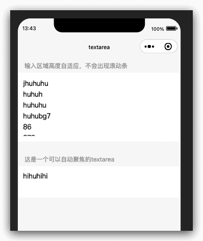
