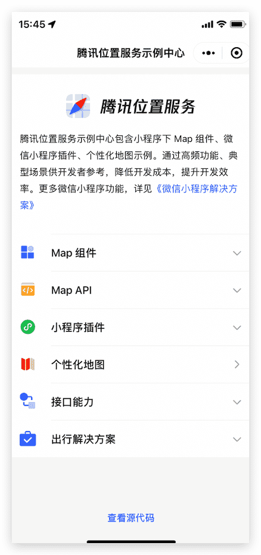
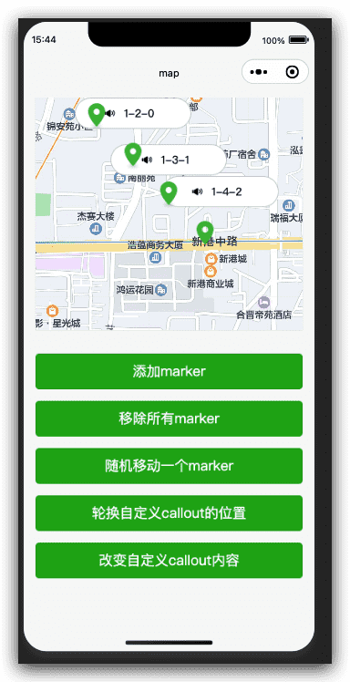
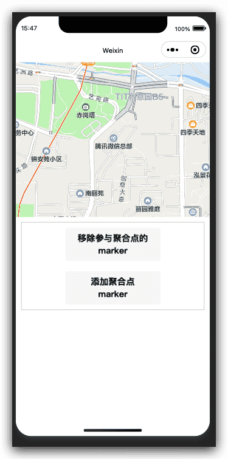
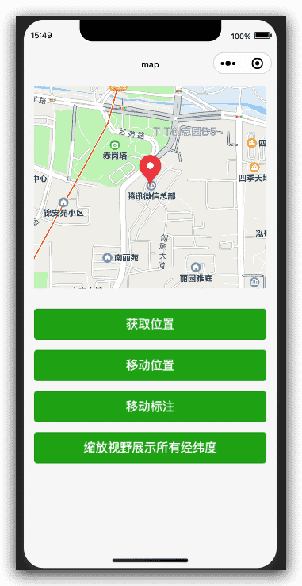

# 微信小程序框架组件-地图组件

## map 地图 组件

> 基础库 1.0.0 开始支持，低版本需做[兼容处理](https://developers.weixin.qq.com/miniprogram/dev/framework/compatibility.html)。

地图（v2.7.0 起支持[同层渲染](https://developers.weixin.qq.com/miniprogram/dev/component/native-component.html#原生组件同层渲染)，相关api [wx.createMapContext](https://developers.weixin.qq.com/miniprogram/dev/api/media/map/wx.createMapContext.html)。


## 小程序解决方案

除本章节介绍的小程序地图基础属性外，腾讯位置服务推出[《微信小程序解决方案》](https://lbs.qq.com/product/miniapp/home/)，从检索API、基础地图组件、个性化、插件、行业方案等多个层面，为不同场景需求的小程序开发者提供完整的地图能力。

## 个性化地图

个性化地图样式是腾讯位置服务开放的一项高级能力，开发者可以根据自身产品的使用场景，UI风格， 选取或者创建风格匹配的地图样式。小程序内地图组件应使用同一 subkey，可通过 layer-style（位置服务官网设置的样式 style 编号）属性配置，并支持动态切换样式。 组件属性的长度单位默认为px，[2.4.0](https://developers.weixin.qq.com/miniprogram/dev/framework/compatibility.html)起支持传入单位(rpx/px)。详情见：[个性化地图使用指南](https://lbs.qq.com/product/miniapp/customized/)

## 小程序插件

腾讯位置服务基于微信提供的小程序插件能力，专注于（围绕）地图功能，打造一系列小程序插件，可以帮助开发者简单、快速的构建小程序，是您实现地图功能的最佳伙伴。目前插件提供路线规划、地铁图、地图选点服务，详情见：[小程序地图插件使用指南](https://lbs.qq.com/miniProgram/plugin/pluginGuide/pluginOverview)。

## 地图检索

腾讯位置服务在[微信开放社区的服务平台](https://developers.weixin.qq.com/miniprogram/dev/extended/service-market/intro.html#地图)上线了一系列地图检索服务，包含4个POI数据类（逆地址解析、地址解析、地点搜索、关键词输入提示）、2个路线规划类（驾车路线规划、步行路线规划）、1个坐标工具类（坐标转换），覆盖了绝大部分地图应用场景。或者登陆位置服务官网的[Webservice使用指南](https://lbs.qq.com/service/webService/webServiceGuide/webServiceOverview)了解详细介绍。 微信小程序开发者可以使用海外地图进行展示，若需要海外检索能力，可在[海外位置服务](https://lbs.qq.com/product/abroad.html)进行申请。

## 小程序示例中心

包含Map组件、API、插件等功能使用方法，全面了解小程序下的所有地图能力。示例内容源码开放，降低各位开发者接入成本。




## 近期新增功能

1. 支持点聚合，适用于marker过多场景。
2. 支持彩虹蚯蚓线，常用于路线规划场景。
3. 覆盖物支持调整与其它地图元素的压盖关系。
4. 支持marker（小车）平移动画，适用于轨迹回放场景。

## 地图基础属性

| 属性               | 类型             | 默认值 | 必填 | 说明                                                         | 最低版本                                                     |
| :----------------- | :--------------- | :----- | :--- | :----------------------------------------------------------- | :----------------------------------------------------------- |
| longitude          | number           |        | 是   | 中心经度                                                     | [1.0.0](https://developers.weixin.qq.com/miniprogram/dev/framework/compatibility.html) |
| latitude           | number           |        | 是   | 中心纬度                                                     | [1.0.0](https://developers.weixin.qq.com/miniprogram/dev/framework/compatibility.html) |
| scale              | number           | 16     | 否   | 缩放级别，取值范围为3-20                                     | [1.0.0](https://developers.weixin.qq.com/miniprogram/dev/framework/compatibility.html) |
| min-scale          | number           | 3      | 否   | 最小缩放级别                                                 | [2.13.0](https://developers.weixin.qq.com/miniprogram/dev/framework/compatibility.html) |
| max-scale          | number           | 20     | 否   | 最大缩放级别                                                 | [2.13.0](https://developers.weixin.qq.com/miniprogram/dev/framework/compatibility.html) |
| markers            | `Array.<marker>`   |        | 否   | 标记点                                                       | [1.0.0](https://developers.weixin.qq.com/miniprogram/dev/framework/compatibility.html) |
| covers             | `Array.<cover>`    |        | 否   | **即将移除，请使用 markers**                                 | [1.0.0](https://developers.weixin.qq.com/miniprogram/dev/framework/compatibility.html) |
| polyline           | `Array.<polyline>` |        | 否   | 路线                                                         | [1.0.0](https://developers.weixin.qq.com/miniprogram/dev/framework/compatibility.html) |
| circles            | `Array.<circle>`   |        | 否   | 圆                                                           | [1.0.0](https://developers.weixin.qq.com/miniprogram/dev/framework/compatibility.html) |
| controls           | `Array.<control>`  |        | 否   | 控件（即将废弃，建议使用 [cover-view](https://developers.weixin.qq.com/miniprogram/dev/component/cover-view.html) 代替） | [1.0.0](https://developers.weixin.qq.com/miniprogram/dev/framework/compatibility.html) |
| include-points     | `Array.<point>`    |        | 否   | 缩放视野以包含所有给定的坐标点                               | [1.0.0](https://developers.weixin.qq.com/miniprogram/dev/framework/compatibility.html) |
| show-location      | boolean          | false  | 否   | 显示带有方向的当前定位点                                     | [1.0.0](https://developers.weixin.qq.com/miniprogram/dev/framework/compatibility.html) |
| polygons           | `Array.<polygon>`  |        | 否   | 多边形                                                       | [2.3.0](https://developers.weixin.qq.com/miniprogram/dev/framework/compatibility.html) |
| subkey             | string           |        | 否   | 个性化地图使用的key                                          | [2.3.0](https://developers.weixin.qq.com/miniprogram/dev/framework/compatibility.html) |
| layer-style        | number           | 1      | 否   | 个性化地图配置的 style，不支持动态修改                       |                                                              |
| rotate             | number           | 0      | 否   | 旋转角度，范围 0 ~ 360, 地图正北和设备 y 轴角度的夹角        | [2.5.0](https://developers.weixin.qq.com/miniprogram/dev/framework/compatibility.html) |
| skew               | number           | 0      | 否   | 倾斜角度，范围 0 ~ 40 , 关于 z 轴的倾角                      | [2.5.0](https://developers.weixin.qq.com/miniprogram/dev/framework/compatibility.html) |
| enable-3D          | boolean          | false  | 否   | 展示3D楼块(工具暂不支持）                                    | [2.3.0](https://developers.weixin.qq.com/miniprogram/dev/framework/compatibility.html) |
| show-compass       | boolean          | false  | 否   | 显示指南针                                                   | [2.3.0](https://developers.weixin.qq.com/miniprogram/dev/framework/compatibility.html) |
| show-scale         | boolean          | false  | 否   | 显示比例尺，工具暂不支持                                     | [2.8.0](https://developers.weixin.qq.com/miniprogram/dev/framework/compatibility.html) |
| enable-overlooking | boolean          | false  | 否   | 开启俯视                                                     | [2.3.0](https://developers.weixin.qq.com/miniprogram/dev/framework/compatibility.html) |
| enable-zoom        | boolean          | true   | 否   | 是否支持缩放                                                 | [2.3.0](https://developers.weixin.qq.com/miniprogram/dev/framework/compatibility.html) |
| enable-scroll      | boolean          | true   | 否   | 是否支持拖动                                                 | [2.3.0](https://developers.weixin.qq.com/miniprogram/dev/framework/compatibility.html) |
| enable-rotate      | boolean          | false  | 否   | 是否支持旋转                                                 | [2.3.0](https://developers.weixin.qq.com/miniprogram/dev/framework/compatibility.html) |
| enable-satellite   | boolean          | false  | 否   | 是否开启卫星图                                               | [2.7.0](https://developers.weixin.qq.com/miniprogram/dev/framework/compatibility.html) |
| enable-traffic     | boolean          | false  | 否   | 是否开启实时路况                                             | [2.7.0](https://developers.weixin.qq.com/miniprogram/dev/framework/compatibility.html) |
| enable-poi         | boolean          | true   | 否   | 是否展示 POI 点                                              | [2.14.0](https://developers.weixin.qq.com/miniprogram/dev/framework/compatibility.html) |
| enable-building    | boolean          |        | 否   | 是否展示建筑物                                               | [2.14.0](https://developers.weixin.qq.com/miniprogram/dev/framework/compatibility.html) |
| setting            | object           |        | 否   | 配置项                                                       | [2.8.2](https://developers.weixin.qq.com/miniprogram/dev/framework/compatibility.html) |
| bindtap            | eventhandle      |        | 否   | 点击地图时触发，[2.9.0](https://developers.weixin.qq.com/miniprogram/dev/framework/compatibility.html)起返回经纬度信息 | [1.0.0](https://developers.weixin.qq.com/miniprogram/dev/framework/compatibility.html) |
| bindmarkertap      | eventhandle      |        | 否   | 点击标记点时触发，`e.detail = {markerId}`                    | [1.0.0](https://developers.weixin.qq.com/miniprogram/dev/framework/compatibility.html) |
| bindlabeltap       | eventhandle      |        | 否   | 点击label时触发，`e.detail = {markerId}`                     | [2.9.0](https://developers.weixin.qq.com/miniprogram/dev/framework/compatibility.html) |
| bindcontroltap     | eventhandle      |        | 否   | 点击控件时触发，`e.detail = {controlId}`                     | [1.0.0](https://developers.weixin.qq.com/miniprogram/dev/framework/compatibility.html) |
| bindcallouttap     | eventhandle      |        | 否   | 点击标记点对应的气泡时触发`e.detail = {markerId}`            | [1.2.0](https://developers.weixin.qq.com/miniprogram/dev/framework/compatibility.html) |
| bindupdated        | eventhandle      |        | 否   | 在地图渲染更新完成时触发                                     | [1.6.0](https://developers.weixin.qq.com/miniprogram/dev/framework/compatibility.html) |
| bindregionchange   | eventhandle      |        | 否   | 视野发生变化时触发，                                         | [2.3.0](https://developers.weixin.qq.com/miniprogram/dev/framework/compatibility.html) |
| bindpoitap         | eventhandle      |        | 否   | 点击地图poi点时触发，`e.detail = {name, longitude, latitude}` | [2.3.0](https://developers.weixin.qq.com/miniprogram/dev/framework/compatibility.html) |
| bindanchorpointtap | eventhandle      |        | 否   | 点击定位标时触发，`e.detail = {longitude, latitude}`         | [2.13.0](https://developers.weixin.qq.com/miniprogram/dev/framework/compatibility.html) |

## regionchange 返回值

视野改变时，regionchange 会触发两次，返回的 type 值分别为 begin 和 end。

[2.8.0](https://developers.weixin.qq.com/miniprogram/dev/framework/compatibility.html) 起 begin 阶段返回 causedBy，有效值为 gesture（手势触发） & update（接口触发）

[2.3.0](https://developers.weixin.qq.com/miniprogram/dev/framework/compatibility.html) 起 end 阶段返回 causedBy，有效值为 drag（拖动导致）、scale（缩放导致）、update（调用更新接口导致）。

```js
e = {causedBy, type, detail: {rotate, skew, scale, centerLocation, region}}
```

## setting

提供 setting 对象统一设置地图配置。同时对于一些动画属性如 `rotate` 和 `skew`，通过 `setData` 分开设置时无法同时生效，需通过 `settting` 统一修改。

```js
// 默认值
const setting = {
  skew: 0,
  rotate: 0,
  showLocation: false,
  showScale: false,
  subKey: '',
  layerStyle: 1,
  enableZoom: true,
  enableScroll: true,
  enableRotate: false,
  showCompass: false,
  enable3D: false,
  enableOverlooking: false,
  enableSatellite: false,
  enableTraffic: false,
}

this.setData({
  // 仅设置的属性会生效，其它的不受影响
  setting: {
    enable3D: true,
    enableTraffic: true
  }
})
```

## marker

标记点用于在地图上显示标记的位置

| 属性          | 说明                                 | 类型          | 必填 | 备注                                                         | 最低版本                                                     |
| :------------ | :----------------------------------- | :------------ | :--- | :----------------------------------------------------------- | :----------------------------------------------------------- |
| id            | 标记点 id                            | number        | 否   | marker 点击事件回调会返回此 id。**建议为每个 marker 设置上 number 类型 id，保证更新 marker 时有更好的性能。** |                                                              |
| clusterId     | 聚合簇的 id                          | Number        | 否   | 自定义点聚合簇效果时使用                                     |                                                              |
| joinCluster   | 是否参与点聚合                       | Boolean       | 否   | 默认不参与点聚合                                             |                                                              |
| latitude      | 纬度                                 | number        | 是   | 浮点数，范围 -90 ~ 90                                        |                                                              |
| longitude     | 经度                                 | number        | 是   | 浮点数，范围 -180 ~ 180                                      |                                                              |
| title         | 标注点名                             | string        | 否   | 点击时显示，callout存在时将被忽略                            |                                                              |
| zIndex        | 显示层级                             | number        | 否   |                                                              | [2.3.0](https://developers.weixin.qq.com/miniprogram/dev/framework/compatibility.html) |
| iconPath      | 显示的图标                           | string        | 是   | 项目目录下的图片路径，支持网络路径、本地路径、代码包路径（[2.3.0](https://developers.weixin.qq.com/miniprogram/dev/framework/compatibility.html)） |                                                              |
| rotate        | 旋转角度                             | number        | 否   | 顺时针旋转的角度，范围 0 ~ 360，默认为 0                     |                                                              |
| alpha         | 标注的透明度                         | number        | 否   | 默认 1，无透明，范围 0 ~ 1                                   |                                                              |
| width         | 标注图标宽度                         | number/string | 否   | 默认为图片实际宽度                                           |                                                              |
| height        | 标注图标高度                         | number/string | 否   | 默认为图片实际高度                                           |                                                              |
| callout       | 标记点上方的气泡窗口                 | Object        | 否   | 支持的属性见下表，可识别换行符。                             | [1.2.0](https://developers.weixin.qq.com/miniprogram/dev/framework/compatibility.html) |
| customCallout | 自定义气泡窗口                       | Object        | 否   | 支持的属性见下表                                             |                                                              |
| label         | 为标记点旁边增加标签                 | Object        | 否   | 支持的属性见下表，可识别换行符。                             | [1.2.0](https://developers.weixin.qq.com/miniprogram/dev/framework/compatibility.html) |
| anchor        | 经纬度在标注图标的锚点，默认底边中点 | Object        | 否   | {x, y}，x 表示横向(0-1)，y 表示竖向(0-1)。{x: .5, y: 1} 表示底边中点 | [1.2.0](https://developers.weixin.qq.com/miniprogram/dev/framework/compatibility.html) |
| aria-label    | 无障碍访问，（属性）元素的额外描述   | string        | 否   |                                                              | [2.5.0](https://developers.weixin.qq.com/miniprogram/dev/framework/compatibility.html) |

## marker 上的气泡 callout

| 属性         | 说明                                      | 类型   | 最低版本                                                     |
| :----------- | :---------------------------------------- | :----- | :----------------------------------------------------------- |
| content      | 文本                                      | string | [1.2.0](https://developers.weixin.qq.com/miniprogram/dev/framework/compatibility.html) |
| color        | 文本颜色                                  | string | [1.2.0](https://developers.weixin.qq.com/miniprogram/dev/framework/compatibility.html) |
| fontSize     | 文字大小                                  | number | [1.2.0](https://developers.weixin.qq.com/miniprogram/dev/framework/compatibility.html) |
| borderRadius | 边框圆角                                  | number | [1.2.0](https://developers.weixin.qq.com/miniprogram/dev/framework/compatibility.html) |
| borderWidth  | 边框宽度                                  | number | [2.3.0](https://developers.weixin.qq.com/miniprogram/dev/framework/compatibility.html) |
| borderColor  | 边框颜色                                  | string | [2.3.0](https://developers.weixin.qq.com/miniprogram/dev/framework/compatibility.html) |
| bgColor      | 背景色                                    | string | [1.2.0](https://developers.weixin.qq.com/miniprogram/dev/framework/compatibility.html) |
| padding      | 文本边缘留白                              | number | [1.2.0](https://developers.weixin.qq.com/miniprogram/dev/framework/compatibility.html) |
| display      | 'BYCLICK':点击显示; 'ALWAYS':常显         | string | [1.2.0](https://developers.weixin.qq.com/miniprogram/dev/framework/compatibility.html) |
| textAlign    | 文本对齐方式。有效值: left, right, center | string | [1.6.0](https://developers.weixin.qq.com/miniprogram/dev/framework/compatibility.html) |
| anchorX      | 横向偏移量，向右为正数                    | number | [2.11.0](https://developers.weixin.qq.com/miniprogram/dev/framework/compatibility.html) |
| anchorY      | 纵向偏移量，向下为正数                    | number | [2.11.0](https://developers.weixin.qq.com/miniprogram/dev/framework/compatibility.html) |

## marker 上的自定义气泡 customCallout

`customCallout` 存在时将忽略 `callout` 与 `title` 属性。自定义气泡采用采用 `cover-view` 定制，灵活度更高。

| 属性    | 说明                              | 类型   | 最低版本                                                     |
| :------ | :-------------------------------- | :----- | :----------------------------------------------------------- |
| display | 'BYCLICK':点击显示; 'ALWAYS':常显 | string | [2.12.0](https://developers.weixin.qq.com/miniprogram/dev/framework/compatibility.html) |
| anchorX | 横向偏移量，向右为正数            | number | [2.12.0](https://developers.weixin.qq.com/miniprogram/dev/framework/compatibility.html) |
| anchorY | 纵向偏移量，向下为正数            | number | [2.12.0](https://developers.weixin.qq.com/miniprogram/dev/framework/compatibility.html) |

使用方式如下，`map` 组件下添加名为 `callout` 的 `slot` 节点，其内部的 `cover-view` 通过 marker-id 属性与 `marker` 绑定。当 `marker` 创建时，该 `cover-view` 显示的内容将作为 `callout` 显示在标记点上方。

```html
<map>
  <cover-view slot="callout">
    <cover-view marker-id="1"></cover-view>
    <cover-view marker-id="2"></cover-view>
  </cover-view>
</map>
```

示例DEMO： [在开发者工具中预览效果](https://developers.weixin.qq.com/s/cZWIojm47pjN)



## marker 上的气泡 label

| 属性         | 说明                                      | 类型   | 最低版本                                                     |
| :----------- | :---------------------------------------- | :----- | :----------------------------------------------------------- |
| content      | 文本                                      | string | [1.2.0](https://developers.weixin.qq.com/miniprogram/dev/framework/compatibility.html) |
| color        | 文本颜色                                  | string | [1.2.0](https://developers.weixin.qq.com/miniprogram/dev/framework/compatibility.html) |
| fontSize     | 文字大小                                  | number | [1.2.0](https://developers.weixin.qq.com/miniprogram/dev/framework/compatibility.html) |
| x            | label的坐标（废弃）                       | number | [1.2.0](https://developers.weixin.qq.com/miniprogram/dev/framework/compatibility.html) |
| y            | label的坐标（废弃）                       | number | [1.2.0](https://developers.weixin.qq.com/miniprogram/dev/framework/compatibility.html) |
| anchorX      | label的坐标，原点是 marker 对应的经纬度   | number | [2.1.0](https://developers.weixin.qq.com/miniprogram/dev/framework/compatibility.html) |
| anchorY      | label的坐标，原点是 marker 对应的经纬度   | number | [2.1.0](https://developers.weixin.qq.com/miniprogram/dev/framework/compatibility.html) |
| borderWidth  | 边框宽度                                  | number | [1.6.0](https://developers.weixin.qq.com/miniprogram/dev/framework/compatibility.html) |
| borderColor  | 边框颜色                                  | string | [1.6.0](https://developers.weixin.qq.com/miniprogram/dev/framework/compatibility.html) |
| borderRadius | 边框圆角                                  | number | [1.6.0](https://developers.weixin.qq.com/miniprogram/dev/framework/compatibility.html) |
| bgColor      | 背景色                                    | string | [1.6.0](https://developers.weixin.qq.com/miniprogram/dev/framework/compatibility.html) |
| padding      | 文本边缘留白                              | number | [1.6.0](https://developers.weixin.qq.com/miniprogram/dev/framework/compatibility.html) |
| textAlign    | 文本对齐方式。有效值: left, right, center | string | [1.6.0](https://developers.weixin.qq.com/miniprogram/dev/framework/compatibility.html) |

## 点聚合

当地图上需要展示的标记点 marker 过多时，可能会导致界面上 marker 出现压盖，展示不全，并导致整体性能变差。针对此类问题，推出点聚合能力。

使用流程如下：

1. [MapContext.initMarkerCluster](https://developers.weixin.qq.com/miniprogram/dev/api/media/map/MapContext.initMarkerCluster.html) 对聚合点进行初始化配置（可选）；
2. [MapContext.addMarkers](https://developers.weixin.qq.com/miniprogram/dev/api/media/map/MapContext.addMarkers.html) 指定参与聚合的 marker；
3. `MapContext.on('markerClusterCreate', callback)` 触发时，通过 [MapContext.addMarkers](https://developers.weixin.qq.com/miniprogram/dev/api/media/map/MapContext.addMarkers.html) 更新聚合簇的样式 （可选）；
4. [MapContext.removeMarkers](https://developers.weixin.qq.com/miniprogram/dev/api/media/map/MapContext.removeMarkers.html) 移除参与聚合的 marker；

## 示例代码

[在开发者工具中预览效果](https://developers.weixin.qq.com/s/ARFICpm272ly)

需注意的是：

1. 地图上的 marker 分为普通的 marker 与参与聚合的 marker，参与聚合时需指定属性 joinCluster 为 true；
2. 自定义聚合簇样式时，同样通过 [MapContext.addMarkers](https://developers.weixin.qq.com/miniprogram/dev/api/media/map/MapContext.addMarkers.html) 进行绘制，此时需携带 clusterId。



## polyline

指定一系列坐标点，从数组第一项连线至最后一项。绘制彩虹线时，需指定不同分段的颜色，如 points 包含 5 个点，则 colorList 应传入 4 个颜色值；若 colorList 长度小于 points.length - 1，则剩下的分段颜色与最后一项保持一致。

| 属性          | 说明         | 类型    | 必填 | 备注                                 | 最低版本                                                     |
| :------------ | :----------- | :------ | :--- | :----------------------------------- | :----------------------------------------------------------- |
| points        | 经纬度数组   | array   | 是   | [{latitude: 0, longitude: 0}]        |                                                              |
| color         | 线的颜色     | string  | 否   | 十六进制                             |                                                              |
| colorList     | 彩虹线       | array   | 否   | 存在时忽略 color 值                  | [2.13.0](https://developers.weixin.qq.com/miniprogram/dev/framework/compatibility.html) |
| width         | 线的宽度     | number  | 否   |                                      |                                                              |
| dottedLine    | 是否虚线     | boolean | 否   | 默认 false                           |                                                              |
| arrowLine     | 带箭头的线   | boolean | 否   | 默认 false，开发者工具暂不支持该属性 | [1.2.0](https://developers.weixin.qq.com/miniprogram/dev/framework/compatibility.html) |
| arrowIconPath | 更换箭头图标 | string  | 否   | 在 arrowLine 为 true 时生效          | [1.6.0](https://developers.weixin.qq.com/miniprogram/dev/framework/compatibility.html) |
| borderColor   | 线的边框颜色 | string  | 否   |                                      | [1.2.0](https://developers.weixin.qq.com/miniprogram/dev/framework/compatibility.html) |
| borderWidth   | 线的厚度     | number  | 否   |                                      | [1.2.0](https://developers.weixin.qq.com/miniprogram/dev/framework/compatibility.html) |
| level         | 压盖关系     | string  | 否   | 默认为 abovelabels                   | [2.14.0](https://developers.weixin.qq.com/miniprogram/dev/framework/compatibility.html) |

`level` 字段表示与其它地图元素的压盖关系，可选值如下：

| 值             | 说明                    | 最低版本                                                     |
| :------------- | :---------------------- | :----------------------------------------------------------- |
| abovelabels    | 显示在所有 POI 之上     | [2.14.0](https://developers.weixin.qq.com/miniprogram/dev/framework/compatibility.html) |
| abovebuildings | 显示在楼块之上 POI 之下 | [2.14.0](https://developers.weixin.qq.com/miniprogram/dev/framework/compatibility.html) |
| aboveroads     | 显示在道路之上楼块之下  | [2.14.0](https://developers.weixin.qq.com/miniprogram/dev/framework/compatibility.html) |

## polygon

指定一系列坐标点，根据 points 坐标数据生成闭合多边形

| 属性        | 说明              | 类型   | 必填 | 备注                          | 最低版本                                                     |
| :---------- | :---------------- | :----- | :--- | :---------------------------- | :----------------------------------------------------------- |
| points      | 经纬度数组        | array  | 是   | [{latitude: 0, longitude: 0}] | [2.3.0](https://developers.weixin.qq.com/miniprogram/dev/framework/compatibility.html) |
| strokeWidth | 描边的宽度        | number | 否   |                               | [2.3.0](https://developers.weixin.qq.com/miniprogram/dev/framework/compatibility.html) |
| strokeColor | 描边的颜色        | string | 否   | 十六进制                      | [2.3.0](https://developers.weixin.qq.com/miniprogram/dev/framework/compatibility.html) |
| fillColor   | 填充颜色          | string | 否   | 十六进制                      |                                                              |
| zIndex      | 设置多边形Z轴数值 | number | 否   |                               | [2.3.0](https://developers.weixin.qq.com/miniprogram/dev/framework/compatibility.html) |
| level       | 压盖关系          | string | 否   | 默认为 abovelabels            | [2.14.0](https://developers.weixin.qq.com/miniprogram/dev/framework/compatibility.html) |

## circle

在地图上显示圆

| 属性        | 说明       | 类型   | 必填 | 备注                    |
| :---------- | :--------- | :----- | :--- | :---------------------- |
| latitude    | 纬度       | number | 是   | 浮点数，范围 -90 ~ 90   |
| longitude   | 经度       | number | 是   | 浮点数，范围 -180 ~ 180 |
| color       | 描边的颜色 | string | 否   | 十六进制                |
| fillColor   | 填充颜色   | string | 否   | 十六进制                |
| radius      | 半径       | number | 是   |                         |
| strokeWidth | 描边的宽度 | number | 否   |                         |
| level       | 压盖关系   | string | 否   | 默认为 abovelabels      |

## control

在地图上显示控件，控件不随着地图移动。**即将废弃，请使用 [cover-view](https://developers.weixin.qq.com/miniprogram/dev/component/cover-view.html)**

| 属性      | 说明             | 类型    | 必填 | 备注                                           |
| :-------- | :--------------- | :------ | :--- | :--------------------------------------------- |
| id        | 控件id           | number  | 否   | 在控件点击事件回调会返回此id                   |
| position  | 控件在地图的位置 | object  | 是   | 控件相对地图位置                               |
| iconPath  | 显示的图标       | string  | 是   | 项目目录下的图片路径，支持本地路径、代码包路径 |
| clickable | 是否可点击       | boolean | 否   | 默认不可点击                                   |

## position

| 属性   | 说明                 | 类型   | 必填 | 备注           |
| :----- | :------------------- | :----- | :--- | :------------- |
| left   | 距离地图的左边界多远 | number | 否   | 默认为0        |
| top    | 距离地图的上边界多远 | number | 否   | 默认为0        |
| width  | 控件宽度             | number | 否   | 默认为图片宽度 |
| height | 控件高度             | number | 否   | 默认为图片高度 |

## bindregionchange 返回值

| 属性     | 说明                     | 类型   | 备注                                                      |
| :------- | :----------------------- | :----- | :-------------------------------------------------------- |
| type     | 视野变化开始、结束时触发 | string | 视野变化开始为begin，结束为end                            |
| causedBy | 导致视野变化的原因       | string | 拖动地图导致(drag)、缩放导致(scale)、调用接口导致(update) |

## 比例尺

|       |        |       |       |       |      |      |      |      |      |
| :---- | :----- | :---- | :---- | :---- | :--- | :--- | :--- | :--- | :--- |
| scale | 3      | 4     | 5     | 6     | 7    | 8    | 9    | 10   | 11   |
| 比例  | 1000km | 500km | 200km | 100km | 50km | 50km | 20km | 10km | 5km  |
| scale | 12     | 13    | 14    | 15    | 16   | 17   | 18   | 19   | 20   |
| 比例  | 2km    | 1km   | 500m  | 200m  | 100m | 50m  | 50m  | 20m  | 10m  |

## 示例代码

[在开发者工具中预览效果](https://developers.weixin.qq.com/s/3uVxpmmT6wY9)



## Bug & Tip

1. `tip`：个性化地图暂不支持工具中调试。请先使用微信客户端进行测试。
2. `tip`：地图中的颜色值color/borderColor/bgColor等需使用6位（8位）十六进制表示，8位时后两位表示alpha值，如：#000000AA
3. `tip`：地图组件的经纬度必填, 如果不填经纬度则默认值是北京的经纬度。
4. `tip`: `map` 组件使用的经纬度是火星坐标系，调用 [wx.getLocation](https://developers.weixin.qq.com/miniprogram/dev/api/location/wx.getLocation.html) 接口需要指定 `type` 为 `gcj02`
5. `tip`：从 2.8.0 起 map 支持同层渲染，更多请参考[原生组件使用限制](https://developers.weixin.qq.com/miniprogram/dev/component/native-component.html#原生组件的使用限制)
6. `tip`：请注意[原生组件使用限制](https://developers.weixin.qq.com/miniprogram/dev/component/native-component.html#原生组件的使用限制)。

