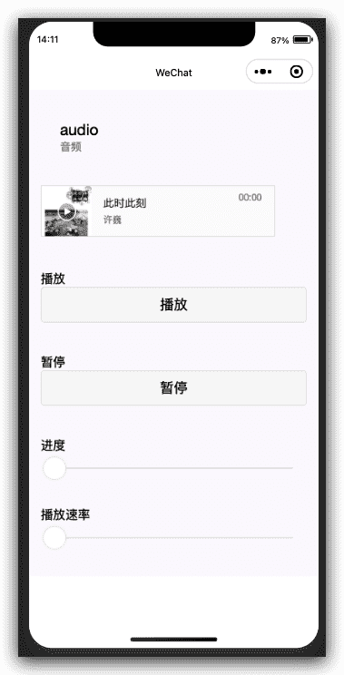
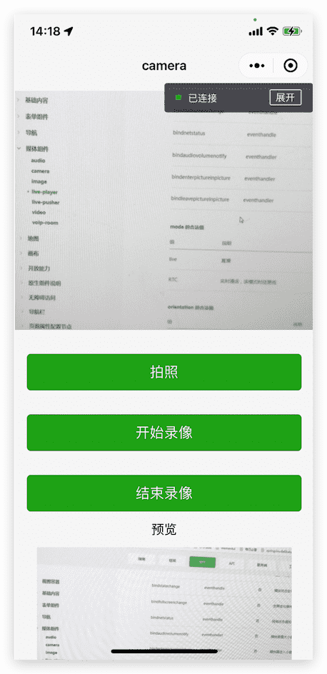
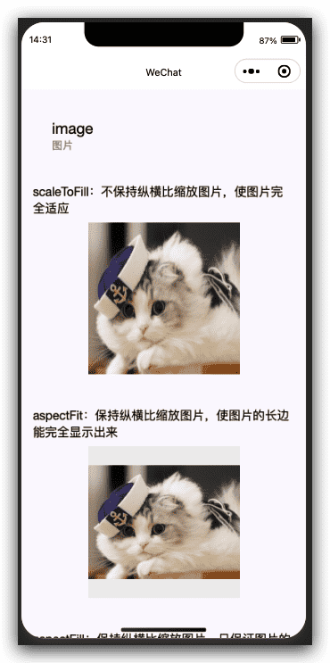
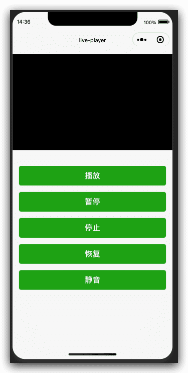
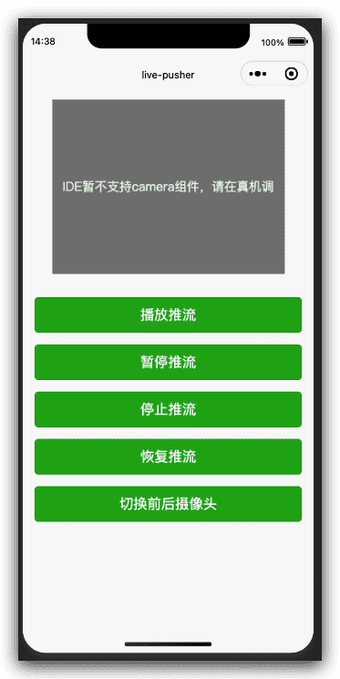
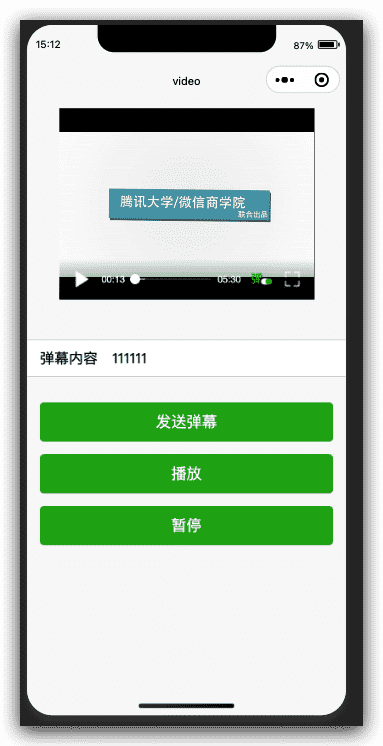

# 微信小程序框架组件-媒体组件

## audio音频组件

> 基础库 1.0.0 开始支持，低版本需做[兼容处理](https://developers.weixin.qq.com/miniprogram/dev/framework/compatibility.html)。

音频。[1.6.0](https://developers.weixin.qq.com/miniprogram/dev/framework/compatibility.html)版本开始，该组件不再维护。建议使用能力更强的 [wx.createInnerAudioContext](https://developers.weixin.qq.com/miniprogram/dev/api/media/audio/wx.createInnerAudioContext.html) 接口


| 属性           | 类型        | 默认值   | 必填 | 说明                                                         | 最低版本                                                     |
| :------------- | :---------- | :------- | :--- | :----------------------------------------------------------- | :----------------------------------------------------------- |
| id             | string      |          | 否   | audio 组件的唯一标识符                                       | [1.0.0](https://developers.weixin.qq.com/miniprogram/dev/framework/compatibility.html) |
| src            | string      |          | 否   | 要播放音频的资源地址                                         | [1.0.0](https://developers.weixin.qq.com/miniprogram/dev/framework/compatibility.html) |
| loop           | boolean     | false    | 否   | 是否循环播放                                                 | [1.0.0](https://developers.weixin.qq.com/miniprogram/dev/framework/compatibility.html) |
| controls       | boolean     | false    | 否   | 是否显示默认控件                                             | [1.0.0](https://developers.weixin.qq.com/miniprogram/dev/framework/compatibility.html) |
| poster         | string      |          | 否   | 默认控件上的音频封面的图片资源地址，如果 controls 属性值为 false 则设置 poster 无效 | [1.0.0](https://developers.weixin.qq.com/miniprogram/dev/framework/compatibility.html) |
| name           | string      | 未知音频 | 否   | 默认控件上的音频名字，如果 controls 属性值为 false 则设置 name 无效 | [1.0.0](https://developers.weixin.qq.com/miniprogram/dev/framework/compatibility.html) |
| author         | string      | 未知作者 | 否   | 默认控件上的作者名字，如果 controls 属性值为 false 则设置 author 无效 | [1.0.0](https://developers.weixin.qq.com/miniprogram/dev/framework/compatibility.html) |
| binderror      | eventhandle |          | 否   | 当发生错误时触发 error 事件，detail = {errMsg:MediaError.code} | [1.0.0](https://developers.weixin.qq.com/miniprogram/dev/framework/compatibility.html) |
| bindplay       | eventhandle |          | 否   | 当开始/继续播放时触发play事件                                | [1.0.0](https://developers.weixin.qq.com/miniprogram/dev/framework/compatibility.html) |
| bindpause      | eventhandle |          | 否   | 当暂停播放时触发 pause 事件                                  | [1.0.0](https://developers.weixin.qq.com/miniprogram/dev/framework/compatibility.html) |
| bindtimeupdate | eventhandle |          | 否   | 当播放进度改变时触发 timeupdate 事件，detail = {currentTime, duration} | [1.0.0](https://developers.weixin.qq.com/miniprogram/dev/framework/compatibility.html) |
| bindended      | eventhandle |          | 否   | 当播放到末尾时触发 ended 事件                                | [1.0.0](https://developers.weixin.qq.com/miniprogram/dev/framework/compatibility.html) |

### MediaError.code

| 返回错误码 | 描述               |
| :--------- | :----------------- |
| 1          | 获取资源被用户禁止 |
| 2          | 网络错误           |
| 3          | 解码错误           |
| 4          | 不合适资源         |

### 示例代码

[在开发者工具中预览效果](https://developers.weixin.qq.com/s/NycgqcmS6KYY)

```html index.wxml
<view class="page">
  <view class="page__hd">
    <text class="page__title">audio</text>
    <text class="page__desc">音频</text>
  </view>
  <view class="page__bd">
    <view class="section section_gap">
      <audio src="{{current.src}}" poster="{{current.poster}}" name="{{current.name}}" author="{{current.author}}" action="{{audioAction}}" bindplay="audioPlayed" bindtimeupdate="audioTimeUpdated" controls></audio>
    </view>
  </view>

  <view class="section section_gap">
    <text class="section__title">播放</text>
    <view class="body-view">
      <button bindtap="playAudio">播放</button>
    </view>
  </view>

  <view class="section section_gap">
    <text class="section__title">暂停</text>
    <view class="body-view">
      <button bindtap="pauseAudio">暂停</button>
    </view>
  </view>

  <view class="section section_gap">
    <text class="section__title">进度</text>
    <view class="body-view">
      <slider bindchange="timeSliderChanged" left-icon="cancel" right-icon="success_no_circle"/>
    </view>
  </view>
  <view class="section section_gap">
    <text class="section__title">播放速率</text>
    <view class="body-view">
      <slider min="1" max="4" bindchange="playbackRateSliderChanged" left-icon="cancel" right-icon="success_no_circle"/>
    </view>
  </view>
</view>
```

```js index.js
Page({
  data: {
    current: {
      poster: 'http://y.gtimg.cn/music/photo_new/T002R300x300M000003rsKF44GyaSk.jpg?max_age=2592000',
      name: '此时此刻',
      author: '许巍',
      src: 'http://ws.stream.qqmusic.qq.com/M500001VfvsJ21xFqb.mp3?guid=ffffffff82def4af4b12b3cd9337d5e7&uin=346897220&vkey=6292F51E1E384E06DCBDC9AB7C49FD713D632D313AC4858BACB8DDD29067D3C601481D36E62053BF8DFEAF74C0A5CCFADD6471160CAF3E6A&fromtag=46',
    },
    audioAction: {
      method: 'pause'
    }
  },
  audioPlayed: function (e) {
    console.log('audio is played')
  },
  audioTimeUpdated: function (e) {
    this.duration = e.detail.duration;
  },

  timeSliderChanged: function (e) {
    if (!this.duration)
      return;

    var time = this.duration * e.detail.value / 100;

    this.setData({
      audioAction: {
        method: 'setCurrentTime',
        data: time
      }
    });
  },
  playbackRateSliderChanged: function (e) {
    this.setData({
      audioAction: {
        method: 'setPlaybackRate',
        data: e.detail.value
      }
    })
  },

  playAudio: function () {
    this.setData({
      audioAction: {
        method: 'play'
      }
    });
  },
  pauseAudio: function () {
    this.setData({
      audioAction: {
        method: 'pause'
      }
    });
  }
})
```



## camera 系统相机 组件

> 基础库 1.6.0 开始支持，低版本需做[兼容处理](https://developers.weixin.qq.com/miniprogram/dev/framework/compatibility.html)。

系统相机。扫码二维码功能，需升级微信客户端至6.7.3。需要[用户授权](https://developers.weixin.qq.com/miniprogram/dev/framework/open-ability/authorize.html) `scope.camera`。 [2.10.0](https://developers.weixin.qq.com/miniprogram/dev/framework/compatibility.html)起 initdone 事件返回 maxZoom，最大变焦范围，相关接口 [CameraContext.setZoom](https://developers.weixin.qq.com/miniprogram/dev/api/media/camera/CameraContext.setZoom.html)。

相关api：[wx.createCameraContext](https://developers.weixin.qq.com/miniprogram/dev/api/media/camera/wx.createCameraContext.html)

| 属性            | 类型        | 默认值 | 必填 | 说明                                              | 最低版本                                                     |
| :-------------- | :---------- | :----- | :--- | :------------------------------------------------ | :----------------------------------------------------------- |
| mode            | string      | normal | 否   | 应用模式，只在初始化时有效，不能动态变更          | [2.1.0](https://developers.weixin.qq.com/miniprogram/dev/framework/compatibility.html) |
| resolution      | string      | medium | 否   | 分辨率，不支持动态修改                            | [2.10.0](https://developers.weixin.qq.com/miniprogram/dev/framework/compatibility.html) |
| device-position | string      | back   | 否   | 摄像头朝向                                        | [1.0.0](https://developers.weixin.qq.com/miniprogram/dev/framework/compatibility.html) |
| flash           | string      | auto   | 否   | 闪光灯，值为auto, on, off                         | [1.0.0](https://developers.weixin.qq.com/miniprogram/dev/framework/compatibility.html) |
| frame-size      | string      | medium | 否   | 指定期望的相机帧数据尺寸                          | [2.7.0](https://developers.weixin.qq.com/miniprogram/dev/framework/compatibility.html) |
| bindstop        | eventhandle |        | 否   | 摄像头在非正常终止时触发，如退出后台等情况        | [1.0.0](https://developers.weixin.qq.com/miniprogram/dev/framework/compatibility.html) |
| binderror       | eventhandle |        | 否   | 用户不允许使用摄像头时触发                        | [1.0.0](https://developers.weixin.qq.com/miniprogram/dev/framework/compatibility.html) |
| bindinitdone    | eventhandle |        | 否   | 相机初始化完成时触发，`e.detail = {maxZoom}`      | [2.7.0](https://developers.weixin.qq.com/miniprogram/dev/framework/compatibility.html) |
| bindscancode    | eventhandle |        | 否   | 在扫码识别成功时触发，仅在 mode="scanCode" 时生效 | [2.1.0](https://developers.weixin.qq.com/miniprogram/dev/framework/compatibility.html) |

**mode 的合法值**

| 值       | 说明     | 最低版本 |
| :------- | :------- | :------- |
| normal   | 相机模式 |          |
| scanCode | 扫码模式 |          |

**resolution 的合法值**

| 值     | 说明 | 最低版本 |
| :----- | :--- | :------- |
| low    | 低   |          |
| medium | 中   |          |
| high   | 高   |          |

**device-position 的合法值**

| 值    | 说明 | 最低版本 |
| :---- | :--- | :------- |
| front | 前置 |          |
| back  | 后置 |          |

**flash 的合法值**

| 值    | 说明 | 最低版本                                                     |
| :---- | :--- | :----------------------------------------------------------- |
| auto  | 自动 |                                                              |
| on    | 打开 |                                                              |
| off   | 关闭 |                                                              |
| torch | 常亮 | [2.8.0](https://developers.weixin.qq.com/miniprogram/dev/framework/compatibility.html) |

**frame-size 的合法值**

| 值     | 说明         | 最低版本 |
| :----- | :----------- | :------- |
| small  | 小尺寸帧数据 |          |
| medium | 中尺寸帧数据 |          |
| large  | 大尺寸帧数据 |          |

### Bug & Tip

1. `tip`: 同一页面只能插入一个 `camera` 组件
2. `tip`:请注意[原生组件使用限制](https://developers.weixin.qq.com/miniprogram/dev/component/native-component.html#原生组件的使用限制)
3. `tip`:onCameraFrame 接口根据 frame-size 返回不同尺寸的原始帧数据，与 Camera 组件展示的图像不同，其实际像素值由系统决定

### 示例代码

[在开发者工具中预览效果](https://developers.weixin.qq.com/s/VBZ3Jim26zYu)

```xml index.wxml
<view class="page-body">
  <view class="page-body-wrapper">
    <camera device-position="back" flash="off" binderror="error" style="width: 100%; height: 300px;"></camera>
    <view class="btn-area">
      <button type="primary" bindtap="takePhoto">拍照</button>
    </view>
    <view class="btn-area">
      <button type="primary" bindtap="startRecord">开始录像</button>
    </view>
    <view class="btn-area">
      <button type="primary" bindtap="stopRecord">结束录像</button>
    </view>
    <view class="preview-tips">预览</view>
    <image wx:if="{{src}}" mode="widthFix" src="{{src}}"></image>
    <video wx:if="{{videoSrc}}" class="video" src="{{videoSrc}}"></video>
  </view>
</view>
```

```js index.js
Page({
  onLoad() {
    this.ctx = wx.createCameraContext()
  },
  takePhoto() {
    this.ctx.takePhoto({
      quality: 'high',
      success: (res) => {
        this.setData({
          src: res.tempImagePath
        })
      }
    })
  },
  startRecord() {
    this.ctx.startRecord({
      success: (res) => {
        console.log('startRecord')
      }
    })
  },
  stopRecord() {
    this.ctx.stopRecord({
      success: (res) => {
        this.setData({
          src: res.tempThumbPath,
          videoSrc: res.tempVideoPath
        })
      }
    })
  },
  error(e) {
    console.log(e.detail)
  }
})
```

真机调试效果：



## image图片组件

> 基础库 1.0.0 开始支持，低版本需做[兼容处理](https://developers.weixin.qq.com/miniprogram/dev/framework/compatibility.html)。

图片。支持 JPG、PNG、SVG、WEBP、GIF 等格式，[2.3.0](https://developers.weixin.qq.com/miniprogram/dev/framework/compatibility.html) 起支持云文件ID。

| 属性                   | 类型        | 默认值      | 必填 | 说明                                                         | 最低版本                                                     |
| :--------------------- | :---------- | :---------- | :--- | :----------------------------------------------------------- | :----------------------------------------------------------- |
| src                    | string      |             | 否   | 图片资源地址                                                 | [1.0.0](https://developers.weixin.qq.com/miniprogram/dev/framework/compatibility.html) |
| mode                   | string      | scaleToFill | 否   | 图片裁剪、缩放的模式                                         | [1.0.0](https://developers.weixin.qq.com/miniprogram/dev/framework/compatibility.html) |
| webp                   | boolean     | false       | 否   | 默认不解析 webP 格式，只支持网络资源                         | [2.9.0](https://developers.weixin.qq.com/miniprogram/dev/framework/compatibility.html) |
| lazy-load              | boolean     | false       | 否   | 图片懒加载，在即将进入一定范围（上下三屏）时才开始加载       | [1.5.0](https://developers.weixin.qq.com/miniprogram/dev/framework/compatibility.html) |
| show-menu-by-longpress | boolean     | false       | 否   | 长按图片显示发送给朋友、收藏、保存图片、搜一搜、打开名片/前往群聊/打开小程序（若图片中包含对应二维码或小程序码）的菜单 | [2.7.0](https://developers.weixin.qq.com/miniprogram/dev/framework/compatibility.html) |
| binderror              | eventhandle |             | 否   | 当错误发生时触发，`event.detail = {errMsg}`                    | [1.0.0](https://developers.weixin.qq.com/miniprogram/dev/framework/compatibility.html) |
| bindload               | eventhandle |             | 否   | 当图片载入完毕时触发，`event.detail = {height, width}`         | [1.0.0](https://developers.weixin.qq.com/miniprogram/dev/framework/compatibility.html) |

**mode 的合法值**

| 值           | 说明                                                         | 最低版本                                                     |
| :----------- | :----------------------------------------------------------- | :----------------------------------------------------------- |
| scaleToFill  | 缩放模式，不保持纵横比缩放图片，使图片的宽高完全拉伸至填满 image 元素 |                                                              |
| aspectFit    | 缩放模式，保持纵横比缩放图片，使图片的长边能完全显示出来。也就是说，可以完整地将图片显示出来。 |                                                              |
| aspectFill   | 缩放模式，保持纵横比缩放图片，只保证图片的短边能完全显示出来。也就是说，图片通常只在水平或垂直方向是完整的，另一个方向将会发生截取。 |                                                              |
| widthFix     | 缩放模式，宽度不变，高度自动变化，保持原图宽高比不变         |                                                              |
| heightFix    | 缩放模式，高度不变，宽度自动变化，保持原图宽高比不变         | [2.10.3](https://developers.weixin.qq.com/miniprogram/dev/framework/compatibility.html) |
| top          | 裁剪模式，不缩放图片，只显示图片的顶部区域                   |                                                              |
| bottom       | 裁剪模式，不缩放图片，只显示图片的底部区域                   |                                                              |
| center       | 裁剪模式，不缩放图片，只显示图片的中间区域                   |                                                              |
| left         | 裁剪模式，不缩放图片，只显示图片的左边区域                   |                                                              |
| right        | 裁剪模式，不缩放图片，只显示图片的右边区域                   |                                                              |
| top left     | 裁剪模式，不缩放图片，只显示图片的左上边区域                 |                                                              |
| top right    | 裁剪模式，不缩放图片，只显示图片的右上边区域                 |                                                              |
| bottom left  | 裁剪模式，不缩放图片，只显示图片的左下边区域                 |                                                              |
| bottom right | 裁剪模式，不缩放图片，只显示图片的右下边区域                 |                                                              |

### Bug & Tip

1. `tip`：image组件默认宽度320px、高度240px
2. `tip`：image组件中二维码/小程序码图片不支持长按识别。仅在wx.previewImage中支持长按识别

### 示例代码

[在开发者工具中预览效果](https://developers.weixin.qq.com/s/3Kcaatmc7Z5s)

#### 原图


```xml index.wxml
<view class="page">
  <view class="page__hd">
    <text class="page__title">image</text>
    <text class="page__desc">图片</text>
  </view>
  <view class="page__bd">
    <view class="section section_gap" wx:for-items="{{array}}" wx:for-item="item">
      <view class="section__title">{{item.text}}</view>
      <view class="section__ctn">
        <image style="width: 200px; height: 200px; background-color: #eeeeee;" mode="{{item.mode}}" src="{{src}}"></image>
      </view>
    </view>
  </view>
</view>
```

```js index.js
Page({
  data: {
    array: [{
      mode: 'scaleToFill',
      text: 'scaleToFill：不保持纵横比缩放图片，使图片完全适应'
    }, {
      mode: 'aspectFit',
      text: 'aspectFit：保持纵横比缩放图片，使图片的长边能完全显示出来'
    }, {
      mode: 'aspectFill',
      text: 'aspectFill：保持纵横比缩放图片，只保证图片的短边能完全显示出来'
    }, {
      mode: 'top',
      text: 'top：不缩放图片，只显示图片的顶部区域'
    }, {
      mode: 'bottom',
      text: 'bottom：不缩放图片，只显示图片的底部区域'
    }, {
      mode: 'center',
      text: 'center：不缩放图片，只显示图片的中间区域'
    }, {
      mode: 'left',
      text: 'left：不缩放图片，只显示图片的左边区域'
    }, {
      mode: 'right',
      text: 'right：不缩放图片，只显示图片的右边边区域'
    }, {
      mode: 'top left',
      text: 'top left：不缩放图片，只显示图片的左上边区域'
    }, {
      mode: 'top right',
      text: 'top right：不缩放图片，只显示图片的右上边区域'
    }, {
      mode: 'bottom left',
      text: 'bottom left：不缩放图片，只显示图片的左下边区域'
    }, {
      mode: 'bottom right',
      text: 'bottom right：不缩放图片，只显示图片的右下边区域'
    }],
    src: '../resources/cat.jpg'
  },
  imageError: function (e) {
    console.log('image3发生error事件，携带值为', e.detail.errMsg)
  }
})
```



## live-player 实时音视频播放 组件

> 基础库 1.7.0 开始支持，低版本需做[兼容处理](https://developers.weixin.qq.com/miniprogram/dev/framework/compatibility.html)。

实时音视频播放（v2.9.1 起支持[同层渲染](https://developers.weixin.qq.com/miniprogram/dev/component/native-component.html#原生组件同层渲染)）。相关api：[wx.createLivePlayerContext](https://developers.weixin.qq.com/miniprogram/dev/api/media/live/wx.createLivePlayerContext.html)

暂只针对国内主体如下类目的小程序开放，需要先通过类目审核，再在小程序管理后台，「开发」-「接口设置」中自助开通该组件权限。

| 一级类目/主体类型 | 二级类目                                                     | 小程序内容场景                                               |
| :---------------- | :----------------------------------------------------------- | :----------------------------------------------------------- |
| 社交              | 直播                                                         | 涉及娱乐性质，如明星直播、生活趣事直播、宠物直播等。选择该类目后首次提交代码审核，需经当地互联网主管机关审核确认，预计审核时长 7 天左右 |
| 教育              | 在线视频课程                                                 | 网课、在线培训、讲座等教育类直播                             |
| 医疗              | 互联网医院，公立医疗机构，私立医疗机构                       | 问诊、大型健康讲座等直播                                     |
| 金融              | 银行、信托、公募基金、私募基金、证券/期货、证券、期货投资咨询、保险、征信业务、新三板信息服务平台、股票信息服务平台（港股/美股）、消费金融 | 金融产品视频客服理赔、金融产品推广直播等                     |
| 汽车              | 汽车预售服务                                                 | 汽车预售、推广直播                                           |
| 政府主体帐号      | /                                                            | 政府相关工作推广直播、领导讲话直播等                         |
| 工具              | 视频客服                                                     | 不涉及以上几类内容的一对一视频客服服务，如企业售后一对一视频服务等 |
| IT科技            | 多方通信；音视频设备                                         | 为多方提供电话会议/视频会议等服务；智能家居场景下控制摄像头  |

> 在小程序插件中使用需要基础库版本 [2.3.0](https://developers.weixin.qq.com/miniprogram/dev/framework/compatibility.html) 起。

| 属性                      | 类型         | 默认值      | 必填 | 说明                                                         | 最低版本                                                     |
| :------------------------ | :----------- | :---------- | :--- | :----------------------------------------------------------- | :----------------------------------------------------------- |
| src                       | string       |             | 否   | 音视频地址。目前仅支持 `flv`, `rtmp` 格式                    | [1.7.0](https://developers.weixin.qq.com/miniprogram/dev/framework/compatibility.html) |
| mode                      | string       | live        | 否   | 模式                                                         | [1.7.0](https://developers.weixin.qq.com/miniprogram/dev/framework/compatibility.html) |
| autoplay                  | boolean      | false       | 否   | 自动播放                                                     | [1.7.0](https://developers.weixin.qq.com/miniprogram/dev/framework/compatibility.html) |
| muted                     | boolean      | false       | 否   | 是否静音                                                     | [1.7.0](https://developers.weixin.qq.com/miniprogram/dev/framework/compatibility.html) |
| orientation               | string       | vertical    | 否   | 画面方向                                                     | [1.7.0](https://developers.weixin.qq.com/miniprogram/dev/framework/compatibility.html) |
| object-fit                | string       | contain     | 否   | 填充模式，可选值有 `contain`，`fillCrop`                     | [1.7.0](https://developers.weixin.qq.com/miniprogram/dev/framework/compatibility.html) |
| background-mute           | boolean      | false       | 否   | 进入后台时是否静音（已废弃，默认退后台静音）                 | [1.7.0](https://developers.weixin.qq.com/miniprogram/dev/framework/compatibility.html) |
| min-cache                 | number       | 1           | 否   | 最小缓冲区，单位s（RTC 模式推荐 0.2s）                       | [1.7.0](https://developers.weixin.qq.com/miniprogram/dev/framework/compatibility.html) |
| max-cache                 | number       | 3           | 否   | 最大缓冲区，单位s（RTC 模式推荐 0.8s）。缓冲区用来抵抗网络波动，缓冲数据越多，网络抗性越好，但时延越大。 | [1.7.0](https://developers.weixin.qq.com/miniprogram/dev/framework/compatibility.html) |
| sound-mode                | string       | speaker     | 否   | 声音输出方式                                                 | [1.9.90](https://developers.weixin.qq.com/miniprogram/dev/framework/compatibility.html) |
| auto-pause-if-navigate    | boolean      | true        | 否   | 当跳转到本小程序的其他页面时，是否自动暂停本页面的实时音视频播放 | [2.5.0](https://developers.weixin.qq.com/miniprogram/dev/framework/compatibility.html) |
| auto-pause-if-open-native | boolean      | true        | 否   | 当跳转到其它微信原生页面时，是否自动暂停本页面的实时音视频播放 | [2.5.0](https://developers.weixin.qq.com/miniprogram/dev/framework/compatibility.html) |
| picture-in-picture-mode   | string/Array |             | 否   | 设置小窗模式： push, pop，空字符串或通过数组形式设置多种模式（如： ["push", "pop"]） | [2.10.3](https://developers.weixin.qq.com/miniprogram/dev/framework/compatibility.html) |
| referrer-policy           | string       | no-referrer | 否   | 格式固定为 `https://servicewechat.com/{appid}/{version}/page-frame.html`，其中 {appid} 为小程序的 appid，{version} 为小程序的版本号，版本号为 0 表示为开发版、体验版以及审核版本，版本号为 devtools 表示为开发者工具，其余为正式版本； | [2.13.0](https://developers.weixin.qq.com/miniprogram/dev/framework/compatibility.html) |
| bindstatechange           | eventhandle  |             | 否   | 播放状态变化事件，`detail = {code}`                            | [1.7.0](https://developers.weixin.qq.com/miniprogram/dev/framework/compatibility.html) |
| bindfullscreenchange      | eventhandle  |             | 否   | 全屏变化事件，`detail = {direction, fullScreen}`               | [1.7.0](https://developers.weixin.qq.com/miniprogram/dev/framework/compatibility.html) |
| bindnetstatus             | eventhandle  |             | 否   | 网络状态通知，`detail = {info}`                                | [1.9.0](https://developers.weixin.qq.com/miniprogram/dev/framework/compatibility.html) |
| bindaudiovolumenotify     | eventhandler |             | 否   | 播放音量大小通知，`detail = {}`                               | [2.10.0](https://developers.weixin.qq.com/miniprogram/dev/framework/compatibility.html) |
| bindenterpictureinpicture | eventhandler |             | 否   | 播放器进入小窗                                               | [2.11.0](https://developers.weixin.qq.com/miniprogram/dev/framework/compatibility.html) |
| bindleavepictureinpicture | eventhandler |             | 否   | 播放器退出小窗                                               | [2.11.0](https://developers.weixin.qq.com/miniprogram/dev/framework/compatibility.html) |

**mode 的合法值**

| 值   | 说明                     | 最低版本 |
| :--- | :----------------------- | :------- |
| live | 直播                     |          |
| RTC  | 实时通话，该模式时延更低 |          |

**orientation 的合法值**

| 值         | 说明 | 最低版本 |
| :--------- | :--- | :------- |
| vertical   | 竖直 |          |
| horizontal | 水平 |          |

**object-fit 的合法值**

| 值       | 说明                                     | 最低版本 |
| :------- | :--------------------------------------- | :------- |
| contain  | 图像长边填满屏幕，短边区域会被填充⿊⾊   |          |
| fillCrop | 图像铺满屏幕，超出显示区域的部分将被截掉 |          |

**sound-mode 的合法值**

| 值      | 说明   | 最低版本 |
| :------ | :----- | :------- |
| speaker | 扬声器 |          |
| ear     | 听筒   |          |

**picture-in-picture-mode 的合法值**

| 值   | 说明                 | 最低版本 |
| :--- | :------------------- | :------- |
| []   | 取消小窗             |          |
| push | 路由 push 时触发小窗 |          |
| pop  | 路由 pop 时触发小窗  |          |

**referrer-policy 的合法值**

| 值          | 说明               | 最低版本 |
| :---------- | :----------------- | :------- |
| origin      | 发送完整的referrer |          |
| no-referrer | 不发送             |          |

### 状态码

| 代码  | 说明                                                     |
| :---- | :------------------------------------------------------- |
| 2001  | 已经连接服务器                                           |
| 2002  | 已经连接 RTMP 服务器,开始拉流                            |
| 2003  | 网络接收到首个视频数据包(IDR)                            |
| 2004  | 视频播放开始                                             |
| 2005  | 视频播放进度                                             |
| 2006  | 视频播放结束                                             |
| 2007  | 视频播放Loading                                          |
| 2008  | 解码器启动                                               |
| 2009  | 视频分辨率改变                                           |
| -2301 | 网络断连，且经多次重连抢救无效，更多重试请自行重启播放   |
| -2302 | 获取加速拉流地址失败                                     |
| 2101  | 当前视频帧解码失败                                       |
| 2102  | 当前音频帧解码失败                                       |
| 2103  | 网络断连, 已启动自动重连                                 |
| 2104  | 网络来包不稳：可能是下行带宽不足，或由于主播端出流不均匀 |
| 2105  | 当前视频播放出现卡顿                                     |
| 2106  | 硬解启动失败，采用软解                                   |
| 2107  | 当前视频帧不连续，可能丢帧                               |
| 2108  | 当前流硬解第一个I帧失败，SDK自动切软解                   |
| 3001  | RTMP -DNS解析失败                                        |
| 3002  | RTMP服务器连接失败                                       |
| 3003  | RTMP服务器握手失败                                       |
| 3005  | RTMP 读/写失败，之后会发起网络重试                       |

### 网络状态数据

| 键名                | 说明                                                         |
| :------------------ | :----------------------------------------------------------- |
| videoBitrate        | 当前视频编/码器输出的比特率，单位 kbps                       |
| audioBitrate        | 当前音频编/码器输出的比特率，单位 kbps                       |
| videoFPS            | 当前视频帧率                                                 |
| videoGOP            | 当前视频 GOP,也就是每两个关键帧(I帧)间隔时长，单位 s         |
| netSpeed            | 当前的发送/接收速度                                          |
| netJitter           | 网络抖动情况，为 0 时表示没有任何抖动，值越大表明网络抖动越大，网络越不稳定 |
| netQualityLevel     | 网络质量：0：未定义 1：最好 2：好 3：一般 4：差 5：很差 6：不可用 |
| videoWidth          | 视频画面的宽度                                               |
| videoHeight         | 视频画面的高度                                               |
| videoCache          | 缓冲的视频总时长，单位毫秒                                   |
| audioCache          | 缓冲的音频总时长，单位毫秒                                   |
| vDecCacheSize       | 解码器中缓存的视频帧数 (Android 端硬解码时存在）             |
| vSumCacheSize       | 缓冲的总视频帧数，该数值越大，播放延迟越高                   |
| avPlayInterval      | 音画同步错位时间（播放），单位 ms，此数值越小，音画同步越好  |
| avRecvInterval      | 音画同步错位时间（网络），单位 ms，此数值越小，音画同步越好  |
| audioCacheThreshold | 音频缓冲时长阈值，缓冲超过该阈值后，播放器会开始调控延时     |

### 小窗特性说明

live-player 小窗支持以下三种触发模式（在组件上设置 picture-in-picture-mode 属性）：

1. push 模式，即从当前页跳转至下一页时出现小窗（页面栈push）
2. pop 模式，即离开当前页面时触发（页面栈pop）
3. 以上两种路由行为均触发小窗

此外，小窗还支持以下特性：

- 小窗容器尺寸会根据原组件尺寸自动判断
- 点击小窗，用户会被导航回小窗对应的播放器页面
- 小窗出现后，用户可点击小窗右上角的关闭按钮或调用 context.exitPictureInPicture() 接口关闭小窗

当播放器进入小窗模式后，播放器所在页面处于 hide 状态(触发 onHide 生命周期)，该页面不会被销毁。当小窗被关闭时，播放器所在页面会被 unload (触发 onUnload 生命周期)。

### Bug & Tip

1. `tip`：[live-player](https://developers.weixin.qq.com/miniprogram/dev/component/live-player.html) 默认宽度300px、高度225px，可通过wxss设置宽高。
2. `tip`：开发者工具上暂不支持。
3. `tip`: 相关介绍和原理可参考[此文章](https://developers.weixin.qq.com/community/develop/doc/000cccb57444107426c621b1756c09)

### 示例代码

[在开发者工具中预览效果](https://developers.weixin.qq.com/s/UzWEzmm763Y4)

```xml index.wxml
<view class="page-body">
  <view class="page-section tc">
    <live-player id="player" src="https://domain/pull_stream" mode="RTC" autoplay bindstatechange="statechange" binderror="error" />

    <view class="btn-area">
      <button bindtap="bindPlay" class="page-body-button" type="primary">播放</button>
      <button bindtap="bindPause" class="page-body-button" type="primary">暂停</button>
      <button bindtap="bindStop" class="page-body-button" type="primary">停止</button>
      <button bindtap="bindResume" class="page-body-button" type="primary">恢复</button>
      <button bindtap="bindMute" class="page-body-button" type="primary">静音</button>
    </view>
  </view>
</view>

```

```js index.js
Page({
  onReady(res) {
    this.ctx = wx.createLivePlayerContext('player')
  },
  statechange(e) {
    console.log('live-player code:', e.detail.code)
  },
  error(e) {
    console.error('live-player error:', e.detail.errMsg)
  },
  bindPlay() {
    this.ctx.play({
      success: res => {
        console.log('play success')
      },
      fail: res => {
        console.log('play fail')
      }
    })
  },
  bindPause() {
    this.ctx.pause({
      success: res => {
        console.log('pause success')
      },
      fail: res => {
        console.log('pause fail')
      }
    })
  },
  bindStop() {
    this.ctx.stop({
      success: res => {
        console.log('stop success')
      },
      fail: res => {
        console.log('stop fail')
      }
    })
  },
  bindResume() {
    this.ctx.resume({
      success: res => {
        console.log('resume success')
      },
      fail: res => {
        console.log('resume fail')
      }
    })
  },
  bindMute() {
    this.ctx.mute({
      success: res => {
        console.log('mute success')
      },
      fail: res => {
        console.log('mute fail')
      }
    })
  }
})
```



## live-pusher 实时音视频录制 组件

> 基础库 1.7.0 开始支持，低版本需做[兼容处理](https://developers.weixin.qq.com/miniprogram/dev/framework/compatibility.html)。

实时音视频录制（v2.9.1 起支持[同层渲染](https://developers.weixin.qq.com/miniprogram/dev/component/native-component.html#原生组件同层渲染)）。需要[用户授权](https://developers.weixin.qq.com/miniprogram/dev/framework/open-ability/authorize.html) `scope.camera`、`scope.record`。

暂只针对国内主体如下类目的小程序开放，需要先通过类目审核，再在小程序管理后台，「开发」-「接口设置」中自助开通该组件权限。

| 一级类目/主体类型 | 二级类目                                                     | 小程序内容场景                                               |
| :---------------- | :----------------------------------------------------------- | :----------------------------------------------------------- |
| 社交              | 直播                                                         | 涉及娱乐性质，如明星直播、生活趣事直播、宠物直播等。选择该类目后首次提交代码审核，需经当地互联网主管机关审核确认，预计审核时长7天左右 |
| 教育              | 在线视频课程                                                 | 网课、在线培训、讲座等教育类直播                             |
| 医疗              | 互联网医院，公立医疗机构，私立医疗机构                       | 问诊、大型健康讲座等直播                                     |
| 金融              | 银行、信托、公募基金、私募基金、证券/期货、证券、期货投资咨询、保险、征信业务、新三板信息服务平台、股票信息服务平台（港股/美股）、消费金融 | 金融产品视频客服理赔、金融产品推广直播等                     |
| 汽车              | 汽车预售服务                                                 | 汽车预售、推广直播                                           |
| 政府主体帐号      | /                                                            | 政府相关工作推广直播、领导讲话直播等                         |
| 工具              | 视频客服                                                     | 不涉及以上几类内容的一对一视频客服服务，如企业售后一对一视频服务等 |
| IT科技            | 多方通信；音视频设备                                         | 为多方提供电话会议/视频会议等服务；智能家居场景下控制摄像头  |

相关api：[wx.createLivePusherContext](https://developers.weixin.qq.com/miniprogram/dev/api/media/live/wx.createLivePusherContext.html)

| 属性                  | 类型        | 默认值   | 必填 | 说明                                                         | 最低版本                                                     |
| :-------------------- | :---------- | :------- | :--- | :----------------------------------------------------------- | :----------------------------------------------------------- |
| url                   | string      |          | 否   | 推流地址。目前仅支持 `rtmp` 格式                             | [1.7.0](https://developers.weixin.qq.com/miniprogram/dev/framework/compatibility.html) |
| mode                  | string      | RTC      | 否   | `SD`（标清）, `HD`（高清）, `FHD`（超清）, `RTC`（实时通话） | [1.7.0](https://developers.weixin.qq.com/miniprogram/dev/framework/compatibility.html) |
| autopush              | boolean     | false    | 否   | 自动推流                                                     | [1.7.0](https://developers.weixin.qq.com/miniprogram/dev/framework/compatibility.html) |
| muted                 | boolean     | false    | 否   | 是否静音。即将废弃，可用 `enable-mic` 替代                   | [1.7.0](https://developers.weixin.qq.com/miniprogram/dev/framework/compatibility.html) |
| enable-camera         | boolean     | true     | 否   | 开启摄像头                                                   | [1.7.0](https://developers.weixin.qq.com/miniprogram/dev/framework/compatibility.html) |
| auto-focus            | boolean     | true     | 否   | 自动聚集                                                     | [1.7.0](https://developers.weixin.qq.com/miniprogram/dev/framework/compatibility.html) |
| orientation           | string      | vertical | 否   | 画面方向                                                     | [1.7.0](https://developers.weixin.qq.com/miniprogram/dev/framework/compatibility.html) |
| beauty                | number      | 0        | 否   | 美颜，取值范围 0-9 ，0 表示关闭                              | [1.7.0](https://developers.weixin.qq.com/miniprogram/dev/framework/compatibility.html) |
| whiteness             | number      | 0        | 否   | 美白，取值范围 0-9 ，0 表示关闭                              | [1.7.0](https://developers.weixin.qq.com/miniprogram/dev/framework/compatibility.html) |
| aspect                | string      | 9:16     | 否   | 宽高比，可选值有 `3:4`, `9:16`                               | [1.7.0](https://developers.weixin.qq.com/miniprogram/dev/framework/compatibility.html) |
| min-bitrate           | number      | 200      | 否   | 最小码率                                                     | [1.7.0](https://developers.weixin.qq.com/miniprogram/dev/framework/compatibility.html) |
| max-bitrate           | number      | 1000     | 否   | 最大码率                                                     | [1.7.0](https://developers.weixin.qq.com/miniprogram/dev/framework/compatibility.html) |
| audio-quality         | string      | high     | 否   | 高音质(48KHz)或低音质(16KHz)，值为`high`, `low`              | [1.7.0](https://developers.weixin.qq.com/miniprogram/dev/framework/compatibility.html) |
| waiting-image         | string      |          | 否   | 进入后台时推流的等待画面                                     | [1.7.0](https://developers.weixin.qq.com/miniprogram/dev/framework/compatibility.html) |
| waiting-image-hash    | string      |          | 否   | 等待画面资源的MD5值                                          | [1.7.0](https://developers.weixin.qq.com/miniprogram/dev/framework/compatibility.html) |
| zoom                  | boolean     | false    | 否   | 调整焦距                                                     | [2.1.0](https://developers.weixin.qq.com/miniprogram/dev/framework/compatibility.html) |
| device-position       | string      | front    | 否   | 前置或后置，值为`front`, `back`                              | [2.3.0](https://developers.weixin.qq.com/miniprogram/dev/framework/compatibility.html) |
| background-mute       | boolean     | false    | 否   | 进入后台时是否静音（已废弃，默认退后台静音）                 | [1.7.0](https://developers.weixin.qq.com/miniprogram/dev/framework/compatibility.html) |
| mirror                | boolean     | false    | 否   | 设置推流画面是否镜像，产生的效果在 live-player 反应到        | [2.7.0](https://developers.weixin.qq.com/miniprogram/dev/framework/compatibility.html) |
| remote-mirror         | boolean     | false    | 否   | 同 mirror 属性，后续 mirror 将废弃                           | [2.10.0](https://developers.weixin.qq.com/miniprogram/dev/framework/compatibility.html) |
| local-mirror          | string      | auto     | 否   | 控制本地预览画面是否镜像                                     | [2.10.0](https://developers.weixin.qq.com/miniprogram/dev/framework/compatibility.html) |
| audio-reverb-type     | number      | 0        | 否   | 音频混响类型                                                 | [2.10.0](https://developers.weixin.qq.com/miniprogram/dev/framework/compatibility.html) |
| enable-mic            | boolean     | true     | 否   | 开启或关闭麦克风                                             | [2.10.0](https://developers.weixin.qq.com/miniprogram/dev/framework/compatibility.html) |
| enable-agc            | boolean     | false    | 否   | 是否开启音频自动增益                                         | [2.10.0](https://developers.weixin.qq.com/miniprogram/dev/framework/compatibility.html) |
| enable-ans            | boolean     | false    | 否   | 是否开启音频噪声抑制                                         | [2.10.0](https://developers.weixin.qq.com/miniprogram/dev/framework/compatibility.html) |
| audio-volume-type     | string      | auto     | 否   | 音量类型                                                     | [2.10.0](https://developers.weixin.qq.com/miniprogram/dev/framework/compatibility.html) |
| video-width           | number      | 360      | 否   | 上推的视频流的分辨率宽度                                     | [2.10.0](https://developers.weixin.qq.com/miniprogram/dev/framework/compatibility.html) |
| video-height          | number      | 640      | 否   | 上推的视频流的分辨率高度                                     | [2.10.0](https://developers.weixin.qq.com/miniprogram/dev/framework/compatibility.html) |
| beauty-style          | string      | smooth   | 否   | 设置美颜类型                                                 | [2.12.0](https://developers.weixin.qq.com/miniprogram/dev/framework/compatibility.html) |
| filter                | string      | standard | 否   | 设置色彩滤镜                                                 | [2.12.0](https://developers.weixin.qq.com/miniprogram/dev/framework/compatibility.html) |
| bindstatechange       | eventhandle |          | 否   | 状态变化事件，`detail = {code}`                                | [1.7.0](https://developers.weixin.qq.com/miniprogram/dev/framework/compatibility.html) |
| bindnetstatus         | eventhandle |          | 否   | 网络状态通知，`detail = {info}`                                | [1.9.0](https://developers.weixin.qq.com/miniprogram/dev/framework/compatibility.html) |
| binderror             | eventhandle |          | 否   | 渲染错误事件，`detail = {errMsg, errCode}`                     | [1.7.4](https://developers.weixin.qq.com/miniprogram/dev/framework/compatibility.html) |
| bindbgmstart          | eventhandle |          | 否   | 背景音开始播放时触发                                         | [2.4.0](https://developers.weixin.qq.com/miniprogram/dev/framework/compatibility.html) |
| bindbgmprogress       | eventhandle |          | 否   | 背景音进度变化时触发，`detail = {progress, duration}`          | [2.4.0](https://developers.weixin.qq.com/miniprogram/dev/framework/compatibility.html) |
| bindbgmcomplete       | eventhandle |          | 否   | 背景音播放完成时触发                                         | [2.4.0](https://developers.weixin.qq.com/miniprogram/dev/framework/compatibility.html) |
| bindaudiovolumenotify | eventhandle |          | 否   | 返回麦克风采集的音量大小                                     | [2.12.0](https://developers.weixin.qq.com/miniprogram/dev/framework/compatibility.html) |

**orientation 的合法值**

| 值         | 说明 | 最低版本 |
| :--------- | :--- | :------- |
| vertical   | 竖直 |          |
| horizontal | 水平 |          |

**local-mirror 的合法值**

| 值      | 说明                             | 最低版本 |
| :------ | :------------------------------- | :------- |
| auto    | 前置摄像头镜像，后置摄像头不镜像 |          |
| enable  | 前后置摄像头均镜像               |          |
| disable | 前后置摄像头均不镜像             |          |

**audio-reverb-type 的合法值**

| 值   | 说明   | 最低版本 |
| :--- | :----- | :------- |
| 0    | 关闭   |          |
| 1    | KTV    |          |
| 2    | 小房间 |          |
| 3    | 大会堂 |          |
| 4    | 低沉   |          |
| 5    | 洪亮   |          |
| 6    | 金属声 |          |
| 7    | 磁性   |          |

**audio-volume-type 的合法值**

| 值        | 说明     | 最低版本 |
| :-------- | :------- | :------- |
| auto      | 自动     |          |
| media     | 媒体音量 |          |
| voicecall | 通话音量 |          |

**beauty-style 的合法值**

| 值     | 说明     | 最低版本 |
| :----- | :------- | :------- |
| smooth | 光滑美颜 |          |
| nature | 自然美颜 |          |

**filter 的合法值**

| 值           | 说明 | 最低版本 |
| :----------- | :--- | :------- |
| standard     | 标准 |          |
| pink         | 粉嫩 |          |
| nostalgia    | 怀旧 |          |
| blues        | 蓝调 |          |
| romantic     | 浪漫 |          |
| cool         | 清凉 |          |
| fresher      | 清新 |          |
| solor        | 日系 |          |
| aestheticism | 唯美 |          |
| whitening    | 美白 |          |
| cerisered    | 樱红 |          |

### Bug & Tip

1. `tip`：开发者工具上暂不支持。
2. `tip`：[live-pusher](https://developers.weixin.qq.com/miniprogram/dev/component/live-pusher.html) 默认宽度为100%、无默认高度，请通过wxss设置宽高。
3. `tip`：`waiting-image` 属性在 2.3.0 起完整支持网络路径、临时文件和包内路径。
4. `tip`：请注意[原生组件使用限制](https://developers.weixin.qq.com/miniprogram/dev/component/native-component.html#原生组件的使用限制)。
5. `tip`: 相关介绍和原理可参考[此文章](https://developers.weixin.qq.com/community/develop/doc/000cccb57444107426c621b1756c09)

### 错误码（errCode）

| 代码  | 说明                                  |
| :---- | :------------------------------------ |
| 10001 | 用户禁止使用摄像头                    |
| 10002 | 用户禁止使用录音                      |
| 10003 | 背景音资源（BGM）加载失败             |
| 10004 | 等待画面资源（waiting-image）加载失败 |

### 状态码（code）

| 代码  | 说明                                                     |
| :---- | :------------------------------------------------------- |
| 1001  | 已经连接推流服务器                                       |
| 1002  | 已经与服务器握手完毕,开始推流                            |
| 1003  | 打开摄像头成功                                           |
| 1004  | 录屏启动成功                                             |
| 1005  | 推流动态调整分辨率                                       |
| 1006  | 推流动态调整码率                                         |
| 1007  | 首帧画面采集完成                                         |
| 1008  | 编码器启动                                               |
| -1301 | 打开摄像头失败                                           |
| -1302 | 打开麦克风失败                                           |
| -1303 | 视频编码失败                                             |
| -1304 | 音频编码失败                                             |
| -1305 | 不支持的视频分辨率                                       |
| -1306 | 不支持的音频采样率                                       |
| -1307 | 网络断连，且经多次重连抢救无效，更多重试请自行重启推流   |
| -1308 | 开始录屏失败，可能是被用户拒绝                           |
| -1309 | 录屏失败，不支持的Android系统版本，需要5.0以上的系统     |
| -1310 | 录屏被其他应用打断了                                     |
| -1311 | Android Mic打开成功，但是录不到音频数据                  |
| -1312 | 录屏动态切横竖屏失败                                     |
| 1101  | 网络状况不佳：上行带宽太小，上传数据受阻                 |
| 1102  | 网络断连, 已启动自动重连                                 |
| 1103  | 硬编码启动失败,采用软编码                                |
| 1104  | 视频编码失败                                             |
| 1105  | 新美颜软编码启动失败，采用老的软编码                     |
| 1106  | 新美颜软编码启动失败，采用老的软编码                     |
| 3001  | RTMP -DNS解析失败                                        |
| 3002  | RTMP服务器连接失败                                       |
| 3003  | RTMP服务器握手失败                                       |
| 3004  | RTMP服务器主动断开，请检查推流地址的合法性或防盗链有效期 |
| 3005  | RTMP 读/写失败                                           |

### 网络状态数据（info）

| 键名            | 说明                                                         |
| :-------------- | :----------------------------------------------------------- |
| videoBitrate    | 当前视频编/码器输出的比特率，单位 kbps                       |
| audioBitrate    | 当前音频编/码器输出的比特率，单位 kbps                       |
| videoFPS        | 当前视频帧率                                                 |
| videoGOP        | 当前视频 GOP,也就是每两个关键帧(I帧)间隔时长，单位 s         |
| netSpeed        | 当前的发送/接收速度                                          |
| netJitter       | 网络抖动情况，抖动越大，网络越不稳定                         |
| netQualityLevel | 网络质量：0：未定义 1：最好 2：好 3：一般 4：差 5：很差 6：不可用 |
| videoWidth      | 视频画面的宽度                                               |
| videoHeight     | 视频画面的高度                                               |
| videoCache      | 主播端堆积的视频帧数                                         |
| audioCache      | 主播端堆积的音频帧数                                         |

### 示例代码

[在开发者工具中预览效果](https://developers.weixin.qq.com/s/KvWD9mmA62Yk)

```xml index.wxml
<view class="page-body">
  <view class="page-section tc">
    <live-pusher id="pusher" url="https://domain/push_stream" mode="RTC" autopush bindstatechange="statechange" />

    <view class="btn-area">
      <button bindtap="bindStart" class="page-body-button" type="primary">播放推流</button>
      <button bindtap="bindPause" class="page-body-button" type="primary">暂停推流</button>
      <button bindtap="bindStop" class="page-body-button" type="primary">停止推流</button>
      <button bindtap="bindResume" class="page-body-button" type="primary">恢复推流</button>
      <button bindtap="bindSwitchCamera" class="page-body-button" type="primary">切换前后摄像头</button>
    </view>
  </view>
</view>

```

```js index.js
Page({
  onReady(res) {
    this.ctx = wx.createLivePusherContext('pusher')
  },
  statechange(e) {
    console.log('live-pusher code:', e.detail.code)
  },
  bindStart() {
    this.ctx.start({
      success: res => {
        console.log('start success')
      },
      fail: res => {
        console.log('start fail')
      }
    })
  },
  bindPause() {
    this.ctx.pause({
      success: res => {
        console.log('pause success')
      },
      fail: res => {
        console.log('pause fail')
      }
    })
  },
  bindStop() {
    this.ctx.stop({
      success: res => {
        console.log('stop success')
      },
      fail: res => {
        console.log('stop fail')
      }
    })
  },
  bindResume() {
    this.ctx.resume({
      success: res => {
        console.log('resume success')
      },
      fail: res => {
        console.log('resume fail')
      }
    })
  },
  bindSwitchCamera() {
    this.ctx.switchCamera({
      success: res => {
        console.log('switchCamera success')
      },
      fail: res => {
        console.log('switchCamera fail')
      }
    })
  }
})
```



## video 视频 组件

> 基础库 1.0.0 开始支持，低版本需做[兼容处理](https://developers.weixin.qq.com/miniprogram/dev/framework/compatibility.html)。

视频（v2.4.0 起支持[同层渲染](https://developers.weixin.qq.com/miniprogram/dev/component/native-component.html#原生组件同层渲染)）。相关api：[wx.createVideoContext](https://developers.weixin.qq.com/miniprogram/dev/api/media/video/wx.createVideoContext.html)

| 属性                             | 类型           | 默认值      | 必填 | 说明                                                         | 最低版本                                                     |
| :------------------------------- | :------------- | :---------- | :--- | :----------------------------------------------------------- | :----------------------------------------------------------- |
| src                              | string         |             | 是   | 要播放视频的资源地址，支持网络路径、本地临时路径、云文件ID（[2.3.0](https://developers.weixin.qq.com/miniprogram/dev/framework/compatibility.html)） | [1.0.0](https://developers.weixin.qq.com/miniprogram/dev/framework/compatibility.html) |
| duration                         | number         |             | 否   | 指定视频时长                                                 | [1.1.0](https://developers.weixin.qq.com/miniprogram/dev/framework/compatibility.html) |
| controls                         | boolean        | true        | 否   | 是否显示默认播放控件（播放/暂停按钮、播放进度、时间）        | [1.0.0](https://developers.weixin.qq.com/miniprogram/dev/framework/compatibility.html) |
| danmu-list                       | `Array.<object>` |             | 否   | 弹幕列表                                                     | [1.0.0](https://developers.weixin.qq.com/miniprogram/dev/framework/compatibility.html) |
| danmu-btn                        | boolean        | false       | 否   | 是否显示弹幕按钮，只在初始化时有效，不能动态变更             | [1.0.0](https://developers.weixin.qq.com/miniprogram/dev/framework/compatibility.html) |
| enable-danmu                     | boolean        | false       | 否   | 是否展示弹幕，只在初始化时有效，不能动态变更                 | [1.0.0](https://developers.weixin.qq.com/miniprogram/dev/framework/compatibility.html) |
| autoplay                         | boolean        | false       | 否   | 是否自动播放                                                 | [1.0.0](https://developers.weixin.qq.com/miniprogram/dev/framework/compatibility.html) |
| loop                             | boolean        | false       | 否   | 是否循环播放                                                 | [1.4.0](https://developers.weixin.qq.com/miniprogram/dev/framework/compatibility.html) |
| muted                            | boolean        | false       | 否   | 是否静音播放                                                 | [1.4.0](https://developers.weixin.qq.com/miniprogram/dev/framework/compatibility.html) |
| initial-time                     | number         | 0           | 否   | 指定视频初始播放位置                                         | [1.6.0](https://developers.weixin.qq.com/miniprogram/dev/framework/compatibility.html) |
| page-gesture                     | boolean        | false       | 否   | 在非全屏模式下，是否开启亮度与音量调节手势（废弃，见 vslide-gesture） | [1.6.0](https://developers.weixin.qq.com/miniprogram/dev/framework/compatibility.html) |
| direction                        | number         |             | 否   | 设置全屏时视频的方向，不指定则根据宽高比自动判断             | [1.7.0](https://developers.weixin.qq.com/miniprogram/dev/framework/compatibility.html) |
| show-progress                    | boolean        | true        | 否   | 若不设置，宽度大于240时才会显示                              | [1.9.0](https://developers.weixin.qq.com/miniprogram/dev/framework/compatibility.html) |
| show-fullscreen-btn              | boolean        | true        | 否   | 是否显示全屏按钮                                             | [1.9.0](https://developers.weixin.qq.com/miniprogram/dev/framework/compatibility.html) |
| show-play-btn                    | boolean        | true        | 否   | 是否显示视频底部控制栏的播放按钮                             | [1.9.0](https://developers.weixin.qq.com/miniprogram/dev/framework/compatibility.html) |
| show-center-play-btn             | boolean        | true        | 否   | 是否显示视频中间的播放按钮                                   | [1.9.0](https://developers.weixin.qq.com/miniprogram/dev/framework/compatibility.html) |
| enable-progress-gesture          | boolean        | true        | 否   | 是否开启控制进度的手势                                       | [1.9.0](https://developers.weixin.qq.com/miniprogram/dev/framework/compatibility.html) |
| object-fit                       | string         | contain     | 否   | 当视频大小与 video 容器大小不一致时，视频的表现形式          | [1.0.0](https://developers.weixin.qq.com/miniprogram/dev/framework/compatibility.html) |
| poster                           | string         |             | 否   | 视频封面的图片网络资源地址或云文件ID（[2.3.0](https://developers.weixin.qq.com/miniprogram/dev/framework/compatibility.html)）。若 controls 属性值为 false 则设置 poster 无效 | [1.0.0](https://developers.weixin.qq.com/miniprogram/dev/framework/compatibility.html) |
| show-mute-btn                    | boolean        | false       | 否   | 是否显示静音按钮                                             | [2.4.0](https://developers.weixin.qq.com/miniprogram/dev/framework/compatibility.html) |
| title                            | string         |             | 否   | 视频的标题，全屏时在顶部展示                                 | [2.4.0](https://developers.weixin.qq.com/miniprogram/dev/framework/compatibility.html) |
| play-btn-position                | string         | bottom      | 否   | 播放按钮的位置                                               | [2.4.0](https://developers.weixin.qq.com/miniprogram/dev/framework/compatibility.html) |
| enable-play-gesture              | boolean        | false       | 否   | 是否开启播放手势，即双击切换播放/暂停                        | [2.4.0](https://developers.weixin.qq.com/miniprogram/dev/framework/compatibility.html) |
| auto-pause-if-navigate           | boolean        | true        | 否   | 当跳转到本小程序的其他页面时，是否自动暂停本页面的视频播放   | [2.5.0](https://developers.weixin.qq.com/miniprogram/dev/framework/compatibility.html) |
| auto-pause-if-open-native        | boolean        | true        | 否   | 当跳转到其它微信原生页面时，是否自动暂停本页面的视频         | [2.5.0](https://developers.weixin.qq.com/miniprogram/dev/framework/compatibility.html) |
| vslide-gesture                   | boolean        | false       | 否   | 在非全屏模式下，是否开启亮度与音量调节手势（同 page-gesture） | [2.6.2](https://developers.weixin.qq.com/miniprogram/dev/framework/compatibility.html) |
| vslide-gesture-in-fullscreen     | boolean        | true        | 否   | 在全屏模式下，是否开启亮度与音量调节手势                     | [2.6.2](https://developers.weixin.qq.com/miniprogram/dev/framework/compatibility.html) |
| ad-unit-id                       | string         |             | 是   | 视频前贴广告单元ID，更多详情可参考开放能力[视频前贴广告](https://developers.weixin.qq.com/miniprogram/dev/framework/open-ability/ad/video-patch-ad.html) | [2.8.1](https://developers.weixin.qq.com/miniprogram/dev/framework/compatibility.html) |
| poster-for-crawler               | string         |             | 是   | 用于给搜索等场景作为视频封面展示，建议使用无播放 icon 的视频封面图，只支持网络地址 |                                                              |
| show-casting-button              | boolean        | false       | 否   | 显示投屏按钮。安卓在同层渲染下生效，支持 DLNA 协议；iOS 支持 AirPlay 和 DLNA 协议 | [2.10.2](https://developers.weixin.qq.com/miniprogram/dev/framework/compatibility.html) |
| picture-in-picture-mode          | string/Array   |             | 否   | 设置小窗模式： push, pop，空字符串或通过数组形式设置多种模式（如： ["push", "pop"]） | [2.11.0](https://developers.weixin.qq.com/miniprogram/dev/framework/compatibility.html) |
| picture-in-picture-show-progress | boolean        | false       | 否   | 是否在小窗模式下显示播放进度                                 | [2.11.0](https://developers.weixin.qq.com/miniprogram/dev/framework/compatibility.html) |
| enable-auto-rotation             | boolean        | false       | 否   | 是否开启手机横屏时自动全屏，当系统设置开启自动旋转时生效     | [2.11.0](https://developers.weixin.qq.com/miniprogram/dev/framework/compatibility.html) |
| show-screen-lock-button          | boolean        | false       | 否   | 是否显示锁屏按钮，仅在全屏时显示，锁屏后控制栏的操作         | [2.11.0](https://developers.weixin.qq.com/miniprogram/dev/framework/compatibility.html) |
| show-snapshot-button             | boolean        | false       | 否   | 是否显示截屏按钮，仅在全屏时显示                             | [2.13.0](https://developers.weixin.qq.com/miniprogram/dev/framework/compatibility.html) |
| show-background-playback-button  | boolean        | false       | 否   | 是否展示后台音频播放按钮                                     | [2.14.3](https://developers.weixin.qq.com/miniprogram/dev/framework/compatibility.html) |
| background-poster                | string         |             | 否   | 进入后台音频播放后的通知栏图标（Android 独有）               | [2.14.3](https://developers.weixin.qq.com/miniprogram/dev/framework/compatibility.html) |
| referrer-policy                  | string         | no-referrer | 否   | 格式固定为 `https://servicewechat.com/{appid}/{version}/page-frame.html`，其中 {appid} 为小程序的 appid，{version} 为小程序的版本号，版本号为 0 表示为开发版、体验版以及审核版本，版本号为 devtools 表示为开发者工具，其余为正式版本； | [2.13.0](https://developers.weixin.qq.com/miniprogram/dev/framework/compatibility.html) |
| is-drm                           | boolean        |             | 否   | 是否是 DRM 视频源                                            | [2.19.3](https://developers.weixin.qq.com/miniprogram/dev/framework/compatibility.html) |
| provision-url                    | string         |             | 否   | DRM 设备身份认证 url，仅 is-drm 为 true 时生效 (Android)     | [2.19.3](https://developers.weixin.qq.com/miniprogram/dev/framework/compatibility.html) |
| certificate-url                  | string         |             | 否   | DRM 设备身份认证 url，仅 is-drm 为 true 时生效 (iOS)         | [2.19.3](https://developers.weixin.qq.com/miniprogram/dev/framework/compatibility.html) |
| license-url                      | string         |             | 否   | DRM 获取加密信息 url，仅 is-drm 为 true 时生效               | [2.19.3](https://developers.weixin.qq.com/miniprogram/dev/framework/compatibility.html) |
| bindplay                         | eventhandle    |             | 否   | 当开始/继续播放时触发play事件                                | [1.0.0](https://developers.weixin.qq.com/miniprogram/dev/framework/compatibility.html) |
| bindpause                        | eventhandle    |             | 否   | 当暂停播放时触发 pause 事件                                  | [1.0.0](https://developers.weixin.qq.com/miniprogram/dev/framework/compatibility.html) |
| bindended                        | eventhandle    |             | 否   | 当播放到末尾时触发 ended 事件                                | [1.0.0](https://developers.weixin.qq.com/miniprogram/dev/framework/compatibility.html) |
| bindtimeupdate                   | eventhandle    |             | 否   | 播放进度变化时触发，`event.detail = {currentTime, duration}` 。触发频率 250ms 一次 | [1.0.0](https://developers.weixin.qq.com/miniprogram/dev/framework/compatibility.html) |
| bindfullscreenchange             | eventhandle    |             | 否   | 视频进入和退出全屏时触发，`event.detail = {fullScreen, direction}`，direction 有效值为 vertical 或 horizontal | [1.4.0](https://developers.weixin.qq.com/miniprogram/dev/framework/compatibility.html) |
| bindwaiting                      | eventhandle    |             | 否   | 视频出现缓冲时触发                                           | [1.7.0](https://developers.weixin.qq.com/miniprogram/dev/framework/compatibility.html) |
| binderror                        | eventhandle    |             | 否   | 视频播放出错时触发                                           | [1.7.0](https://developers.weixin.qq.com/miniprogram/dev/framework/compatibility.html) |
| bindprogress                     | eventhandle    |             | 否   | 加载进度变化时触发，只支持一段加载。`event.detail = {buffered}`，百分比 | [2.4.0](https://developers.weixin.qq.com/miniprogram/dev/framework/compatibility.html) |
| bindloadedmetadata               | eventhandle    |             | 否   | 视频元数据加载完成时触发。`event.detail = {width, height, duration}` | [2.7.0](https://developers.weixin.qq.com/miniprogram/dev/framework/compatibility.html) |
| bindcontrolstoggle               | eventhandle    |             | 否   | 切换 controls 显示隐藏时触发。`event.detail = {show}`          | [2.9.5](https://developers.weixin.qq.com/miniprogram/dev/framework/compatibility.html) |
| bindenterpictureinpicture        | eventhandler   |             | 否   | 播放器进入小窗                                               | [2.11.0](https://developers.weixin.qq.com/miniprogram/dev/framework/compatibility.html) |
| bindleavepictureinpicture        | eventhandler   |             | 否   | 播放器退出小窗                                               | [2.11.0](https://developers.weixin.qq.com/miniprogram/dev/framework/compatibility.html) |
| bindseekcomplete                 | eventhandler   |             | 否   | seek 完成时触发 `(position iOS 单位 s, Android 单位 ms)`       | [2.12.0](https://developers.weixin.qq.com/miniprogram/dev/framework/compatibility.html) |

**direction 的合法值**

| 值   | 说明           | 最低版本 |
| :--- | :------------- | :------- |
| 0    | 正常竖向       |          |
| 90   | 屏幕逆时针90度 |          |
| -90  | 屏幕顺时针90度 |          |

**object-fit 的合法值**

| 值      | 说明 | 最低版本 |
| :------ | :--- | :------- |
| contain | 包含 |          |
| fill    | 填充 |          |
| cover   | 覆盖 |          |

**play-btn-position 的合法值**

| 值     | 说明           | 最低版本 |
| :----- | :------------- | :------- |
| bottom | controls bar上 |          |
| center | 视频中间       |          |

**picture-in-picture-mode 的合法值**

| 值   | 说明                 | 最低版本 |
| :--- | :------------------- | :------- |
| []   | 取消小窗             |          |
| push | 路由 push 时触发小窗 |          |
| pop  | 路由 pop 时触发小窗  |          |

**referrer-policy 的合法值**

| 值          | 说明               | 最低版本 |
| :---------- | :----------------- | :------- |
| origin      | 发送完整的referrer |          |
| no-referrer | 不发送             |          |

### Bug & Tip

1. `tip`：`[video](https://developers.weixin.qq.com/miniprogram/dev/component/video.html) 默认宽度 300px、高度 225px，可通过 wxss 设置宽高。
2. `tip`：从 2.4.0 起 video 支持同层渲染，更多请参考[原生组件使用限制](https://developers.weixin.qq.com/miniprogram/dev/component/native-component.html#原生组件的使用限制)

### 支持的格式

| 格式 | iOS  | Android |
| :--- | :--- | :------ |
| mp4  | √    | √       |
| mov  | √    | x       |
| m4v  | √    | x       |
| 3gp  | √    | √       |
| avi  | √    | x       |
| m3u8 | √    | √       |
| webm | x    | √       |

### 支持的编码格式

| 格式   | iOS  | Android |
| :----- | :--- | :------ |
| H.264  | √    | √       |
| HEVC   | √    | √       |
| MPEG-4 | √    | √       |
| VP9    | x    | √       |

### 小窗特性说明

video 小窗支持以下三种触发模式（在组件上设置 picture-in-picture-mode 属性）：

1. push 模式，即从当前页跳转至下一页时出现小窗（页面栈push）
2. pop 模式，即离开当前页面时触发（页面栈pop）
3. 以上两种路由行为均触发小窗

此外，小窗还支持以下特性：

- 小窗容器尺寸会根据原组件尺寸自动判断
- 点击小窗，用户会被导航回小窗对应的播放器页面
- 小窗出现后，用户可点击小窗右上角的关闭按钮或调用 context.exitPictureInPicture() 接口关闭小窗

当播放器进入小窗模式后，播放器所在页面处于 hide 状态(触发 onHide 生命周期)，该页面不会被销毁。当小窗被关闭时，播放器所在页面会被 unload (触发 onUnload 生命周期)。

### 示例代码

[在开发者工具中预览效果](https://developers.weixin.qq.com/s/X5V6Xmmk6xYB)

```html index.wxml
<view class="page-body">
  <view class="page-section tc">
    <video id="myVideo" src="http://wxsnsdy.tc.qq.com/105/20210/snsdyvideodownload?filekey=30280201010421301f0201690402534804102ca905ce620b1241b726bc41dcff44e00204012882540400&bizid=1023&hy=SH&fileparam=302c020101042530230204136ffd93020457e3c4ff02024ef202031e8d7f02030f42400204045a320a0201000400" binderror="videoErrorCallback" danmu-list="{{danmuList}}" enable-danmu danmu-btn controls></video>

    <view class="weui-cells">
      <view class="weui-cell weui-cell_input">
        <view class="weui-cell__hd">
          <view class="weui-label">弹幕内容</view>
        </view>
        <view class="weui-cell__bd">
          <input bindblur="bindInputBlur" class="weui-input" type="text" placeholder="在此处输入弹幕内容" />
        </view>
      </view>
    </view>
    <view class="btn-area">
      <button bindtap="bindSendDanmu" class="page-body-button" type="primary" formType="submit">发送弹幕</button>
      <button bindtap="bindPlay" class="page-body-button" type="primary">播放</button>
      <button bindtap="bindPause" class="page-body-button" type="primary">暂停</button>
    </view>
  </view>
</view>

```

```js index.js
function getRandomColor () {
  const rgb = []
  for (let i = 0 ; i < 3; ++i){
    let color = Math.floor(Math.random() * 256).toString(16)
    color = color.length == 1 ? '0' + color : color
    rgb.push(color)
  }
  return '#' + rgb.join('')
}

Page({
  onReady: function (res) {
    this.videoContext = wx.createVideoContext('myVideo')
  },
  inputValue: '',
    data: {
    src: '',
    danmuList:
      [{
        text: '第 1s 出现的弹幕',
        color: '#ff0000',
        time: 1
      },
      {
        text: '第 3s 出现的弹幕',
        color: '#ff00ff',
        time: 3
      }]
    },
  bindInputBlur: function(e) {
    this.inputValue = e.detail.value
  },
  bindSendDanmu: function () {
    this.videoContext.sendDanmu({
      text: this.inputValue,
      color: getRandomColor()
    })
  },
  bindPlay: function() {
    this.videoContext.play()
  },
  bindPause: function() {
    this.videoContext.pause()
  },
  videoErrorCallback: function(e) {
    console.log('视频错误信息:')
    console.log(e.detail.errMsg)
  }
})
```



## voip-room 多人视频对话 组件

> 基础库 2.11.0 开始支持，低版本需做[兼容处理](https://developers.weixin.qq.com/miniprogram/dev/framework/compatibility.html)。

多人音视频对话。需[用户授权](https://developers.weixin.qq.com/miniprogram/dev/framework/open-ability/authorize.html) `scope.camera`、`scope.record`。相关接口： [wx.joinVoIPChat](https://developers.weixin.qq.com/miniprogram/dev/api/media/voip/wx.joinVoIPChat.html)

暂只针对国内主体如下类目的小程序开放，需要先通过类目审核，再在小程序管理后台，「开发」-「接口设置」中自助开通该组件权限。

| 一级类目/主体类型 | 二级类目                                                     | 小程序内容场景                           |
| :---------------- | :----------------------------------------------------------- | :--------------------------------------- |
| 教育              | 在线视频课程                                                 | 网课、在线培训、讲座等教育类直播         |
| 医疗              | 互联网医院，公立医院                                         | 问诊、大型健康讲座等直播                 |
| 医疗              | 私立医疗机构                                                 | /                                        |
| 金融              | 银行、信托、基金、证券/期货、证券、期货投资咨询、保险、征信业务、新三板信息服务平台、股票信息服务平台（港股/美股）、消费金融 | 金融产品视频客服理赔、金融产品推广直播等 |
| 汽车              | 汽车预售服务                                                 | 汽车预售、推广直播                       |
| 政府主体帐号      | /                                                            | 政府相关工作推广直播、领导讲话直播等     |
| IT 科技           | 多方通信                                                     | 在线会议                                 |
| IT 科技           | 硬件设备                                                     | 智能硬件                                 |

开通该组件权限后，开发者可在 `joinVoIPChat` 成功后，获取房间成员的 `openid`，传递给 `voip-room` 组件，以显示成员画面。

| 属性            | 类型        | 默认值 | 必填 | 说明                                                        | 最低版本                                                     |
| :-------------- | :---------- | :----- | :--- | :---------------------------------------------------------- | :----------------------------------------------------------- |
| openid          | string      |        | 是   | 进入房间用户的 openid                                       | [2.11.0](https://developers.weixin.qq.com/miniprogram/dev/framework/compatibility.html) |
| mode            | string      | camera | 否   | 对话窗口类型，自身传入 camera，其它用户传入 video           | [2.11.0](https://developers.weixin.qq.com/miniprogram/dev/framework/compatibility.html) |
| device-position | string      | front  | 否   | 仅在 mode 为 camera 时有效，前置或后置，值为`front`, `back` | [2.11.0](https://developers.weixin.qq.com/miniprogram/dev/framework/compatibility.html) |
| binderror       | eventhandle |        | 否   | 创建对话窗口失败时触发                                      | [2.11.0](https://developers.weixin.qq.com/miniprogram/dev/framework/compatibility.html) |

### Bug & Tip

1. `tip`：开发者工具上暂不支持
2. `tip`：请注意[原生组件使用限制](https://developers.weixin.qq.com/miniprogram/dev/component/native-component.html#原生组件的使用限制)

### 示例代码

```html
<block wx:for="{{openIdList}}" wx:key="*this">
  <voip-room
    openid="{{item}}"
    mode="{{selfOpenId === item ? 'camera' : 'video'}}">
  </voip-room>
</block>
```

