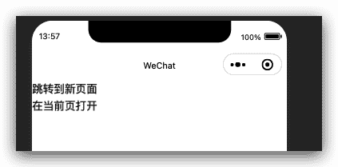

# 微信小程序框架组件-导航组件

## 页面导航 navigator

页面导航(navigator)组件,它类似于HTML中的a标签;


> 基础库 1.0.0 开始支持，低版本需做[兼容处理](https://developers.weixin.qq.com/miniprogram/dev/framework/compatibility.html)。

页面链接。

> 在小程序插件中使用需要基础库版本 [2.1.0](https://developers.weixin.qq.com/miniprogram/dev/framework/compatibility.html) 起。

| 属性                   | 类型    | 默认值          | 必填 | 说明                                                         | 最低版本                                                     |
| :--------------------- | :------ | :-------------- | :--- | :----------------------------------------------------------- | :----------------------------------------------------------- |
| target                 | string  | self            | 否   | 在哪个目标上发生跳转，默认当前小程序                         | [2.0.7](https://developers.weixin.qq.com/miniprogram/dev/framework/compatibility.html) |
| url                    | string  |                 | 否   | 当前小程序内的跳转链接                                       | [1.0.0](https://developers.weixin.qq.com/miniprogram/dev/framework/compatibility.html) |
| open-type              | string  | navigate        | 否   | 跳转方式                                                     | [1.0.0](https://developers.weixin.qq.com/miniprogram/dev/framework/compatibility.html) |
| delta                  | number  | 1               | 否   | 当 open-type 为 'navigateBack' 时有效，表示回退的层数        | [1.0.0](https://developers.weixin.qq.com/miniprogram/dev/framework/compatibility.html) |
| app-id                 | string  |                 | 否   | 当`target="miniProgram"`时有效，要打开的小程序 appId         | [2.0.7](https://developers.weixin.qq.com/miniprogram/dev/framework/compatibility.html) |
| path                   | string  |                 | 否   | 当`target="miniProgram"`时有效，打开的页面路径，如果为空则打开首页 | [2.0.7](https://developers.weixin.qq.com/miniprogram/dev/framework/compatibility.html) |
| extra-data             | object  |                 | 否   | 当`target="miniProgram"`时有效，需要传递给目标小程序的数据，目标小程序可在 `App.onLaunch()`，`App.onShow()` 中获取到这份数据。[详情](https://developers.weixin.qq.com/miniprogram/dev/framework/app-service/app.html) | [2.0.7](https://developers.weixin.qq.com/miniprogram/dev/framework/compatibility.html) |
| version                | string  | release         | 否   | 当`target="miniProgram"`时有效，要打开的小程序版本           | [2.0.7](https://developers.weixin.qq.com/miniprogram/dev/framework/compatibility.html) |
| short-link             | string  |                 | 否   | 当`target="miniProgram"`时有效，当传递该参数后，可以不传 app-id 和 path。链接可以通过【小程序菜单】->【复制链接】获取。 | [2.18.1](https://developers.weixin.qq.com/miniprogram/dev/framework/compatibility.html) |
| hover-class            | string  | navigator-hover | 否   | 指定点击时的样式类，当`hover-class="none"`时，没有点击态效果 | [1.0.0](https://developers.weixin.qq.com/miniprogram/dev/framework/compatibility.html) |
| hover-stop-propagation | boolean | false           | 否   | 指定是否阻止本节点的祖先节点出现点击态                       | [1.5.0](https://developers.weixin.qq.com/miniprogram/dev/framework/compatibility.html) |
| hover-start-time       | number  | 50              | 否   | 按住后多久出现点击态，单位毫秒                               | [1.0.0](https://developers.weixin.qq.com/miniprogram/dev/framework/compatibility.html) |
| hover-stay-time        | number  | 600             | 否   | 手指松开后点击态保留时间，单位毫秒                           | [1.0.0](https://developers.weixin.qq.com/miniprogram/dev/framework/compatibility.html) |
| bindsuccess            | string  |                 | 否   | 当`target="miniProgram"`时有效，跳转小程序成功               | [2.0.7](https://developers.weixin.qq.com/miniprogram/dev/framework/compatibility.html) |
| bindfail               | string  |                 | 否   | 当`target="miniProgram"`时有效，跳转小程序失败               | [2.0.7](https://developers.weixin.qq.com/miniprogram/dev/framework/compatibility.html) |
| bindcomplete           | string  |                 | 否   | 当`target="miniProgram"`时有效，跳转小程序完成               | [2.0.7](https://developers.weixin.qq.com/miniprogram/dev/framework/compatibility.html) |

**target 的合法值**

| 值          | 说明       | 最低版本 |
| :---------- | :--------- | :------- |
| self        | 当前小程序 |          |
| miniProgram | 其它小程序 |          |

**open-type 的合法值**

| 值           | 说明                                                         | 最低版本                                                     |
| :----------- | :----------------------------------------------------------- | :----------------------------------------------------------- |
| navigate     | 对应 [wx.navigateTo](https://developers.weixin.qq.com/miniprogram/dev/api/route/wx.navigateTo.html) 或 [wx.navigateToMiniProgram](https://developers.weixin.qq.com/miniprogram/dev/api/navigate/wx.navigateToMiniProgram.html) 的功能 |                                                              |
| redirect     | 对应 [wx.redirectTo](https://developers.weixin.qq.com/miniprogram/dev/api/route/wx.redirectTo.html) 的功能 |                                                              |
| switchTab    | 对应 [wx.switchTab](https://developers.weixin.qq.com/miniprogram/dev/api/route/wx.switchTab.html) 的功能 |                                                              |
| reLaunch     | 对应 [wx.reLaunch](https://developers.weixin.qq.com/miniprogram/dev/api/route/wx.reLaunch.html) 的功能 | [1.1.0](https://developers.weixin.qq.com/miniprogram/dev/framework/compatibility.html) |
| navigateBack | 对应 [wx.navigateBack](https://developers.weixin.qq.com/miniprogram/dev/api/route/wx.navigateBack.html) 的功能 | [1.1.0](https://developers.weixin.qq.com/miniprogram/dev/framework/compatibility.html) |
| exit         | 退出小程序，`target="miniProgram"`时生效                     | [2.1.0](https://developers.weixin.qq.com/miniprogram/dev/framework/compatibility.html) |

**version 的合法值**

| 值      | 说明                                                         | 最低版本 |
| :------ | :----------------------------------------------------------- | :------- |
| develop | 开发版                                                       |          |
| trial   | 体验版                                                       |          |
| release | 正式版，仅在当前小程序为开发版或体验版时此参数有效；如果当前小程序是正式版，则打开的小程序必定是正式版。 |          |

### 使用限制

1. 需要用户确认跳转 从 `2.3.0` 版本开始，在跳转至其他小程序前，将统一增加弹窗，询问是否跳转，用户确认后才可以跳转其他小程序。如果用户点击取消，则回调 `fail cancel`。
2. 每个小程序可跳转的其他小程序数量限制为不超过 10 个 从 2.4.0 版本以及指定日期（具体待定）开始，开发者提交新版小程序代码时，如使用了跳转其他小程序功能，则需要在代码配置中声明将要跳转的小程序名单，限定不超过 10 个，否则将无法通过审核。该名单可在发布新版时更新，不支持动态修改。配置方法详见 [配置](https://developers.weixin.qq.com/miniprogram/dev/framework/config.html)。调用此接口时，所跳转的 appId 必须在配置列表中，否则回调 `fail appId "${appId}" is not in navigateToMiniProgramAppIdList`。

### 无需声明跳转名单，不限跳转数量（众测中）

1. 从2020年4月24日起，使用跳转其他小程序功能将无需在全局配置中声明跳转名单，调用此接口时将不再校验所跳转的 AppID 是否在 navigateToMiniProgramAppIdList 中。
2. 从2020年4月24日起，跳转其他小程序将不再受数量限制，使用此功能时请注意遵守运营规范。

### 关于调试

- 在开发者工具上调用此 API 并不会真实的跳转到另外的小程序，但是开发者工具会校验本次调用跳转是否成功。[详情](https://developers.weixin.qq.com/miniprogram/dev/devtools/different.html#跳转小程序调试支持)
- 开发者工具上支持被跳转的小程序处理接收参数的调试。[详情](https://developers.weixin.qq.com/miniprogram/dev/devtools/different.html#跳转小程序调试支持)

### Bug & Tip

1. `tip`：`navigator-hover` 默认为 `{background-color: rgba(0, 0, 0, 0.1); opacity: 0.7;}`, [navigator](https://developers.weixin.qq.com/miniprogram/dev/component/navigator.html) 的子节点背景色应为透明色

### 示例代码

[在开发者工具中预览效果](https://developers.weixin.qq.com/s/2Ec11cmI6BY1)

```html index.wxml
<!-- sample.wxml -->
<view class="btn-area">
  <navigator url="/navigate/navigate?title=navigate" hover-class="navigator-hover">跳转到新页面</navigator>
  <navigator url="../redirect/redirect?title=redirect" open-type="redirect" hover-class="other-navigator-hover">在当前页打开</navigator>
  <!-- <navigator url="/index/index" open-type="switchTab" hover-class="other-navigator-hover">切换 Tab</navigator> -->
</view>
```

```js index.js
// redirect.js navigator.js
Page({
  onLoad: function (options) {
    this.setData({
      title: options.title
    })
  }
})
```

```css index.wxss
@import '../lib/weui.wxss'
/** wxss **/
/** 修改默认的navigator点击态 **/
.navigator-hover {
    color:blue;
}
/** 自定义其他点击态样式类 **/
.other-navigator-hover {
    color:red;
}
```

```html navigate.wxml
<!-- navigator.wxml -->
<view style="text-align:center"> {{title}} </view>
<view> 点击左上角返回回到之前页面 </view>
```

```js navigate.js
// redirect.js navigator.js
Page({
  onLoad: function (options) {
    this.setData({
      title: options.title
    })
  }
})
```

```html redirect.wxml
<!-- redirect.wxml -->
<view style="text-align:center"> {{title}} </view>
<view> 点击左上角返回回到上级页面 </view>
```

```js redirect.js
// redirect.js navigator.js
Page({
  onLoad: function (options) {
    this.setData({
      title: options.title
    })
  }
})
```



## 功能页导航 functional-page-navigator

> 基础库 2.1.0 开始支持，低版本需做[兼容处理](https://developers.weixin.qq.com/miniprogram/dev/framework/compatibility.html)。

仅在插件中有效，用于跳转到插件功能页。

| 属性        | 类型         | 默认值  | 必填 | 说明                                                       | 最低版本                                                     |
| :---------- | :----------- | :------ | :--- | :--------------------------------------------------------- | :----------------------------------------------------------- |
| version     | string       | release | 否   | 跳转到的小程序版本，**线上版本必须设置为 release**         | [2.1.0](https://developers.weixin.qq.com/miniprogram/dev/framework/compatibility.html) |
| name        | string       |         | 否   | 要跳转到的功能页                                           | [2.1.0](https://developers.weixin.qq.com/miniprogram/dev/framework/compatibility.html) |
| args        | object       |         | 否   | 功能页参数，参数格式与具体功能页相关                       | [2.1.0](https://developers.weixin.qq.com/miniprogram/dev/framework/compatibility.html) |
| bindsuccess | eventhandler |         | 否   | 功能页返回，且操作成功时触发， detail 格式与具体功能页相关 | [2.1.0](https://developers.weixin.qq.com/miniprogram/dev/framework/compatibility.html) |
| bindfail    | eventhandler |         | 否   | 功能页返回，且操作失败时触发， detail 格式与具体功能页相关 | [2.1.0](https://developers.weixin.qq.com/miniprogram/dev/framework/compatibility.html) |
| bindcancel  | eventhandler |         | 否   | 因用户操作从功能页返回时触发                               | [2.4.1](https://developers.weixin.qq.com/miniprogram/dev/framework/compatibility.html) |

**version 的合法值**

| 值      | 说明   | 最低版本 |
| :------ | :----- | :------- |
| develop | 开发版 |          |
| trial   | 体验版 |          |
| release | 正式版 |          |

**name 的合法值**

| 值                  | 说明                                                         | 最低版本                                                     |
| :------------------ | :----------------------------------------------------------- | :----------------------------------------------------------- |
| loginAndGetUserInfo | [用户信息功能页](https://developers.weixin.qq.com/miniprogram/dev/framework/plugin/functional-pages/user-info.html) | [2.1.0](https://developers.weixin.qq.com/miniprogram/dev/framework/compatibility.html) |
| requestPayment      | [支付功能页](https://developers.weixin.qq.com/miniprogram/dev/framework/plugin/functional-pages/request-payment.html) | [2.1.0](https://developers.weixin.qq.com/miniprogram/dev/framework/compatibility.html) |
| chooseAddress       | [收货地址功能页](https://developers.weixin.qq.com/miniprogram/dev/framework/plugin/functional-pages/choose-address.html) | [2.4.0](https://developers.weixin.qq.com/miniprogram/dev/framework/compatibility.html) |
| chooseInvoice       | [获取发票功能页](https://developers.weixin.qq.com/miniprogram/dev/framework/plugin/functional-pages/choose-invoice.html) | [2.14.1](https://developers.weixin.qq.com/miniprogram/dev/framework/compatibility.html) |
| chooseInvoiceTitle  | [获取发票抬头功能页](https://developers.weixin.qq.com/miniprogram/dev/framework/plugin/functional-pages/choose-invoice-title.html) | [2.14.1](https://developers.weixin.qq.com/miniprogram/dev/framework/compatibility.html) |

### Bug & Tip

1. `tip`: 功能页是插件所有者小程序中的一个特殊页面，开发者不能自定义这个页面的外观。
2. `tip`: 在功能页展示时，一些与界面展示相关的接口将被禁用（接口调用返回 fail ）。
3. `tip`: 这个组件本身可以在开发者工具中使用，但功能页的跳转目前不支持在开发者工具中调试，请在真机上测试。

### 示例代码

```html
<!-- sample.wxml -->
<functional-page-navigator name="loginAndGetUserInfo" bind:success="loginSuccess">
  <button>登录到插件</button>
</functional-page-navigator>
```

```js
// redirect.js navigator.js
Component({
  methods: {
    loginSuccess: function(e) {
      console.log(e.detail.code) // wx.login 的 code
      console.log(e.detail.userInfo) // wx.getUserInfo 的 userInfo
    }
  }
})
```

