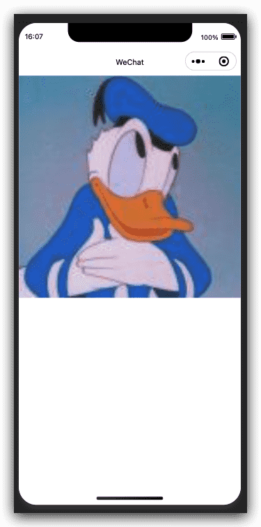
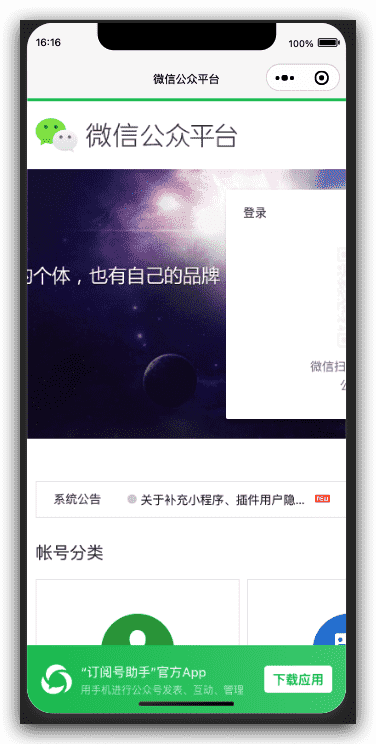

# 微信小程序框架组件-开放能力组件

## 简介

开放能力组件大多为新增组件,且使用频率较低,属于相对比较冷门的组件。可以先简单了解一下。


## open-data 展示开放数据 组件

> 基础库 1.4.0 开始支持，低版本需做[兼容处理](https://developers.weixin.qq.com/miniprogram/dev/framework/compatibility.html)。

用于展示微信开放的数据。

小程序插件中不能使用。

| 属性           | 类型        | 默认值 | 必填 | 说明                                                 | 最低版本                                                     |
| :------------- | :---------- | :----- | :--- | :--------------------------------------------------- | :----------------------------------------------------------- |
| type           | string      |        | 否   | 开放数据类型                                         | [1.4.0](https://developers.weixin.qq.com/miniprogram/dev/framework/compatibility.html) |
| open-gid       | string      |        | 否   | 当 type="groupName" 时生效, 群id                     | [1.4.0](https://developers.weixin.qq.com/miniprogram/dev/framework/compatibility.html) |
| lang           | string      | en     | 否   | 当 type="user*" 时生效，以哪种语言展示 userInfo      | [1.4.0](https://developers.weixin.qq.com/miniprogram/dev/framework/compatibility.html) |
| default-text   | string      |        | 否   | 数据为空时的默认文案                                 | [2.8.1](https://developers.weixin.qq.com/miniprogram/dev/framework/compatibility.html) |
| default-avatar | string      |        | 否   | 用户头像为空时的默认图片，支持相对路径和网络图片路径 | [2.8.1](https://developers.weixin.qq.com/miniprogram/dev/framework/compatibility.html) |
| binderror      | eventhandle |        | 否   | 群名称或用户信息为空时触发                           | [2.8.1](https://developers.weixin.qq.com/miniprogram/dev/framework/compatibility.html) |

**type 的合法值**

| 值            | 说明         | 最低版本                                                     |
| :------------ | :----------- | :----------------------------------------------------------- |
| groupName     | 拉取群名称   | [1.4.0](https://developers.weixin.qq.com/miniprogram/dev/framework/compatibility.html) |
| userNickName  | 用户昵称     | [1.9.90](https://developers.weixin.qq.com/miniprogram/dev/framework/compatibility.html) |
| userAvatarUrl | 用户头像     | [1.9.90](https://developers.weixin.qq.com/miniprogram/dev/framework/compatibility.html) |
| userGender    | 用户性别     | [1.9.90](https://developers.weixin.qq.com/miniprogram/dev/framework/compatibility.html) |
| userCity      | 用户所在城市 | [1.9.90](https://developers.weixin.qq.com/miniprogram/dev/framework/compatibility.html) |
| userProvince  | 用户所在省份 | [1.9.90](https://developers.weixin.qq.com/miniprogram/dev/framework/compatibility.html) |
| userCountry   | 用户所在国家 | [1.9.90](https://developers.weixin.qq.com/miniprogram/dev/framework/compatibility.html) |
| userLanguage  | 用户的语言   | [1.9.90](https://developers.weixin.qq.com/miniprogram/dev/framework/compatibility.html) |

**lang 的合法值**

| 值    | 说明     | 最低版本 |
| :---- | :------- | :------- |
| en    | 英文     |          |
| zh_CN | 简体中文 |          |
| zh_TW | 繁体中文 |          |

### Bug & Tip

1. `tip`：只有当前用户在此群内才能拉取到群名称
2. `tip`：关于open-gid的获取请使用 [wx.getShareInfo](https://developers.weixin.qq.com/miniprogram/dev/api/share/wx.getShareInfo.html)

### 示例代码

[在开发者工具中预览效果](https://developers.weixin.qq.com/s/vbdmRcmV67YB)

```xml index.wxml
<open-data type="groupName" open-gid="xxxxxx"></open-data>
<open-data type="userAvatarUrl"></open-data>
<open-data type="userGender" lang="zh_CN"></open-data>
```

```js index.js
const app = getApp()

Page({
  data: {

  },
  onLoad: function () {
    console.log('代码片段是一种迷你、可分享的小程序或小游戏项目，可用于分享小程序和小游戏的开发经验、展示组件和 API 的使用、复现开发问题和 Bug 等。可点击以下链接查看代码片段的详细文档：')
    console.log('https://mp.weixin.qq.com/debug/wxadoc/dev/devtools/devtools.html')
  },
})

```




## web-view 网页容器 组件

> 基础库 1.6.4 开始支持，低版本需做[兼容处理](https://developers.weixin.qq.com/miniprogram/dev/framework/compatibility.html)。

承载网页的容器。会自动铺满整个小程序页面，**个人类型的小程序暂不支持使用。**

客户端 6.7.2 版本开始，[`navigationStyle: custom`](https://developers.weixin.qq.com/miniprogram/dev/reference/configuration/app.html) 对 [web-view](https://developers.weixin.qq.com/miniprogram/dev/component/web-view.html) 组件无效

小程序插件中不能使用。

| 属性        | 类型         | 默认值 | 必填 | 说明                                                         | 最低版本                                                     |
| :---------- | :----------- | :----- | :--- | :----------------------------------------------------------- | :----------------------------------------------------------- |
| src         | string       |        | 否   | webview 指向网页的链接。可打开关联的公众号的文章，其它网页需登录[小程序管理后台](https://mp.weixin.qq.com/)配置业务域名。 | [1.6.4](https://developers.weixin.qq.com/miniprogram/dev/framework/compatibility.html) |
| bindmessage | eventhandler |        | 否   | 网页向小程序 postMessage 时，会在特定时机（小程序后退、组件销毁、分享）触发并收到消息。`e.detail = { data }`，data是多次 postMessage 的参数组成的数组 | [1.6.4](https://developers.weixin.qq.com/miniprogram/dev/framework/compatibility.html) |
| bindload    | eventhandler |        | 否   | 网页加载成功时候触发此事件。`e.detail = { src }`               | [1.6.4](https://developers.weixin.qq.com/miniprogram/dev/framework/compatibility.html) |
| binderror   | eventhandler |        | 否   | 网页加载失败的时候触发此事件。`e.detail = { src }`             | [1.6.4](https://developers.weixin.qq.com/miniprogram/dev/framework/compatibility.html) |

### 相关接口 1

[web-view](https://developers.weixin.qq.com/miniprogram/dev/component/web-view.html)网页中可使用[JSSDK 1.3.2](https://res.wx.qq.com/open/js/jweixin-1.3.2.js)提供的接口返回小程序页面。 支持的接口有：

| 接口名                      | 说明                                                         | 最低版本                                                     |
| :-------------------------- | :----------------------------------------------------------- | :----------------------------------------------------------- |
| wx.miniProgram.navigateTo   | 参数与小程序接口一致                                         | [1.6.4](https://developers.weixin.qq.com/miniprogram/dev/framework/compatibility.html) |
| wx.miniProgram.navigateBack | 参数与小程序接口一致                                         | [1.6.4](https://developers.weixin.qq.com/miniprogram/dev/framework/compatibility.html) |
| wx.miniProgram.switchTab    | 参数与小程序接口一致                                         | [1.6.5](https://developers.weixin.qq.com/miniprogram/dev/framework/compatibility.html) |
| wx.miniProgram.reLaunch     | 参数与小程序接口一致                                         | [1.6.5](https://developers.weixin.qq.com/miniprogram/dev/framework/compatibility.html) |
| wx.miniProgram.redirectTo   | 参数与小程序接口一致                                         | [1.6.5](https://developers.weixin.qq.com/miniprogram/dev/framework/compatibility.html) |
| wx.miniProgram.postMessage  | 向小程序发送消息，会在特定时机（小程序后退、组件销毁、分享）触发组件的message事件 | [1.7.1](https://developers.weixin.qq.com/miniprogram/dev/framework/compatibility.html) |
| wx.miniProgram.getEnv       | 获取当前环境                                                 | [1.7.1](https://developers.weixin.qq.com/miniprogram/dev/framework/compatibility.html) |

#### 示例代码

[在开发者工具中预览效果](https://developers.weixin.qq.com/s/aRVmcimz66Yb)

```xml index.wxml
<view class="page-body">
  <view class="page-section page-section-gap">
    <web-view src="https://mp.weixin.qq.com/"></web-view>
  </view>
</view>
```

```js index.js
Page({})
```




### 相关接口 2

[web-view](https://developers.weixin.qq.com/miniprogram/dev/component/web-view.html)网页中**仅支持以下[JSSDK接口](https://mp.weixin.qq.com/wiki?t=resource/res_main&id=mp1421141115)**：

| 接口模块             | 接口说明             | 具体接口           |
| :------------------- | :------------------- | :----------------- |
| 判断客户端是否支持js |                      | checkJSApi         |
| 图像接口             | 拍照或上传           | chooseImage        |
|                      | 预览图片             | previewImage       |
|                      | 上传图片             | uploadImage        |
|                      | 下载图片             | downloadImage      |
|                      | 获取本地图片         | getLocalImgData    |
| 音频接口             | 开始录音             | startRecord        |
|                      | 停止录音             | stopRecord         |
|                      | 监听录音自动停止     | onVoiceRecordEnd   |
|                      | 播放语音             | playVoice          |
|                      | 暂停播放             | pauseVoice         |
|                      | 停止播放             | stopVoice          |
|                      | 监听语音播放完毕     | onVoicePlayEnd     |
|                      | 上传接口             | uploadVoice        |
|                      | 下载接口             | downloadVoice      |
| 智能接口             | 识别音频             | translateVoice     |
| 设备信息             | 获取网络状态         | getNetworkType     |
| 地理位置             | 使用内置地图打开地点 | openLocation       |
|                      | 获取地理位置         | getLocation        |
| 摇一摇周边           | 开启ibeacon          | startSearchBeacons |
|                      | 关闭ibeacon          | stopSearchBeacons  |
|                      | 监听ibeacon          | onSearchBeacons    |
| 微信扫一扫           | 调起微信扫一扫       | scanQRCode         |
| 微信卡券             | 拉取使用卡券列表     | chooseCard         |
|                      | 批量添加卡券接口     | addCard            |
|                      | 查看微信卡包的卡券   | openCard           |
| 长按识别             | 小程序圆形码         | 无                 |

### 相关接口 3

用户分享时可获取当前[web-view](https://developers.weixin.qq.com/miniprogram/dev/component/web-view.html)的URL，即在`onShareAppMessage`回调中返回`webViewUrl`参数。

#### 示例代码

示例代码：

```javascript
Page({
  onShareAppMessage(options) {
    console.log(options.webViewUrl)
  }
})
```

### 相关接口 4

在网页内可通过`window.__wxjs_environment`变量判断是否在小程序环境，建议在`WeixinJSBridgeReady`回调中使用，也可以使用[JSSDK 1.3.2](https://res.wx.qq.com/open/js/jweixin-1.3.2.js)提供的`getEnv`接口。

#### 示例代码

```javascript
// web-view下的页面内
function ready() {
  console.log(window.__wxjs_environment === 'miniprogram') // true
}
if (!window.WeixinJSBridge || !WeixinJSBridge.invoke) {
  document.addEventListener('WeixinJSBridgeReady', ready, false)
} else {
  ready()
}

// 或者
wx.miniProgram.getEnv(function(res) {
  console.log(res.miniprogram) // true
})
```

### 相关接口 5

从微信`7.0.0`开始，可以通过判断`userAgent`中包含`miniProgram`字样来判断小程序web-view环境。

### 相关接口 6

从微信`7.0.3`开始，webview内可以通过判断下面的方式判断小程序是否在前台：

```js
WeixinJSBridge.on('onPageStateChange', function(res) {
  console.log('res is active', res.active)
})
```

### Bug & Tip

1. `tip`：**网页内 iframe 的域名也需要配置到域名白名单。**
2. `tip`：开发者工具上，可以在 [web-view](https://developers.weixin.qq.com/miniprogram/dev/component/web-view.html) 组件上通过右键 - 调试，打开 [web-view](https://developers.weixin.qq.com/miniprogram/dev/component/web-view.html) 组件的调试。
3. `tip`：每个页面只能有一个 [web-view](https://developers.weixin.qq.com/miniprogram/dev/component/web-view.html)，[web-view](https://developers.weixin.qq.com/miniprogram/dev/component/web-view.html) 会自动铺满整个页面，并覆盖其他组件。
4. `tip`：[web-view](https://developers.weixin.qq.com/miniprogram/dev/component/web-view.html) 网页与小程序之间不支持除 JSSDK 提供的接口之外的通信。
5. `tip`：在 iOS 中，若存在JSSDK接口调用无响应的情况，可在 [web-view](https://developers.weixin.qq.com/miniprogram/dev/component/web-view.html) 的 src 后面加个#wechat_redirect解决。
6. `tip`：避免在链接中带有中文字符，在 iOS 中会有打开白屏的问题，建议加一下 encodeURIComponent

## ad 广告 组件

> 基础库 1.9.94 开始支持，低版本需做[兼容处理](https://developers.weixin.qq.com/miniprogram/dev/framework/compatibility.html)。

Banner 广告。

| 属性         | 类型        | 默认值 | 必填 | 说明                                                         | 最低版本                                                     |
| :----------- | :---------- | :----- | :--- | :----------------------------------------------------------- | :----------------------------------------------------------- |
| unit-id      | string      |        | 是   | 广告单元id，可在[小程序管理后台](https://mp.weixin.qq.com/)的流量主模块新建 | [1.9.94](https://developers.weixin.qq.com/miniprogram/dev/framework/compatibility.html) |
| ad-intervals | number      |        | 否   | 广告自动刷新的间隔时间，单位为秒，参数值必须大于等于30（该参数不传入时 Banner 广告不会自动刷新） | [2.3.1](https://developers.weixin.qq.com/miniprogram/dev/framework/compatibility.html) |
| ad-type      | string      | banner | 否   | 广告类型，默认为展示banner，可通过设置该属性为`video`展示视频广告, `grid`为格子广告 | [2.8.0](https://developers.weixin.qq.com/miniprogram/dev/framework/compatibility.html) |
| ad-theme     | string      | white  | 否   |                                                              | [2.8.0](https://developers.weixin.qq.com/miniprogram/dev/framework/compatibility.html) |
| bindload     | eventhandle |        | 否   | 广告加载成功的回调                                           | [2.2.1](https://developers.weixin.qq.com/miniprogram/dev/framework/compatibility.html) |
| binderror    | eventhandle |        | 否   | 广告加载失败的回调，`event.detail = {errCode: 1002}`           | [2.2.1](https://developers.weixin.qq.com/miniprogram/dev/framework/compatibility.html) |
| bindclose    | eventhandle |        | 否   | 广告关闭的回调                                               | [2.6.5](https://developers.weixin.qq.com/miniprogram/dev/framework/compatibility.html) |

### 错误码信息与解决方案表

错误码是通过binderror回调获取到的错误信息。

| 代码 | 异常情况         | 理由                                                         | 解决方案                                                     |
| :--- | :--------------- | :----------------------------------------------------------- | :----------------------------------------------------------- |
| 1000 | 后端错误调用失败 | 该项错误不是开发者的异常情况                                 | 一般情况下忽略一段时间即可恢复。                             |
| 1001 | 参数错误         | 使用方法错误                                                 | 可以前往developers.weixin.qq.com确认具体教程（小程序和小游戏分别有各自的教程，可以在顶部选项中，“设计”一栏的右侧进行切换。 |
| 1002 | 广告单元无效     | 可能是拼写错误、或者误用了其他APP的广告ID                    | 请重新前往mp.weixin.qq.com确认广告位ID。                     |
| 1003 | 内部错误         | 该项错误不是开发者的异常情况                                 | 一般情况下忽略一段时间即可恢复。                             |
| 1004 | 无适合的广告     | 广告不是每一次都会出现，这次没有出现可能是由于该用户不适合浏览广告 | 属于正常情况，且开发者需要针对这种情况做形态上的兼容。       |
| 1005 | 广告组件审核中   | 你的广告正在被审核，无法展现广告                             | 请前往mp.weixin.qq.com确认审核状态，且开发者需要针对这种情况做形态上的兼容。 |
| 1006 | 广告组件被驳回   | 你的广告审核失败，无法展现广告                               | 请前往mp.weixin.qq.com确认审核状态，且开发者需要针对这种情况做形态上的兼容。 |
| 1007 | 广告组件被驳回   | 你的广告能力已经被封禁，封禁期间无法展现广告                 | 请前往mp.weixin.qq.com确认小程序广告封禁状态。               |
| 1008 | 广告单元已关闭   | 该广告位的广告能力已经被关闭                                 | 请前往mp.weixin.qq.com重新打开对应广告位的展现。             |

### Bug & Tip

1. `tip`：在无广告展示时，`ad` 标签不会占用高度
2. `tip`：`ad` 组件不支持触发 `bindtap` 等触摸相关事件
3. `tip`：目前可以给 `ad` 标签设置 wxss 样式调整广告宽度，以使广告与页面更融洽，但请遵循[小程序流量主应用规范](https://wximg.qq.com/wxp/pdftool/get.html?id=rynYA8o3f&pa=10&name=miniprogramAds_supplier_guidance)
4. `tip`：监听到error回调后，开发者可以针对性的处理，比如隐藏广告组件的父容器，以保证用户体验，但不要移除广告组件，否则将无法收到bindload的回调。

## ad-custom 原生模板广告 组件

> 基础库 2.10.4 开始支持，低版本需做[兼容处理](https://developers.weixin.qq.com/miniprogram/dev/framework/compatibility.html)。

原生模板 广告。

| 属性         | 类型        | 默认值 | 必填 | 说明                                                         | 最低版本                                                     |
| :----------- | :---------- | :----- | :--- | :----------------------------------------------------------- | :----------------------------------------------------------- |
| unit-id      | string      |        | 是   | 广告单元id，可在[小程序管理后台](https://mp.weixin.qq.com/)的流量主模块新建 | [2.10.4](https://developers.weixin.qq.com/miniprogram/dev/framework/compatibility.html) |
| ad-intervals | number      |        | 否   | 广告自动刷新的间隔时间，单位为秒，参数值必须大于等于30（该参数不传入时 模板 广告不会自动刷新） | [2.10.4](https://developers.weixin.qq.com/miniprogram/dev/framework/compatibility.html) |
| bindload     | eventhandle |        | 否   | 广告加载成功的回调                                           | [2.10.4](https://developers.weixin.qq.com/miniprogram/dev/framework/compatibility.html) |
| binderror    | eventhandle |        | 否   | 广告加载失败的回调，`event.detail = {errCode: 1002}`           | [2.10.4](https://developers.weixin.qq.com/miniprogram/dev/framework/compatibility.html) |

### 错误码信息与解决方案表

错误码是通过binderror回调获取到的错误信息。

| 代码 | 异常情况         | 理由                                                         | 解决方案                                                     |
| :--- | :--------------- | :----------------------------------------------------------- | :----------------------------------------------------------- |
| 1000 | 后端错误调用失败 | 该项错误不是开发者的异常情况                                 | 一般情况下忽略一段时间即可恢复。                             |
| 1001 | 参数错误         | 使用方法错误                                                 | 可以前往developers.weixin.qq.com确认具体教程（小程序和小游戏分别有各自的教程，可以在顶部选项中，“设计”一栏的右侧进行切换。 |
| 1002 | 广告单元无效     | 可能是拼写错误、或者误用了其他APP的广告ID                    | 请重新前往mp.weixin.qq.com确认广告位ID。                     |
| 1003 | 内部错误         | 该项错误不是开发者的异常情况                                 | 一般情况下忽略一段时间即可恢复。                             |
| 1004 | 无适合的广告     | 广告不是每一次都会出现，这次没有出现可能是由于该用户不适合浏览广告 | 属于正常情况，且开发者需要针对这种情况做形态上的兼容。       |
| 1005 | 广告组件审核中   | 你的广告正在被审核，无法展现广告                             | 请前往mp.weixin.qq.com确认审核状态，且开发者需要针对这种情况做形态上的兼容。 |
| 1006 | 广告组件被驳回   | 你的广告审核失败，无法展现广告                               | 请前往mp.weixin.qq.com确认审核状态，且开发者需要针对这种情况做形态上的兼容。 |
| 1007 | 广告组件被驳回   | 你的广告能力已经被封禁，封禁期间无法展现广告                 | 请前往mp.weixin.qq.com确认小程序广告封禁状态。               |
| 1008 | 广告单元已关闭   | 该广告位的广告能力已经被关闭                                 | 请前往mp.weixin.qq.com重新打开对应广告位的展现。             |

### Bug & Tip

1. `tip`：在无广告展示时，`ad-custom` 标签不会占用高度
2. `tip`：`ad-custom` 组件不支持触发 `bindtap` 等触摸相关事件
3. `tip`：目前可以给 `ad-custom` 标签设置 wxss 样式调整广告宽度，以使广告与页面更融洽，但请遵循[小程序流量主应用规范](https://wximg.qq.com/wxp/pdftool/get.html?id=rynYA8o3f&pa=10&name=miniprogramAds_supplier_guidance)
4. `tip`：监听到error回调后，开发者可以针对性的处理，比如隐藏广告组件的父容器，以保证用户体验，但不要移除广告组件，否则将无法收到bindload的回调
5. `tip`：不同模板涉及一些不同的使用场景，具体方式请参考模板编辑器

## official-account 公众号关注 组件

> 基础库 2.3.0 开始支持，低版本需做[兼容处理](https://developers.weixin.qq.com/miniprogram/dev/framework/compatibility.html)。

公众号关注组件。当用户扫[小程序码](https://developers.weixin.qq.com/miniprogram/dev/framework/open-ability/qr-code.html?t=19032815)打开小程序时，开发者可在小程序内配置公众号关注组件，方便用户快捷关注公众号，可嵌套在原生组件内。

基础库 `2.18.1` 起，公众号关注组件显示场景值变更如下：

小程序场景值命中以下值时，可展示关注公众号组件：

1. 1011 扫描二维码
2. 1017 前往小程序体验版的入口页
3. 1025 扫描一维码
4. 1047 扫描小程序码
5. 1124 扫“一物一码”打开小程序

小程序热启动场景值命中以下值时，冷启动场景值在【1011、1017、1025、1047、1124】中，可展示关注公众号组件：

1. 1001 发现栏小程序主入口，「最近使用」列表
2. 1038 从另一个小程序返回
3. 1041 从插件小程序返回小程序
4. 1089 微信聊天主界面下拉，「最近使用」栏
5. 1090 长按小程序右上角菜单唤出最近使用历史
6. 1104 微信聊天主界面下拉，「我的小程序」栏
7. 1131 浮窗
8. 1187 新版浮窗，微信8.0起

### Tips

1. 使用组件前，需前往小程序后台，在“设置”->“关注公众号”中设置要展示的公众号。**注：设置的公众号需与小程序主体一致。**
2. 在一个小程序的生命周期内，只有从以下场景进入小程序，才具有展示引导关注公众号组件的能力:
   - 当小程序从扫小程序码场景（场景值1047，场景值1124）打开时
   - 当小程序从聊天顶部场景（场景值1089）中的「最近使用」内打开时，若小程序之前未被销毁，则该组件保持上一次打开小程序时的状态
   - 当从其他小程序返回小程序（场景值1038）时，若小程序之前未被销毁，则该组件保持上一次打开小程序时的状态
3. 为便于开发者调试，基础库 `2.7.3` 版本起开发版小程序增加以下场景展示公众号组件：
   - 开发版小程序从扫二维码（场景值 1011）打开 — 体验版小程序打开
4. 组件限定最小宽度为300px，高度为定值84px。
5. 每个页面只能配置一个该组件。

| 属性名    | 类型        | 说明               |
| :-------- | :---------- | :----------------- |
| bindload  | EventHandle | 组件加载成功时触发 |
| binderror | EventHandle | 组件加载失败时触发 |

### detail 对象

| 属性名 | 类型   | 说明     |
| :----- | :----- | :------- |
| status | Number | 状态码   |
| errMsg | String | 错误信息 |

### status 有效值

| 值   | 说明                           |
| :--- | :----------------------------- |
| -2   | 网络错误                       |
| -1   | 数据解析错误                   |
| 0    | 加载成功                       |
| 1    | 小程序关注公众号功能被封禁     |
| 2    | 关联公众号被封禁               |
| 3    | 关联关系解除或未选中关联公众号 |
| 4    | 未开启关注公众号功能           |
| 5    | 场景值错误                     |
| 6    | 重复创建                       |

### 示例代码

```html
<official-account></official-account>
```
