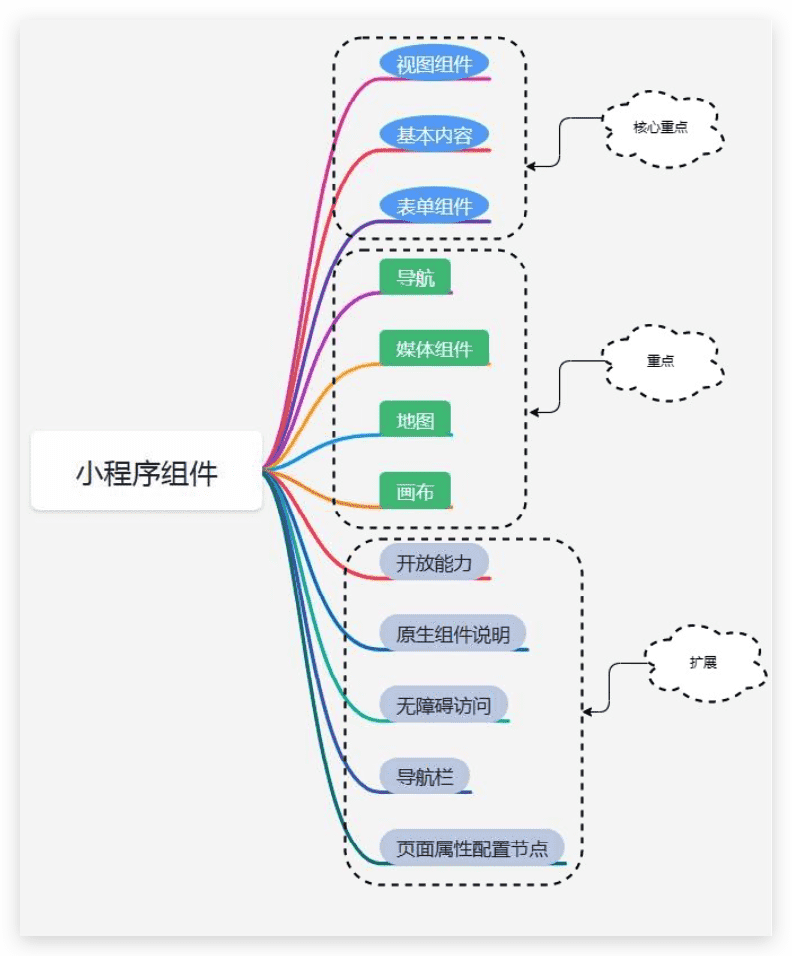

# 微信小程序框架组件简单介绍

## 组件介绍

微信小程序框架为开发者提供了一系列完备的UI组件,方便开发者快速构建小程序UI界面。借助这些UI组 件开发者可以像搭积木一样快速地拼装出一栋房子的样子,这非常类似于当下建筑行业比较流行的装配式 建筑,UI组件就好比预先定制好的建筑构件,只需要按照设计图纸即可快速组装各个组件,便捷迅速地完成 界面布局和渲染工作。

下方思维导图是小程序的组件，重点掌握核心组件和重点组件，了解扩展;

