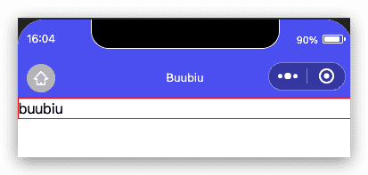
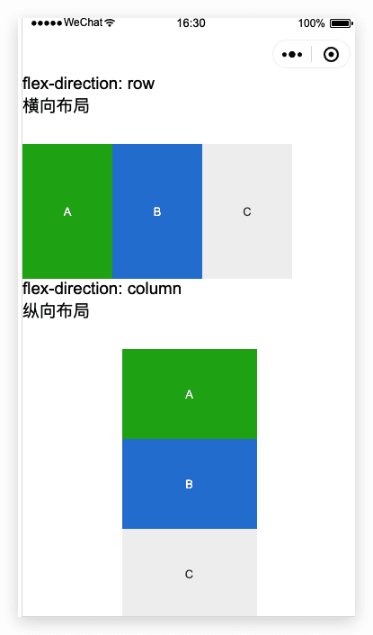
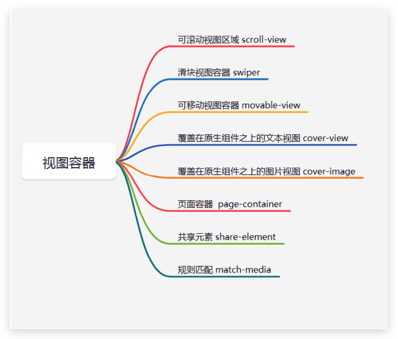
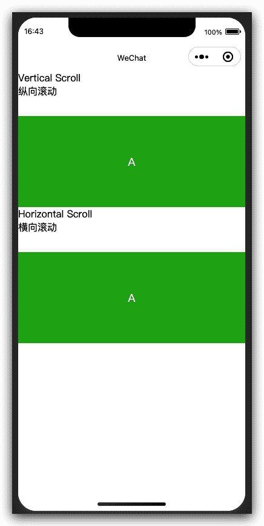
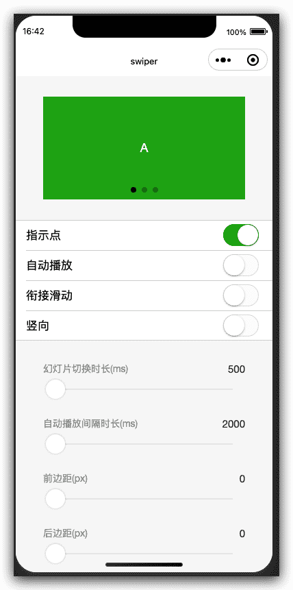
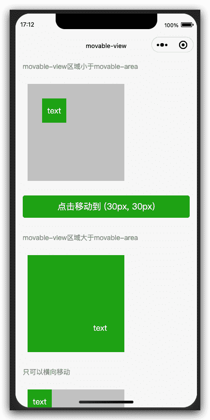
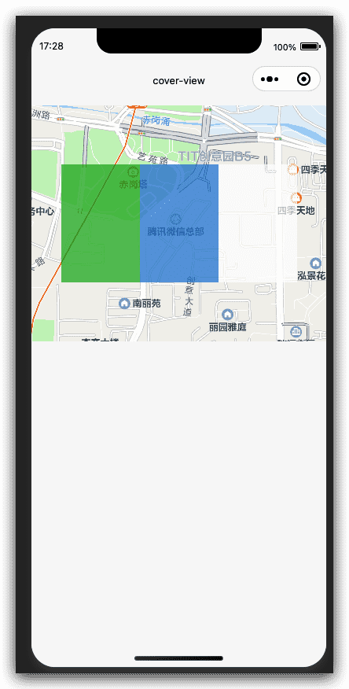
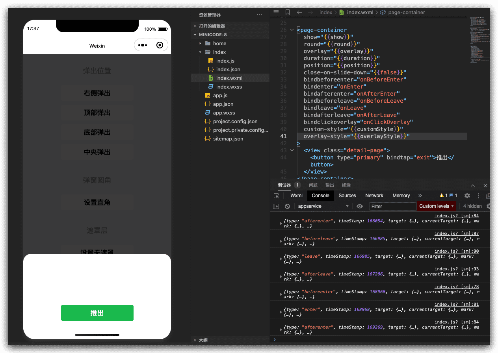
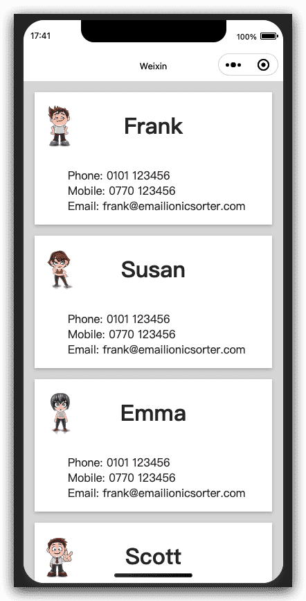

# 微信小程序框架组件-视图容器组件

## 视图容器view

> 基础库 1.0.0 开始支持，低版本需做[兼容处理](https://developers.weixin.qq.com/miniprogram/dev/framework/compatibility.html)。

视图容器(View)是小程序框架组件中最常见的基础组件,它的作用跟 HTML中的DIV功能非常相似,用来布 局 WXML界面。

| 属性                   | 类型    | 默认值 | 必填 | 说明                                                         | 最低版本                                                     |
| :--------------------- | :------ | :----- | :--- | :----------------------------------------------------------- | :----------------------------------------------------------- |
| hover-class            | string  | none   | 否   | 指定按下去的样式类。当 `hover-class="none"` 时，没有点击态效果 | [1.0.0](https://developers.weixin.qq.com/miniprogram/dev/framework/compatibility.html) |
| hover-stop-propagation | boolean | false  | 否   | 指定是否阻止本节点的祖先节点出现点击态                       | [1.5.0](https://developers.weixin.qq.com/miniprogram/dev/framework/compatibility.html) |
| hover-start-time       | number  | 50     | 否   | 按住后多久出现点击态，单位毫秒                               | [1.0.0](https://developers.weixin.qq.com/miniprogram/dev/framework/compatibility.html) |
| hover-stay-time        | number  | 400    | 否   | 手指松开后点击态保留时间，单位毫秒                           | [1.0.0](https://developers.weixin.qq.com/miniprogram/dev/framework/compatibility.html) |


### 案例一:设置长按点击效果，以及时间;

```html
<!--pages/viewTest/viewTest.wxml-->
<view hover-class="hc" hover-start-time="1000" hover-stay-time="2000">buubiu</view>
```

```css
/* pages/viewTest/viewTest.wxss */
.hc{
  border: 1px solid red;
}
```



### 案例二:flex布局

[在开发者工具中预览效果](https://developers.weixin.qq.com/s/Fr3Wq6mS7ZlE)



视图容器分类:



## 可滚动视图区域scroll-view

> 基础库 1.0.0 开始支持，低版本需做[兼容处理](https://developers.weixin.qq.com/miniprogram/dev/framework/compatibility.html)。

可滚动视图区域。使用竖向滚动时，需要给[scroll-view](https://developers.weixin.qq.com/miniprogram/dev/component/scroll-view.html)一个固定高度，通过 WXSS 设置 height。组件属性的长度单位默认为px，[2.4.0](https://developers.weixin.qq.com/miniprogram/dev/framework/compatibility.html)起支持传入单位(rpx/px)。

| 属性                    | 类型          | 默认值  | 必填 | 说明                                                         | 最低版本                                                     |
| :---------------------- | :------------ | :------ | :--- | :----------------------------------------------------------- | :----------------------------------------------------------- |
| scroll-x                | boolean       | false   | 否   | 允许横向滚动                                                 | [1.0.0](https://developers.weixin.qq.com/miniprogram/dev/framework/compatibility.html) |
| scroll-y                | boolean       | false   | 否   | 允许纵向滚动                                                 | [1.0.0](https://developers.weixin.qq.com/miniprogram/dev/framework/compatibility.html) |
| upper-threshold         | number/string | 50      | 否   | 距顶部/左边多远时，触发 scrolltoupper 事件                   | [1.0.0](https://developers.weixin.qq.com/miniprogram/dev/framework/compatibility.html) |
| lower-threshold         | number/string | 50      | 否   | 距底部/右边多远时，触发 scrolltolower 事件                   | [1.0.0](https://developers.weixin.qq.com/miniprogram/dev/framework/compatibility.html) |
| scroll-top              | number/string |         | 否   | 设置竖向滚动条位置                                           | [1.0.0](https://developers.weixin.qq.com/miniprogram/dev/framework/compatibility.html) |
| scroll-left             | number/string |         | 否   | 设置横向滚动条位置                                           | [1.0.0](https://developers.weixin.qq.com/miniprogram/dev/framework/compatibility.html) |
| scroll-into-view        | string        |         | 否   | 值应为某子元素id（id不能以数字开头）。设置哪个方向可滚动，则在哪个方向滚动到该元素 | [1.0.0](https://developers.weixin.qq.com/miniprogram/dev/framework/compatibility.html) |
| scroll-with-animation   | boolean       | false   | 否   | 在设置滚动条位置时使用动画过渡                               | [1.0.0](https://developers.weixin.qq.com/miniprogram/dev/framework/compatibility.html) |
| enable-back-to-top      | boolean       | false   | 否   | iOS点击顶部状态栏、安卓双击标题栏时，滚动条返回顶部，只支持竖向 | [1.0.0](https://developers.weixin.qq.com/miniprogram/dev/framework/compatibility.html) |
| enable-flex             | boolean       | false   | 否   | 启用 flexbox 布局。开启后，当前节点声明了 `display: flex` 就会成为 flex container，并作用于其孩子节点。 | [2.7.3](https://developers.weixin.qq.com/miniprogram/dev/framework/compatibility.html) |
| scroll-anchoring        | boolean       | false   | 否   | 开启 scroll anchoring 特性，即控制滚动位置不随内容变化而抖动，仅在 iOS 下生效，安卓下可参考 CSS `overflow-anchor` 属性。 | [2.8.2](https://developers.weixin.qq.com/miniprogram/dev/framework/compatibility.html) |
| refresher-enabled       | boolean       | false   | 否   | 开启自定义下拉刷新                                           | [2.10.1](https://developers.weixin.qq.com/miniprogram/dev/framework/compatibility.html) |
| refresher-threshold     | number        | 45      | 否   | 设置自定义下拉刷新阈值                                       | [2.10.1](https://developers.weixin.qq.com/miniprogram/dev/framework/compatibility.html) |
| refresher-default-style | string        | "black" | 否   | 设置自定义下拉刷新默认样式，支持设置 `black | white | none`， none 表示不使用默认样式 | [2.10.1](https://developers.weixin.qq.com/miniprogram/dev/framework/compatibility.html) |
| refresher-background    | string        | "#FFF"  | 否   | 设置自定义下拉刷新区域背景颜色                               | [2.10.1](https://developers.weixin.qq.com/miniprogram/dev/framework/compatibility.html) |
| refresher-triggered     | boolean       | false   | 否   | 设置当前下拉刷新状态，true 表示下拉刷新已经被触发，false 表示下拉刷新未被触发 | [2.10.1](https://developers.weixin.qq.com/miniprogram/dev/framework/compatibility.html) |
| enhanced                | boolean       | false   | 否   | 启用 scroll-view 增强特性，启用后可通过 [ScrollViewContext](https://developers.weixin.qq.com/miniprogram/dev/api/ui/scroll/ScrollViewContext.html) 操作 scroll-view | [2.12.0](https://developers.weixin.qq.com/miniprogram/dev/framework/compatibility.html) |
| bounces                 | boolean       | true    | 否   | iOS 下 scroll-view 边界弹性控制 (同时开启 enhanced 属性后生效) | [2.12.0](https://developers.weixin.qq.com/miniprogram/dev/framework/compatibility.html) |
| show-scrollbar          | boolean       | true    | 否   | 滚动条显隐控制 (同时开启 enhanced 属性后生效)                | [2.12.0](https://developers.weixin.qq.com/miniprogram/dev/framework/compatibility.html) |
| paging-enabled          | boolean       | false   | 否   | 分页滑动效果 (同时开启 enhanced 属性后生效)                  | [2.12.0](https://developers.weixin.qq.com/miniprogram/dev/framework/compatibility.html) |
| fast-deceleration       | boolean       | false   | 否   | 滑动减速速率控制 (同时开启 enhanced 属性后生效)              | [2.12.0](https://developers.weixin.qq.com/miniprogram/dev/framework/compatibility.html) |
| binddragstart           | eventhandle   |         | 否   | 滑动开始事件 (同时开启 enhanced 属性后生效) `detail { scrollTop, scrollLeft }` | [2.12.0](https://developers.weixin.qq.com/miniprogram/dev/framework/compatibility.html) |
| binddragging            | eventhandle   |         | 否   | 滑动事件 (同时开启 enhanced 属性后生效) `detail { scrollTop, scrollLeft }` | [2.12.0](https://developers.weixin.qq.com/miniprogram/dev/framework/compatibility.html) |
| binddragend             | eventhandle   |         | 否   | 滑动结束事件 (同时开启 enhanced 属性后生效) `detail { scrollTop, scrollLeft, velocity }` | [2.12.0](https://developers.weixin.qq.com/miniprogram/dev/framework/compatibility.html) |
| bindscrolltoupper       | eventhandle   |         | 否   | 滚动到顶部/左边时触发                                        | [1.0.0](https://developers.weixin.qq.com/miniprogram/dev/framework/compatibility.html) |
| bindscrolltolower       | eventhandle   |         | 否   | 滚动到底部/右边时触发                                        | [1.0.0](https://developers.weixin.qq.com/miniprogram/dev/framework/compatibility.html) |
| bindscroll              | eventhandle   |         | 否   | 滚动时触发，`event.detail = {scrollLeft, scrollTop, scrollHeight, scrollWidth, deltaX, deltaY} `| [1.0.0](https://developers.weixin.qq.com/miniprogram/dev/framework/compatibility.html) |
| bindrefresherpulling    | eventhandle   |         | 否   | 自定义下拉刷新控件被下拉                                     | [2.10.1](https://developers.weixin.qq.com/miniprogram/dev/framework/compatibility.html) |
| bindrefresherrefresh    | eventhandle   |         | 否   | 自定义下拉刷新被触发                                         | [2.10.1](https://developers.weixin.qq.com/miniprogram/dev/framework/compatibility.html) |
| bindrefresherrestore    | eventhandle   |         | 否   | 自定义下拉刷新被复位                                         | [2.10.1](https://developers.weixin.qq.com/miniprogram/dev/framework/compatibility.html) |
| bindrefresherabort      | eventhandle   |         | 否   | 自定义下拉刷新被中止                                         | [2.10.1](https://developers.weixin.qq.com/miniprogram/dev/framework/compatibility.html) |

### 示例代码

[在开发者工具中预览效果](https://developers.weixin.qq.com/s/BuZXR5mD7yl2)



## 滑块视图容器swiper

> 基础库 1.0.0 开始支持，低版本需做[兼容处理](https://developers.weixin.qq.com/miniprogram/dev/framework/compatibility.html)。

滑块视图容器。其中只可放置[swiper-item](https://developers.weixin.qq.com/miniprogram/dev/component/swiper-item.html)组件，否则会导致未定义的行为。

| 属性                   | 类型        | 默认值            | 必填 | 说明                                                         | 最低版本                                                     |
| :--------------------- | :---------- | :---------------- | :--- | :----------------------------------------------------------- | :----------------------------------------------------------- |
| indicator-dots         | boolean     | false             | 否   | 是否显示面板指示点                                           | [1.0.0](https://developers.weixin.qq.com/miniprogram/dev/framework/compatibility.html) |
| indicator-color        | color       | rgba(0, 0, 0, .3) | 否   | 指示点颜色                                                   | [1.1.0](https://developers.weixin.qq.com/miniprogram/dev/framework/compatibility.html) |
| indicator-active-color | color       | #000000           | 否   | 当前选中的指示点颜色                                         | [1.1.0](https://developers.weixin.qq.com/miniprogram/dev/framework/compatibility.html) |
| autoplay               | boolean     | false             | 否   | 是否自动切换                                                 | [1.0.0](https://developers.weixin.qq.com/miniprogram/dev/framework/compatibility.html) |
| current                | number      | 0                 | 否   | 当前所在滑块的 index                                         | [1.0.0](https://developers.weixin.qq.com/miniprogram/dev/framework/compatibility.html) |
| interval               | number      | 5000              | 否   | 自动切换时间间隔                                             | [1.0.0](https://developers.weixin.qq.com/miniprogram/dev/framework/compatibility.html) |
| duration               | number      | 500               | 否   | 滑动动画时长                                                 | [1.0.0](https://developers.weixin.qq.com/miniprogram/dev/framework/compatibility.html) |
| circular               | boolean     | false             | 否   | 是否采用衔接滑动                                             | [1.0.0](https://developers.weixin.qq.com/miniprogram/dev/framework/compatibility.html) |
| vertical               | boolean     | false             | 否   | 滑动方向是否为纵向                                           | [1.0.0](https://developers.weixin.qq.com/miniprogram/dev/framework/compatibility.html) |
| previous-margin        | string      | "0px"             | 否   | 前边距，可用于露出前一项的一小部分，接受 px 和 rpx 值        | [1.9.0](https://developers.weixin.qq.com/miniprogram/dev/framework/compatibility.html) |
| next-margin            | string      | "0px"             | 否   | 后边距，可用于露出后一项的一小部分，接受 px 和 rpx 值        | [1.9.0](https://developers.weixin.qq.com/miniprogram/dev/framework/compatibility.html) |
| snap-to-edge           | boolean     | "false"           | 否   | 当 swiper-item 的个数大于等于 2，关闭 circular 并且开启 previous-margin 或 next-margin 的时候，可以指定这个边距是否应用到第一个、最后一个元素 | [2.12.1](https://developers.weixin.qq.com/miniprogram/dev/framework/compatibility.html) |
| display-multiple-items | number      | 1                 | 否   | 同时显示的滑块数量                                           | [1.9.0](https://developers.weixin.qq.com/miniprogram/dev/framework/compatibility.html) |
| easing-function        | string      | "default"         | 否   | 指定 swiper 切换缓动动画类型                                 | [2.6.5](https://developers.weixin.qq.com/miniprogram/dev/framework/compatibility.html) |
| bindchange             | eventhandle |                   | 否   | current 改变时会触发 change 事件，`event.detail = {current, source}` | [1.0.0](https://developers.weixin.qq.com/miniprogram/dev/framework/compatibility.html) |
| bindtransition         | eventhandle |                   | 否   | swiper-item 的位置发生改变时会触发 transition 事件，`event.detail = {dx: dx, dy: dy}` | [2.4.3](https://developers.weixin.qq.com/miniprogram/dev/framework/compatibility.html) |
| bindanimationfinish    | eventhandle |                   | 否   | 动画结束时会触发 animationfinish 事件，`event.detail` 同上     | [1.9.0](https://developers.weixin.qq.com/miniprogram/dev/framework/compatibility.html) |

**easing-function 的合法值**

| 值             | 说明         | 最低版本 |
| :------------- | :----------- | :------- |
| default        | 默认缓动函数 |          |
| linear         | 线性动画     |          |
| easeInCubic    | 缓入动画     |          |
| easeOutCubic   | 缓出动画     |          |
| easeInOutCubic | 缓入缓出动画 |          |

**`change`事件 `source` 返回值**

从 [1.4.0](https://developers.weixin.qq.com/miniprogram/dev/framework/compatibility.html) 开始，`change`事件增加 `source`字段，表示导致变更的原因，可能值如下：

1. `autoplay` 自动播放导致swiper变化；
2. `touch` 用户划动引起swiper变化；
3. 其它原因将用空字符串表示。

### 示例代码

[在开发者工具中预览效果](https://developers.weixin.qq.com/s/SeizywmX6gY0)



## swiper-item

> 基础库 1.0.0 开始支持，低版本需做[兼容处理](https://developers.weixin.qq.com/miniprogram/dev/framework/compatibility.html)。

仅可放置在[swiper](https://developers.weixin.qq.com/miniprogram/dev/component/swiper.html)组件中，宽高自动设置为100%。

| 属性                    | 类型    | 默认值 | 必填 | 说明                                                         | 最低版本                                                     |
| :---------------------- | :------ | :----- | :--- | :----------------------------------------------------------- | :----------------------------------------------------------- |
| item-id                 | string  |        | 否   | 该 swiper-item 的标识符                                      | [1.9.0](https://developers.weixin.qq.com/miniprogram/dev/framework/compatibility.html) |
| skip-hidden-item-layout | boolean | false  | 否   | 是否跳过未显示的滑块布局，设为 true 可优化复杂情况下的滑动性能，但会丢失隐藏状态滑块的布局信息 | [1.9.0](https://developers.weixin.qq.com/miniprogram/dev/framework/compatibility.html) |

## 可移动的视图容器movable-view

> 基础库 1.2.0 开始支持，低版本需做[兼容处理](https://developers.weixin.qq.com/miniprogram/dev/framework/compatibility.html)。

可移动的视图容器，在页面中可以拖拽滑动。[movable-view](https://developers.weixin.qq.com/miniprogram/dev/component/movable-view.html)必须在 [movable-area](https://developers.weixin.qq.com/miniprogram/dev/component/movable-area.html) 组件中，并且必须是直接子节点，否则不能移动。

| 属性          | 类型          | 默认值 | 必填 | 说明                                                         | 最低版本                                                     |
| :------------ | :------------ | :----- | :--- | :----------------------------------------------------------- | :----------------------------------------------------------- |
| direction     | string        | none   | 否   | movable-view的移动方向，属性值有all、vertical、horizontal、none | [1.2.0](https://developers.weixin.qq.com/miniprogram/dev/framework/compatibility.html) |
| inertia       | boolean       | false  | 否   | movable-view是否带有惯性                                     | [1.2.0](https://developers.weixin.qq.com/miniprogram/dev/framework/compatibility.html) |
| out-of-bounds | boolean       | false  | 否   | 超过可移动区域后，movable-view是否还可以移动                 | [1.2.0](https://developers.weixin.qq.com/miniprogram/dev/framework/compatibility.html) |
| x             | number/string |        | 否   | 定义x轴方向的偏移，如果x的值不在可移动范围内，会自动移动到可移动范围；改变x的值会触发动画；单位支持px（默认）、rpx； | [1.2.0](https://developers.weixin.qq.com/miniprogram/dev/framework/compatibility.html) |
| y             | number/string |        | 否   | 定义y轴方向的偏移，如果y的值不在可移动范围内，会自动移动到可移动范围；改变y的值会触发动画；单位支持px（默认）、rpx； | [1.2.0](https://developers.weixin.qq.com/miniprogram/dev/framework/compatibility.html) |
| damping       | number        | 20     | 否   | 阻尼系数，用于控制x或y改变时的动画和过界回弹的动画，值越大移动越快 | [1.2.0](https://developers.weixin.qq.com/miniprogram/dev/framework/compatibility.html) |
| friction      | number        | 2      | 否   | 摩擦系数，用于控制惯性滑动的动画，值越大摩擦力越大，滑动越快停止；必须大于0，否则会被设置成默认值 | [1.2.0](https://developers.weixin.qq.com/miniprogram/dev/framework/compatibility.html) |
| disabled      | boolean       | false  | 否   | 是否禁用                                                     | [1.9.90](https://developers.weixin.qq.com/miniprogram/dev/framework/compatibility.html) |
| scale         | boolean       | false  | 否   | 是否支持双指缩放，默认缩放手势生效区域是在movable-view内     | [1.9.90](https://developers.weixin.qq.com/miniprogram/dev/framework/compatibility.html) |
| scale-min     | number        | 0.5    | 否   | 定义缩放倍数最小值                                           | [1.9.90](https://developers.weixin.qq.com/miniprogram/dev/framework/compatibility.html) |
| scale-max     | number        | 10     | 否   | 定义缩放倍数最大值                                           | [1.9.90](https://developers.weixin.qq.com/miniprogram/dev/framework/compatibility.html) |
| scale-value   | number        | 1      | 否   | 定义缩放倍数，取值范围为 0.5 - 10                            | [1.9.90](https://developers.weixin.qq.com/miniprogram/dev/framework/compatibility.html) |
| animation     | boolean       | true   | 否   | 是否使用动画                                                 | [2.1.0](https://developers.weixin.qq.com/miniprogram/dev/framework/compatibility.html) |
| bindchange    | eventhandle   |        | 否   | 拖动过程中触发的事件，`event.detail = {x, y, source}`          | [1.9.90](https://developers.weixin.qq.com/miniprogram/dev/framework/compatibility.html) |
| bindscale     | eventhandle   |        | 否   | 缩放过程中触发的事件，`event.detail = {x, y, scale}`，x和y字段在[2.1.0](https://developers.weixin.qq.com/miniprogram/dev/framework/compatibility.html)之后支持 | [1.9.90](https://developers.weixin.qq.com/miniprogram/dev/framework/compatibility.html) |
| htouchmove    | eventhandle   |        | 否   | 初次手指触摸后移动为横向的移动时触发，如果catch此事件，则意味着touchmove事件也被catch | [1.9.90](https://developers.weixin.qq.com/miniprogram/dev/framework/compatibility.html) |
| vtouchmove    | eventhandle   |        | 否   | 初次手指触摸后移动为纵向的移动时触发，如果catch此事件，则意味着touchmove事件也被catch | [1.9.90](https://developers.weixin.qq.com/miniprogram/dev/framework/compatibility.html) |

**`bindchange` 返回的 `source` 表示产生移动的原因**

| 值                  | 说明                 |
| :------------------ | :------------------- |
| touch               | 拖动                 |
| touch-out-of-bounds | 超出移动范围         |
| out-of-bounds       | 超出移动范围后的回弹 |
| friction            | 惯性                 |
| 空字符串            | setData              |

## movable-area

> 基础库 1.2.0 开始支持，低版本需做[兼容处理](https://developers.weixin.qq.com/miniprogram/dev/framework/compatibility.html)。

[movable-view](https://developers.weixin.qq.com/miniprogram/dev/component/movable-view.html)的可移动区域。

| 属性       | 类型    | 默认值 | 必填 | 说明                                                         | 最低版本                                                     |
| :--------- | :------ | :----- | :--- | :----------------------------------------------------------- | :----------------------------------------------------------- |
| scale-area | Boolean | false  | 否   | 当里面的movable-view设置为支持双指缩放时，设置此值可将缩放手势生效区域修改为整个movable-area | [1.9.90](https://developers.weixin.qq.com/miniprogram/dev/framework/compatibility.html) |

### 示例代码

[在开发者工具中预览效果](https://developers.weixin.qq.com/s/1g3lR6mv73lm)



## 覆盖在原生组件之上的文本视图cover-view

> 基础库 1.4.0 开始支持，低版本需做[兼容处理](https://developers.weixin.qq.com/miniprogram/dev/framework/compatibility.html)。

覆盖在原生组件之上的文本视图。

目前[原生组件](https://developers.weixin.qq.com/miniprogram/dev/component/native-component.html)均已支持同层渲染，建议使用 [view](https://developers.weixin.qq.com/miniprogram/dev/component/view.html) 替代。可覆盖的原生组件包括 [map](https://developers.weixin.qq.com/miniprogram/dev/component/map.html)、[video](https://developers.weixin.qq.com/miniprogram/dev/component/video.html)、[canvas](https://developers.weixin.qq.com/miniprogram/dev/component/canvas.html)、[camera](https://developers.weixin.qq.com/miniprogram/dev/component/camera.html)、[live-player](https://developers.weixin.qq.com/miniprogram/dev/component/live-player.html)、[live-pusher](https://developers.weixin.qq.com/miniprogram/dev/component/live-pusher.html)

只支持嵌套 [cover-view](https://developers.weixin.qq.com/miniprogram/dev/component/cover-view.html)、[cover-image](https://developers.weixin.qq.com/miniprogram/dev/component/cover-image.html)，可在 [cover-view](https://developers.weixin.qq.com/miniprogram/dev/component/cover-view.html) 中使用 [button](https://developers.weixin.qq.com/miniprogram/dev/component/button.html)。组件属性的长度单位默认为px，[2.4.0](https://developers.weixin.qq.com/miniprogram/dev/framework/compatibility.html)起支持传入单位(rpx/px)。

| 属性       | 类型          | 默认值 | 必填 | 说明                                                         | 最低版本                                                     |
| :--------- | :------------ | :----- | :--- | :----------------------------------------------------------- | :----------------------------------------------------------- |
| scroll-top | number/string |        | 否   | 设置顶部滚动偏移量，仅在设置了 overflow-y: scroll 成为滚动元素后生效 | [2.1.0](https://developers.weixin.qq.com/miniprogram/dev/framework/compatibility.html) |

## 示例代码

[在开发者工具中预览效果](https://developers.weixin.qq.com/s/PE0P46m47plJ)



## 覆盖在原生组件之上的图片视图cover-image

> 基础库 1.4.0 开始支持，低版本需做[兼容处理](https://developers.weixin.qq.com/miniprogram/dev/framework/compatibility.html)。

覆盖在原生组件之上的图片视图。

目前[原生组件](https://developers.weixin.qq.com/miniprogram/dev/component/native-component.html)均已支持同层渲染，建议使用 [image](https://developers.weixin.qq.com/miniprogram/dev/component/image.html) 替代。可覆盖的原生组件同[cover-view](https://developers.weixin.qq.com/miniprogram/dev/component/cover-view.html)，支持嵌套在[cover-view](https://developers.weixin.qq.com/miniprogram/dev/component/cover-view.html)里。

| 属性            | 类型        | 默认值      | 必填 | 说明                                                         | 最低版本                                                     |
| :-------------- | :---------- | :---------- | :--- | :----------------------------------------------------------- | :----------------------------------------------------------- |
| src             | string      |             | 否   | 图标路径，支持临时路径、网络地址（1.6.0起支持）、云文件ID（2.2.3起支持）。 | [1.4.0](https://developers.weixin.qq.com/miniprogram/dev/framework/compatibility.html) |
| referrer-policy | string      | no-referrer | 否   | 格式固定为 `https://servicewechat.com/{appid}/{version}/page-frame.html`，其中 {appid} 为小程序的 appid，{version} 为小程序的版本号，版本号为 0 表示为开发版、体验版以及审核版本，版本号为 devtools 表示为开发者工具，其余为正式版本； | [2.13.0](https://developers.weixin.qq.com/miniprogram/dev/framework/compatibility.html) |
| bindload        | eventhandle |             | 否   | 图片加载成功时触发                                           | [2.1.0](https://developers.weixin.qq.com/miniprogram/dev/framework/compatibility.html) |
| binderror       | eventhandle |             | 否   | 图片加载失败时触发                                           | [2.1.0](https://developers.weixin.qq.com/miniprogram/dev/framework/compatibility.html) |

**referrer-policy 的合法值**

| 值          | 说明               | 最低版本 |
| :---------- | :----------------- | :------- |
| origin      | 发送完整的referrer |          |
| no-referrer | 不发送             |          |

#### 支持的格式

| 格式   | iOS  | Android |
| :----- | :--- | :------ |
| JPG    | √    | √       |
| PNG    | √    | √       |
| SVG    | x    | x       |
| WEBP   | √    | √       |
| GIF    | √    | √       |
| BASE64 | x    | x       |



## 共享元素share-element

> 基础库 2.16.0 开始支持，低版本需做[兼容处理](https://developers.weixin.qq.com/miniprogram/dev/framework/compatibility.html)。

共享元素。

共享元素是一种动画形式，类似于 [flutter Hero](https://flutterchina.club/animations/hero-animations/)动画，表现为元素像是在页面间穿越一样。该组件需与 [page-container](https://developers.weixin.qq.com/miniprogram/dev/component/page-container.html) 组件结合使用。

使用时需在当前页放置 `share-element` 组件，同时在 `page-container` 容器中放置对应的 `share-element` 组件，对应关系通过属性值 `key` 映射。当设置 `page-container` 显示时，`transform` 属性为 `true` 的共享元素会产生动画。当前页面容器退出时，会产生返回动画。

| 属性            | 类型    | 默认值   | 必填 | 说明               | 最低版本                                                     |
| :-------------- | :------ | :------- | :--- | :----------------- | :----------------------------------------------------------- |
| key             | string  |          | 是   | 映射标记           | [2.16.0](https://developers.weixin.qq.com/miniprogram/dev/framework/compatibility.html) |
| transform       | boolean | false    | 否   | 是否进行动画       | [2.16.0](https://developers.weixin.qq.com/miniprogram/dev/framework/compatibility.html) |
| duration        | number  | 300      | 否   | 动画时长，单位毫秒 | [2.16.0](https://developers.weixin.qq.com/miniprogram/dev/framework/compatibility.html) |
| easing-function | string  | ease-out | 否   | `css`缓动函数      | [2.16.0](https://developers.weixin.qq.com/miniprogram/dev/framework/compatibility.html) |

## 示例代码

[在开发者工具中预览效果](https://developers.weixin.qq.com/s/NqVP7ImA73ou)



## 规则匹配match-media

> 基础库 2.11.1 开始支持，低版本需做[兼容处理](https://developers.weixin.qq.com/miniprogram/dev/framework/compatibility.html)。

media query 匹配检测节点。可以指定一组 media query 规则，满足时，这个节点才会被展示。

通过这个节点可以实现“页面宽高在某个范围时才展示某个区域”这样的效果。

| 属性        | 类型   | 默认值 | 必填 | 说明                                    | 最低版本                                                     |
| :---------- | :----- | :----- | :--- | :-------------------------------------- | :----------------------------------------------------------- |
| min-width   | number |        | 否   | 页面最小宽度（ px 为单位）              | [2.11.1](https://developers.weixin.qq.com/miniprogram/dev/framework/compatibility.html) |
| max-width   | number |        | 否   | 页面最大宽度（ px 为单位）              | [2.11.1](https://developers.weixin.qq.com/miniprogram/dev/framework/compatibility.html) |
| width       | number |        | 否   | 页面宽度（ px 为单位）                  | [2.11.1](https://developers.weixin.qq.com/miniprogram/dev/framework/compatibility.html) |
| min-height  | number |        | 否   | 页面最小高度（ px 为单位）              | [2.11.1](https://developers.weixin.qq.com/miniprogram/dev/framework/compatibility.html) |
| max-height  | number |        | 否   | 页面最大高度（ px 为单位）              | [2.11.1](https://developers.weixin.qq.com/miniprogram/dev/framework/compatibility.html) |
| height      | number |        | 否   | 页面高度（ px 为单位）                  | [2.11.1](https://developers.weixin.qq.com/miniprogram/dev/framework/compatibility.html) |
| orientation | string |        | 否   | 屏幕方向（ `landscape` 或 `portrait` ） | [2.11.1](https://developers.weixin.qq.com/miniprogram/dev/framework/compatibility.html) |

## 示例代码

```html
<match-media min-width="300" max-width="600">
  <view>当页面宽度在 300 ~ 500 px 之间时展示这里</view>
</match-media>

<match-media min-height="400" orientation="landscape">
  <view>当页面高度不小于 400 px 且屏幕方向为纵向时展示这里</view>
</match-media>
```

