# 微信小程序框架API

微信小程序框架所提供的API接口也是相当完备的,如果说小程序组件是用来构建小程序的视图层,那么小 程序API则在小程序逻辑层担当重任。随着小程序版本的更新迭代,目前小程序框架 API分类已经达到了 19个大类,如下图所示。

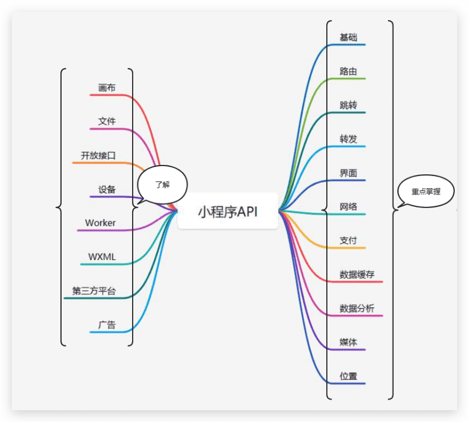


当然这么多API并不需要读者一个个去详细研究,而是建议大家重点掌握其中常用的API如何查阅和使用,然 后即可触类旁通使用其他的API。其实查阅API有点类似于查词典,我们只需要知道如何去查阅的方法即可, 而没必要将整部词典学会,故而掌握查阅API定义以及如何使用才是至关重要的。 接下来,就开始重点讲解小程序框架中一些常用的API,通过这些API的学习和理解,希望读者能够对小程序 API如何查阅和使用形成一定的思维认知。

## 基础

微信小程序基础API包含一些环境变量，转码，系统信息，更新，小程序生命周期，应用及事件，调试， 性能，加密等功能;

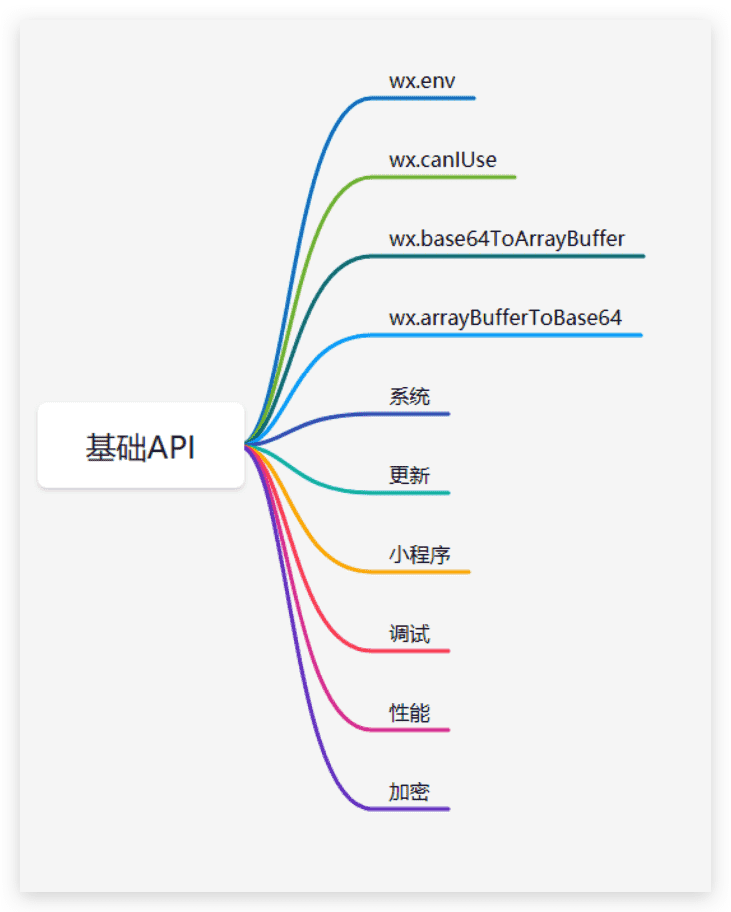

### wx.getSystemInfo 获取系统信息实例

**wx.getSystemInfo(Object object)**

> **以 [Promise 风格](https://developers.weixin.qq.com/miniprogram/dev/framework/app-service/api.html#异步-API-返回-Promise) 调用**：支持
>
> **小程序插件**：支持，需要小程序基础库版本不低于 [1.9.6](https://developers.weixin.qq.com/miniprogram/dev/framework/compatibility.html)
>
> **微信 Windows 版**：支持
>
> **微信 Mac 版**：支持

获取系统信息。**由于历史原因，wx.getSystemInfo 是异步的调用格式，但是是同步返回，需要异步获取系统信息请使用 [wx.getSystemInfoAsync](https://developers.weixin.qq.com/miniprogram/dev/api/base/system/wx.getSystemInfoAsync.html)。**

**参数**

**Object object**

| 属性     | 类型     | 默认值 | 必填 | 说明                                             |
| :------- | :------- | :----- | :--- | :----------------------------------------------- |
| success  | function |        | 否   | 接口调用成功的回调函数                           |
| fail     | function |        | 否   | 接口调用失败的回调函数                           |
| complete | function |        | 否   | 接口调用结束的回调函数（调用成功、失败都会执行） |

**object.success 回调函数**

**参数**

**Object res**

| 属性                        | 类型    | 说明                                                         | 最低版本                                                     |
| :-------------------------- | :------ | :----------------------------------------------------------- | :----------------------------------------------------------- |
| brand                       | string  | 设备品牌                                                     | [1.5.0](https://developers.weixin.qq.com/miniprogram/dev/framework/compatibility.html) |
| model                       | string  | 设备型号。新机型刚推出一段时间会显示unknown，微信会尽快进行适配。 |                                                              |
| pixelRatio                  | number  | 设备像素比                                                   |                                                              |
| screenWidth                 | number  | 屏幕宽度，单位px                                             | [1.1.0](https://developers.weixin.qq.com/miniprogram/dev/framework/compatibility.html) |
| screenHeight                | number  | 屏幕高度，单位px                                             | [1.1.0](https://developers.weixin.qq.com/miniprogram/dev/framework/compatibility.html) |
| windowWidth                 | number  | 可使用窗口宽度，单位px                                       |                                                              |
| windowHeight                | number  | 可使用窗口高度，单位px                                       |                                                              |
| statusBarHeight             | number  | 状态栏的高度，单位px                                         | [1.9.0](https://developers.weixin.qq.com/miniprogram/dev/framework/compatibility.html) |
| language                    | string  | 微信设置的语言                                               |                                                              |
| version                     | string  | 微信版本号                                                   |                                                              |
| system                      | string  | 操作系统及版本                                               |                                                              |
| platform                    | string  | 客户端平台                                                   |                                                              |
| fontSizeSetting             | number  | 用户字体大小（单位px）。以微信客户端「我-设置-通用-字体大小」中的设置为准 | [1.5.0](https://developers.weixin.qq.com/miniprogram/dev/framework/compatibility.html) |
| SDKVersion                  | string  | 客户端基础库版本                                             | [1.1.0](https://developers.weixin.qq.com/miniprogram/dev/framework/compatibility.html) |
| benchmarkLevel              | number  | 设备性能等级（仅 Android）。取值为：-2 或 0（该设备无法运行小游戏），-1（性能未知），>=1（设备性能值，该值越高，设备性能越好，目前最高不到50） | [1.8.0](https://developers.weixin.qq.com/miniprogram/dev/framework/compatibility.html) |
| albumAuthorized             | boolean | 允许微信使用相册的开关（仅 iOS 有效）                        | [2.6.0](https://developers.weixin.qq.com/miniprogram/dev/framework/compatibility.html) |
| cameraAuthorized            | boolean | 允许微信使用摄像头的开关                                     | [2.6.0](https://developers.weixin.qq.com/miniprogram/dev/framework/compatibility.html) |
| locationAuthorized          | boolean | 允许微信使用定位的开关                                       | [2.6.0](https://developers.weixin.qq.com/miniprogram/dev/framework/compatibility.html) |
| microphoneAuthorized        | boolean | 允许微信使用麦克风的开关                                     | [2.6.0](https://developers.weixin.qq.com/miniprogram/dev/framework/compatibility.html) |
| notificationAuthorized      | boolean | 允许微信通知的开关                                           | [2.6.0](https://developers.weixin.qq.com/miniprogram/dev/framework/compatibility.html) |
| notificationAlertAuthorized | boolean | 允许微信通知带有提醒的开关（仅 iOS 有效）                    | [2.6.0](https://developers.weixin.qq.com/miniprogram/dev/framework/compatibility.html) |
| notificationBadgeAuthorized | boolean | 允许微信通知带有标记的开关（仅 iOS 有效）                    | [2.6.0](https://developers.weixin.qq.com/miniprogram/dev/framework/compatibility.html) |
| notificationSoundAuthorized | boolean | 允许微信通知带有声音的开关（仅 iOS 有效）                    | [2.6.0](https://developers.weixin.qq.com/miniprogram/dev/framework/compatibility.html) |
| phoneCalendarAuthorized     | boolean | 允许微信使用日历的开关                                       | [2.19.3](https://developers.weixin.qq.com/miniprogram/dev/framework/compatibility.html) |
| bluetoothEnabled            | boolean | 蓝牙的系统开关                                               | [2.6.0](https://developers.weixin.qq.com/miniprogram/dev/framework/compatibility.html) |
| locationEnabled             | boolean | 地理位置的系统开关                                           | [2.6.0](https://developers.weixin.qq.com/miniprogram/dev/framework/compatibility.html) |
| wifiEnabled                 | boolean | Wi-Fi 的系统开关                                             | [2.6.0](https://developers.weixin.qq.com/miniprogram/dev/framework/compatibility.html) |
| safeArea                    | Object  | 在竖屏正方向下的安全区域                                     | [2.7.0](https://developers.weixin.qq.com/miniprogram/dev/framework/compatibility.html) |
| locationReducedAccuracy     | boolean | `true` 表示模糊定位，`false` 表示精确定位，仅 iOS 支持       |                                                              |
| theme                       | string  | 系统当前主题，取值为`light`或`dark`，全局配置`"darkmode":true`时才能获取，否则为 undefined （不支持小游戏） | [2.11.0](https://developers.weixin.qq.com/miniprogram/dev/framework/compatibility.html) |
| host                        | Object  | 当前小程序运行的宿主环境                                     | [2.12.3](https://developers.weixin.qq.com/miniprogram/dev/framework/compatibility.html) |
| enableDebug                 | boolean | 是否已打开调试。可通过右上角菜单或 [wx.setEnableDebug](https://developers.weixin.qq.com/miniprogram/dev/api/base/debug/wx.setEnableDebug.html) 打开调试。 | [2.15.0](https://developers.weixin.qq.com/miniprogram/dev/framework/compatibility.html) |
| deviceOrientation           | string  | 设备方向                                                     |                                                              |

**safeArea 的结构**

| 属性   | 类型   | 说明                         |
| :----- | :----- | :--------------------------- |
| left   | number | 安全区域左上角横坐标         |
| right  | number | 安全区域右下角横坐标         |
| top    | number | 安全区域左上角纵坐标         |
| bottom | number | 安全区域右下角纵坐标         |
| width  | number | 安全区域的宽度，单位逻辑像素 |
| height | number | 安全区域的高度，单位逻辑像素 |

**theme 的合法值**

| 值    | 说明     | 最低版本 |
| :---- | :------- | :------- |
| dark  | 深色主题 |          |
| light | 浅色主题 |          |

**host 的结构**

| 属性  | 类型   | 说明                  |
| :---- | :----- | :-------------------- |
| appId | string | 宿主 app 对应的 appId |

**deviceOrientation 的合法值**

| 值        | 说明 | 最低版本 |
| :-------- | :--- | :------- |
| portrait  | 竖屏 |          |
| landscape | 横屏 |          |

**示例代码**

[在开发者工具中预览效果](https://developers.weixin.qq.com/s/WkUCgXmS7mqO)

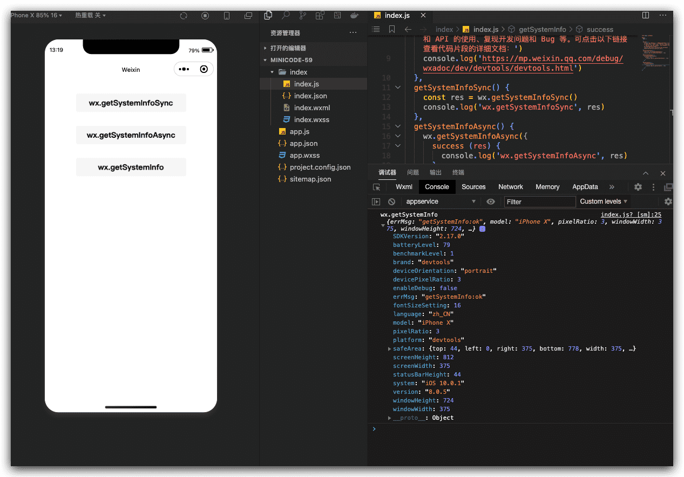

```js
wx.getSystemInfo({
  success (res) {
    console.log(res.model)
    console.log(res.pixelRatio)
    console.log(res.windowWidth)
    console.log(res.windowHeight)
    console.log(res.language)
    console.log(res.version)
    console.log(res.platform)
  }
})
try {
  const res = wx.getSystemInfoSync()
  console.log(res.model)
  console.log(res.pixelRatio)
  console.log(res.windowWidth)
  console.log(res.windowHeight)
  console.log(res.language)
  console.log(res.version)
  console.log(res.platform)
} catch (e) {
  // Do something when catch error
}
```

## 路由

路由API主要提供一些页面跳转，关闭页面以及页面之间的通信接口;

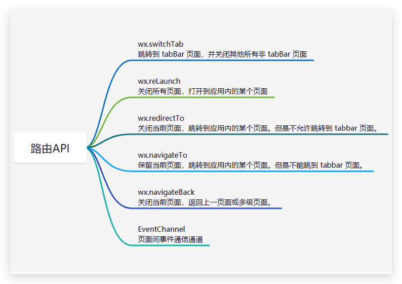

## 跳转

跳转API主要提供打开另外一个小程序，退出小程序和关闭小程序操作接口;

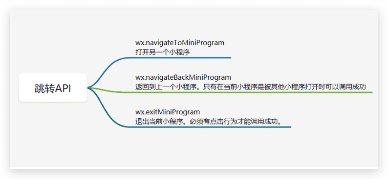

## 转发

转发API，主要提供转发属性设置，打开分享弹窗，转发视频或者文件，以及显示和隐藏转发按钮，验证 私密消息等接口;

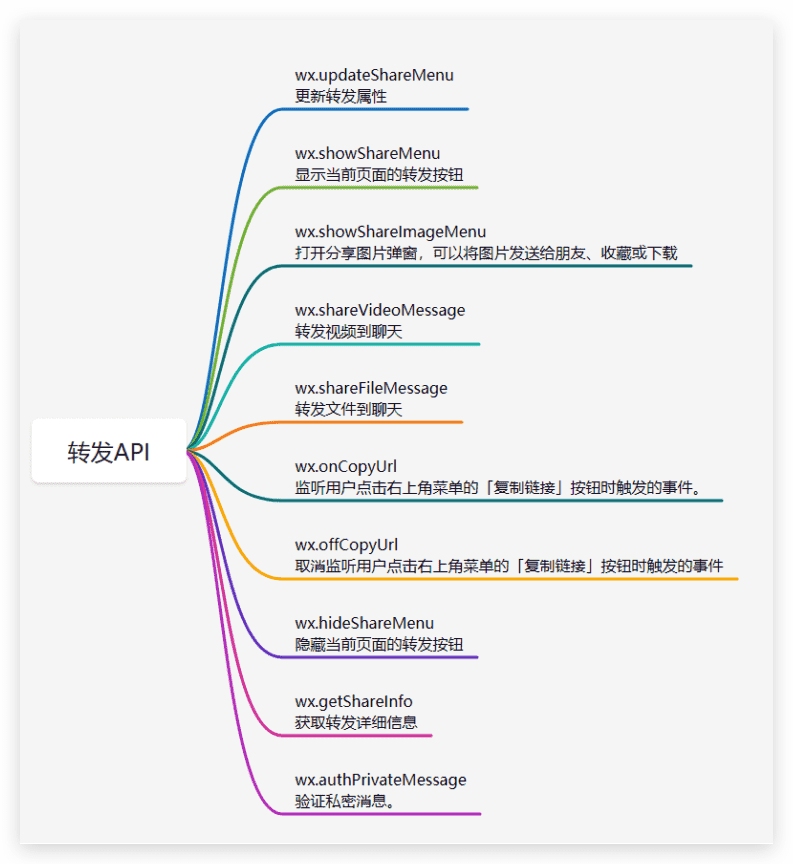

## 界面

界面API主要提供交互，导航栏，背景，Tab Bar，字体，下拉刷新，滚动，动画，置顶，自定义组件， 菜单，窗口等接口!

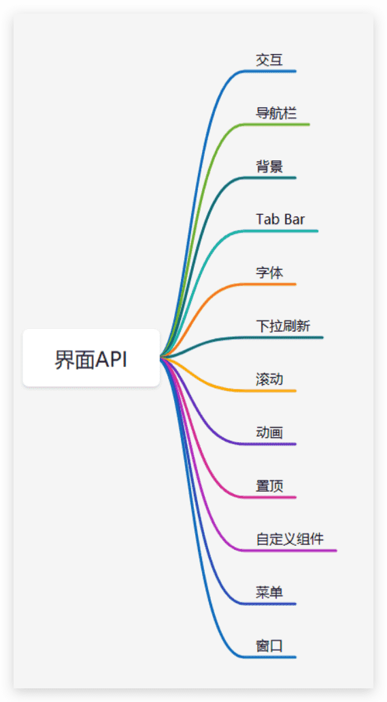

## 网络

网络API主要提供发起请求，下载，上传，WebSocket，mDNS，TCP通信，UDP通信接口;

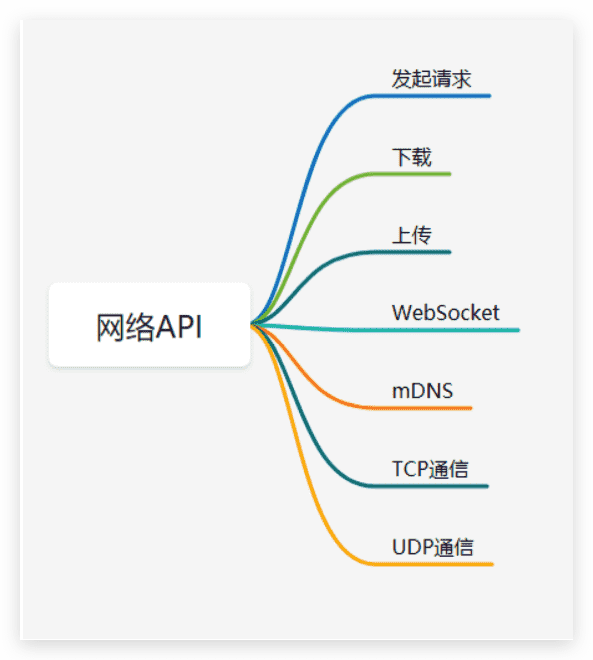

## 支付

支付API主要提供发起微信支付和创建自定义版交易组件订单等接口

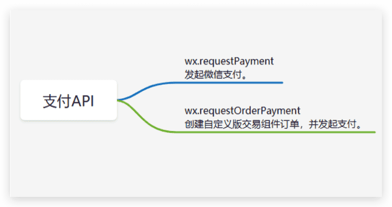

## 数据缓存

数据缓存API主要提供本地缓存的添加，获取，销毁以及内存中数据的操作和周期性更新接口;

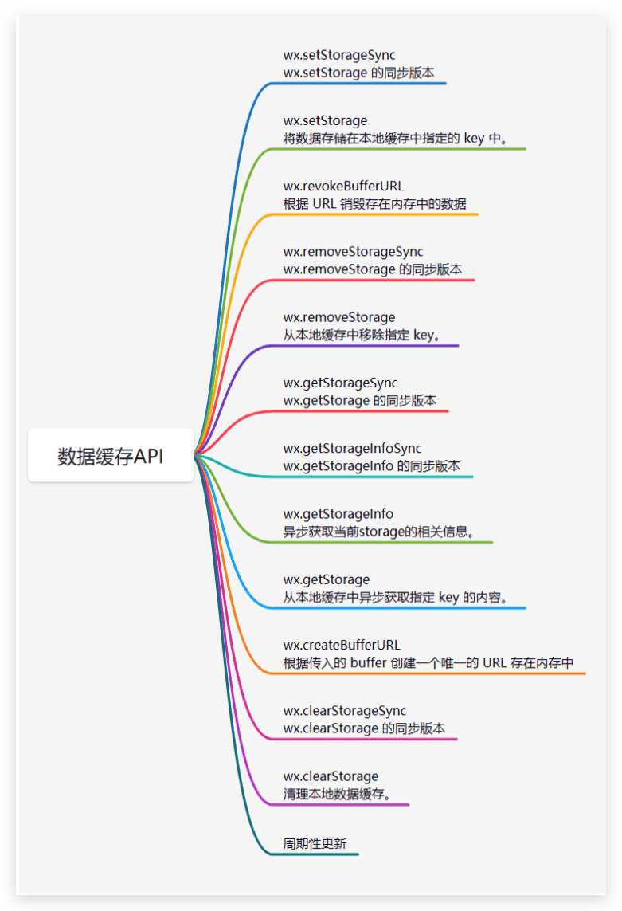

## 数据分析

数据分析接口主要提供自定义分析数据上报，事件上报，监控等接口;

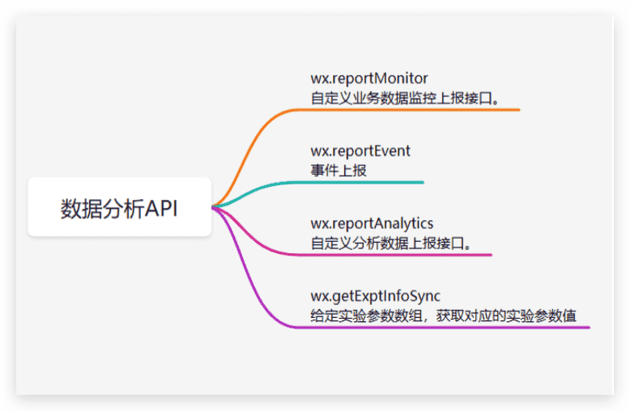

## 画布

画布API主要提供画布相关接口。

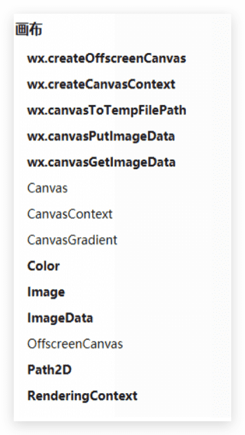

## 媒体

媒体API主要提供地图，图片，视频，音频，背景音频，实时音视频，录音，相机，富文本，音视频合 成，实时语音，画面录制器，视频解码器等接口;

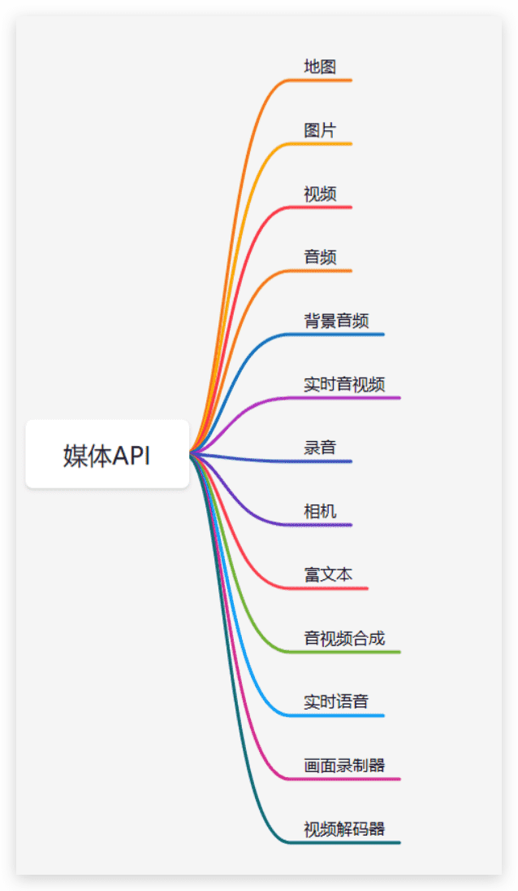

## 位置

位置API主要提供位置相关接口

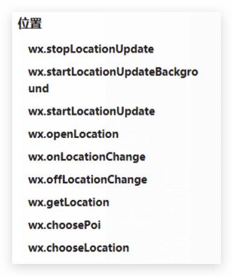

## 文件

文件API主要提供文件操作相关接口。

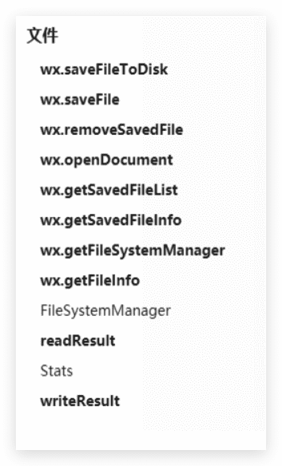

## 开放接口

开放接口API主要提供登录，账号信息，用户信息，授权，设置，收货地址，卡券，发票，生物认证，微信运动，订阅信息，微信红包，收藏，微信群等接口。

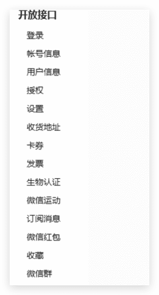

## 设备

设备API主要提供外围设备，iBeacon，NFC，Wi-Fi，日历，联系人，无障碍，低功耗蓝牙，电量，剪贴 板，网络，加密，屏幕，键盘，电话，加速计，罗盘，设备方向，陀螺仪，内存，扫码，震动等接口。

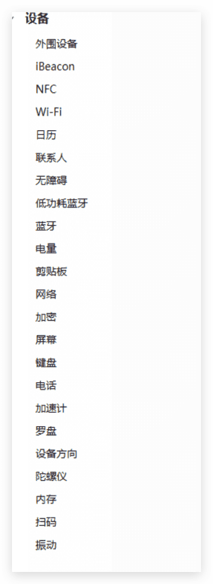

## Worker

Worker API主要提供Worker线程操作接口;

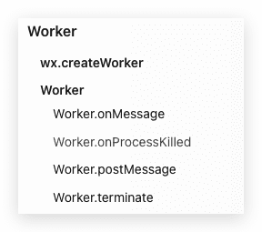

## WXML

WXML API提供主要提供WXML节点相关操作接口;

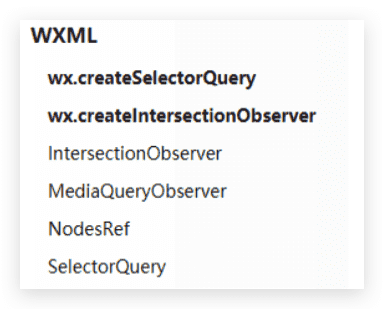

## 第三方平台

第三方平台API主要提供第三方平台相关调用接口。

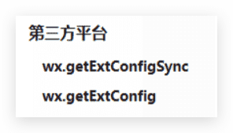

## 广告 

广告API主要提供广告操作相关API接口。


## AI

AI API主要提供人工智能相关的API接口。

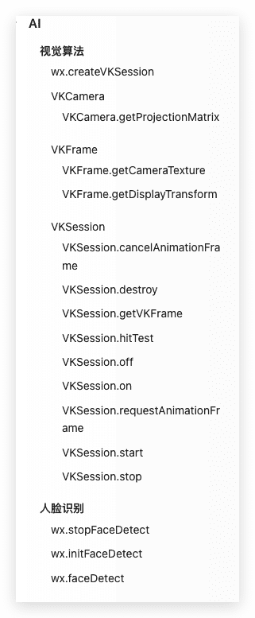
