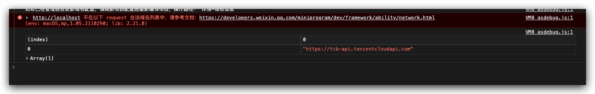
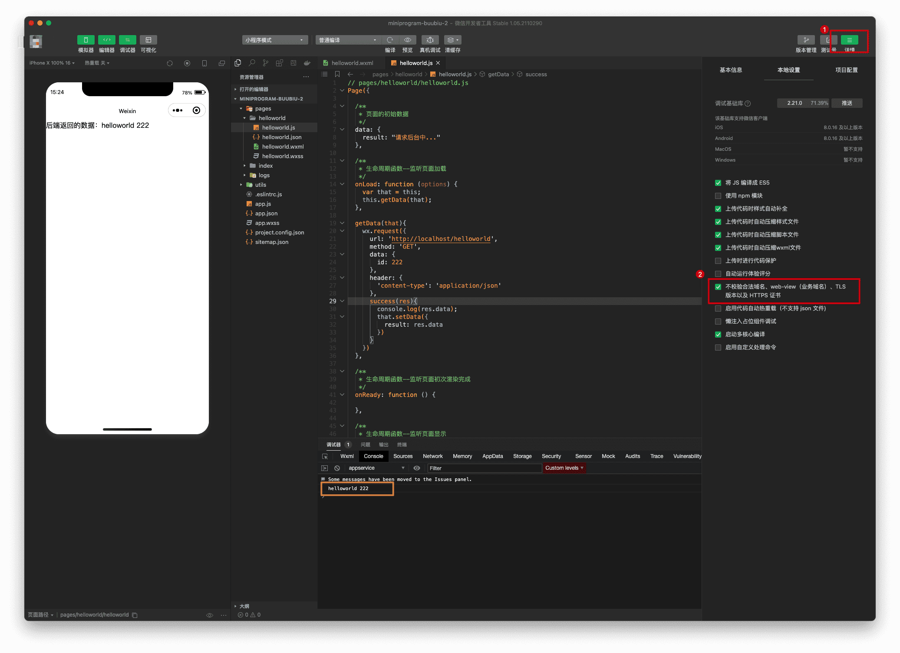
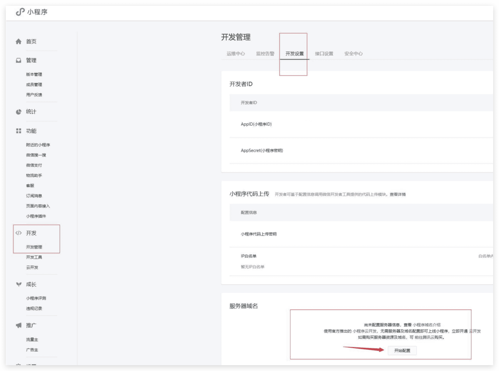
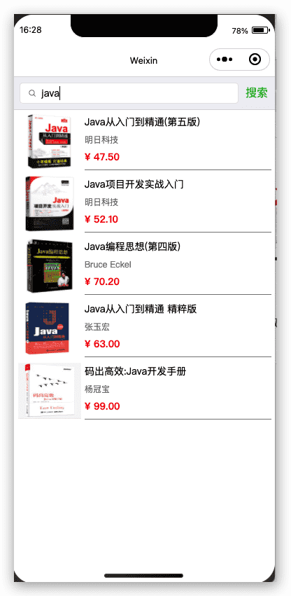
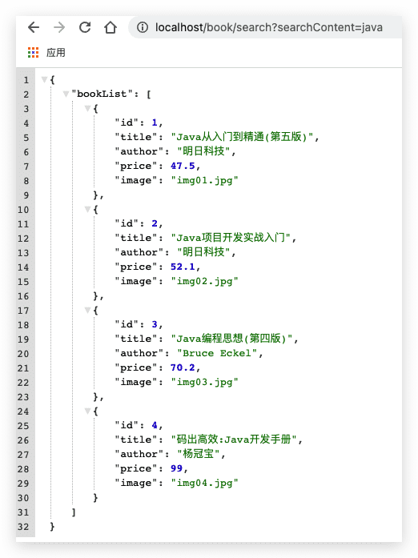
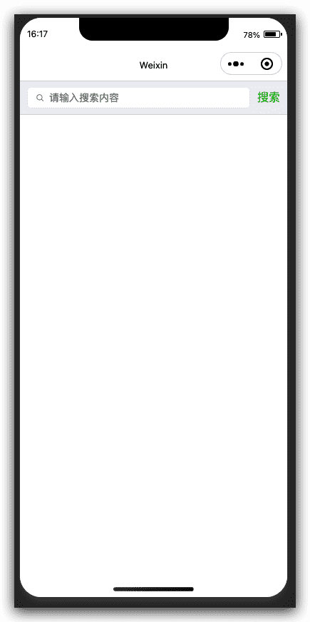
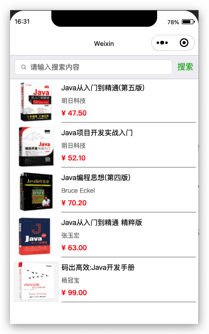
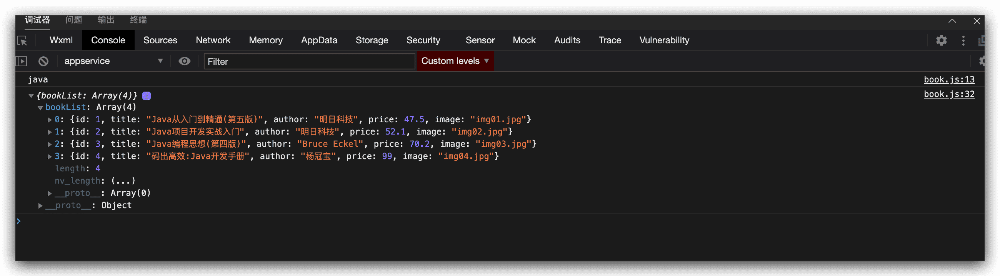
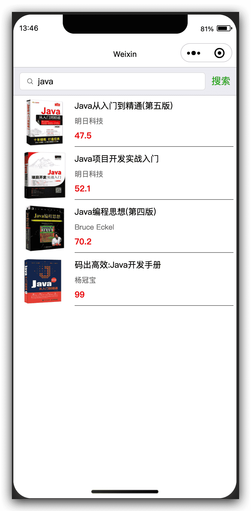

# 微信小程序后端Java接口开发

## HelloWorld实现

### SpringBoot项目提供helloworld接口

```java HelloWorldController.java
/**
 * @comment:
 * @author: buubiu
 * @create: 2021/11/26 13:59
 */
@RestController
public class HelloWorldController {

	@GetMapping("/helloworld")
	public String helloworld(Integer id) {
		return "helloworld " + id;
	}
}
```

```yaml application.yml
server:
  port: 80
  servlet:
    context-path: /
  tomcat:
    uri-encoding: utf-8
```


浏览器访问:http://localhost/helloWorld?id=1 

页面显示:

helloWorld 1

### 新建helloworld微信小程序请求后端

通过微信小程序API wx.request调用后端接口

```js helloworld.js
// pages/helloworld/helloworld.js
Page({

  /**
   * 页面的初始数据
   */
  data: {
    result: "请求后台中..."
  },

  /**
   * 生命周期函数--监听页面加载
   */
  onLoad: function (options) {
    var that = this;
    this.getData(that);
  },

  getData(that){
    wx.request({
      url: 'http://localhost/helloworld',
      method: 'GET',
      data: {
        id: 222
      },
      header: {
        'content-type': 'application/json'
      },
      success(res){
        console.log(res.data);
        that.setData({
          result: res.data
        })
      }
    })
  }
})
```

```html helloworld.wxml
<!--pages/helloworld/helloworld.wxml-->
<text>后端返回的数据：{{result}}</text>
```

运行报错：



这里我们需要设置下:
 详情->本地设置->勾选 “不校验合法域名、web-view (业务域名)、TLS版本以及HITPS证书”



## 开发环境配置域名

> 参考： https://developers.weixin.qq.com/miniprogram/dev/framework/ability/network.html

服务器域名请在 「小程序后台-开发-开发设置-服务器域名」 中进行配置，配置时需要注意：

- 域名只支持 `https` ([wx.request](https://developers.weixin.qq.com/miniprogram/dev/api/network/request/wx.request.html)、[wx.uploadFile](https://developers.weixin.qq.com/miniprogram/dev/api/network/upload/wx.uploadFile.html)、[wx.downloadFile](https://developers.weixin.qq.com/miniprogram/dev/api/network/download/wx.downloadFile.html)) 和 `wss` ([wx.connectSocket](https://developers.weixin.qq.com/miniprogram/dev/api/network/websocket/wx.connectSocket.html)) 协议；
- 域名不能使用 IP 地址（小程序的[局域网](https://developers.weixin.qq.com/miniprogram/dev/framework/ability/mDNS.html) IP 除外）或 localhost；
- 可以配置端口，如 https://myserver.com:8080，但是配置后只能向 https://myserver.com:8080 发起请求。如果向 https://myserver.com、https://myserver.com:9091 等 URL 请求则会失败。
- 如果不配置端口。如 https://myserver.com，那么请求的 URL 中也不能包含端口，甚至是默认的 443 端口也不可以。如果向 https://myserver.com:443 请求则会失败。
- 域名必须经过 ICP 备案；
- **出于安全考虑，`api.weixin.qq.com` 不能被配置为服务器域名，相关API也不能在小程序内调用。** 开发者应将 AppSecret 保存到后台服务器中，通过服务器使用 `getAccessToken` 接口获取 `access_token`，并调用相关 API；
- 不支持配置父域名，使用子域名。



## 图书搜索实现

模拟实现一个微信小程序端关键字图书，然后显示图书列表的功能，如下图:



实现大体思路，前端用户输入关键字，通过 `bindtap` 事件，事件里得到用户输入的关键字，通过 `wx.request`请求后端，后端返回json数据，最后页面通过`wx:for`遍历显示图书信息;

具体实现步骤:

### 后端实现

后端实现接口，传入参数，模拟返回图书json数据

```java  Book.java
package com.buubiu.entity;

/**
 * @comment:
 * @author: buubiu
 * @create: 2021/11/26 15:53
 */
public class Book {

	/**
	 * 编号
	 */
	private Integer id;

	/**
	 * 图书名称
	 */
	private String title;

	/**
	 * 作者
	 */
	private String author;

	/**
	 * 价格
	 */
	private float price;

	/**
	 * 图片名称
	 */
	private String image;

	public Integer getId() {
		return id;
	}

	public void setId(Integer id) {
		this.id = id;
	}

	public String getTitle() {
		return title;
	}

	public void setTitle(String title) {
		this.title = title;
	}

	public String getAuthor() {
		return author;
	}

	public void setAuthor(String author) {
		this.author = author;
	}

	public float getPrice() {
		return price;
	}

	public void setPrice(float price) {
		this.price = price;
	}

	public String getImage() {
		return image;
	}

	public void setImage(String image) {
		this.image = image;
	}
}
```

```java BookController.java
package com.buubiu.controller;

import com.buubiu.entity.Book;
import java.util.ArrayList;
import java.util.HashMap;
import java.util.List;
import java.util.Map;
import javax.annotation.PostConstruct;
import org.springframework.web.bind.annotation.GetMapping;
import org.springframework.web.bind.annotation.RequestMapping;
import org.springframework.web.bind.annotation.RestController;

/**
 * @comment:
 * @author: buubiu
 * @create: 2021/11/26 16:02
 */
@RestController
@RequestMapping("book")
public class BookController {

	List<Book> bookList = new ArrayList<>();

	/**
	 * 初始化数据
	 */
	@PostConstruct
	public void iniData() {
		Book book1 = new Book();
		book1.setId(1);
		book1.setTitle("Java从入门到精通(第五版)");
		book1.setAuthor("明日科技");
		book1.setPrice(47.50f);
		book1.setImage("img01.jpg");
		bookList.add(book1);
		Book book2 = new Book();
		book2.setId(2);
		book2.setTitle("Java项目开发实战入门");
		book2.setAuthor("明日科技");
		book2.setPrice(52.10f);
		book2.setImage("img02.jpg");
		bookList.add(book2);
		Book book3 = new Book();
		book3.setId(3);
		book3.setTitle("Java编程思想(第四版)");
		book3.setAuthor("Bruce Eckel");
		book3.setPrice(70.20f);
		book3.setImage("img03.jpg");
		bookList.add(book3);
		Book book4 = new Book();
		book4.setId(4);
		book4.setTitle("码出高效:Java开发手册");
		book4.setAuthor("杨冠宝");
		book4.setPrice(99.00f);
		book4.setImage("img04.jpg");
		bookList.add(book4);
	}

	@GetMapping("search")
	public Map search(String searchContent) {
		HashMap<String, Object> resultMap = new HashMap<>();
		if ("java".equals(searchContent)) {
			resultMap.put("bookList", bookList);
		}
		return resultMap;
	}
}
```

启动项目，浏览器地址栏输入:http://localhost/book/search?searchContent=java 页面显示:



### 小程序实现

#### 搭建搜索框

```html book.wxml
<!--pages/book/book.wxml-->
<view>
  <view>
    <view class="weui-search-bar">
      <view class="weui-search-bar__form">
        <!-- 搜索框 -->
        <view class="weui-search-bar__box">
          <icon class="weui-icon-search_in-box" type="search" size="14"></icon>
          <input type="text" class="weui-search-bar__input" model:value="{{searchContent}}" placeholder="请输入搜索内容" />
        </view>
      </view>
      <!-- 搜索按钮,调用搜索查询方法 -->
      <view class="weui-search-bar__cancel-btn" bindtap='searchBook'>搜索
      </view>
    </view>
  </view>
</view>
```

```css book.wxss
/* pages/book/book.wxss */
.weui-search-bar {
  position: relative;
  padding: 8px 10px;
  display: -webkit-box;
  display: -webkit-flex;
  display: flex;
  box-sizing: border-box;
  background-color: #EFEFF4;
  border-top: 1rpx solid #D7D6DC;
  border-bottom: 1rpx solid #D7D6DC;
}

.weui-icon-search_in-box {
  position: absolute;
  left: 10px;
  top: 7px;
}

.weui-search-bar__form {
  position: relative;
  -webkit-box-flex: 1;
  -webkit-flex: auto;
  flex: auto;
  border-radius: 5px;
  background: #FFFFFF;
  border: 1rpx solid #E6E6EA;
}

.weui-search-bar__box {
  position: relative;
  padding-left: 30px;
  padding-right: 30px;
  width: 100%;
  box-sizing: border-box;
  z-index: 1;
}

.weui-search-bar__input {
  height: 28px;
  line-height: 28px;
  font-size: 14px;
}

.weui-search-bar__cancel-btn {
  margin-left: 10px;
  line-height: 28px;
  color: #09BB07;
  white-space: nowrap;
}
```

效果：



#### 实现静态图书列表

```html book.wxml
<view class="book">
      <view class="book-left">
        <image src="/imgs/img01.jpg" alt="" />
      </view>
      <view class="book-right">
        <view id="title">Java从入门到精通(第五版)</view>
        <view id="author">明日科技</view>
        <view id="price">¥ 47.50</view>
      </view>
    </view>
    <view class="book">
      <view class="book-left">
        <image src="/imgs/img02.jpg" alt="" />
      </view>
      <view class="book-right">
        <view id="title">Java项目开发实战入门</view>
        <view id="author">明日科技</view>
        <view id="price">¥ 52.10</view>
      </view>
    </view>
    <view class="book">
      <view class="book-left">
        <image src="/imgs/img03.jpg" alt="" />
      </view>
      <view class="book-right">
        <view id="title">Java编程思想(第四版)</view>
        <view id="author">Bruce Eckel</view>
        <view id="price">¥ 70.20</view>
      </view>
    </view>
    <view class="book">
      <view class="book-left">
        <image src="/imgs/img04.jpg" alt="" />
      </view>
      <view class="book-right">
        <view id="title">Java从入门到精通 精粹版</view>
        <view id="author">张玉宏</view>
        <view id="price">¥ 63.00</view>
      </view>
    </view>
    <view class="book">
      <view class="book-left">
        <image src="/imgs/img05.jpg" alt="" />
      </view>
      <view class="book-right">
        <view id="title">码出高效:Java开发手册</view>
        <view id="author">杨冠宝</view>
        <view id="price">¥ 99.00</view>
      </view>
    </view>
```

```css book.wxss
.book {
  padding: 5px 5px 3px 3px;
}

.book-left {
  float: left;
  width: 200rpx;
  text-align: center;
}

.book-left image {
  width: 180rpx;
  height: 80px;
}

.book-right {
  padding-top: 0px;
  margin-left: 200rpx;
  height: 80px;
  line-height: 50rpx;
  border-bottom: 1px solid gray;
}

.book-right #title {
  font-size: 14px;
}

.book-right #author {
  font-size: 12px;
  color: gray;
}

.book-right #price {
  font-size: 14px;
  color: red;
  font-weight: bold;
}
```

运行效果：



#### 微信小程序通过bindtap获取后端数据

```js book.js
// pages/book/book.js
Page({

  /**
   * 页面的初始数据
   */
  data: {
    searchContent: "",
    bookList: null
  },

  searchBook(e){
    console.log(this.data.searchContent);
    var searchContent = this.data.searchContent;
    var that = this;

    //重置数据
    that.setData({
      bookList: null
    })

    wx.request({
      url: 'http://127.0.0.1/book/search',
      method: 'GET',
      data: {
        searchContent: searchContent
      },
      header: {
        'content-type': 'application/json'
      },
      success(res){
        console.log(res.data);
        var bookList = res.data.bookList;
        that.setData({
          bookList: bookList
        })
      }
    })
  }
})
```

点击请求，获取数据：



#### 微信小程序获取数据后动态渲染页面

通过`wx:for`遍历数据，渲染页面：

```html book.wxml
<view class="book" wx:for="{{bookList}}">
  <view class="book-left">
    <image src="/imgs/{{item.image}}" alt=""/>
  </view>
  <view class="book-right">
    <view id="title">{{item.title}}</view>
    <view id="author">{{item.author}}</view>
    <view id="price">{{item.price}}</view>
  </view>
</view>
```

效果：


