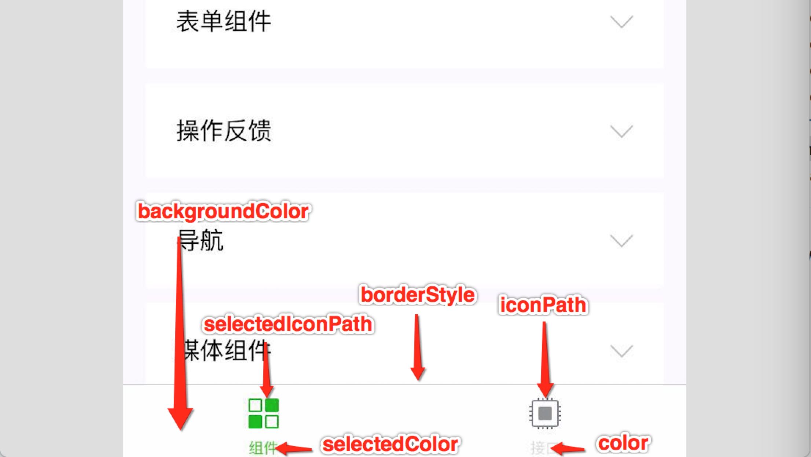
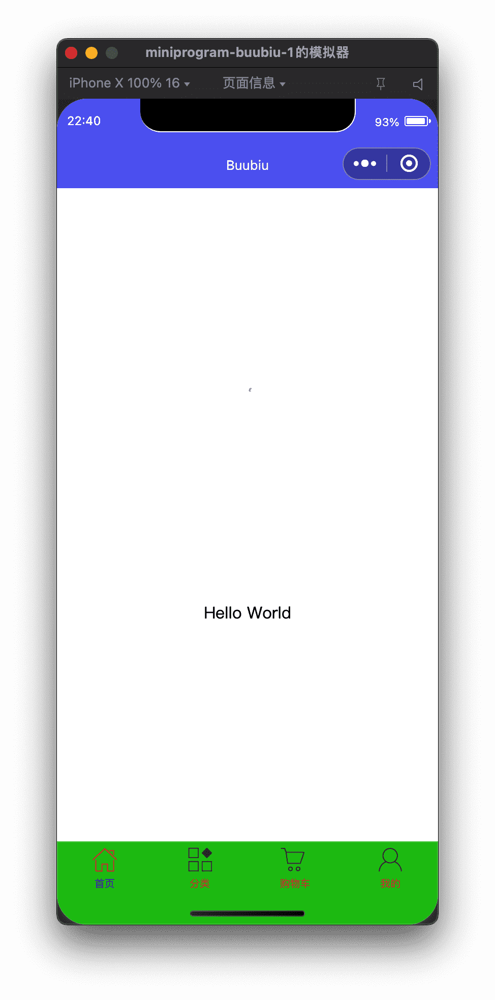

# 微信小程序配置

## 全局配置app.json

小程序根目录下的 `app.json` 文件用来对微信小程序进行全局配置。文件内容为一个 JSON 对象，有以下属性：

### 配置项


| 属性                                                         | 类型     | 必填 | 描述                                                         | 最低版本                                                     |
| :----------------------------------------------------------- | :------- | :--- | :----------------------------------------------------------- | :----------------------------------------------------------- |
| [entryPagePath](https://developers.weixin.qq.com/miniprogram/dev/reference/configuration/app.html#entryPagePath) | string   | 否   | 小程序默认启动首页                                           |                                                              |
| [pages](https://developers.weixin.qq.com/miniprogram/dev/reference/configuration/app.html#pages) | string[] | 是   | 页面路径列表                                                 |                                                              |
| [window](https://developers.weixin.qq.com/miniprogram/dev/reference/configuration/app.html#window) | Object   | 否   | 全局的默认窗口表现                                           |                                                              |
| [tabBar](https://developers.weixin.qq.com/miniprogram/dev/reference/configuration/app.html#tabBar) | Object   | 否   | 底部 `tab` 栏的表现                                          |                                                              |
| [networkTimeout](https://developers.weixin.qq.com/miniprogram/dev/reference/configuration/app.html#networkTimeout) | Object   | 否   | 网络超时时间                                                 |                                                              |
| [debug](https://developers.weixin.qq.com/miniprogram/dev/reference/configuration/app.html#debug) | boolean  | 否   | 是否开启 debug 模式，默认关闭                                |                                                              |
| [functionalPages](https://developers.weixin.qq.com/miniprogram/dev/reference/configuration/app.html#functionalPages) | boolean  | 否   | 是否启用插件功能页，默认关闭                                 | [2.1.0](https://developers.weixin.qq.com/miniprogram/dev/framework/compatibility.html) |
| [subpackages](https://developers.weixin.qq.com/miniprogram/dev/reference/configuration/app.html#subpackages) | Object[] | 否   | 分包结构配置                                                 | [1.7.3](https://developers.weixin.qq.com/miniprogram/dev/framework/compatibility.html) |
| [workers](https://developers.weixin.qq.com/miniprogram/dev/reference/configuration/app.html#workers) | string   | 否   | `Worker` 代码放置的目录                                      | [1.9.90](https://developers.weixin.qq.com/miniprogram/dev/framework/compatibility.html) |
| [requiredBackgroundModes](https://developers.weixin.qq.com/miniprogram/dev/reference/configuration/app.html#requiredBackgroundModes) | string[] | 否   | 需要在后台使用的能力，如「音乐播放」                         |                                                              |
| [plugins](https://developers.weixin.qq.com/miniprogram/dev/reference/configuration/app.html#plugins) | Object   | 否   | 使用到的插件                                                 | [1.9.6](https://developers.weixin.qq.com/miniprogram/dev/framework/compatibility.html) |
| [preloadRule](https://developers.weixin.qq.com/miniprogram/dev/reference/configuration/app.html#preloadRule) | Object   | 否   | 分包预下载规则                                               | [2.3.0](https://developers.weixin.qq.com/miniprogram/dev/framework/compatibility.html) |
| [resizable](https://developers.weixin.qq.com/miniprogram/dev/reference/configuration/app.html#resizable) | boolean  | 否   | PC 小程序是否支持用户任意改变窗口大小（包括最大化窗口）；iPad 小程序是否支持屏幕旋转。默认关闭 | [2.3.0](https://developers.weixin.qq.com/miniprogram/dev/framework/compatibility.html) |
| [usingComponents](https://developers.weixin.qq.com/miniprogram/dev/reference/configuration/app.html#usingComponents) | Object   | 否   | 全局[自定义组件](https://developers.weixin.qq.com/miniprogram/dev/framework/custom-component/)配置 | 开发者工具 1.02.1810190                                      |
| [permission](https://developers.weixin.qq.com/miniprogram/dev/reference/configuration/app.html#permission) | Object   | 否   | 小程序接口权限相关设置                                       | 微信客户端 7.0.0                                             |
| [sitemapLocation](https://developers.weixin.qq.com/miniprogram/dev/reference/configuration/app.html#sitemapLocation) | string   | 是   | 指明 sitemap.json 的位置                                     |                                                              |
| [style](https://developers.weixin.qq.com/miniprogram/dev/reference/configuration/app.html#style) | string   | 否   | 指定使用升级后的weui样式                                     | [2.8.0](https://developers.weixin.qq.com/miniprogram/dev/framework/compatibility.html) |
| [useExtendedLib](https://developers.weixin.qq.com/miniprogram/dev/reference/configuration/app.html#useextendedlib) | Object   | 否   | 指定需要引用的扩展库                                         | [2.2.1](https://developers.weixin.qq.com/miniprogram/dev/framework/compatibility.html) |
| [entranceDeclare](https://developers.weixin.qq.com/miniprogram/dev/reference/configuration/app.html#entranceDeclare) | Object   | 否   | 微信消息用小程序打开                                         | 微信客户端7.0.9                                              |
| [darkmode](https://developers.weixin.qq.com/miniprogram/dev/reference/configuration/app.html#darkmode) | boolean  | 否   | 小程序支持 DarkMode                                          | [2.11.0](https://developers.weixin.qq.com/miniprogram/dev/framework/compatibility.html) |
| [themeLocation](https://developers.weixin.qq.com/miniprogram/dev/reference/configuration/app.html#themeLocation) | string   | 否   | 指明 theme.json 的位置，darkmode为true为必填                 | 开发者工具 1.03.2004271                                      |
| [lazyCodeLoading](https://developers.weixin.qq.com/miniprogram/dev/reference/configuration/app.html#lazyCodeLoading) | string   | 否   | 配置自定义组件代码按需注入                                   | [2.11.1](https://developers.weixin.qq.com/miniprogram/dev/framework/compatibility.html) |
| [singlePage](https://developers.weixin.qq.com/miniprogram/dev/reference/configuration/app.html#singlePage) | Object   | 否   | 单页模式相关配置                                             | [2.12.0](https://developers.weixin.qq.com/miniprogram/dev/framework/compatibility.html) |
| supportedMaterials                                           | Object   | 否   | [聊天素材小程序打开](https://developers.weixin.qq.com/miniprogram/dev/framework/material/support_material.html)相关配置 | [2.14.3](https://developers.weixin.qq.com/miniprogram/dev/framework/compatibility.html) |
| serviceProviderTicket                                        | string   | 否   | [定制化型服务商](https://developers.weixin.qq.com/doc/oplatform/Third-party_Platforms/2.0/operation/thirdparty/customized_service_platform_guidelines.html)票据 |                                                              |
| [embeddedAppIdList](https://developers.weixin.qq.com/miniprogram/dev/reference/configuration/app.html#embeddedAppIdList) | string[] | 否   | 内嵌小程序 appId                                             |                                                              |

### tabBar

如果小程序是一个多 tab 应用（客户端窗口的底部或顶部有 tab 栏可以切换页面），可以通过 tabBar 配置项指定 tab 栏的表现，以及 tab 切换时显示的对应页面。

| 属性            | 类型     | 必填 | 默认值 | 描述                                                         | 最低版本                                                     |
| :-------------- | :------- | :--- | :----- | :----------------------------------------------------------- | :----------------------------------------------------------- |
| color           | HexColor | 是   |        | tab 上的文字默认颜色，仅支持十六进制颜色                     |                                                              |
| selectedColor   | HexColor | 是   |        | tab 上的文字选中时的颜色，仅支持十六进制颜色                 |                                                              |
| backgroundColor | HexColor | 是   |        | tab 的背景色，仅支持十六进制颜色                             |                                                              |
| borderStyle     | string   | 否   | black  | tabbar 上边框的颜色， 仅支持 `black` / `white`               |                                                              |
| list            | Array    | 是   |        | tab 的列表，详见 `list` 属性说明，最少 2 个、最多 5 个 tab   |                                                              |
| position        | string   | 否   | bottom | tabBar 的位置，仅支持 `bottom` / `top`                       |                                                              |
| custom          | boolean  | 否   | false  | 自定义 tabBar，见[详情](https://developers.weixin.qq.com/miniprogram/dev/framework/ability/custom-tabbar.html) | [2.5.0](https://developers.weixin.qq.com/miniprogram/dev/framework/compatibility.html) |

其中 list 接受一个数组，**只能配置最少 2 个、最多 5 个 tab**。tab 按数组的顺序排序，每个项都是一个对象，其属性值如下：

| 属性             | 类型   | 必填 | 说明                                                         |
| :--------------- | :----- | :--- | :----------------------------------------------------------- |
| pagePath         | string | 是   | 页面路径，必须在 pages 中先定义                              |
| text             | string | 是   | tab 上按钮文字                                               |
| iconPath         | string | 否   | 图片路径，icon 大小限制为 40kb，建议尺寸为 81px * 81px，不支持网络图片。 **当 `position` 为 `top` 时，不显示 icon。** |
| selectedIconPath | string | 否   | 选中时的图片路径，icon 大小限制为 40kb，建议尺寸为 81px * 81px，不支持网络图片。 **当 `position` 为 `top` 时，不显示 icon。** |



### 示例

```json app.json
{
  "entryPagePath": "pages/index/index",
  "pages":[
    "pages/demo01/demo01",
    "pages/classification/classification",
    "pages/cart/cart",
    "pages/my/my",
    "pages/index/index",
    "pages/logs/logs"
  ],
  "tabBar": {
    "color": "#bf2e2e",
    "selectedColor": "#0e0cc1",
    "backgroundColor": "#0cc112",
    "borderStyle": "white",
    "position": "bottom",
    "list": [{
      "pagePath": "pages/index/index",
      "text": "首页",
      "iconPath": "icon/_home.png",
      "selectedIconPath": "icon/home.png"
    }, {
      "pagePath": "pages/classification/classification",
      "text": "分类",
      "iconPath": "icon/_classification.png",
      "selectedIconPath": "icon/classification.png"
    }, {
      "pagePath": "pages/cart/cart",
      "text": "购物车",
      "iconPath": "icon/_cart.png",
      "selectedIconPath": "icon/cart.png"
    }, {
      "pagePath": "pages/my/my",
      "text": "我的",
      "iconPath": "icon/_my.png",
      "selectedIconPath": "icon/my.png"
    }]
  },
  "window":{
    "backgroundTextStyle":"dark",
    "navigationBarBackgroundColor": "#5e6af3",
    "navigationBarTitleText": "Buubiu",
    "navigationBarTextStyle":"white",
    "enablePullDownRefresh": true
  },
  "style": "v2",
  "sitemapLocation": "sitemap.json"
}

```



## 页面配置

每一个小程序页面也可以使用 `.json` 文件来对本页面的窗口表现进行配置。页面中配置项在当前页面会覆盖 `app.json` 的 `window` 中相同的配置项。文件内容为一个 JSON 对象，有以下属性：

### 配置项

| 属性                                                         | 类型     | 默认值   | 描述                                                         | 最低版本                                                     |
| :----------------------------------------------------------- | :------- | :------- | :----------------------------------------------------------- | :----------------------------------------------------------- |
| navigationBarBackgroundColor                                 | HexColor | #000000  | 导航栏背景颜色，如 `#000000`                                 |                                                              |
| navigationBarTextStyle                                       | string   | white    | 导航栏标题颜色，仅支持 `black` / `white`                     |                                                              |
| navigationBarTitleText                                       | string   |          | 导航栏标题文字内容                                           |                                                              |
| navigationStyle                                              | string   | default  | 导航栏样式，仅支持以下值： `default` 默认样式 `custom` 自定义导航栏，只保留右上角胶囊按钮。参见注 1。 | iOS/Android 微信客户端 7.0.0，Windows 微信客户端不支持       |
| backgroundColor                                              | HexColor | #ffffff  | 窗口的背景色                                                 |                                                              |
| backgroundTextStyle                                          | string   | dark     | 下拉 loading 的样式，仅支持 `dark` / `light`                 |                                                              |
| backgroundColorTop                                           | string   | #ffffff  | 顶部窗口的背景色，仅 iOS 支持                                | 微信客户端 6.5.16                                            |
| backgroundColorBottom                                        | string   | #ffffff  | 底部窗口的背景色，仅 iOS 支持                                | 微信客户端 6.5.16                                            |
| enablePullDownRefresh                                        | boolean  | false    | 是否开启当前页面下拉刷新。 详见 [Page.onPullDownRefresh](https://developers.weixin.qq.com/miniprogram/dev/reference/api/Page.html#onpulldownrefresh) |                                                              |
| onReachBottomDistance                                        | number   | 50       | 页面上拉触底事件触发时距页面底部距离，单位为px。 详见 [Page.onReachBottom](https://developers.weixin.qq.com/miniprogram/dev/reference/api/Page.html#onreachbottom) |                                                              |
| pageOrientation                                              | string   | portrait | 屏幕旋转设置，支持 `auto` / `portrait` / `landscape` 详见 [响应显示区域变化](https://developers.weixin.qq.com/miniprogram/dev/framework/view/resizable.html) | [2.4.0](https://developers.weixin.qq.com/miniprogram/dev/framework/compatibility.html) (auto) / [2.5.0](https://developers.weixin.qq.com/miniprogram/dev/framework/compatibility.html) (landscape) |
| disableScroll                                                | boolean  | false    | 设置为 `true` 则页面整体不能上下滚动。 只在页面配置中有效，无法在 `app.json` 中设置 |                                                              |
| usingComponents                                              | Object   | 否       | 页面[自定义组件](https://developers.weixin.qq.com/miniprogram/dev/framework/custom-component/)配置 | [1.6.3](https://developers.weixin.qq.com/miniprogram/dev/framework/compatibility.html) |
| initialRenderingCache                                        | string   |          | 页面[初始渲染缓存](https://developers.weixin.qq.com/miniprogram/dev/framework/view/initial-rendering-cache.html)配置，支持 `static` / `dynamic` | [2.11.1](https://developers.weixin.qq.com/miniprogram/dev/framework/compatibility.html) |
| style                                                        | string   | default  | 启用新版的组件样式                                           | [2.10.2](https://developers.weixin.qq.com/miniprogram/dev/framework/compatibility.html) |
| [singlePage](https://developers.weixin.qq.com/miniprogram/dev/reference/configuration/page.html#singlePage) | Object   | 否       | 单页模式相关配置                                             | [2.12.0](https://developers.weixin.qq.com/miniprogram/dev/framework/compatibility.html) |
| [restartStrategy](https://developers.weixin.qq.com/miniprogram/dev/reference/configuration/page.html#restartStrategy) | string   | homePage | 重新启动策略配置                                             | [2.8.0](https://developers.weixin.qq.com/miniprogram/dev/framework/compatibility.html) |

> 页面配置中只能设置 `app.json` 中 `window` 对应的配置项，以决定本页面的窗口表现，所以无需写 `window` 这个属性。

- 注 1：关于

  ```
  navigationStyle
  ```

  - iOS/Android 客户端 7.0.0 以下版本，`navigationStyle` 只在 `app.json` 中生效。
  - iOS/Android 客户端 6.7.2 版本开始，`navigationStyle: custom` 对 [web-view](https://developers.weixin.qq.com/miniprogram/dev/component/web-view.html) 组件无效
  - 开启 custom 后，低版本客户端需要做好兼容。开发者工具基础库版本切到 1.7.0（不代表最低版本，只供调试用）可方便切到旧视觉
  - Windows 客户端 3.0 及以上版本，为了给用户提供更符合桌面软件的使用体验，统一了小程序窗口的导航栏，`navigationStyle: custom` 不再生效

### singlePage

> 基础库 2.11.3 及以上版本支持，目前[分享到朋友圈 (Beta)](https://developers.weixin.qq.com/miniprogram/dev/framework/open-ability/share-timeline.html) 后打开会进入单页模式

单页模式相关配置

| 属性             | 类型   | 必填 | 默认值                                                       | 描述                                                         |
| :--------------- | :----- | :--- | :----------------------------------------------------------- | :----------------------------------------------------------- |
| navigationBarFit | String | 否   | 默认自动调整，若原页面是自定义导航栏，则为 float，否则为 squeezed | 导航栏与页面的相交状态，值为 float 时表示导航栏浮在页面上，与页面相交；值为 squeezed 时表示页面被导航栏挤压，与页面不相交 |

### restartStrategy

> 基础库 2.8.0 开始支持，低版本需做[兼容处理](https://developers.weixin.qq.com/miniprogram/dev/framework/compatibility.html)。

[重新启动策略](https://developers.weixin.qq.com/miniprogram/dev/framework/runtime/operating-mechanism.html#_2-1-重新启动策略)配置，与 `app.json` 中一致。

### 配置示例

```json index.json
{
  "usingComponents": {},
  "navigationBarBackgroundColor": "#d443ae",
  "navigationBarTitleText": "buubiu-首页",
  "enablePullDownRefresh": true
}
```

## sitemap配置

微信现已开放小程序内搜索，开发者可以通过 `sitemap.json` 配置，或者管理后台页面收录开关来配置其小程序页面是否允许微信索引。当开发者允许微信索引时，微信会通过爬虫的形式，为小程序的页面内容建立索引。当用户的搜索词条触发该索引时，小程序的页面将可能展示在搜索结果中。 爬虫访问小程序内页面时，会携带特定的 user-agent：`mpcrawler` 及[场景值](https://developers.weixin.qq.com/miniprogram/dev/reference/scene-list.html)：`1129`。需要注意的是，若小程序爬虫发现的页面数据和真实用户的呈现不一致，那么该页面将不会进入索引中。

小程序根目录下的 `sitemap.json` 文件用于配置小程序及其页面是否允许被微信索引，文件内容为一个 JSON 对象，如果没有 `sitemap.json` ，则默认为所有页面都允许被索引；`sitemap.json` 有以下属性：

### 配置项

| 属性                                                         | 类型     | 必填 | 描述         |
| :----------------------------------------------------------- | :------- | :--- | :----------- |
| [rules](https://developers.weixin.qq.com/miniprogram/dev/reference/configuration/sitemap.html#rules) | Object[] | 是   | 索引规则列表 |

### rules

rules 配置项指定了索引规则，每项规则为一个JSON对象，属性如下所示：

| 属性     | 类型     | 必填 | 默认值      | 取值                       | 取值说明                                                     |
| :------- | :------- | :--- | :---------- | :------------------------- | :----------------------------------------------------------- |
| action   | string   | 否   | "allow"     | "allow"、"disallow"        | 命中该规则的页面是否能被索引                                 |
| page     | string   | 是   |             | "*"、页面的路径            | `*` 表示所有页面，不能作为通配符使用                         |
| params   | string[] | 否   | []          |                            | 当 page 字段指定的页面在被本规则匹配时可能使用的页面参数名称的列表（不含参数值） |
| matching | string   | 否   | "inclusive" | 参考 **matching 取值说明** | 当 page 字段指定的页面在被本规则匹配时，此参数说明 params 匹配方式 |
| priority | Number   | 否   |             |                            | 优先级，值越大则规则越早被匹配，否则默认从上到下匹配         |

**matching 取值说明**

| 值        | 说明                                                   |
| :-------- | :----------------------------------------------------- |
| exact     | 当小程序页面的参数列表等于 params 时，规则命中         |
| inclusive | 当小程序页面的参数列表包含 params 时，规则命中         |
| exclusive | 当小程序页面的参数列表与 params 交集为空时，规则命中   |
| partial   | 当小程序页面的参数列表与 params 交集不为空时，规则命中 |

### 配置示例

**示例1**

```json
{
  "rules":[{
    "action": "allow",
    "page": "path/to/page",
    "params": ["a", "b"],
    "matching": "exact"
  }, {
    "action": "disallow",
    "page": "path/to/page"
  }]
}
```

- `path/to/page?a=1&b=2` => 优先索引
- `path/to/page` => 不被索引
- `path/to/page?a=1` => 不被索引
- `path/to/page?a=1&b=2&c=3` => 不被索引
- 其他页面都会被索引

**示例2**

```json
{
  "rules":[{
    "action": "allow",
    "page": "path/to/page",
    "params": ["a", "b"],
    "matching": "inclusive"
  }, {
    "action": "disallow",
    "page": "path/to/page"
  }]
}
```

- `path/to/page?a=1&b=2` => 优先索引
- `path/to/page?a=1&b=2&c=3` => 优先索引
- `path/to/page` => 不被索引
- `path/to/page?a=1` => 不被索引
- 其他页面都会被索引

**示例3**

```json
{
  "rules":[{
    "action": "allow",
    "page": "path/to/page",
    "params": ["a", "b"],
    "matching": "exclusive"
  }, {
    "action": "disallow",
    "page": "path/to/page"
  }]
}
```

- `path/to/page` => 优先索引
- `path/to/page?c=3` => 优先索引
- `path/to/page?a=1` => 不被索引
- `path/to/page?a=1&b=2` => 不被索引
- 其他页面都会被索引

**示例4**

```json
{
  "rules":[{
    "action": "allow",
    "page": "path/to/page",
    "params": ["a", "b"],
    "matching": "partial"
  }, {
    "action": "disallow",
    "page": "path/to/page"
  }]
}
```

- `path/to/page?a=1` => 优先索引
- `path/to/page?a=1&b=2` => 优先索引
- `path/to/page` => 不被索引
- `path/to/page?c=3` => 不被索引
- 其他页面都会被索引

**注：没有 sitemap.json 则默认所有页面都能被索引**

**注：`{"action": "allow", "page": "\*"}` 是优先级最低的默认规则，未显式指明 "disallow" 的都默认被索引**
