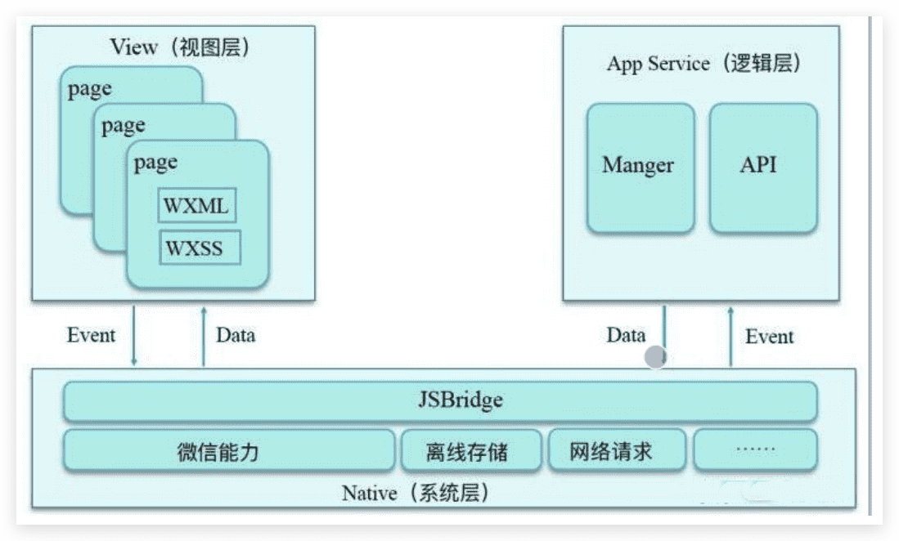
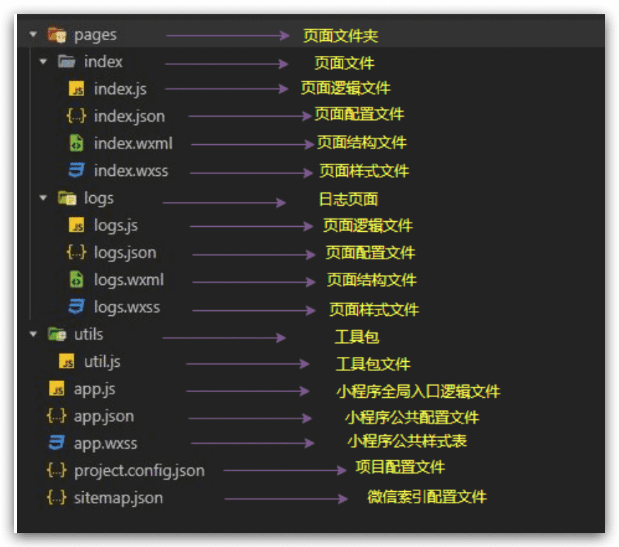

# 微信小程序框架介绍与项目目录结构

## 框架介绍

微信团队为小程序提供的框架命名为**MINA**。MINA框架通过封装微信客户端提供的文件系统、网络通信、任务管理、数据安全等基础功能，对上层提供一整套JavaScript API，让开发者方便的使用微信 客户端提供的各种基础功能与能力，快速构建应用。

小程序开发框架的目标是通过尽可能简单、高效的方式让开发者可以在微信中开发具有原生 APP 体验的 服务。

整个小程序框架系统分为两部分:逻辑层(App Service)和 视图层(View)。小程序提供了自己的视 图层描述语言 WXML 和 WXSS，以及基于 JavaScript 的逻辑层框架，并在视图层与逻辑层间提供了数据传输和事件系统，让开发者能够专注于数据与逻辑。

## 项目目录结构

官方文档： https://developers.weixin.qq.com/miniprogram/dev/framework/structure.html

小程序包含一个描述整体程序的 app 和多个描述各自页面的 page 。 一个小程序主体部分由三个文件组成，必须放在项目的根目录，如下：

| **文件**                                                     | **必需** | **作用**         |
| :----------------------------------------------------------- | -------- | ---------------- |
| [app.js](https://developers.weixin.qq.com/miniprogram/dev/framework/app-service/app.html) | 是       | 小程序逻辑       |
| [app.json](https://developers.weixin.qq.com/miniprogram/dev/framework/config.html) | 是       | 小程序公共配置   |
| [app.wxss](https://developers.weixin.qq.com/miniprogram/dev/framework/view/wxss.html) | 否       | 小程序公共样式表 |

一个小程序页面由四个文件组成，分别是：

| **文件类型**                                                 | **必需** | **作用**   |
| ------------------------------------------------------------ | -------- | ---------- |
| [js](https://developers.weixin.qq.com/miniprogram/dev/framework/app-service/page.html) | 是       | 页面逻辑   |
| [wxml](https://developers.weixin.qq.com/miniprogram/dev/framework/view/wxml/) | 是       | 页面结构   |
| [json](https://developers.weixin.qq.com/miniprogram/dev/framework/config.html#页面配置) | 否       | 页面配置   |
| [wxss](https://developers.weixin.qq.com/miniprogram/dev/framework/view/wxss.html) | 否       | 页面样式表 |

**注意：为了方便开发者减少配置项，描述页面的四个文件必须具有相同的路径与文件名。**

## 允许上传的文件

在项目目录中，以下文件会经过编译，因此上传之后无法直接访问到：`.js、app.json、.wxml、
*.wxss`（其中 wxml 和 wxss 文件仅针对在 app.json 中配置了的页面）。除此之外，只有后 名在白名单内的文件可以被上传，不在白名单列表内文件在开发工具能被访问到，但无法被上传。具体白名单列表如下：

1.	wxs
2.	png
3.	jpg
4.	jpeg
5.	gif
6.	svg
7.	json
8.	cer
9.	mp3
10.	aac
11.	m4a
12.	mp4
13.	wav
14.	ogg
15.	silk
16.	wasm
17.	br
