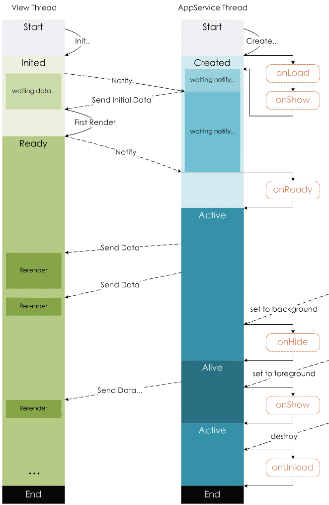

# 微信小程序应用和页面生命周期

## 小程序应用生命周期

### App(Object object)

注册小程序。接受一个 `Object` 参数，其指定小程序的生命周期回调等。

**App() 必须在 `app.js` 中调用，必须调用且只能调用一次。不然会出现无法预期的后果。**


#### 参数

**Object object**

| 属性                                                         | 类型     | 默认值 | 必填 | 说明                                                         | 最低版本                                                     |
| :----------------------------------------------------------- | :------- | :----- | :--- | :----------------------------------------------------------- | :----------------------------------------------------------- |
| [onLaunch](https://developers.weixin.qq.com/miniprogram/dev/reference/api/App.html#onLaunch-Object-object) | function |        | 否   | 生命周期回调——监听小程序初始化。                             |                                                              |
| [onShow](https://developers.weixin.qq.com/miniprogram/dev/reference/api/App.html#onShow-Object-object) | function |        | 否   | 生命周期回调——监听小程序启动或切前台。                       |                                                              |
| [onHide](https://developers.weixin.qq.com/miniprogram/dev/reference/api/App.html#onHide) | function |        | 否   | 生命周期回调——监听小程序切后台。                             |                                                              |
| [onError](https://developers.weixin.qq.com/miniprogram/dev/reference/api/App.html#onError-String-error) | function |        | 否   | 错误监听函数。                                               |                                                              |
| [onPageNotFound](https://developers.weixin.qq.com/miniprogram/dev/reference/api/App.html#onPageNotFound-Object-object) | function |        | 否   | 页面不存在监听函数。                                         | [1.9.90](https://developers.weixin.qq.com/miniprogram/dev/framework/compatibility.html) |
| [onUnhandledRejection](https://developers.weixin.qq.com/miniprogram/dev/reference/api/App.html#onUnhandledRejection-Object-object) | function |        | 否   | 未处理的 Promise 拒绝事件监听函数。                          | [2.10.0](https://developers.weixin.qq.com/miniprogram/dev/framework/compatibility.html) |
| [onThemeChange](https://developers.weixin.qq.com/miniprogram/dev/reference/api/App.html#onThemeChange-Object-object) | function |        | 否   | 监听系统主题变化                                             | [2.11.0](https://developers.weixin.qq.com/miniprogram/dev/framework/compatibility.html) |
| 其他                                                         | any      |        | 否   | 开发者可以添加任意的函数或数据变量到 `Object` 参数中，用 `this` 可以访问 |                                                              |

> 关于小程序前后台的定义和小程序的运行机制，请参考[运行机制](https://developers.weixin.qq.com/miniprogram/dev/framework/runtime/operating-mechanism.html)章节。

#### onLaunch(Object object)

小程序初始化完成时触发，全局只触发一次。参数也可以使用 [wx.getLaunchOptionsSync](https://developers.weixin.qq.com/miniprogram/dev/api/base/app/life-cycle/wx.getLaunchOptionsSync.html) 获取。

**参数**：与 [wx.getLaunchOptionsSync](https://developers.weixin.qq.com/miniprogram/dev/api/base/app/life-cycle/wx.getLaunchOptionsSync.html) 一致

#### onShow(Object object)

小程序启动，或从后台进入前台显示时触发。也可以使用 [wx.onAppShow](https://developers.weixin.qq.com/miniprogram/dev/api/base/app/app-event/wx.onAppShow.html) 绑定监听。

**参数**：与 [wx.onAppShow](https://developers.weixin.qq.com/miniprogram/dev/api/base/app/app-event/wx.onAppShow.html) 一致

#### onHide()

小程序从前台进入后台时触发。也可以使用 [wx.onAppHide](https://developers.weixin.qq.com/miniprogram/dev/api/base/app/app-event/wx.onAppHide.html) 绑定监听。

#### onError(String error)

小程序发生脚本错误或 API 调用报错时触发。也可以使用 [wx.onError](https://developers.weixin.qq.com/miniprogram/dev/api/base/app/app-event/wx.onError.html) 绑定监听。

**参数**：与 [wx.onError](https://developers.weixin.qq.com/miniprogram/dev/api/base/app/app-event/wx.onError.html) 一致

#### onPageNotFound(Object object)

> 基础库 1.9.90 开始支持，低版本需做[兼容处理](https://developers.weixin.qq.com/miniprogram/dev/framework/compatibility.html)。

小程序要打开的页面不存在时触发。也可以使用 [wx.onPageNotFound](https://developers.weixin.qq.com/miniprogram/dev/api/base/app/app-event/wx.onPageNotFound.html) 绑定监听。注意事项请参考 [wx.onPageNotFound](https://developers.weixin.qq.com/miniprogram/dev/api/base/app/app-event/wx.onPageNotFound.html)。

**参数**：与 [wx.onPageNotFound](https://developers.weixin.qq.com/miniprogram/dev/api/base/app/app-event/wx.onPageNotFound.html) 一致

**示例代码：**

```js
App({
  onPageNotFound(res) {
    wx.redirectTo({
      url: 'pages/...'
    }) // 如果是 tabbar 页面，请使用 wx.switchTab
  }
})
```

#### onUnhandledRejection(Object object)

> 基础库 2.10.0 开始支持，低版本需做[兼容处理](https://developers.weixin.qq.com/miniprogram/dev/framework/compatibility.html)。

小程序有未处理的 Promise 拒绝时触发。也可以使用 [wx.onUnhandledRejection](https://developers.weixin.qq.com/miniprogram/dev/api/base/app/app-event/wx.onUnhandledRejection.html) 绑定监听。注意事项请参考 [wx.onUnhandledRejection](https://developers.weixin.qq.com/miniprogram/dev/api/base/app/app-event/wx.onUnhandledRejection.html)。

**参数**：与 [wx.onUnhandledRejection](https://developers.weixin.qq.com/miniprogram/dev/api/base/app/app-event/wx.onUnhandledRejection.html) 一致

#### onThemeChange(Object object)

> 基础库 2.11.0 开始支持，低版本需做[兼容处理](https://developers.weixin.qq.com/miniprogram/dev/framework/compatibility.html)。

系统切换主题时触发。也可以使用 [wx.onThemeChange](https://developers.weixin.qq.com/miniprogram/dev/api/base/app/app-event/wx.onThemeChange.html) 绑定监听。

**参数**：与 [wx.onThemeChange](https://developers.weixin.qq.com/miniprogram/dev/api/base/app/app-event/wx.onThemeChange.html) 一致

#### 示例代码

```js
// app.js
App({
  onLaunch() {
    console.log("onLaunch:监听小程序 初始化")
    // 展示本地存储能力
    const logs = wx.getStorageSync('logs') || []
    logs.unshift(Date.now())
    wx.setStorageSync('logs', logs)

    // 登录
    wx.login({
      success: res => {
        // 发送 res.code 到后台换取 openId, sessionKey, unionId
      }
    })
  },
  onShow(){
    console.log("onShow:监听小程序 启动或切前台")
  },
  onHide(){
    console.log("onHide:监听小程序 切后台")
  },
  onError(error){
    console.log("onError:错误监听函数" + error)
  },
  globalData: {
    userInfo: null
  }
})

```

## 小程序页面生命周期

### Page(Object object)

注册小程序中的一个页面。接受一个 `Object` 类型参数，其指定页面的初始数据、生命周期回调、事件处理函数等。

#### 参数

**Object object**

| 属性                                                         | 类型     | 默认值 | 必填 | 说明                                                         |
| :----------------------------------------------------------- | :------- | :----- | :--- | :----------------------------------------------------------- |
| [data](https://developers.weixin.qq.com/miniprogram/dev/reference/api/Page.html#data) | Object   |        |      | 页面的初始数据                                               |
| options                                                      | Object   |        |      | 页面的组件选项，同 [`Component` 构造器](https://developers.weixin.qq.com/miniprogram/dev/reference/api/Component.html) 中的 `options` ，需要基础库版本 [2.10.1](https://developers.weixin.qq.com/miniprogram/dev/framework/compatibility.html) |
| [onLoad](https://developers.weixin.qq.com/miniprogram/dev/reference/api/Page.html#onLoad-Object-query) | function |        |      | 生命周期回调—监听页面加载                                    |
| [onShow](https://developers.weixin.qq.com/miniprogram/dev/reference/api/Page.html#onShow) | function |        |      | 生命周期回调—监听页面显示                                    |
| [onReady](https://developers.weixin.qq.com/miniprogram/dev/reference/api/Page.html#onReady) | function |        |      | 生命周期回调—监听页面初次渲染完成                            |
| [onHide](https://developers.weixin.qq.com/miniprogram/dev/reference/api/Page.html#onHide) | function |        |      | 生命周期回调—监听页面隐藏                                    |
| [onUnload](https://developers.weixin.qq.com/miniprogram/dev/reference/api/Page.html#onUnload) | function |        |      | 生命周期回调—监听页面卸载                                    |
| [onPullDownRefresh](https://developers.weixin.qq.com/miniprogram/dev/reference/api/Page.html#onPullDownRefresh) | function |        |      | 监听用户下拉动作                                             |
| [onReachBottom](https://developers.weixin.qq.com/miniprogram/dev/reference/api/Page.html#onReachBottom) | function |        |      | 页面上拉触底事件的处理函数                                   |
| [onShareAppMessage](https://developers.weixin.qq.com/miniprogram/dev/reference/api/Page.html#onShareAppMessage-Object-object) | function |        |      | 用户点击右上角转发                                           |
| [onShareTimeline](https://developers.weixin.qq.com/miniprogram/dev/reference/api/Page.html#onShareTimeline) | function |        |      | 用户点击右上角转发到朋友圈                                   |
| [onAddToFavorites](https://developers.weixin.qq.com/miniprogram/dev/reference/api/Page.html#onAddToFavorites-Object-object) | function |        |      | 用户点击右上角收藏                                           |
| [onPageScroll](https://developers.weixin.qq.com/miniprogram/dev/reference/api/Page.html#onPageScroll-Object-object) | function |        |      | 页面滚动触发事件的处理函数                                   |
| [onResize](https://developers.weixin.qq.com/miniprogram/dev/reference/api/Page.html#onResize-Object-object) | function |        |      | 页面尺寸改变时触发，详见 [响应显示区域变化](https://developers.weixin.qq.com/miniprogram/dev/framework/view/resizable.html#在手机上启用屏幕旋转支持) |
| [onTabItemTap](https://developers.weixin.qq.com/miniprogram/dev/reference/api/Page.html#onTabItemTap-Object-object) | function |        |      | 当前是 tab 页时，点击 tab 时触发                             |
| [onSaveExitState](https://developers.weixin.qq.com/miniprogram/dev/reference/api/Page.html#onSaveExitState) | function |        |      | 页面销毁前保留状态回调                                       |
| 其他                                                         | any      |        |      | 开发者可以添加任意的函数或数据到 `Object` 参数中，在页面的函数中用 `this` 可以访问 |

#### 个别参数使用说明

1. onLoad，经常用作异步加载数据，页面显示用;

2. onHide， 监听页面隐藏，onUnload 页面卸载 

   链接组件跳转可以处罚切换/隐藏

   ```html
   //navigate只是隐藏，可以返回
   //redirect是重定向页面，不可以返回，触发的是onUnload 页面卸载
   <navigator url="/pages/index/index" open-type="navigate">index navigate</navigator>
   <navigator url="/pages/index/index" open-type="redirect">index redirect</navigator>
   ```

3. onPullDownRefresh

   先全局设置允许下拉刷新

   ```json app.json
   {
     ...
     "window":{
       "enablePullDownRefresh": true
     }
     ...
   }
   ```

4. onReachBottom

   小技巧
    `view{$}*100` 可以复制100个view标签

5. onResize

   先在需要横屏竖屏的页面json中加入配置，开发工具可是界面右上角就会出现横屏的按钮

   ```json demo01.json
   {
     "pageOrientation": "auto"
   }
   ```

#### 示例代码

```json
// pages/demo01/demo01.js
Page({

  /**
   * 页面的初始数据
   */
  data: {

  },

  /**
   * 生命周期函数--监听页面加载
   */
  onLoad: function (options) {
    console.log("onLoad:监听页面加载")
  },

  /**
   * 生命周期函数--监听页面显示
   */
  onShow: function () {
    console.log("onShow:监听页面显示")
  },

  /**
   * 生命周期函数--监听页面初次渲染完成
   */
  onReady: function () {
    console.log("onReady:监听页面初次渲染完成")
  },

  /**
   * 生命周期函数--监听页面隐藏
   */
  onHide: function () {
    console.log("onHide:监听页面隐藏")
  },

  /**
   * 生命周期函数--监听页面卸载
   */
  onUnload: function () {
    console.log("onUnload:监听页面卸载")
  },

  /**
   * 页面相关事件处理函数--监听用户下拉动作
   */
  onPullDownRefresh: function () {
    console.log("onPullDownRefresh:监听用户下拉动作")
  },

  /**
   * 页面上拉触底事件的处理函数
   */
  onReachBottom: function () {
    console.log("onReachBottom:页面上拉触底事件的处理函数")
  },

  /**
   * 用户点击右上角分享
   */
  onShareAppMessage: function () {
    console.log("onShareAppMessage:用户点击右上角分享")
  },

  /**
   * 页面滚动触发事件的处理函数
   */
  onPageScroll:function(){
    console.log("onPageScroll:页面滚动触发事件的处理函数")
  },

  /**
   * 页面尺寸改变时触发
   */
  onResize:function(){
    console.log("onResize:页面尺寸改变时触发")
  }
})
```

## 生命周期原理图



