# 微信小程序WXML教程

## 介绍

WXML（WeiXin Markup Language）是框架设计的一套标签语言，结合[基础组件](https://developers.weixin.qq.com/miniprogram/dev/component/index.html)、[事件系统](https://developers.weixin.qq.com/miniprogram/dev/framework/view/wxml/event.html)，可以构建出页面的结构。


## 标签与属性

### 常用基础标签：text view

特征：

`text`类似html的span标签，行内元素，不换行；

`view`类似html的div标签，块级元素，换行；

```html
<text>text 类似html span标签 行内元素</text> 
<text>，不换行</text>
<view>view 类似html div标签 块级元素</view> 
<view>view 类似html div标签 换行</view>
```

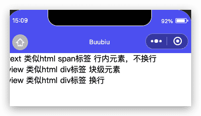

### 公共属性

所有组件都有以下属性：

| 属性名         | 类型         | 描述           | 注解                                                         |
| :------------- | :----------- | :------------- | :----------------------------------------------------------- |
| id             | String       | 组件的唯一标示 | 保持整个页面唯一                                             |
| class          | String       | 组件的样式类   | 在对应的 WXSS 中定义的样式类                                 |
| style          | String       | 组件的内联样式 | 可以动态设置的内联样式                                       |
| hidden         | Boolean      | 组件是否显示   | 所有组件默认显示                                             |
| data-*         | Any          | 自定义属性     | 组件上触发的事件时，会发送给事件处理函数                     |
| bind* / catch* | EventHandler | 组件的事件     | 详见[事件](https://developers.weixin.qq.com/miniprogram/dev/framework/view/wxml/event.html) |

```html
<!--pages/tag/tag.wxml-->
<text>text 类似html span标签 行内元素</text> 
<text>，不换行</text>
<view>view 类似html div标签 块级元素</view> 
<view>view 类似html div标签 换行</view>

<view id="name" class="namceClass" style="font-style: italic;" hidden="">view 类似html div标签 块级元素</view>
```

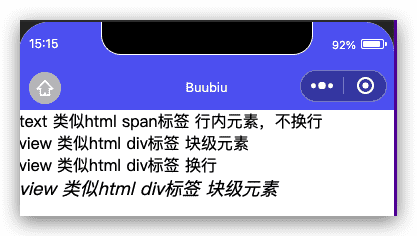

## 数据绑定

数据绑定功能使得程序在运行过程中,具备动态改变渲染界面的能力,从而达到了更好的用户体验效果。在 WEB开发中,需要借助JavaScript并通过DOM接口来实现界面的动态更新,而在小程序中,则是使用WXML 语言提供的数据绑定功能来实现的。

**WXML 中的动态数据均来自对应 Page 的 data。**

### 简单的数据绑定

数据绑定使用 Mustache 语法（双大括号）将变量包起来

```html
<!--pages/dataBinding/dataBingding.wxml-->
<view>{{message}}</view>
<view>{{number}}</view>
<view>{{condition}}</view>
<view>{{isChecked}}</view>
<view>{{person}}</view>
<view>{{person.name}}</view>
<view>{{person.age}}</view>
<view>{{person.sex}}</view>
<!-- 自定义属性 data -->
<view data-number="{{number}}">自定义属性</view>
<!-- 组件属性（需要在双引号之内） -->
<view id="item-{{id}}">组件属性</view>
<!-- 控制属性 -->
<view wx:if="{{condition}}">控制属性</view>
<!-- 使用布尔类型充当属性 -->
<checkbox checked="{{isChecked}}"></checkbox>
```


```json
// pages/dataBinding/dataBingding.js
Page({

  /**
   * 页面的初始数据
   */
  data: {
    id: 1,
    message: 'Hello MINA!',
    number: 1234,
    condition: true,
    isChecked: true,
    person: {
      name: "张三", age: 25, sex: "男"
    }
  }
})
```

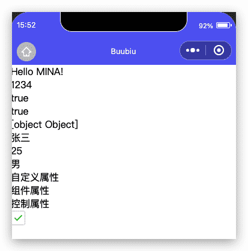

### 运算

可以在 <span v-pre>`{{}}`</span> 内进行简单的运算，支持的有如下几种方式：

```html
<!--pages/operation/operation.wxml-->
<!-- 三元运算 -->
<view hidden="{{flag?true:false}}">三元运算</view>
<!-- 算数运算 -->
<view> {{a + b}} + {{c}} + d </view>
<!-- 逻辑判断 -->
<view wx:if="{{length > 5}}">逻辑判断</view>
<!-- 字符串拼接 -->
<view>{{"hello " + name}}</view>
<!-- 数据路径运算 -->
<view>{{object.key}} {{array[0]}}</view>
```

```json
// pages/operation/operation.js
Page({

  /**
   * 页面的初始数据
   */
  data: {
    flag: false,
    a: 1,
    b: 2,
    c: 3,
    length: 6,
    name: "MINA",
    object: {
      key: 'Hello'
    },
    array: ['MINA']
  }
})
```

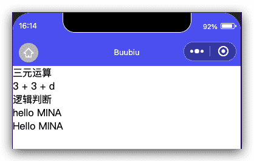

## 列表渲染

### wx:for

在组件上使用 `wx:for` 控制属性绑定一个数组，即可使用数组中各项的数据重复渲染该组件。

默认数组的当前项的下标变量名默认为 `index`，数组当前项的变量名默认为 `item`

使用 `wx:for-item` 可以指定数组当前元素的变量名，

使用 `wx:for-index` 可以指定数组当前下标的变量名：

```html
<!--pages/listRender/listRender.wxml-->
<!-- wx:for -->
<view 
 wx:for="{{array}}"
 wx:for-item="item"
 wx:for-index="index">
 {{index}}-{{item.id}}-{{item.name}}
 </view>
```

```json
// pages/listRender/listRender.js
Page({

  /**
   * 页面的初始数据
   */
  data: {
    array: [
      {
        id: 1,
        name: '张三'
      },
      {
        id: 2,
        name: '李四'
      },
      {
        id: 3,
        name: '王五'
      }
    ]
  }
})
```

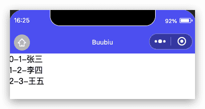

### wx:key

如果列表中项目的位置会动态改变或者有新的项目添加到列表中，并且希望列表中的项目保持自己的特征和状态（如 [input](https://developers.weixin.qq.com/miniprogram/dev/component/input.html) 中的输入内容，[switch](https://developers.weixin.qq.com/miniprogram/dev/component/switch.html) 的选中状态），需要使用 `wx:key` 来指定列表中项目的唯一的标识符。

`wx:key` 的值以两种形式提供

1. 字符串，代表在 for 循环的 array 中 item 的某个 property，该 property 的值需要是列表中唯一的字符串或数字，且不能动态改变。
2. 保留关键字 `*this` 代表在 for 循环中的 item 本身，这种表示需要 item 本身是一个唯一的字符串或者数字。

当数据改变触发渲染层重新渲染的时候，会校正带有 key 的组件，框架会确保他们被重新排序，而不是重新创建，以确保使组件保持自身的状态，并且提高列表渲染时的效率。

**如不提供 `wx:key`，会报一个 `warning`， 如果明确知道该列表是静态，或者不必关注其顺序，可以选择忽略。**

```html
<!--pages/listRender/listRender.wxml-->
<!-- wx:for -->
<view 
 wx:for="{{array}}"
 wx:for-item="item"
 wx:for-index="index"
 wx:key="id">
 {{index}}-{{item.id}}-{{item.name}}
 </view>
```

### block wx:for

类似 `block wx:if`，也可以将 `wx:for` 用在`<block/>`标签上，以渲染一个包含多节点的结构块。例如：

```html
<!--pages/listRender/listRender.wxml-->
<!-- wx:for -->
<view 
 wx:for="{{array}}"
 wx:for-item="item"
 wx:for-index="index"
 wx:key="id">
 {{index}}-{{item.id}}-{{item.name}}
 </view>

 <!-- block wx:for -->
 <view>
  <block 
    wx:for="{{array}}"
    wx:for-item="item"
    wx:for-index="index"
    wx:key="id">
    {{index}}-{{item.id}}-{{item.name}}
  </block>
 </view>
```

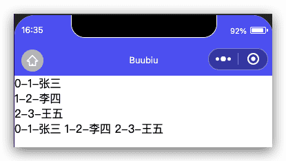

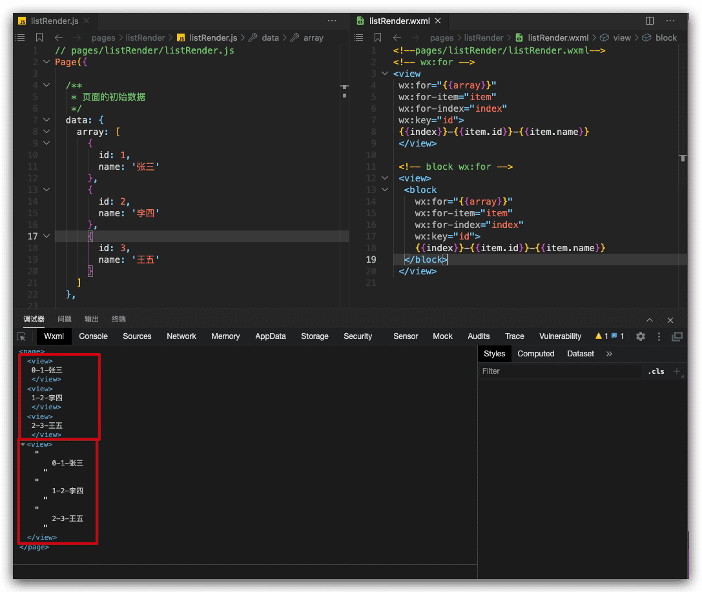

## 条件渲染

### wx:if

在框架中，使用 `wx:if=""` 来判断是否需要渲染该代码块：

```html
<view wx:if="{{condition}}"> True </view>
```

也可以用 `wx:elif` 和 `wx:else` 来添加一个 else 块：

```html
<view wx:if="{{length > 5}}"> 1 </view>
<view wx:elif="{{length > 2}}"> 2 </view>
<view wx:else> 3 </view>
```

### block wx:if

因为 `wx:if` 是一个控制属性，需要将它添加到一个标签上。如果要一次性判断多个组件标签，可以使用一个 `<block/>` 标签将多个组件包装起来，并在上边使用 `wx:if` 控制属性。

```html
<block wx:if="{{true}}">
  <view> view1 </view>
  <view> view2 </view>
</block>
```

**注意：** `<block/>` 并不是一个组件，它仅仅是一个包装元素，不会在页面中做任何渲染，只接受控制属性。             

### hidden

```html
<view hidden="{{condition}}"> hidden </view>
```

因为 `wx:if` 之中的模板也可能包含数据绑定，所以当 `wx:if` 的条件值切换时，框架有一个局部渲染的过程，因为它会确保条件块在切换时销毁或重新渲染。

同时 `wx:if` 也是**惰性的**，如果在初始渲染条件为 `false`，框架什么也不做，在条件第一次变成真的时候才开始局部渲染。

相比之下，`hidden` 就简单的多，组件始终会被渲染，只是简单的控制显示与隐藏。

一般来说，`wx:if` 有更高的切换消耗而 `hidden` 有更高的初始渲染消耗。因此，如果需要频繁切换的情景下，用 `hidden` 更好，如果在运行时条件不大可能改变则 `wx:if` 较好。

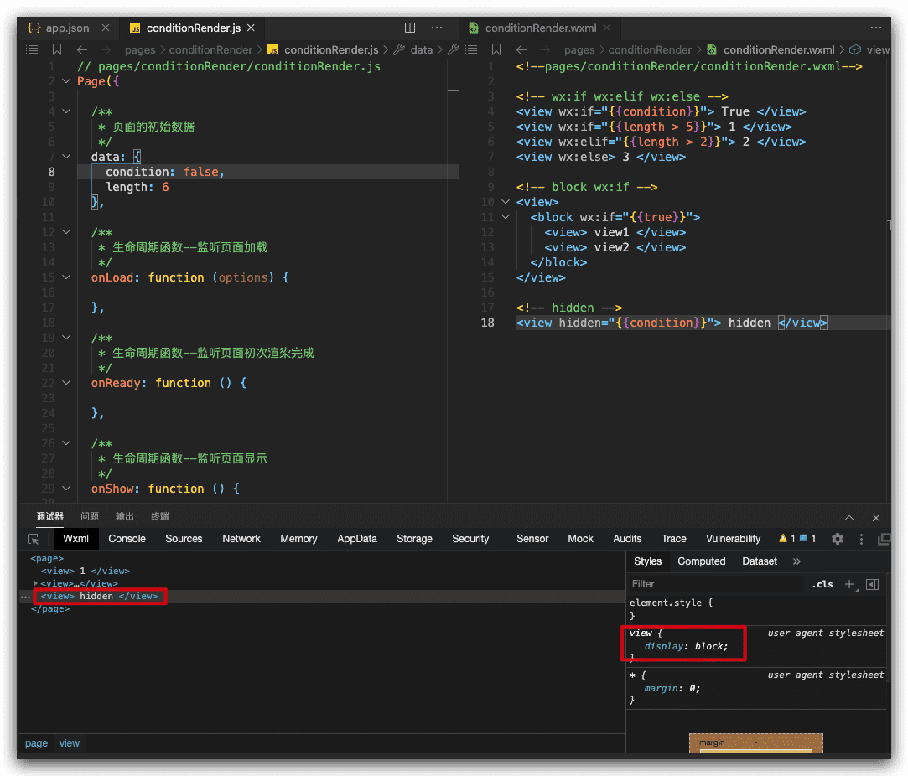

### 示例代码

```html
<!--pages/conditionRender/conditionRender.wxml-->

<!-- wx:if wx:elif wx:else -->
<view wx:if="{{condition}}"> True </view>
<view wx:if="{{length > 5}}"> 1 </view>
<view wx:elif="{{length > 2}}"> 2 </view>
<view wx:else> 3 </view>

<!-- block wx:if -->
<view>
  <block wx:if="{{true}}">
    <view> view1 </view>
    <view> view2 </view>
  </block>
</view>

<!-- hidden -->
<view hidden="{{condition}}"> hidden </view>
```

```json
// pages/conditionRender/conditionRender.js
Page({

  /**
   * 页面的初始数据
   */
  data: {
    condition: false,
    length: 6
  }
})
```

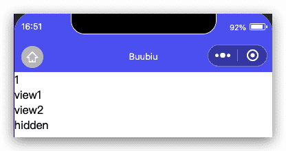

## 模版

WXML提供模板（template），可以在模板中定义代码片段，然后在不同的地方调用。

### 定义模板

使用 name 属性，作为模板的名字。然后在`<template/>`内定义代码片段，如：

```html
<!--
  index: int
  msg: string
  time: string
-->
<template name="msgItem">
  <view>
    <text> {{index}}: {{msg}} </text>
    <text> Time: {{time}} </text>
  </view>
</template>
```

### 使用模板

使用 is 属性，声明需要的使用的模板，然后将模板所需要的 data 传入，如：

```html
<template is="msgItem" data="{{...item}}"/>
```

```js
Page({
  data: {
    item: {
      index: 0,
      msg: 'this is a template',
      time: '2016-09-15'
    }
  }
})
```

is 属性可以使用 Mustache 语法，来动态决定具体需要渲染哪个模板：

```html
<template name="odd">
  <view> odd </view>
</template>
<template name="even">
  <view> even </view>
</template>

<block wx:for="{{[1, 2, 3, 4, 5]}}">
  <template is="{{item % 2 == 0 ? 'even' : 'odd'}}"/>
</block>
```

### 模板的作用域

模板拥有自己的作用域，只能使用 data 传入的数据以及模板定义文件中定义的 `<wxs />` 模块。

### 示例代码

```html
<!--pages/templateTest/templateTest.wxml-->
<template name="msgItem">
 <view>
  <text> {{index}}: {{msg}}</text>
  <text> Time: {{time}}</text>
 </view>
</template>

<template is="msgItem" data="{{...item}}"/>

<template name="odd">
  <view> odd </view>
</template>
<template name="even">
  <view> even </view>
</template>

<block wx:for="{{[1, 2, 3, 4, 5]}}">
  <template is="{{item % 2 == 0 ? 'even' : 'odd'}}"/>
</block>

```

```json
// pages/templateTest/templateTest.js
Page({

  /**
   * 页面的初始数据
   */
  data: {
    item: {
      index: 0,
      msg: 'this is a template',
      time: '2016-09-15'
    }
  }
})
```

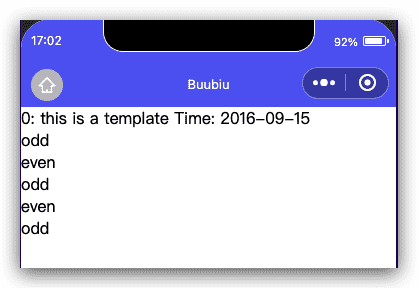

## 引用

WXML 提供两种文件引用方式`import`和`include`。

### import

`import`可以在该文件中使用目标文件定义的`template`，如：

在 item.wxml 中定义了一个叫`item`的`template`：

```html
<!-- item.wxml -->
<template name="item">
  <text>{{text}}</text>
</template>
```

在 index.wxml 中引用了 item.wxml，就可以使用`item`模板：

```html
<import src="item.wxml"/>
<template is="item" data="{{text: 'forbar'}}"/>
```

### import 的作用域

import 有作用域的概念，即只会 import 目标文件中定义的 template，而不会 import 目标文件 import 的 template。

**如：C import B，B import A，在C中可以使用B定义的`template`，在B中可以使用A定义的`template`，但是C不能使用A定义的`template`**。

```html
<!-- A.wxml -->
<template name="A">
  <text> A template </text>
</template>
<!-- B.wxml -->
<import src="a.wxml"/>
<template name="B">
  <text> B template </text>
</template>
<!-- C.wxml -->
<import src="b.wxml"/>
<template is="A"/>  <!-- Error! Can not use tempalte when not import A. -->
<template is="B"/>
```

### include

`include` 可以将目标文件**除了** `<template/>` `<wxs/>` 外的整个代码引入，相当于是拷贝到 `include` 位置，如：

```html
<!-- index.wxml -->
<include src="header.wxml"/>
<view> body </view>
<include src="footer.wxml"/>
<!-- header.wxml -->
<view> header </view>
<!-- footer.wxml -->
<view> footer </view>
```

## 事件

### 什么是事件

- 事件是视图层到逻辑层的通讯方式。
- 事件可以将用户的行为反馈到逻辑层进行处理。
- 事件可以绑定在组件上，当达到触发事件，就会执行逻辑层中对应的事件处理函数。
- 事件对象可以携带额外信息，如 id, dataset, touches。

### 事件的使用方式

- 在组件中绑定一个事件处理函数。

如`bindtap`，当用户点击该组件的时候会在该页面对应的Page中找到相应的事件处理函数。

```html
<view id="tapTest" data-hi="Weixin" bindtap="tapName"> Click me! </view>
```

- 在相应的Page定义中写上相应的事件处理函数，参数是event。

```js
Page({
  tapName: function(event) {
    console.log(event)
  }
})
```

### 事件分类

事件分为冒泡事件和非冒泡事件：

1. 冒泡事件：当一个组件上的事件被触发后，该事件会向父节点传递。
2. 非冒泡事件：当一个组件上的事件被触发后，该事件不会向父节点传递。

WXML的冒泡事件列表：

| 类型               | 触发条件                                                     | 最低版本                                                     |
| :----------------- | :----------------------------------------------------------- | :----------------------------------------------------------- |
| touchstart         | 手指触摸动作开始                                             |                                                              |
| touchmove          | 手指触摸后移动                                               |                                                              |
| touchcancel        | 手指触摸动作被打断，如来电提醒，弹窗                         |                                                              |
| touchend           | 手指触摸动作结束                                             |                                                              |
| tap                | 手指触摸后马上离开                                           |                                                              |
| longpress          | 手指触摸后，超过350ms再离开，如果指定了事件回调函数并触发了这个事件，tap事件将不被触发 | [1.5.0](https://developers.weixin.qq.com/miniprogram/dev/framework/compatibility.html) |
| longtap            | 手指触摸后，超过350ms再离开（推荐使用longpress事件代替）     |                                                              |
| transitionend      | 会在 WXSS transition 或 wx.createAnimation 动画结束后触发    |                                                              |
| animationstart     | 会在一个 WXSS animation 动画开始时触发                       |                                                              |
| animationiteration | 会在一个 WXSS animation 一次迭代结束时触发                   |                                                              |
| animationend       | 会在一个 WXSS animation 动画完成时触发                       |                                                              |
| touchforcechange   | 在支持 3D Touch 的 iPhone 设备，重按时会触发                 | [1.9.90](https://developers.weixin.qq.com/miniprogram/dev/framework/compatibility.html) |

**注：除上表之外的其他组件自定义事件如无特殊声明都是非冒泡事件，如 [form](https://developers.weixin.qq.com/miniprogram/dev/component/form.html) 的`submit`事件，[input](https://developers.weixin.qq.com/miniprogram/dev/component/input.html) 的`input`事件，[scroll-view](https://developers.weixin.qq.com/miniprogram/dev/component/scroll-view.html) 的`scroll`事件，(详见各个[组件](https://developers.weixin.qq.com/miniprogram/dev/component/))**

### 绑定并阻止事件冒泡

除 `bind` 外，也可以用 `catch` 来绑定事件。与 `bind` 不同， `catch` 会阻止事件向上冒泡。

例如在下边这个例子中，点击 inner view 会先后调用`handleTap3`和`handleTap2`(因为tap事件会冒泡到 middle view，而 middle view 阻止了 tap 事件冒泡，不再向父节点传递)，点击 middle view 会触发`handleTap2`，点击 outer view 会触发`handleTap1`。

```html
<view id="outer" bindtap="handleTap1">
  outer view
  <view id="middle" catchtap="handleTap2">
    middle view
    <view id="inner" bindtap="handleTap3">
      inner view
    </view>
  </view>
</view>
```

### 示例一

实现文本输入框和文本框数据同步，思路：

**通过bindinput绑定input事件，通过事件源参数e获取文本输入框数据，最后通过setData方法，设置 num值;**

```html
<!--pages/eventTest1/eventTest1.wxml-->
<input type="text" style="border: 1px solid; padding: 2px; margin: 2px;" bindinput="handleInput"/>
<text>文本框的值是：{{num}}</text>
```

```json
// pages/eventTest1/eventTest1.js
Page({

  /**
   * 页面的初始数据
   */
  data: {
    num: ''
  },

  /**
   * input事件处理
   * @param {*} e 
   */
  handleInput(e){
    console.log(e.detail.value);
    this.setData({
      num: e.detail.value
    })
  }
})
```

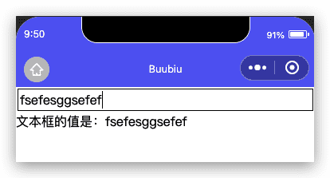

### 示例二

实现简单加计算器，思路：

**这里我们要用bindtap绑定按钮点击事件;input双向绑定 model:value ; 事件代码里设置total数据;**

```html
<!--pages/eventTest2/eventTest2.wxml-->
<input type="text" class="inputNumber"  model:value="{{numA}}"/>
<button>+</button>
<input type="text" class="inputNumber" model:value="{{numB}}"/>
<button bindtap="handleTap">=</button>
<input type="text" disabled class="inputNumber" value="{{total}}"/>

```

```json
// pages/eventTest2/eventTest2.js
Page({

  /**
   * 页面的初始数据
   */
  data: {
    numA: '',
    numB: '',
    total: ''
  },

  /**
   * 按钮点击事件处理
   * @param {*}} e 事件源
   */
  handleTap(e){
    console.log(e);
    console.log(this.data.numA);
    console.log(this.data.numB);
    this.setData({
      total: parseInt(this.data.numA) + parseInt(this.data.numB)
    })
  }
})
```

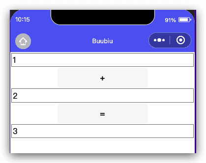

### 进阶：事件传参

通过data- 带参数; 事件里通过e.currentTarget.dataset获取参数值;

```html
<button bindtap="handleTap" data-action="=">=</button>
```

```json
/**
   * 按钮点击事件处理
   * @param {*}} e 事件源
   */
  handleTap(e){
    console.log(e);
    let action = e.currentTarget.dataset.action;
    console.log(action);
    if(action == "="){
      this.setData({
        total: parseInt(this.data.numA) + parseInt(this.data.numB)
      })
    }
  },
```

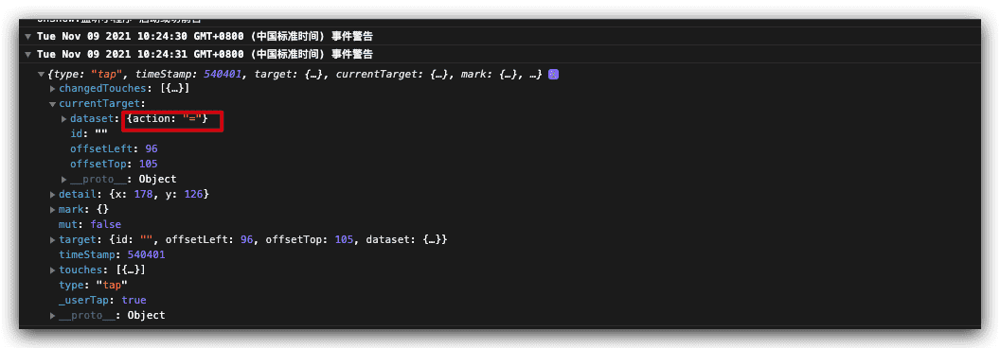
