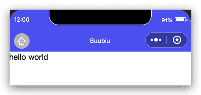

# 微信小程序WXS教程

## 介绍

WXS（WeiXin Script）是小程序的一套脚本语言，结合 `WXML`，可以构建出页面的结构。

WXS 与 JavaScript 是不同的语言，有自己的语法，并不和 JavaScript 一致。

WXS 代码可以编写在 wxml 文件中的 `<wxs>` 标签内，或以 `.wxs` 为后缀名的文件内。


## 模块

每一个 `.wxs` 文件和 `<wxs>` 标签都是一个单独的模块。

每个模块都有自己独立的作用域。即在一个模块里面定义的变量与函数，默认为私有的，对其他模块不可见。

一个模块要想对外暴露其内部的私有变量与函数，只能通过 `module.exports` 实现。

### `<wxs>` 标签

| 属性名 | 类型   | 默认值 | 说明                                                         |
| :----- | :----- | :----- | :----------------------------------------------------------- |
| module | String |        | 当前 `<wxs>` 标签的模块名。必填字段。                        |
| src    | String |        | 引用 .wxs 文件的相对路径。仅当本标签为**单闭合标签**或**标签的内容为空**时有效。 |

### module 属性

module 属性是当前 `<wxs>` 标签的模块名。在单个 wxml 文件内，建议其值唯一。有重复模块名则按照先后顺序覆盖（后者覆盖前者）。不同文件之间的 wxs 模块名不会相互覆盖。

module 属性值的命名必须符合下面两个规则：

- 首字符必须是：字母（a-zA-Z），下划线（_）
- 剩余字符可以是：字母（a-zA-Z），下划线（_）， 数字（0-9）

每个 `wxs` 模块均有一个内置的 `module` 对象。

**属性**

- `exports`: 通过该属性，可以对外共享本模块的私有变量与函数。

示例：

```html
<!--pages/moduleTest/moduleTest.wxml-->
<wxs module="foo">
var some_msg = "hello world";
  module.exports = {
    msg : some_msg,
  }
</wxs>
<view> {{foo.msg}} </view>
```

页面输出：



上面例子声明了一个名字为 `foo` 的模块，将 `some_msg` 变量暴露出来，供当前页面使用。

### src 属性

src 属性可以用来引用其他的 `wxs` 文件模块。

引用的时候，要注意如下几点：

- 只能引用 `.wxs` 文件模块，且必须使用相对路径。
- `wxs` 模块均为单例，`wxs` 模块在第一次被引用时，会自动初始化为单例对象。多个页面，多个地方，多次引用，使用的都是同一个 `wxs` 模块对象。
- 如果一个 `wxs` 模块在定义之后，一直没有被引用，则该模块不会被解析与运行。

**示例代码:**

在**微信开发者工具**里面，右键可以直接创建 `.wxs` 文件，在其中直接编写 WXS 脚本。

```js
// /pages/comm.wxs

var foo = "'hello world' from comm.wxs";
var bar = function(d) {
  return d;
}
module.exports = {
  foo: foo,
  bar: bar
};
```

上述例子在 `/pages/comm.wxs` 的文件里面编写了 WXS 代码。该 `.wxs` 文件可以被其他的 `.wxs` 文件 或 WXML 中的 `<wxs>` 标签引用。

wxs标签通过src引入:

```html
<!--pages/moduleTest/moduleTest.wxml-->

<wxs src="../../pages/comm.wxs" module="comm"/>
<view>{{comm.msg}}</view>
<view>{{comm.bar(comm.foo)}}</view>
```

运行结果：


### require函数

在`.wxs`模块中引用其他 `wxs` 文件模块，可以使用 `require` 函数。

引用的时候，要注意如下几点：

- 只能引用 `.wxs` 文件模块，且必须使用相对路径。
- `wxs` 模块均为单例，`wxs` 模块在第一次被引用时，会自动初始化为单例对象。多个页面，多个地方，多次引用，使用的都是同一个 `wxs` 模块对象。
- 如果一个 `wxs` 模块在定义之后，一直没有被引用，则该模块不会被解析与运行。

```js
// /pages/tools.wxs

var foo = "'hello world' from tools.wxs";
var bar = function (d) {
  return d;
}
module.exports = {
  FOO: foo,
  bar: bar,
};
module.exports.msg = "some msg";
```

```js
// /pages/logic.wxs

var tools = require("./tools.wxs");

console.log(tools.FOO);
console.log(tools.bar("logic.wxs"));
console.log(tools.msg);
```

```html
<!--pages/moduleTest/moduleTest.wxml-->

<wxs src="./../logic.wxs" module="logic"/>
```

控制台输出：

```js
'hello world' from tools.wxs
logic.wxs
some msg
```

### 注意事项

- `<wxs>` 模块只能在定义模块的 WXML 文件中被访问到。使用 `<include>` 或 `<import>` 时，`<wxs>` 模块不会被引入到对应的 WXML 文件中。
- `<template>` 标签中，只能使用定义该 `<template>` 的 WXML 文件中定义的 `<wxs>` 模块。

## 变量

### 概念

- WXS 中的变量均为值的引用。
- 没有声明的变量直接赋值使用，会被定义为全局变量。
- 如果只声明变量而不赋值，则默认值为 `undefined`。
- var表现与javascript一致，会有变量提升。

```js
var foo = 1;
var bar = "hello world";
var i; // i === undefined
```

上面代码，分别声明了 `foo`、 `bar`、 `i` 三个变量。然后，`foo` 赋值为数值 `1` ，`bar` 赋值为字符串 `"hello world"`。

### 变量名

变量命名必须符合下面两个规则：

- 首字符必须是：字母（a-zA-Z），下划线（_）
- 剩余字符可以是：字母（a-zA-Z），下划线（_）， 数字（0-9）

### 保留标识符

以下标识符不能作为变量名：

```text
delete
void
typeof

null
undefined
NaN
Infinity
var

if
else

true
false

require

this
function
arguments
return

for
while
do
break
continue
switch
case
default
```

## 注释

WXS 主要有 3 种注释的方法。

**示例代码：**

```html
<!-- wxml -->
<wxs module="sample">
// 方法一：单行注释

/*
方法二：多行注释
*/

/*
方法三：结尾注释。即从 /* 开始往后的所有 WXS 代码均被注释

var a = 1;
var b = 2;
var c = "fake";

</wxs>
```

上述例子中，所有 WXS 代码均被注释掉了。

> 方法三 和 方法二 的唯一区别是，没有 `*/` 结束符。

## 运算符

### 基本运算符

**示例代码：**

```js
var a = 10, b = 20;

// 加法运算
console.log(30 === a + b);
// 减法运算
console.log(-10 === a - b);
// 乘法运算
console.log(200 === a * b);
// 除法运算
console.log(0.5 === a / b);
// 取余运算
console.log(10 === a % b);
```

- 加法运算（`+`）也可以用作字符串的拼接。

```js
var a = '.w' , b = 'xs';

// 字符串拼接
console.log('.wxs' === a + b);
```

### 一元运算符

**示例代码：**

```js
var a = 10, b = 20;

// 自增运算
console.log(10 === a++);
console.log(12 === ++a);
// 自减运算
console.log(12 === a--);
console.log(10 === --a);
// 正值运算
console.log(10 === +a);
// 负值运算
console.log(0-10 === -a);
// 否运算
console.log(-11 === ~a);
// 取反运算
console.log(false === !a);
// delete 运算
console.log(true === delete a.fake);
// void 运算
console.log(undefined === void a);
// typeof 运算
console.log("number" === typeof a);
```

### 位运算符

**示例代码：**

```js
var a = 10, b = 20;

// 左移运算
console.log(80 === (a << 3));
// 带符号右移运算
console.log(2 === (a >> 2));
// 无符号右移运算
console.log(2 === (a >>> 2));
// 与运算
console.log(2 === (a & 3));
// 异或运算
console.log(9 === (a ^ 3));
// 或运算
console.log(11 === (a | 3));
```

### 比较运算符

**示例代码：**

```js
var a = 10, b = 20;

// 小于
console.log(true === (a < b));
// 大于
console.log(false === (a > b));
// 小于等于
console.log(true === (a <= b));
// 大于等于
console.log(false === (a >= b));
```

### 等值运算符

**示例代码：**

```js
var a = 10, b = 20;

// 等号
console.log(false === (a == b));
// 非等号
console.log(true === (a != b));
// 全等号
console.log(false === (a === b));
// 非全等号
console.log(true === (a !== b));
```

### 赋值运算符

**示例代码：**

```js
var a = 10;

a = 10; a *= 10;
console.log(100 === a);
a = 10; a /= 5;
console.log(2 === a);
a = 10; a %= 7;
console.log(3 === a);
a = 10; a += 5;
console.log(15 === a);
a = 10; a -= 11;
console.log(-1 === a);
a = 10; a <<= 10;
console.log(10240 === a);
a = 10; a >>= 2;
console.log(2 === a);
a = 10; a >>>= 2;
console.log(2 === a);
a = 10; a &= 3;
console.log(2 === a);
a = 10; a ^= 3;
console.log(9 === a);
a = 10; a |= 3;
console.log(11 === a);
```

### 二元逻辑运算符

**示例代码：**

```js
var a = 10, b = 20;

// 逻辑与
console.log(20 === (a && b));
// 逻辑或
console.log(10 === (a || b));
```

### 其他运算符

**示例代码：**

```js
var a = 10, b = 20;

//条件运算符
console.log(20 === (a >= 10 ? a + 10 : b + 10));
//逗号运算符
console.log(20 === (a, b));
```

### 运算符优先级

| 优先级 | 运算符              | 说明       | 结合性   |
| :----- | :------------------ | :--------- | :------- |
| 20     | `(` ... `)`         | 括号       | n/a      |
| 19     | ... `.` ...         | 成员访问   | 从左到右 |
|        | ... `[` ... `]`     | 成员访问   | 从左到右 |
|        | ... `(` ... `)`     | 函数调用   | 从左到右 |
| 17     | ... `++`            | 后置递增   | n/a      |
|        | ... `--`            | 后置递减   | n/a      |
| 16     | `!` ...             | 逻辑非     | 从右到左 |
|        | `~` ...             | 按位非     | 从右到左 |
|        | `+` ...             | 一元加法   | 从右到左 |
|        | `-` ...             | 一元减法   | 从右到左 |
|        | `++` ...            | 前置递增   | 从右到左 |
|        | `--` ...            | 前置递减   | 从右到左 |
|        | `typeof` ...        | typeof     | 从右到左 |
|        | `void` ...          | void       | 从右到左 |
|        | `delete` ...        | delete     | 从右到左 |
| 14     | ... `*` ...         | 乘法       | 从左到右 |
|        | ... `/` ...         | 除法       | 从左到右 |
|        | ... `%` ...         | 取模       | 从左到右 |
| 13     | ... `+` ...         | 加法       | 从左到右 |
|        | ... `-` ...         | 减法       | 从左到右 |
| 12     | ... `<<` ...        | 按位左移   | 从左到右 |
|        | ... `>>` ...        | 按位右移   | 从左到右 |
|        | ... `>>>` ...       | 无符号右移 | 从左到右 |
| 11     | ... `<` ...         | 小于       | 从左到右 |
|        | ... `<=` ...        | 小于等于   | 从左到右 |
|        | ... `>` ...         | 大于       | 从左到右 |
|        | ... `>=` ...        | 大于等于   | 从左到右 |
| 10     | ... `==` ...        | 等号       | 从左到右 |
|        | ... `!=` ...        | 非等号     | 从左到右 |
|        | ... `===` ...       | 全等号     | 从左到右 |
|        | ... `!==` ...       | 非全等号   | 从左到右 |
| 9      | ... `&` ...         | 按位与     | 从左到右 |
| 8      | ... `^` ...         | 按位异或   | 从左到右 |
| 7      | ... `｜` ...        | 按位或     | 从左到右 |
| 6      | ... `&&` ...        | 逻辑与     | 从左到右 |
| 5      | ... `｜｜` ...      | 逻辑或     | 从左到右 |
| 4      | ... `?` ... `:` ... | 条件运算符 | 从右到左 |
| 3      | ... `=` ...         | 赋值       | 从右到左 |
|        | ... `+=` ...        | 赋值       | 从右到左 |
|        | ... `-=` ...        | 赋值       | 从右到左 |
|        | ... `*=` ...        | 赋值       | 从右到左 |
|        | ... `/=` ...        | 赋值       | 从右到左 |
|        | ... `%=` ...        | 赋值       | 从右到左 |
|        | ... `<<=` ...       | 赋值       | 从右到左 |
|        | ... `>>=` ...       | 赋值       | 从右到左 |
|        | ... `>>>=` ...      | 赋值       | 从右到左 |
|        | ... `&=` ...        | 赋值       | 从右到左 |
|        | ... `^=` ...        | 赋值       | 从右到左 |
|        | ... `｜=` ...       | 赋值       | 从右到左 |
| 0      | ... `,` ...         | 逗号       | 从左到右 |

## 语句

### if 语句

在 WXS 中，可以使用以下格式的 `if` 语句 ：

- `if (expression) statement` ： 当 `expression` 为 truthy 时，执行 `statement`。
- `if (expression) statement1 else statement2` : 当 `expression` 为 truthy 时，执行 `statement1`。 否则，执行 `statement2`
- `if ... else if ... else statementN` 通过该句型，可以在 `statement1` ~ `statementN` 之间选其中一个执行。

**示例语法：**

```js
// if ...

if (表达式) 语句;

if (表达式)
  语句;

if (表达式) {
  代码块;
}


// if ... else

if (表达式) 语句;
else 语句;

if (表达式)
  语句;
else
  语句;

if (表达式) {
  代码块;
} else {
  代码块;
}

// if ... else if ... else ...

if (表达式) {
  代码块;
} else if (表达式) {
  代码块;
} else if (表达式) {
  代码块;
} else {
  代码块;
}
```

### switch 语句

**示例语法：**

```js
switch (表达式) {
  case 变量:
    语句;
  case 数字:
    语句;
    break;
  case 字符串:
    语句;
  default:
    语句;
}
```

- `default` 分支可以省略不写。
- `case` 关键词后面只能使用：`变量`，`数字`，`字符串`。

**示例代码：**

```js
var exp = 10;

switch ( exp ) {
case "10":
  console.log("string 10");
  break;
case 10:
  console.log("number 10");
  break;
case exp:
  console.log("var exp");
  break;
default:
  console.log("default");
}
```

**输出：**

```text
number 10
```

### for 语句

**示例语法：**

```js
for (语句; 语句; 语句)
  语句;

for (语句; 语句; 语句) {
  代码块;
}
```

- 支持使用 `break`，`continue` 关键词。

**示例代码：**

```js
for (var i = 0; i < 3; ++i) {
  console.log(i);
  if( i >= 1) break;
}
```

**输出：**

```js
0
1
```

### while 语句

**示例语法：**

```js
while (表达式)
  语句;

while (表达式){
  代码块;
}

do {
  代码块;
} while (表达式)
```

- 当`表达式`为 true 时，循环执行`语句`或`代码块`。
- 支持使用 `break`，`continue` 关键词。

## 数据类型

WXS 语言目前共有以下几种数据类型：

- `number` ： 数值
- `string` ：字符串
- `boolean`：布尔值
- `object`：对象
- `function`：函数
- `array` : 数组
- `date`：日期
- `regexp`：正则

### number

#### 语法

number 包括两种数值：整数，小数。

```js
var a = 10;
var PI = 3.141592653589793;
```

#### 属性

- `constructor`：返回字符串 `"Number"`。

#### 方法

- `toString`
- `toLocaleString`
- `valueOf`
- `toFixed`
- `toExponential`
- `toPrecision`

> 以上方法的具体使用请参考 `ES5` 标准。

### string

#### 语法

string 有两种写法：

```js
'hello world';
"hello world";
```

#### 属性

- `constructor`：返回字符串 `"String"`。
- `length`

> 除constructor外属性的具体含义请参考 `ES5` 标准。

#### 方法

- `toString`
- `valueOf`
- `charAt`
- `charCodeAt`
- `concat`
- `indexOf`
- `lastIndexOf`
- `localeCompare`
- `match`
- `replace`
- `search`
- `slice`
- `split`
- `substring`
- `toLowerCase`
- `toLocaleLowerCase`
- `toUpperCase`
- `toLocaleUpperCase`
- `trim`

> 以上方法的具体使用请参考 `ES5` 标准。

### boolean

#### 语法

布尔值只有两个特定的值：`true` 和 `false`。

#### 属性

- `constructor`：返回字符串 `"Boolean"`。

#### 方法

- `toString`
- `valueOf`

> 以上方法的具体使用请参考 `ES5` 标准。

### object

#### 语法

object 是一种无序的键值对。使用方法如下所示：

```js
var o = {} //生成一个新的空对象

//生成一个新的非空对象
o = {
  'string'  : 1,  //object 的 key 可以是字符串
  const_var : 2,  //object 的 key 也可以是符合变量定义规则的标识符
  func      : {}, //object 的 value 可以是任何类型
};

//对象属性的读操作
console.log(1 === o['string']);
console.log(2 === o.const_var);

//对象属性的写操作
o['string']++;
o['string'] += 10;
o.const_var++;
o.const_var += 10;

//对象属性的读操作
console.log(12 === o['string']);
console.log(13 === o.const_var);
```

#### 属性

- `constructor`：返回字符串 `"Object"`。

```js
console.log("Object" === {k:"1",v:"2"}.constructor)
```

#### 方法

- `toString`：返回字符串 `"[object Object]"`。

### function

#### 语法

function 支持以下的定义方式：

```js
//方法 1
function a (x) {
  return x;
}

//方法 2
var b = function (x) {
  return x;
}
```

function 同时也支持以下的语法（匿名函数，闭包等）：

```js
var a = function (x) {
  return function () { return x;}
}

var b = a(100);
console.log( 100 === b() );
```

##### arguments

function 里面可以使用 `arguments` 关键词。该关键词目前只支持以下的属性：

- `length`: 传递给函数的参数个数。
- `[index]`: 通过 `index` 下标可以遍历传递给函数的每个参数。

**示例代码：**

```js
var a = function(){
  console.log(3 === arguments.length);
  console.log(100 === arguments[0]);
  console.log(200 === arguments[1]);
  console.log(300 === arguments[2]);
};
a(100,200,300);
```

#### 属性

- `constructor`：返回字符串 `"Function"`。
- `length`：返回函数的形参个数。

#### 方法

- `toString`：返回字符串 `"[function Function]"`。

**示例代码：**

```js
var func = function (a,b,c) { }

console.log("Function" === func.constructor);
console.log(3 === func.length);
console.log("[function Function]" === func.toString());
```

### array

#### 语法

array 支持以下的定义方式：

```js
var a = [];      //生成一个新的空数组

a = [1,"2",{},function(){}];  //生成一个新的非空数组，数组元素可以是任何类型
```

#### 属性

- `constructor`：返回字符串 `"Array"`。
- `length`

> 除constructor外属性的具体含义请参考 `ES5` 标准。

#### 方法

- `toString`
- `concat`
- `join`
- `pop`
- `push`
- `reverse`
- `shift`
- `slice`
- `sort`
- `splice`
- `unshift`
- `indexOf`
- `lastIndexOf`
- `every`
- `some`
- `forEach`
- `map`
- `filter`
- `reduce`
- `reduceRight`

> 以上方法的具体使用请参考 `ES5` 标准。

### date

#### 语法

生成 date 对象需要使用 `getDate`函数, 返回一个当前时间的对象。

```js
getDate()
getDate(milliseconds)
getDate(datestring)
getDate(year, month[, date[, hours[, minutes[, seconds[, milliseconds]]]]])
```

- 参数
  - `milliseconds`: 从1970年1月1日00:00:00 UTC开始计算的毫秒数
  - `datestring`: 日期字符串，其格式为："month day, year hours:minutes:seconds"

**示例代码：**

```js
var date = getDate(); //返回当前时间对象

date = getDate(1500000000000);
// Fri Jul 14 2017 10:40:00 GMT+0800 (中国标准时间)
date = getDate('2017-7-14');
// Fri Jul 14 2017 00:00:00 GMT+0800 (中国标准时间)
date = getDate(2017, 6, 14, 10, 40, 0, 0);
// Fri Jul 14 2017 10:40:00 GMT+0800 (中国标准时间)
```

#### 属性

- `constructor`：返回字符串 “Date”。

#### 方法

- `toString`
- `toDateString`
- `toTimeString`
- `toLocaleString`
- `toLocaleDateString`
- `toLocaleTimeString`
- `valueOf`
- `getTime`
- `getFullYear`
- `getUTCFullYear`
- `getMonth`
- `getUTCMonth`
- `getDate`
- `getUTCDate`
- `getDay`
- `getUTCDay`
- `getHours`
- `getUTCHours`
- `getMinutes`
- `getUTCMinutes`
- `getSeconds`
- `getUTCSeconds`
- `getMilliseconds`
- `getUTCMilliseconds`
- `getTimezoneOffset`
- `setTime`
- `setMilliseconds`
- `setUTCMilliseconds`
- `setSeconds`
- `setUTCSeconds`
- `setMinutes`
- `setUTCMinutes`
- `setHours`
- `setUTCHours`
- `setDate`
- `setUTCDate`
- `setMonth`
- `setUTCMonth`
- `setFullYear`
- `setUTCFullYear`
- `toUTCString`
- `toISOString`
- `toJSON`

> 以上方法的具体使用请参考 `ES5` 标准。

### regexp

#### 语法

生成 regexp 对象需要使用 `getRegExp`函数。

```js
getRegExp(pattern[, flags])
```

- 参数：
  - `pattern`: 正则表达式的内容。
  - `flags`:修饰符。该字段只能包含以下字符:
    - `g`: global
    - `i`: ignoreCase
    - `m`: multiline。

**示例代码：**

```js
var a = getRegExp("x", "img");
console.log("x" === a.source);
console.log(true === a.global);
console.log(true === a.ignoreCase);
console.log(true === a.multiline);
```

#### 属性

- `constructor`：返回字符串 `"RegExp"`。
- `source`
- `global`
- `ignoreCase`
- `multiline`
- `lastIndex`

> 除constructor外属性的具体含义请参考 `ES5` 标准。

#### 方法

- `exec`
- `test`
- `toString`

> 以上方法的具体使用请参考 `ES5` 标准。

### 数据类型判断

#### `constructor` 属性

数据类型的判断可以使用 `constructor` 属性。

**示例代码：**

```js
var number = 10;
console.log( "Number" === number.constructor );

var string = "str";
console.log( "String" === string.constructor );

var boolean = true;
console.log( "Boolean" === boolean.constructor );

var object = {};
console.log( "Object" === object.constructor );

var func = function(){};
console.log( "Function" === func.constructor );

var array = [];
console.log( "Array" === array.constructor );

var date = getDate();
console.log( "Date" === date.constructor );

var regexp = getRegExp();
console.log( "RegExp" === regexp.constructor );
```

#### `typeof`

使用 `typeof` 也可以区分部分数据类型。

**示例代码：**

```js
var number = 10;
var boolean = true;
var object = {};
var func = function(){};
var array = [];
var date = getDate();
var regexp = getRegExp();

console.log( 'number' === typeof number );
console.log( 'boolean' === typeof boolean );
console.log( 'object' === typeof object );
console.log( 'function' === typeof func );
console.log( 'object' === typeof array );
console.log( 'object' === typeof date );
console.log( 'object' === typeof regexp );

console.log( 'undefined' === typeof undefined );
console.log( 'object' === typeof null );
```

## 基础类库

### console

`console.log` 方法用于在 console 窗口输出信息。它可以接受多个参数，将它们的结果连接起来输出。

### Math

#### 属性

- `E`
- `LN10`
- `LN2`
- `LOG2E`
- `LOG10E`
- `PI`
- `SQRT1_2`
- `SQRT2`

> 以上属性的具体使用请参考 `ES5` 标准。

#### 方法

- `abs`
- `acos`
- `asin`
- `atan`
- `atan2`
- `ceil`
- `cos`
- `exp`
- `floor`
- `log`
- `max`
- `min`
- `pow`
- `random`
- `round`
- `sin`
- `sqrt`
- `tan`

> 以上方法的具体使用请参考 `ES5` 标准。

### JSON

#### 方法

- `stringify(object)`: 将 `object` 对象转换为 `JSON` 字符串，并返回该字符串。
- `parse(string)`: 将 `JSON` 字符串转化成对象，并返回该对象。

**示例代码：**

```text
console.log(undefined === JSON.stringify());
console.log(undefined === JSON.stringify(undefined));
console.log("null"===JSON.stringify(null));

console.log("111"===JSON.stringify(111));
console.log('"111"'===JSON.stringify("111"));
console.log("true"===JSON.stringify(true));
console.log(undefined===JSON.stringify(function(){}));


console.log(undefined===JSON.parse(JSON.stringify()));
console.log(undefined===JSON.parse(JSON.stringify(undefined)));
console.log(null===JSON.parse(JSON.stringify(null)));

console.log(111===JSON.parse(JSON.stringify(111)));
console.log("111"===JSON.parse(JSON.stringify("111")));
console.log(true===JSON.parse(JSON.stringify(true)));

console.log(undefined===JSON.parse(JSON.stringify(function(){})));
```

### Number

#### 属性

- `MAX_VALUE`
- `MIN_VALUE`
- `NEGATIVE_INFINITY`
- `POSITIVE_INFINITY`

> 以上属性的具体使用请参考 `ES5` 标准。

### Date

#### 属性

- `parse`
- `UTC`
- `now`

> 以上属性的具体使用请参考 `ES5` 标准。

### Global

#### 属性

- `NaN`
- `Infinity`
- `undefined`

> 以上属性的具体使用请参考 `ES5` 标准。

#### 方法

- `parseInt`
- `parseFloat`
- `isNaN`
- `isFinite`
- `decodeURI`
- `decodeURIComponent`
- `encodeURI`
- `encodeURIComponent`

> 以上方法的具体使用请参考 `ES5` 标准。
