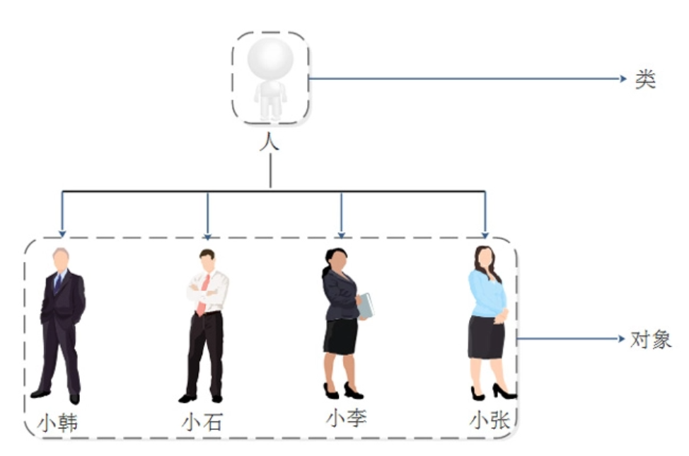

# 初识Python类和对象

## 引入



在现实生活中，人是抽象的类，简称人类，像张三，李四，王五，这样真真正正存在人的实体，我们称这些实体称为对象。

## 类的基本定义

在面向对象的程序设计过程中有两个重要概念：**类(class)和对象(object，也被称为实例,instance)**

其中类是某一批对象的抽象，可以把类理解成某种概念；对象才是一个具体存在的实体。

语法：

```python
class 类名:
    零个或者多个属性
    零个或者多个方法
```

示例：

```python
"""
    初识Python类和对象
"""
# 定义人类
class Person:
    # 属性 姓名
    name = None
    # 属性 年龄
    age = None

# 创建一个对象 zhangsan
zhangsan = Person()
zhangsan.name = "张三"
zhangsan.age = 21
print(f"姓名：{zhangsan.name}，年龄：{zhangsan.age}")

# 在创建一个对象 lisi
lisi = Person()
lisi.name = "李四"
lisi.age = 18
print(f"姓名：{lisi.name}，年龄：{lisi.age}")

#======输出======
姓名：张三，年龄：21
姓名：李四，年龄：18
```

