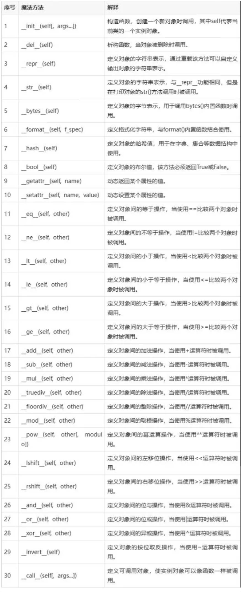

# 魔法方法

Python的魔法方法，也称为特殊方法或双下划线方法，用于在类中实现一些特殊的功能。这些方法的名称始终**以双下划线开头和结尾**，例如**init**，**repr**，**add**等



## str方法

定义对象的显示字符串，默认是对象内存地址，我们可以通过重写str方法，显示我们需要的数据。

```python
"""
    魔法方法
"""
# 定义人类
class Person:
    # 属性 姓名
    name = None
    # 属性 年龄
    age = None

    # 有参构造方法
    def __init__(self, name, age):
        self.name = name
        self.age = age

# 创建一个对象 zhangsan
zhangsan = Person("张三", 22)
print(zhangsan)
print(str(zhangsan))

#======输出======
<__main__.Person object at 0x109e87230>
<__main__.Person object at 0x109e87230>
```

重写str方法

```python
"""
    魔法方法
"""
# 定义人类
class Person:
    # 属性 姓名
    name = None
    # 属性 年龄
    age = None

    # 有参构造方法
    def __init__(self, name, age):
        self.name = name
        self.age = age

    # 重写str方法
    def __str__(self):
        print("调用str方法")
        return f"姓名：{self.name},年龄：{self.age}"

# 创建一个对象 zhangsan
zhangsan = Person("张三", 22)
print(zhangsan)
print(str(zhangsan))

#======输出======
调用str方法
姓名：张三,年龄：22
调用str方法
姓名：张三,年龄：22
```

## eq方法

定义对象间的等于操作，当使用`==`比较两个对象时被调用。

```python
"""
    魔法方法
"""
# 定义人类
class Person:
    # 属性 姓名
    name = None
    # 属性 年龄
    age = None

    # 有参构造方法
    def __init__(self, name, age):
        self.name = name
        self.age = age

    # 重写str方法
    def __str__(self):
        print("调用str方法")
        return f"姓名：{self.name},年龄：{self.age}"

# 创建一个对象 zhangsan
zhangsan = Person("张三", 22)
print(zhangsan)
print(str(zhangsan))

# 在创建一个对象 lisi
lisi = Person("李四", 22)
print(lisi)
print(zhangsan == lisi)

#======输出======
调用str方法
姓名：张三,年龄：22
调用str方法
姓名：张三,年龄：22
姓名：李四,年龄：22
False
```

重写eq方法 让年龄相比较

```python
"""
    魔法方法
"""
# 定义人类
class Person:
    # 属性 姓名
    name = None
    # 属性 年龄
    age = None

    # 有参构造方法
    def __init__(self, name, age):
        self.name = name
        self.age = age

    # 重写str方法
    def __str__(self):
        print("调用str方法")
        return f"姓名：{self.name},年龄：{self.age}"

    # 重写eq方法
    def __eq__(self, other):
        return self.age == other.age

# 创建一个对象 zhangsan
zhangsan = Person("张三", 22)
print(zhangsan)
print(str(zhangsan))

# 在创建一个对象 lisi
lisi = Person("李四", 22)
print(lisi)
print(zhangsan == lisi)

#======输出======
调用str方法
姓名：张三,年龄：22
调用str方法
姓名：张三,年龄：22
姓名：李四,年龄：18
True
```

