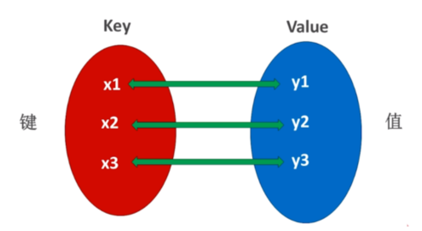

# 字典dict

字典也是Python提供的一种常用的数据结构，它用于存放具有映射关系的数据。

## 字典的定义

### 引入

比如有成绩表数据——语文:68，数学:98，英语: 76，这组数据看上去像两个列表，但这两个列表的元素 之间有一定的关联关系。如果单纯使用两个列表来保存这组数据，则无法记录两组数据之间的关联关系。

**为了保存具有映射关系的数据，Python提供了字典，字典相当于保存了两组数据，其中一组数据是关键数据，被称为key;另一组数据可通过key来访问，被称为 value。形象地看，字典中key和 value的关联关 系如下图所示。**



### 基础使用

语法：

```python
# 字典赋值定义
dict1={key:value , key:value , ... , key:value}
# 空字典定义
dict2={}
dict3=dict()
```

**注意点:key不能重复，否则新的key:value会覆盖老的key:value**

示例：

```python
"""
    字典的定义
"""
# 字典赋值定义
dict1 = {"语文": 98, "数学": 66, "英语": 34}
print(f"dict1 = {dict1}, type={type(dict1)}")

# 空字典定义
dict2 = {}
dict3 = dict()
print(f"dict2 = {dict2}, type={type(dict2)}")
print(f"dict3 = {dict3}, type={type(dict3)}")

# key不能重复，否则新的key:value会覆盖老的key:value
dict4 = {"语文": 98, "数学": 66, "英语": 34, "数学": 100}
print(f"dict4 = {dict4}, type={type(dict4)}")

#======输出======
dict1 = {'语文': 98, '数学': 66, '英语': 34}, type=<class 'dict'>
dict2 = {}, type=<class 'dict'>
dict3 = {}, type=<class 'dict'>
dict4 = {'语文': 98, '数学': 100, '英语': 34}, type=<class 'dict'>
```

### 字典的嵌套

复杂业务逻辑下，我们可以通过字典的嵌套。

**字典的key和value可以是任意数据类型，但是key不能是字典类型**

示例：设计学生的成绩单。

```python
# 字典的嵌套
dict5 = {
    "张三": {"语文": 98, "数学": 66, "英语": 34},
    "李四": {"语文": 28, "数学": 26, "英语": 74},
    "王五": {"语文": 38, "数学": 56, "英语": 54}
}
print(f"dict5 = {dict5}, type={type(dict5)}")

#======输出======
dict5 = {'张三': {'语文': 98, '数学': 66, '英语': 34}, '李四': {'语文': 28, '数学': 26, '英语': 74}, '王五': {'语文': 38, '数学': 56, '英语': 54}}, type=<class 'dict'>
```

## 字典的常用方法

### 获取元素

通过key值来获取对应的value 

语法：

- `字典["Key"]` ：**也可以单引号，如果访问的key在字典里不存在，则报错;**

增强方法:

- `get("key")`：**根据key获取对应的value值。假如不存在，不报错，返回None**

```python
"""
    字典的常用方法
"""
# 通过key值来获取对应的value
dict1 = {"语文": 98, "数学": 66, "英语": 34}
print(dict1["语文"])
print(dict1['数学'])
# print(dict1["数学2"]) # 不存在，则报错
print(dict1.get("英语"))
print(dict1.get("英语2")) # 不存在，返回None

dict2 = {
    "张三": {"语文": 98, "数学": 66, "英语": 34},
    "李四": {"语文": 28, "数学": 26, "英语": 74},
    "王五": {"语文": 38, "数学": 56, "英语": 54}
}
print(dict2["张三"]["数学"])
print(dict2.get("李四").get("英语"))

#======输出======
98
66
34
None
66
74
```

### 新增或修改元素

新增或者修改元素

语法：

- `字典["Key"]=Value` ：**如果key不存在，就是新增，如果key存在，就是修改。** 

增强方法：

- `update("{key:value}")` 功能一样
- `update("{key1:value1,key2:value2}")` 但是**可以一次操作多个键值对**

```python
# 新增或修改元素
dict3 = {"语文": 98, "数学": 66, "英语": 34}
# key不存在，新增元素
dict3["体育"] = 88
print(dict3)
# key存在，修改元素
dict3["数学"] = 99
print(dict3)
# 使用update
dict3.update({"计算机": 100})
dict3.update({"英语": 33})
print(dict3)
dict3.update({"语文": 10, "历史": 55})
print(dict3)

#======输出======
{'语文': 98, '数学': 66, '英语': 34, '体育': 88}
{'语文': 98, '数学': 99, '英语': 34, '体育': 88}
{'语文': 98, '数学': 99, '英语': 33, '体育': 88, '计算机': 100}
{'语文': 10, '数学': 99, '英语': 33, '体育': 88, '计算机': 100, '历史': 55}
```

### 删除元素

字典中删除该key:value元素，然后方法返回该key的Value

语法：`字典.pop("Key") `

```python
# 删除元素。语法 字典.pop("Key") 字典中删除该key:value元素，然后方法返回该key的Value
dict4 = {"语文": 98, "数学": 66, "英语": 34}
dict4_1 = dict4.pop("语文")
print(dict4_1)
print(dict4)

#======输出======
98
{'数学': 66, '英语': 34}
```

### 清空元素

语法：`clear()`

```python
# 清空元素。语法:clear()
dict5 = {"语文": 98, "数学": 66, "英语": 34}
dict5.clear()
print(dict5)

#======输出======
{}
```

### 获取所有key

返回值类型的是 `dict_keys` 类对象

语法：`字典.keys()`

```python
# 获取所有key。语法 字典.keys()。返回值类型的是 dict_keys 类对象
dict6 = {"语文": 98, "数学": 66, "英语": 34}
dict6_1 = dict6.keys()
print(f"keys = {dict6_1}, type = {type(dict6_1)}")

#======输出======
keys=dict_keys(['语文', '数学', '英语']), type=<class 'dict_keys'>
```

### 遍历字典

1. 先获取字典的keys，然后遍历keys，通过key获取字典值

```python
# 遍历字典 先获取字典的keys，然后遍历keys，通过key获取字典值
dict7 = {"语文": 98, "数学": 66, "英语": 34}
dict7_1 = dict7.keys()
for key in dict7_1:
    value = dict7[key]
    print(key, value)

#======输出======
语文 98
数学 66
英语 34
```

2. 直接遍历字典，每次拿到的也是key

```python
# 遍历方式2 遍历字典，每次拿到的也是key 以后我们就用这种简单方式，不用获取keys
dict8 = {"语文": 98, "数学": 66, "英语": 34}
for key in dict8:
    value = dict8[key]
    print(key, value)

#======输出======
语文 98
数学 66
英语 34
```

### 获取元素总数量

统计字典元素的总数量

语法：`len(字典)`

```python
# 统计字典元素的总数量，len(字典)
dict9 = {"语文": 98, "数学": 66, "英语": 34}
print(len(dict9))

#======输出======
3
```

