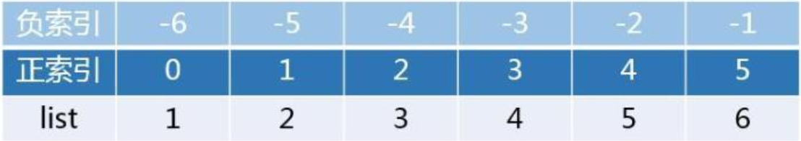

# 列表list

## 容器含义

容器是一种可以存储多个元素的数据类型
Python中的容器有：

 `列表list ， 元组tuple ， 字符串str ， 集合set ， 字典dict`

## 列表的定义

列表是多个元素的集合

### 语法

```python
# 赋值定义
列表变量名称 = [ 元素1, 元素2, 元素3, 元素4, ... ]
# 空列表定义
列表变量名称 = []
列表变量名称 = list()
```

注意点:

- 列表里元素类型没有限制
- 列表里可以嵌套列表

### 示例

```python
"""
    列表的定义
"""
# 定义一个有多元素的列表
list1 = ["java", "python", "c"]
print(f"list1={list1}, 类型：{type(list1)}")

# 定义空列表
list2 = []
list3 = list()
print(f"list2={list2}")
print(f"list3={list3}")

# 赋值
list2 = list1
list3 = list2
print(f"list2={list2}")
print(f"list3={list3}")

# 列表里元素类型没有限制
list4 = ["python", 111, 22.22, True]
print(f"list4={list4}")

# 列表里可以嵌套列表
list5 = [[1, 2, 3], [4, 5, 6]]
print(f"list5={list5}")

#======输出======
list1=['java', 'python', 'c'], 类型：<class 'list'>
list2=[]
list3=[]
list2=['java', 'python', 'c']
list3=['java', 'python', 'c']
list4=['python', 111, 22.22, True]
list5=[[1, 2, 3], [4, 5, 6]]
```

## 列表的下标索引



### 语法

我们可以通过列表的下标索引获取列表元素。 

**下标索引从0开始，第一个元素下标索引是0，第二个元素下标索引是1，...第N个元素下标索引是N-1**

注意点：

- 下标不要越界，否则就会越界错误

### 示例

```python
"""
    列表的定义
"""
# 定义一个有多元素的列表
list1 = ["java", "python", "c"]
print(f"list1={list1}, 类型：{type(list1)}")

# 通过正向索引获取列表元素
print(list1[0])
print(list1[1])
print(list1[2])
print(list1[3])

#======输出======
list1=['java', 'python', 'c'], 类型：<class 'list'>
java
python
c
Traceback (most recent call last):
  File "列表的下标索引.py", line 12, in <module>
    print(list1[3])
          ~~~~~^^^
IndexError: list index out of range
```

### 反向索引

或者通过反向索引也可以获取列表元素。

**索引从-1开始，最后一个元素下标索引是-1，倒数第二个元素 下标索引是-2，...倒数第N个元素的下标索引是-N**

示例

```python
# 定义一个有多元素的列表
list1 = ["java", "python", "c"]
print(f"list1={list1}, 类型：{type(list1)}")

# 通过反向索引获取列表元素
print(list1[-1])
print(list1[-2])
print(list1[-3])

#======输出======
list1=['java', 'python', 'c'], 类型：<class 'list'>
c
python
java
```

### 获取嵌套列表数据

通过下标索引获取嵌套列表的数据

```python
# 列表里可以嵌套列表
list5 = [[1, 2, 3], [4, 5, 6]]
print(list5[0])
# 获取第一个嵌套列表里面的第二个元素
print(list5[0][1])

#======输出======
[1, 2, 3]
2
```

## 列表的常用方法

列表list对象提供了很多内置方法供我们操作list。我们要掌握常用的list方法。

### 修改元素值

修改指定位置的元素值

语法：`列表[下标索引]=值`

```python
"""
    列表的常用方法
"""
# 定义一个有多元素的列表
list1 = ["java", "python", "c"]
# 修改指定位置的元素值 语法:列表[下标索引]=值
list1[1] = "php"
list1[-1] = "c#"
print(list1)

#======输出======
['java', 'php', 'c#']
```

### index

查找列表中指定元素的下标，不存在就报错

语法：`index(元素)方法`

```python
# index(元素)方法，查找列表中指定元素的下标，不存在就报错
list2  = ["java", "python", "c"]
index = list2.index("python")
index2 = list2.index("python2")
print(index)

#======输出======
1
Traceback (most recent call last):
  File "列表的常用方法.py", line 4, in <module>
    index2 = list2.index("python2")
ValueError: list.index(x): x not in list
```

### insert

在指定下标位置元素之前，插入元素

语法：`insert(下标,元素)`

```python
# insert(下标,元素)，在指定下标位置元素之前，插入元素
list3  = ["java", "python", "c"]
list3.insert(1, "php")
print(list3)

#======输出======
['java', 'php', 'python', 'c']
```

### append

将指定元素，追加到列表的尾部

语法：`append(元素)`

```python
# append(元素)，将指定元素，追加到列表的尾部
list4 = ["java", "python", "c"]
list4.append("php")
print(list4)

#======输出======
['java', 'python', 'c', 'php']
```

### extend

追加容器数据到列表最后

语法：`extend(容器)`

```python
# extend(容器)，追加容器数据到列表最后
list5 = ["java", "python", "c"]
list5.extend(["php", "c#"])
print(list5)

#======输出======
['java', 'python', 'c', 'php', 'c#']
```

### del

删除指定下标的元素

语法：`del 列表[下标] `

```python
# del 列表[下标] 删除指定下标的元素
list6 = ["java", "python", "c"]
del list6[1]
print(list6)

#======输出======
['java', 'c']
```

### pop

取出元素。从列表中删除这个元素，方法返回该元素。(下标越界就报错)

语法：`pop(元素下标)`

```python
# pop(元素下标) ，取出元素。从列表中删除这个元素，方法返回该元素。(下标越界就报错)
list7 = ["java", "python", "c"]
ele = list7.pop(1)
print(list7, ele)

#======输出======
['java', 'c'] python
```

### remove

删除指定元素在列表中的第一个匹配项

语法：`remove(元素)`

```python
# remove(元素)，删除指定元素在列表中的第一个匹配项
list8 = ["java", "python", "c", "python", "php"]
list8.remove("python")
print(list8)

#======输出======
['java', 'c', 'python', 'php']
```

### clear

清空列表

语法：`clear()`

```python
# clear()清空列表
list9 = ["java", "python", "c"]
list9.clear()
print(list9)

#======输出======
[]
```

### count

统计某元素在列表中的个数

语法：`count(元素)`

```python
# count(元素) 统计某元素在列表中的个数
list10 = ["java", "python", "c", "python", "php"]
count = list10.count("python")
print(count)

#======输出======
2
```

### len

统计列表内一共有多少元素

语法：`len(列表)`

```python
# len(列表)，统计列表内一共有多少元素
list11 = ["java", "python", "c", "python", "php"]
print(len(list11))

#======输出======
5
```

## 列表的遍历

我们假如需要获取列表的所有元素，我们可以通过前面学过的while或者for循环遍历来获取;

```python
"""
    列表的遍历
"""
list1 = ["java", "python", "c"]

# for循环
for ele in list1:
    print(ele)

# while循环
i = 0
while i < len(list1):
    ele = list1[i]
    print(ele)
    i += 1

#======输出======
java
python
c
java
python
c
```

