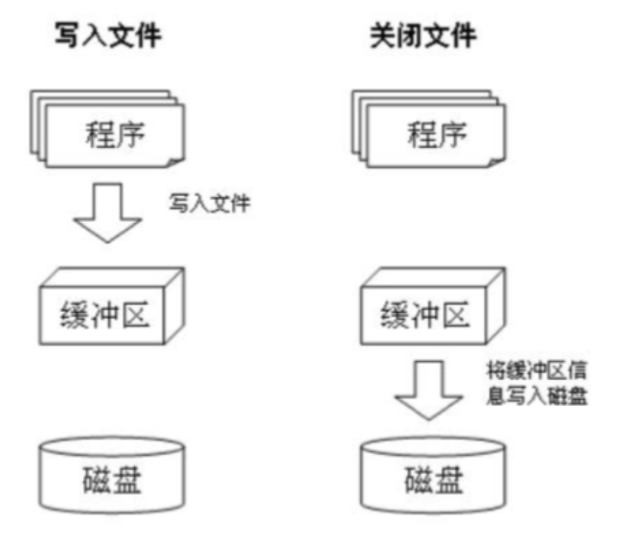

# 文件写入和追加操作

## 文件写入



w模式是写入，通过write方法写入内容。

注意点：

- write写入操作 内容先写入到内存缓存区，需要通过flush刷新，把内容刷新到硬盘
- close方法包含了flush功能，所以可以省略flush
- **这里的write是把内容覆盖操作**

```python
"""
    文件写入操作
"""
# 打开文件 open() w 写入模式，如果文件不存在，则自动创建
f = open("测试2.txt", "w", encoding="utf-8")

# write写入操作 内容先写入到内存缓存区
f.write("python.org真好1")

# flush刷新，把内容刷新到硬盘
# f.flush()

# close关闭文件 close方法包含了flush功能，所以可以省略flush
f.close()
```

## 文件追加

a模式，追加内容。写入依然是write方法。

注意点：

- write写入操作 内容先写入到内存缓存区，需要通过flush刷新，把内容刷新到硬盘
- close方法包含了flush功能，所以可以省略flush
- **这里的write是在文末追加操作**

```python
"""
    文件追加操作
"""
# 打开文件 open() a 写入模式，如果文件不存在，则自动创建
f = open("测试3.txt", "w", encoding="utf-8")

# write写入操作 内容先写入到内存缓存区
f.write("python.org真好1")

# flush刷新，把内容刷新到硬盘
# f.flush()

# close关闭文件 close方法包含了flush功能，所以可以省略flush
f.close()
```

