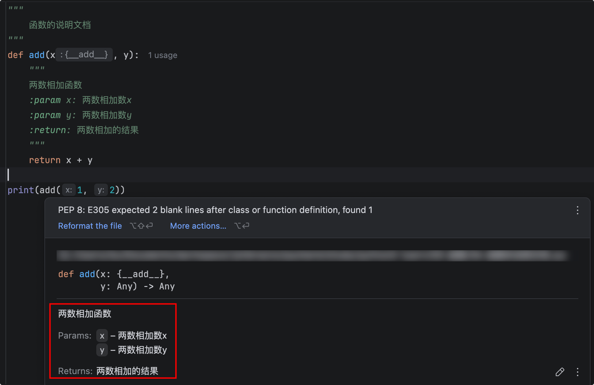

# 函数的说明文档

用`""" """`备注说明，然后我们调用函数的地方，鼠标移动上去就能看到函数的说明。提供代码的可读 性。

示例：
```python
"""
    函数的说明文档
"""
def add(x, y):
    """
    两数相加函数
    :param x: 两数相加数x
    :param y: 两数相加数y
    :return: 两数相加的结果
    """
    return x + y

print(add(1, 2))
```

