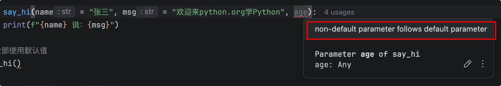

# 函数的参数

## 基础使用

函数形参部分，可以不定义参数，直接空括号即可。假如有多个参数，逗号隔开。

我们调用的时候，传入的就是实际参数，按照形参定义，顺序传入即可。

### 示例

```python
"""
    函数的参数
"""
# 定义加方法函数
def add(x, y):
    result = x + y
    print(f"{x} + {y} = {result}")

# 调用函数
add(1, 2)
add(2, 3)
add(3, 4)

#======输出======
1 + 2 = 3
2 + 3 = 5
3 + 4 = 7
```

## 关键字(keyword) 参数

前面示例，是位置参数，调用的时候，必须严格按照定义函数时指定的顺序来传入参数值。

**如果根据参数名来传入参数值，则无需遵守定义形参的顺序，这种方式被称为关键字(keyword)参数。**

注意点:

- 在使用关键字参数的时候，顺序可以随便换
- 部分使用关键字参数，部分使用位置参数混用的时候，关键字参数必须位于位置参数之后，否则报错

### 示例

```python
"""
    函数的参数
"""
# 定义加方法函数
def add(x, y):
    result = x + y
    print(f"{x} + {y} = {result}")

# 调用函数
add(1, 2)
add(2, 3)
add(3, 4)

# 根据关键字参数来传入参数值
add(x = 1, y = 2)

# 在使用关键字参数的时候，顺序可以随便换
add(y = 2, x = 1)

# 部分只用关键字参数，部分使用位置参数 混用的时候
add(1, y = 2)

# 混用的时候，关键字参数必须位于位置参数之后，否则报错
add(x =1, 2)

#======输出======
1 + 2 = 3
2 + 3 = 5
3 + 4 = 7
1 + 2 = 3
1 + 2 = 3
1 + 2 = 3
    add(x =1, 2)
               ^
SyntaxError: positional argument follows keyword argument
```

## 参数默认值

在某些情况下，程序需要在定义函数时为一个或多个形参指定默认值——这样在调用函数时就可以省略为 该形参传入参数值，而是直接使用该形参的默认值。

语法格式：
`形参名=默认值`

注意点：

- 可以全部使用默认参数
- 可以部分使用默认参数
- 可以全部不使用默认参数 
- 假如前面参数使用默认参数，后面的参数需要使用关键字参数
- Python要求将带有默认值的参数定义放在形参列表的最后。

### 示例

```python
"""
    参数默认值
"""
def say_hi(name = "张三", msg = "欢迎来python.org学Python"):
    print(f"{name} 说：{msg}")

# 全部使用默认值
say_hi()

# name不适用默认值，msg使用默认值
say_hi(name = "李四")

# 两个参数都不使用默认值
say_hi("王五", "也喜欢学习python")

# name使用默认值，msg不适用默认值
say_hi(msg = "也喜欢学习Java")

#======输出======
张三 说：欢迎来python.org学Python
李四 说：欢迎来python.org学Python
王五 说：也喜欢学习python
张三 说：喜欢学习Java
```

