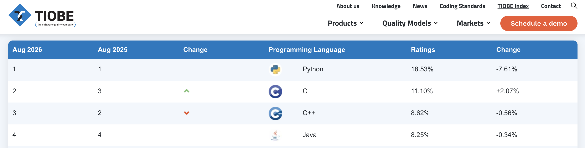
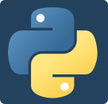
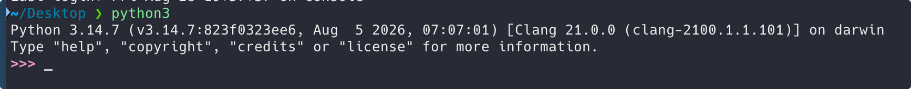
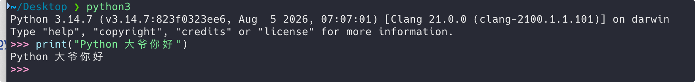
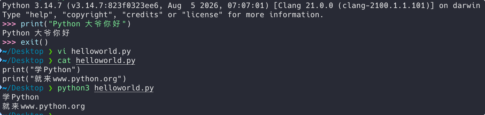
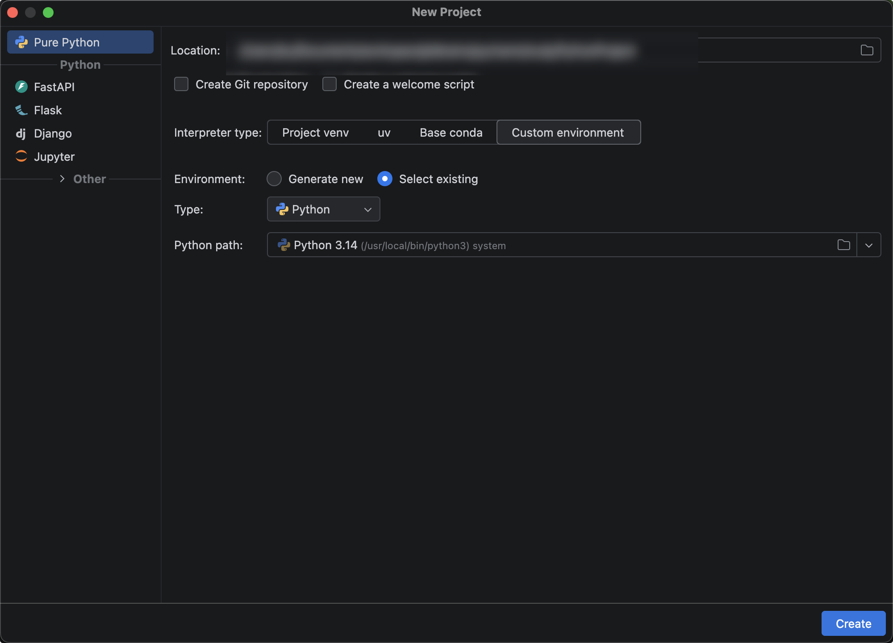
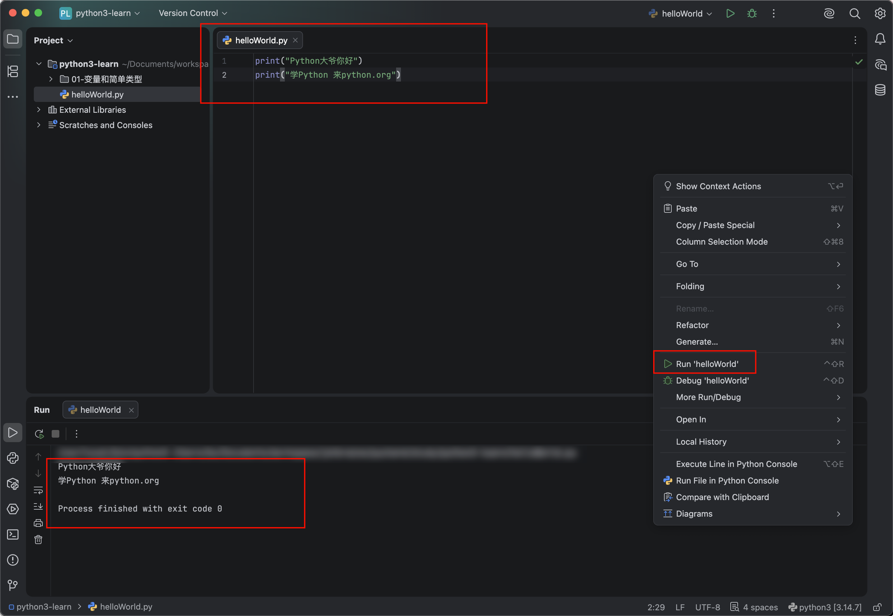

# 概述

## 语言概述



Python作为一门非常流行的高级编程语言，自从22年开始，TIOBE编程语言排行榜Python一直排第一。 Python简洁高效，丰富的应用场景，受到广大程序员，科研工作者的喜爱。

相对比其他语言，Python代码非常简单，上手非常容易，比如我们要完成某个功能，如果用Java需要 100行代码，但是用Python可能只需要20行代码即可。

Python应用非常丰富，可以做桌面开发，web开发，网络编程，数据科学，自动化测试，游戏开发，人 工智能，金融分析，图像处理等领域，都有这广泛的应用。

Python由 Guido van Rossum (吉多.范罗苏姆) 于1989年年底出于某种娱乐目的而开发。 

Python官网:https://www.python.org/
目前最新版本:Python 3.14.7

Python的英译就是蟒蛇的意思，所以Logo就是两条蟒蛇。



区别于Java这种编译型语言，Python属于解释型编程语言，源程序通过Python解释器在指定机器上逐条 读取，转换，执行。

## 开发环境安装

首先去Python官网下载Python安装包 https://www.python.org/

目前最新版本:Python 3.14.7

安装完成后，验证是否安装成功;

输入python(windows)/ python3(Mac) 回车执行



说明Python安装成功。

## 第一个程序HelloWorld实现

先输入python3，进入解释器内部 有 >>> 符号 

直接命令窗口输入 `print("Python大爷你好") `然后回车即可。



执行输出结果: Python大爷你好

**运行原理**：

我们写的Python代码，通过Python解释器，翻译成机器能够识别的01二进制代码，并且提交给计算机运行。

前面我们是一行一行执行代码，如何来执行多行代码呢? 

我们可以新建一个helloWorld.py文件
代码:

```python
print("学Python") 
print("就来www.python.org")
```

然后命令行，切记，要先退出Python解释器程序，可以通过 exit() 命令退出
然后执行 python3 helloWorld.py 来执行python文件。.py结尾的就是python源程序文件。



## PyCharm开发工具安装

我们开发复杂项目，用记事本开发，效率太低了，所以要借助专业的第三方Python集成开发工具(IDE)，

这里推荐主流的PyCharm。 https://www.jetbrains.com/pycharm/


下载安装后，点击 New Project 新建项目



设置本地解释器

右击项目新建HelloWorld.py

通过右击 Run 'helloWorld'，来执行python文件。控制台输出运行结果。

