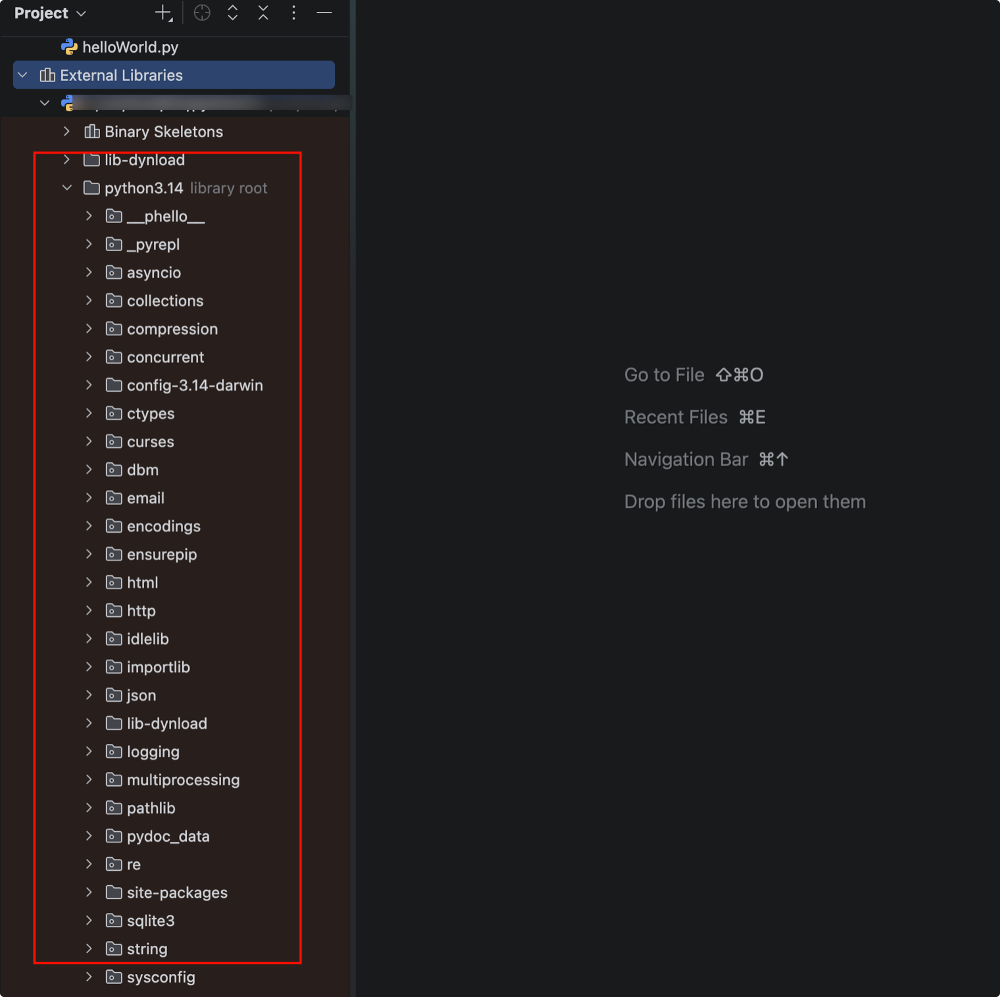
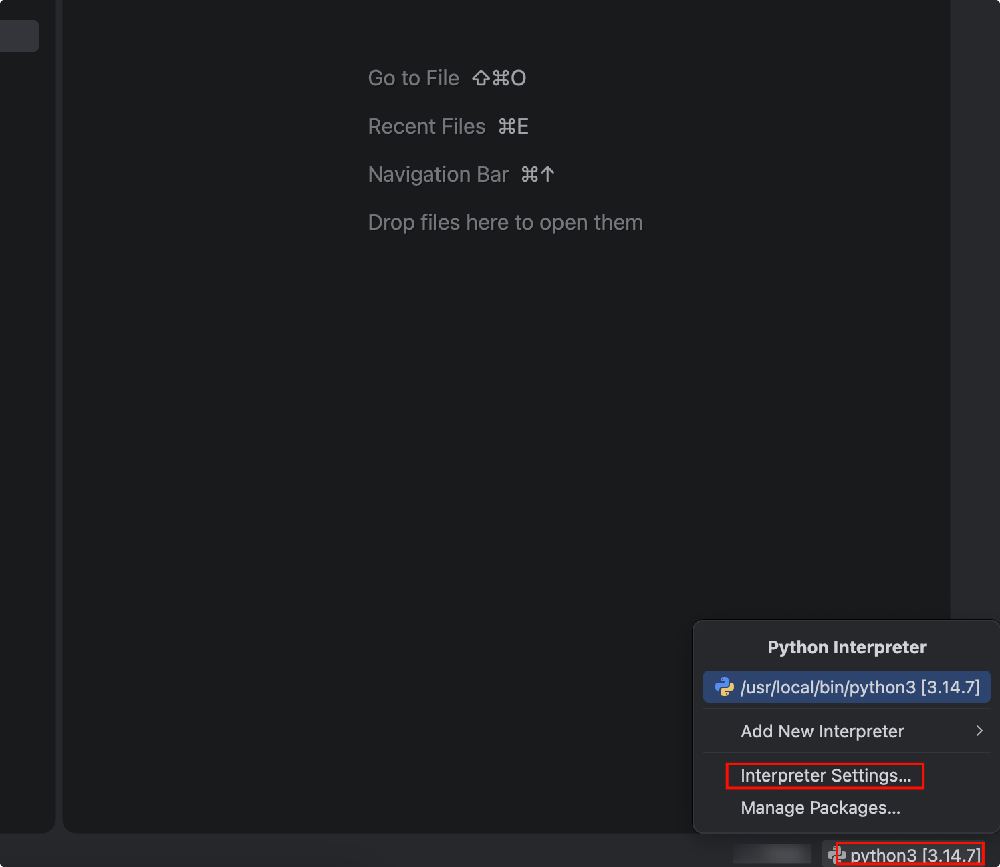
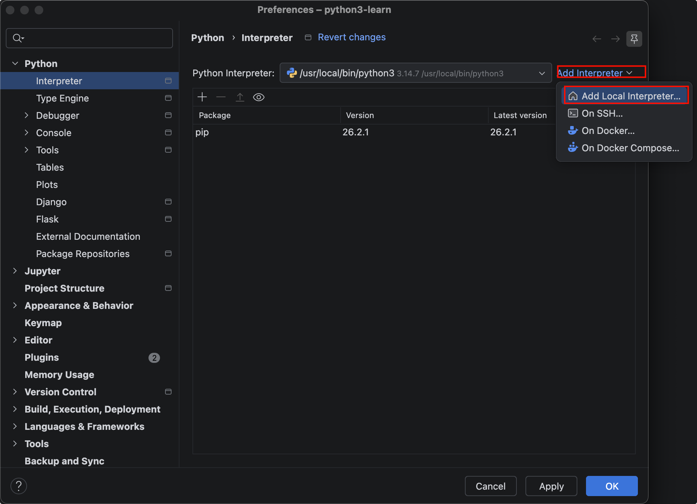
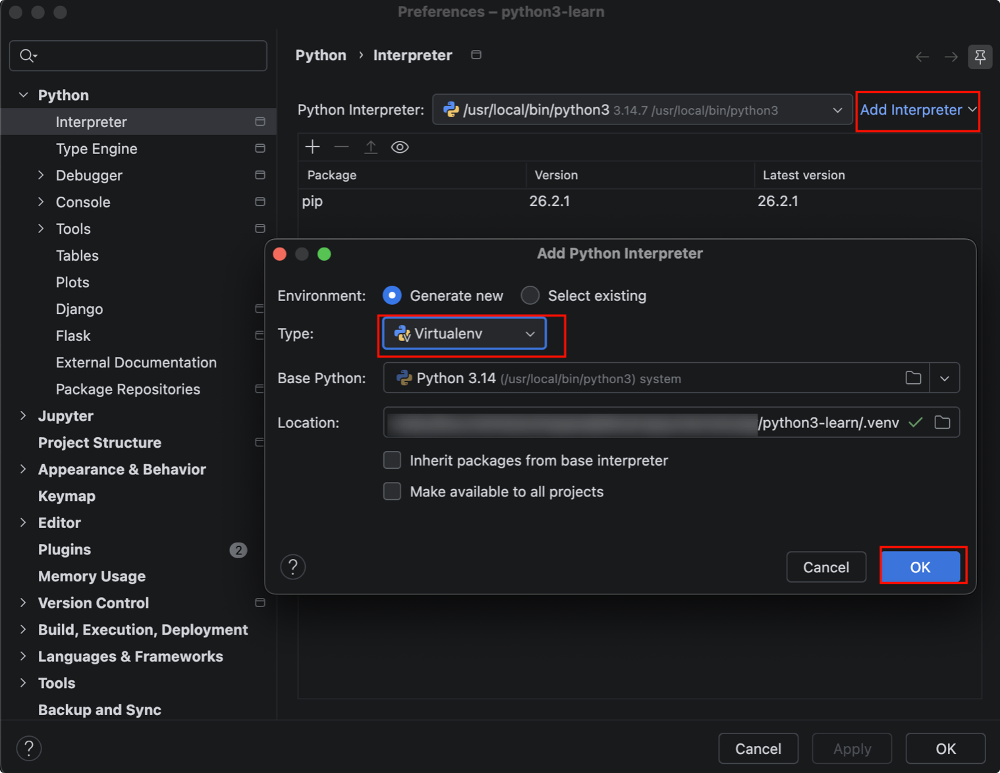
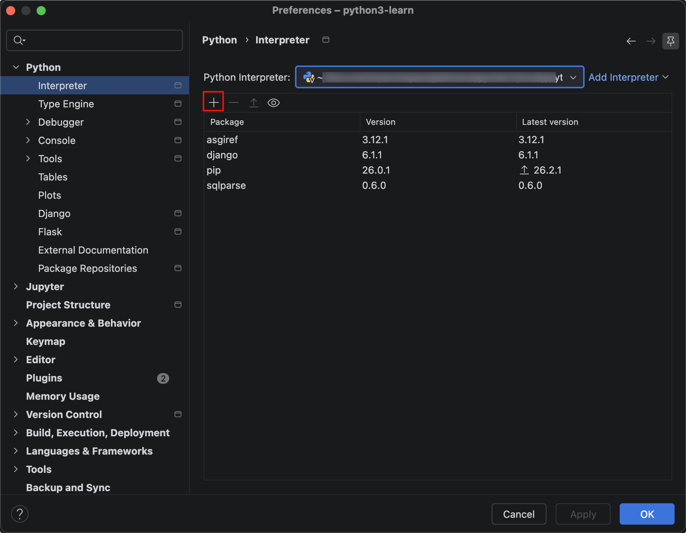
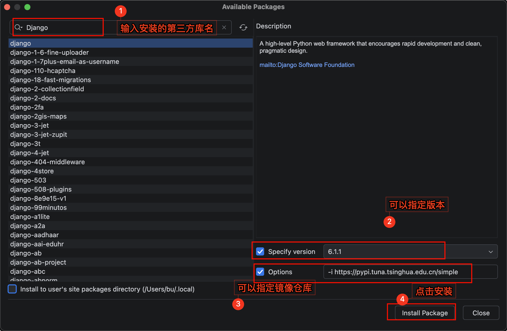
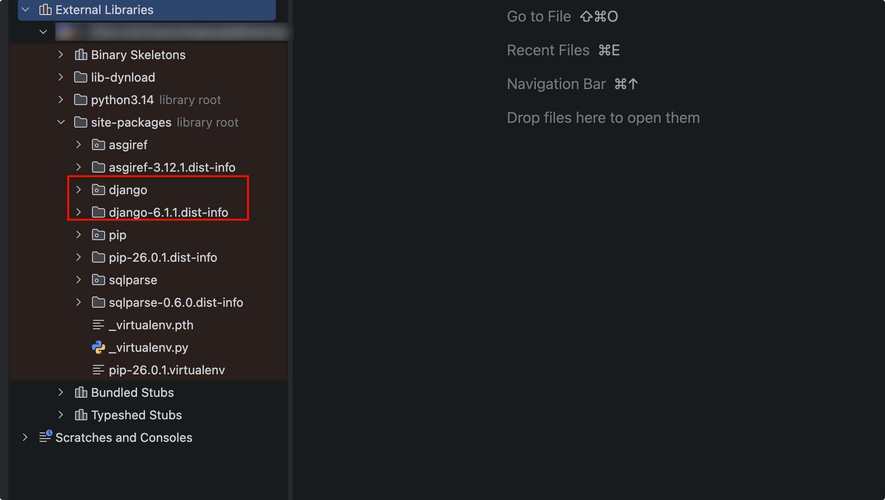

# 安装Python第三方库

## 引入

在Python的标准安装中，包含了一组自带的模块，这些模块被成为“标准库”。比如常用的math,random,datetime,os,json等等。

此外，还有很多的第三方模块，或者叫做库也行，叫包也行。 

- numpy库：科学计算领域
- Django库：web开发领域
- pandas库：数据分析领域
- pyspark库：大数据领域 

等等...形成了Python的强大“生态圈”

## 通过pip命令安装

1. 通过python官方镜像库安装

   `pip install 包名`

2. 通过指定镜像库安装

   `pip install -i https://pypi.tuna.tsinghua.edu.cn/simple 包名`

## 通过pycharm安装

用pycharm安装更方便

1. 打开设置或者点击右下角

2. 如果建项目的时候不是用的虚拟环境，直接用的系统自带的Python解释器，在安装的时候会报错提示

3. 所以要先安装个虚拟环境

5. 点击 "+" 号

6. 输入你想要安装的第三方库名，可以指定版本，再加上清华的库镜像，然后点击安装。

7. 安装完成

