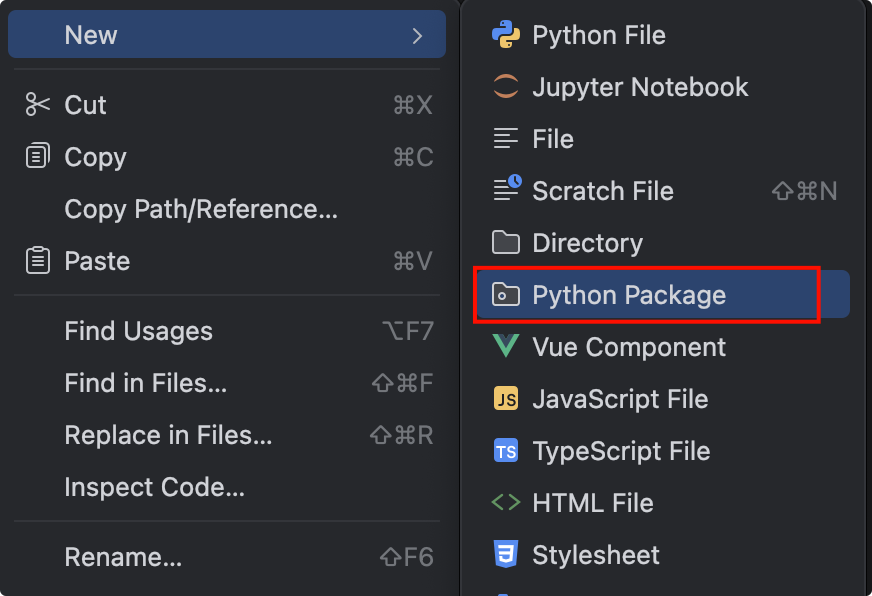

# Python包

## 引入

对于需要实际应用的模块而言，往往会具有很多程序单元，包括变量、函数和类等，如果将整个模块的所有内容都定义在同一个Python源文件中，这个文件将会变得非常庞大，显然并不利于模块化开发。

为了更好地管理多个模块源文件，Python提供了包的概念。那么问题来了，什么是包呢?

- 从物理上看，包就是一个文件夹，在该文件夹下包含了一个`__init__.py`文件，该文件夹可用于包含多个模块源文件。
- 从逻辑上看，包的本质依然是模块。

## 定义包

我们右击项目 Python Package，就是新建包



pycharm自动给我们创建了`__init__.py`文件


再新建两个模块，分别是 module1.py 和 module2.py


```python module1.py
# module1.py
def test1():
    print("module1")
```

```python module2.py
# module2.py
def test2():
    print("module2")
```

## 导入包

我们再写个test.py来导入，有几种导入方法

### import导入整个模块

语法：`import 包名.模块名`

使用的时候也要加上包名.模块名

```python
"""
    包使用测试
"""
import my_package.module1
import my_package.module2

my_package.module1.test1()
my_package.module2.test2()

#======输出======
module1
module2
```

### from导入模块中指定成员

语法：`from 包名 import 模块名, 模块名2`

```python
"""
    包使用测试
"""
from my_package import module1
from my_package import module2

module1.test1()
module2.test2()
```

或者：**这个最常用**

```python
"""
    包使用测试
"""
from my_package import module1, module2

module1.test1()
module2.test2()
```

或者：

```python
"""
    包使用测试
"""
from my_package.module1 import test1
from my_package.module2 import test2

test1()
test2()
```

## 控制暴露的模块

我们可以在`__init__.py`文件里面控制暴露的模块，通过`__all__=[]`列表指定，同样的只能在 `from 包名 import *`时生效

```python
# __init__.py
__all__ = ["module1"]
```

test.py

```python
"""
    包使用测试
"""
# import my_package.module1
# import my_package.module2
#
# my_package.module1.test1()
# my_package.module2.test2()

# from my_package import module1
# from my_package import module2
#
# module1.test1()
# module2.test2()

# from my_package import module1, module2
#
# module1.test1()
# module2.test2()

# from my_package.module1 import test1
# from my_package.module2 import test2
#
# test1()
# test2()

from my_package import *
module1.test1()
module2.test2()

#======输出======
module1
Traceback (most recent call last):
  File "test.py", line 29, in <module>
    module2.test2()
    ^^^^^^^
NameError: name 'module2' is not defined. Did you mean: 'module1'?
```

