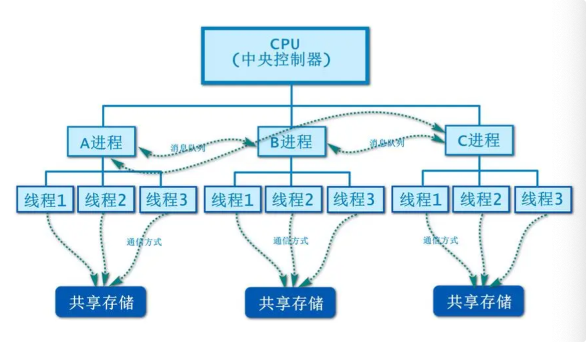

# 多线程编程

## 多线程概述

几乎所有的操作系统都支持同时运行多个任务，一个任务通常就是一个程序，每一个运行中的程序就是一个进程。当一个程序运行时，内部可能包含多个顺序执行流，每一个顺序执行流就是一个线程。

前面所有的学习实例都是单线程的，同一时刻，只能执行一个代码，如果遇到阻塞或者异常，则整个项目都停止了。

可以这样理解：单线程的程序如同只雇佣一个服务员的餐厅，他必须做完一件事情后才可以做下一件事情；而多线程的程序则如同雇佣多个服务员的餐厅，他们可以同时做多件事情。

**进程之间，内存都独立，而同属于一个进程的多个线程共享内存。这个是重要的物理区别。**



## 通过threading模块实现多线程

我们可以**使用threading模块的Thread类的构造器**来创建线程

构造方法：

`def __init__(self, group=None, target=None, name=None, args=(), kwargs=None, *, daemon=None):` 

上面的构造器涉及如下几个参数。

- `group`：指定该线程所属的线程组。目前该参数还未实现，因此它只能设为None。
- `target`：指定该线程要调度的目标方法。
- `name`：线程名称，一般不用设置，会自动生成
- `args`：指定一个元组，以位置参数的形式为 target 指定的函数传入参数。
  - 元组的第一个元素传给 target函数的第一个参数
  - 元组的第二个元素传给target函数的第二个参数......依此类推。
- `kwargs`：指定一个字典，以关键字参数的形式为target 指定的函数传入参数。
- `daemon`：指定所构建的线程是否为后代线程。

## 基本使用

### 未使用多线程

运行输出的，一直是洗菜。
如果我们不用多线程，无法实现两个任务一起执行。

```python
"""
    通过threading模块实现多线程-无多线程
"""
import time


def wishing():
    while True:
        print("正在洗菜")
        time.sleep(1)

def cooking():
    while True:
        print("正在做饭")
        time.sleep(1)
        
if __name__ == '__main__':
    wishing()
    cooking()

#======输出======
正在洗菜
正在洗菜
正在洗菜
正在洗菜
正在洗菜
正在洗菜
正在洗菜
正在洗菜
正在洗菜
正在洗菜
```


### 使用多线程

我们使用多线程实现代码：

#### 不带参数

```python
"""
    通过threading模块实现多线程-多线程-无参数
"""
import threading
import time


def wishing():
    while True:
        print("正在洗菜")
        time.sleep(1)

def cooking():
    while True:
        print("正在做饭")
        time.sleep(1)

if __name__ == '__main__':
    # 创建洗菜线程
    wishing_thread = threading.Thread(target = wishing)
    # 创建做饭线程
    cooking_thread = threading.Thread(target = cooking)

    # 启动线程
    wishing_thread.start()
    cooking_thread.start()

#======输出======
正在洗菜
正在洗菜
正在做饭
正在做饭
正在洗菜
正在做饭
正在洗菜
正在做饭正在洗菜
正在洗菜
正在做饭
正在洗菜
正在做饭
```

#### 带参数

```python
"""
    通过threading模块实现多线程-多线程-有参数
"""
import threading
import time


def wishing(msg):
    while True:
        print(msg)
        time.sleep(1)

def cooking(msg):
    while True:
        print(msg)
        time.sleep(1)

if __name__ == '__main__':
    # 创建洗菜线程，并用元组传参
    wishing_thread = threading.Thread(target = wishing, args = ("正在洗菜",))
    # 创建做饭线程，并用字典关键字参数传参
    cooking_thread = threading.Thread(target = cooking, kwargs = {"msg": "正在做饭"})

    # 启动线程
    wishing_thread.start()
    cooking_thread.start()

#======输出======
正在洗菜
正在做饭
正在洗菜
正在做饭
正在做饭正在洗菜
正在做饭
正在洗菜
```

