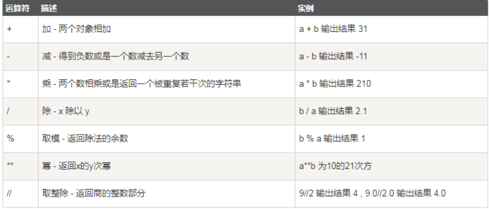
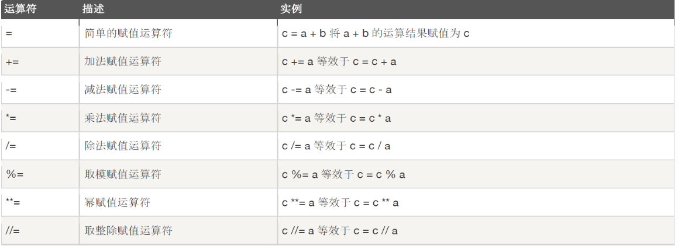

# 运算符

运算符是一种特殊的符号，用来表示数据的运算、赋值和比较等。

## 赋值运算符

赋值运算符用于为变量或常量指定值，Python使用“=”作为赋值运算符。通常，使用赋值运算符将表达式 的值赋给另一个变量。

示例：

```python
"""
    运算符Demo
    赋值运算符
    算数运算符
    扩展后的赋值预算符
"""

# 为变量age赋值为18
age = 18

# 将变量age的值赋值给变量age2
age2 = age

# 将表达式值赋值给age3
age3 = age2 + 1

print("age=",age)
print("age2=",age2)
print("age3=",age3)
```

执行结果：

```python
age= 18
age2= 18
age3= 19
```


## 算数运算符

Python支持所有的基本算术运算符，这些算术运算符用于执行基本的数学运算，如加、减、乘、除和求 余等。下面是7个基本的算术运算符。

以下，假设变量a为10，变量b为21:



示例：

```python
# 定义变量a值为10
a = 10

# 定义变量b为21
b = 21

print("a+b=", a + b)
print("a-b=", a - b)
print("a*b=", a * b)
print("b/a=", b / a)
print("a**b=", a ** b)
print("b//a=", b // a)
print("a%b=", a % b)
```

执行结果：

```python
a+b= 31
a-b= -11
a*b= 210
b/a= 2.1
a**b= 1000000000000000000000
b//a= 2
a%b= 10
```

## 扩展后的赋值运算符



示例：

```python
# 定义变量a值为10
a = 10

# 定义变量c为21
c = 21

c += a
print("c+=a c=", c)

c -= a
print("c-=a c=", c)

c *= a
print("c*=a c=", c)

c /= a
print("c/=a c=", c)

c //= a
print("c/=a c=", c)

c %= a
print("c%=a c=", c)

c **= a
print("c**=a c=", c)
```

执行结果：

```python
c+=a c= 31
c-=a c= 21
c*=a c= 210
c/=a c= 21.0
c/=a c= 2.0
c%=a c= 2.0
c**=a c= 1024.0
```