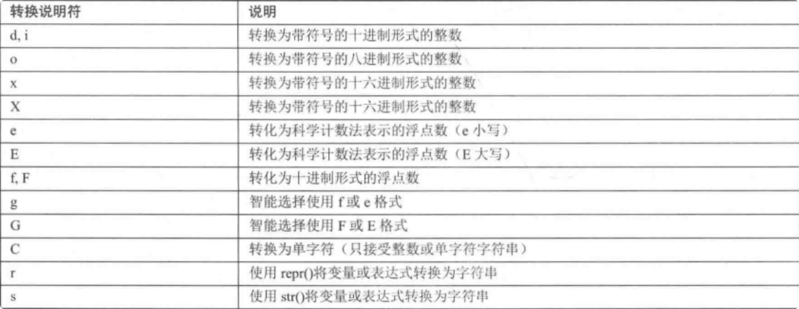

# 字符串

## 定义

字符串的意思就是“一串字符”，比如"python,牛逼"是一个字符串，"Python知识分享网"也是一个字 符串。Python要求字符串必须使用引号括起来，使用单引号也行，使用双引号也行——只要两边的引号 能配对即可

示例：
```python
"""
    字符串定义和转义字符
"""

# 字符串定义
str1 = "Python知识分享网"
str2 = 'www.python.org'
print(str1)
print(str2)

#=======输出=====
Python知识分享网
www.python.org
```

## 转义字符

假如我们定义的字符串里面 含有单引号或者双引号，对于这种情况，我们有两种解决方案; 

1. 使用不同的引号将字符串括起来。
2. 通过使用 \ 对引号进行转义。

示例：

```python
# 转义字符
# str3 = 'I'm a coder'
str3 = "I'm a coder"
print(str3)

str3_2 = '"西游记"，真好看！'
print(str3_2)

str4 = 'I\'m a coder'
print(str4)

str4_2 = "\"西游记\"，真好看！"
print(str4_2)

#=======输出=====
I'm a coder
"西游记"，真好看！
I'm a coder
"西游记"，真好看！
```

## 长字符串的定义

前面介绍Python多行注释时提到使用三个引号(单引号、双引号都行)来包含多行注释内容，其实这是长 字符串写法，只是由于在长字符串中可以放置任何内容，包括放置单引号、双引号都可以，**如果所定义 的长字符串没有赋值给任何变量，那么这个字符串就相当于被解释器忽略了，也就相当于注释掉了。**

示例：
```python
# 长字符串的定义
str5 = """
        《鹅鹅鹅》
        鹅鹅鹅，
        曲项向天歌，
        白毛红绿水，
        红掌拨清波。
        """
print(str5)

#=======输出=====
        《鹅鹅鹅》
        鹅鹅鹅，
        曲项向天歌，
        白毛红绿水，
        红掌拨清波。
```

## 字符串拼接

在Python中，使用加号`+` 作为字符串的拼接运算符;

有时候，我们需要将字符串与数值进行拼接，而 Python不允许直接拼接数值和字符串，程序必须先将数 值转换成字符串。为了将数值转换成字符串，可以使用`str()`或` repr()`函数；

示例：
```python
"""
    字符串拼接
        在Python中，使用加号 ( + )作为字符串的拼接运算符;
        为了将数值转换成字符串，可以使用str()或 repr()函数
"""

name = "张三"
site = "Python知识分享网 www.python.org"
tel =5555555555
# print("姓名：" + name + "，网站：" + site + "，电话：" + tel) # 错误，不能直接拼接整数
print("姓名：" + name + "，网站：" + site + "，电话：" + str(tel))
print("姓名：" + name + "，网站：" + site + "，电话：" + repr(tel))


#=======输出=====
姓名：张三，网站：Python知识分享网 www.python.org，电话：5555555555
姓名：张三，网站：Python知识分享网 www.python.org，电话：5555555555
```


## 使用input获取用户输入

`input()`函数用于向用户生成一条提示，然后获取用户输入的内容。由于input()函数总会将用户输入的内容放入字符串中，因此用户可以输入任何内容，input()函数总是返回一个字符串。我们可以通过`int() float()`方法来转换类型。

示例：
```python
"""
    使用input获取用户输入的字符串
"""

name = input("请输入姓名：")
print(name, type(name))

age = input("请输入年龄：")
age = int(age)
print(age, type(age))

height = input("请输入身高：")
height = float(height)
print(height, type(height))

#=======输出=====
请输入姓名：张三
张三 <class 'str'>
请输入年龄：22
22 <class 'int'>
请输入身高：178.4
178.4 <class 'float'>

```

## 字符串格式化

### 示例一

我们前面学到字符串拼接，如果简单的2,3个字符串拼接那还算好，如果大于3个变量的拼接，就比较麻烦。还有一点，就是字符串无法和其他类型直接拼接，需要进行类型转换，也麻烦。这时候，Python 提供了`%`对各种类型的数据进行格式化输出。

示例：
```python
"""
    字符串格式化
"""

name = "张三"
print("我的姓名是：%s" % name)

#=======输出=====
我的姓名是：张三
```

这里` %s `是占位符，第二个` %` 是分隔符，name就是变量了。这个很好理解。

### 示例二

示例：

```python
name = "张三"
age = 23
print("我的姓名是：%s，我今年 %s 岁了" % (name, age))

#=======输出=====
我的姓名是：张三，我今年 23 岁了
```

这里多了一个int类型的age变量。我们输出的时候，用两个`%s`，中间依然用`%`间隔，第三块，括号里两 个参数。注意参数的顺序不能乱。

### 示例三

除了`%s`，还有很多占位符，如下表。我们现在掌握最基础常用的`%s`，`%d`，`%f`，分别把参数或者表达式 转换成字符串，整型，浮点型。



示例：

```python
name = "张三"
age = 23
height = 183.4
print("我的姓名是：%s，我今年 %d 岁了，身高 %f" % (name, age, height))

#=======输出=====
我的姓名是：张三，我今年 23 岁了，身高 183.400000
```

刚才我们打印身高，这个打印结果，后面多了五个0。这里就涉及到一个格式化精度控制。 我们可以使用辅助符号`m,n`来控制数据的宽度和精度;

- m：控制宽度(包括小数点)，注意，如果设置的宽度小于数字本身，则不生效；如果设置的宽度大于数字本身，则前面补空格。
-  n：控制小数点精度，注意，如果设置的精度大于小数位数，则进行四舍五入；如果设置的精度小于小数位数，则后面补0。

示例：
我们先把前面的身高，加下小数精度 %.1f 这样输出结果就没有0了。

```python
name = "张三"
age = 23
height = 183.4
print("我的姓名是：%s，我今年 %d 岁了，身高 %.1f" % (name, age, height))
print("我的姓名是：%s，我今年 %d 岁了，身高 %0.1f" % (name, age, height))

#=======输出=====
我的姓名是：张三，我今年 23 岁了，身高 183.4
我的姓名是：张三，我今年 23 岁了，身高 183.4
```


示例：
```python
money1 = 99.99
money2 = 111.66
money3 = 12000
print("张三的钱包余额：%10.2f元" % money1)
print("李四的钱包余额：%10.1f元" % money2)
print("王五的钱包余额：%10.2f元" % money3)

#=======输出=====
张三的钱包余额：     99.99元
李四的钱包余额：     111.7元
王五的钱包余额：  12000.00元
```

### 示例四

其实我们发现上面的字符串格式化方式，虽然功能强大，但是写起来也不是太方便，这边提供一种更加快捷优雅的格式化方式。

语法是：`f"内容{变量}内容"`; 

**这种方式缺点是无法进行精度控制，以及也不关心类型，原值输出。**

示例：
```python
name = "张三"
age = 23
height = 183.4
print(f"我的姓名是：{name}，我今年 {age} 岁了，身高 {height}")

#=======输出=====
我的姓名是：张三，我今年 23 岁了，身高 183.4
```

