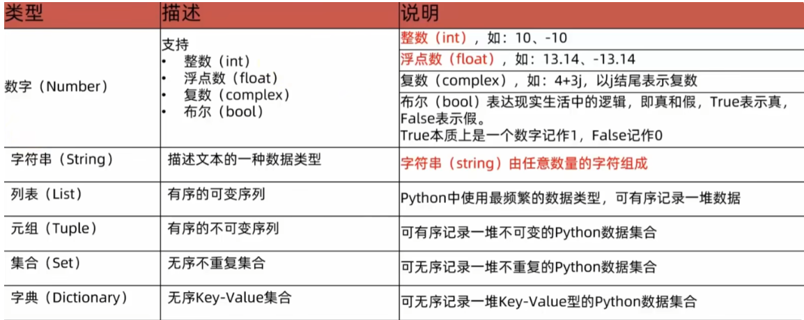
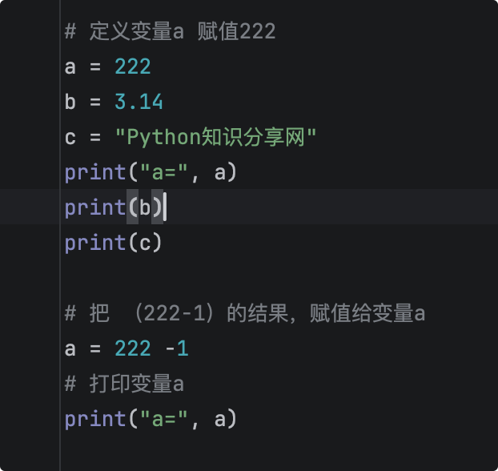
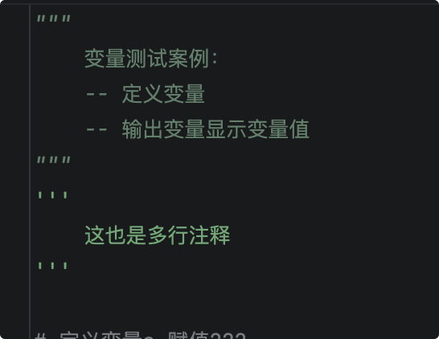
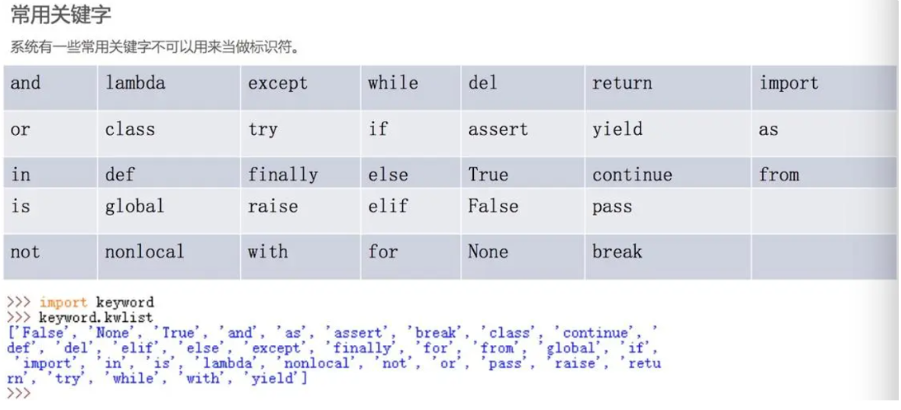

# 变量

## 介绍

无论使用什么语言编程，总要处理数据，处理数据就需要使用变量来保存数据。变量就像一个个小容器，用于“盛装”程序中的数据


再说说，Python的数据类型，有以下六种类型：数字，字符串，列表，字典，元组，集合。数字类型 又分四种小类：整数，浮点数，复数，布尔类型。



## 定义方式

变量名称 = 变量的值

 (''=''是赋值符号，意思是把右侧的值赋值给左侧变量)

**示例**

```python
a = 222
b = 3.14
c = "Python知识分享网"
print(a)
print(b)
print(c)
```

变量的数据是可以变化的，我们重新赋值即可;

```python
a = 222
b = 3.14
c = "Python知识分享网"
print("a=", a)
print(b)
print(c)

a = 222 -1
print("a=", a)
```

## 注释

### 介绍

注释:对程序员代码进行解释说明的文字;

可以用来解释程序某些部分的作用和功能，提高程序的可读性。

注释分为单行注释和多行注释:

### 单行注释

Python使用井号(#)表示单行注释的开始，跟在“#”号后面直到这行结束为止的代码都将被解释器 忽略。



### 多行注释

多行注释是指一次性将程序中的多行代码注释掉，在 Python程序中使用三个单引号或三个双引号 将注释的内容括起来。



**示例**

```python
"""
    变量测试案例：
    -- 定义变量
    -- 输出变量显示变量值
"""
'''
    这也是多行注释
'''

# 定义变量a 赋值222
a = 222
b = 3.14
c = "Python知识分享网"
print("a=", a)
print(b)
print(c)

# 把 （222-1）的结果，赋值给变量a
a = 222 -1
# 打印变量a
print("a=", a, "类型是：", type(a))
# 修改变量a值为字符串类型
a = "字符串类型"
print("a=", a, "类型是：", type(a))
```

输出结果：
```python
a= 222
3.14
Python知识分享网
a= 221 类型是： <class 'int'>
a= 字符串类型 类型是： <class 'str'>
```

## 数据类型

前面讲过，Python有6大类数据类型，第一大类还有四种小类数据类型，我们先学习最基础整型(int)， 浮点(float)，字符串(string)类型;

我们先定义变量，用type()方法可以查看变量的类型; 

Python是弱类型语言，变量的类型也是可以改变的。

示例

```python
"""
    数据类型测试Demo
    用type()方法可以查看变量的类型
    Python是弱类型语言，变量的类型也是可以改变的
"""

a = 222
b = 3.14
c = "Python知识分享网"

# 打印变量类型
print("a=",a, type(a))
print("b=",b, type(b))
print("c=",c, type(c))

# 改变变量a的类型为字符串
a = "字符串类型"
print("a=",a, type(a))
```

运行输出结果：

```python
a= 222 <class 'int'>
b= 3.14 <class 'float'>
c= Python知识分享网 <class 'str'>
a= 字符串类型 <class 'str'>
```

## 命名规则

Python需要使用标识符给变量命名，其实标识符就是用于给程序中变量、类、方法命名的符号(简单来 说，标识符就是合法的名字)。Python语言的标识符必须以字母、下画线(_)开头，后面可以跟任意数目 的字母、数字和下画线(__)。此处的字母并不局限于26个英文字母，可以包含中文字符，但是不推荐。

**在使用标识符时，需要注意如下规则。**

1. 标识符可以由字母、数字、下画线(_)组成，其中数字不能打头 
2. 标识符不能是Python关键字
3. 标识符不能包含空格

### 关键字



示例
```python
"""
    变量的命名规则
    1. 标识符可以由字母、数字、下划线(_)组成，其中数字不能打头
    2. 标识符不能是Python关键字
    3. 标识符不能包含空格
"""

# 1. 标识符可以由字母、数字、下划线(_)组成，其中数字不能打头
name = "张三"
_age = 11
# 1age = 12 报错

# 2. 标识符不能是Python关键字
# if = 11 报错
# class = 12 报错

# 3. 标识符不能包含空格
# nam e = "李四" 报错
```
